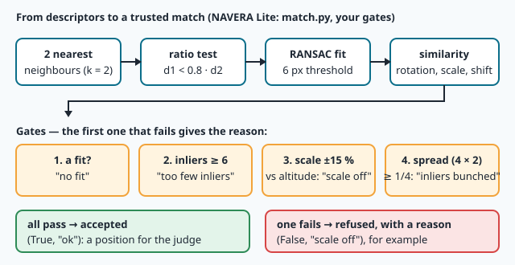
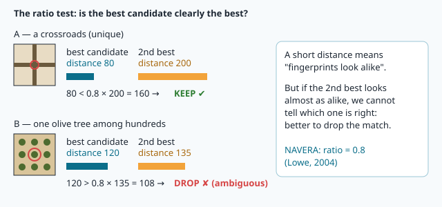
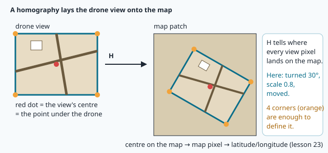
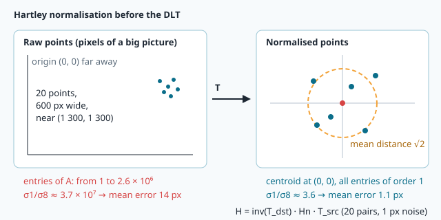
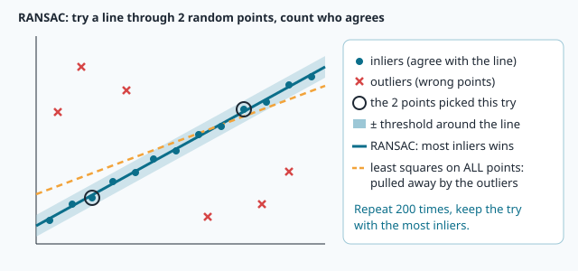
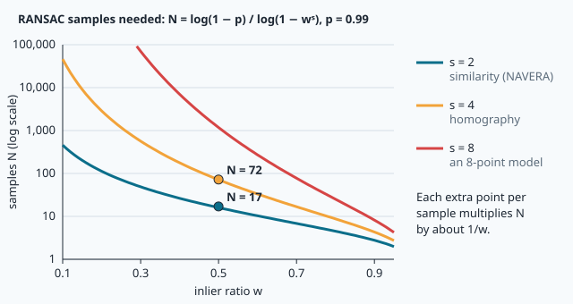
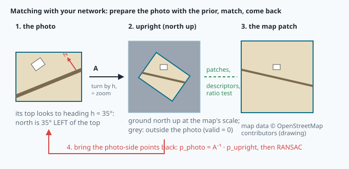
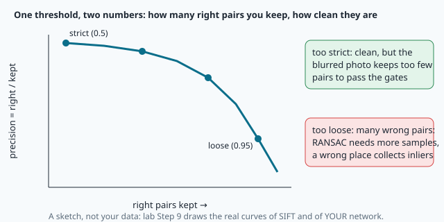

# Matching and geometry: ratio test, DLT and RANSAC



> [!NOTE] Mission brief
> **1 October 2026, IRIS's bench.** NAVERA's first local matcher compares 33 aerial frames with the map around
> Sousse. Its rule is simple: SIFT pairs, a RANSAC fit of rotation + scale + shift, and "accept when at least 12 pairs
> agree". It accepts **10 frames out of 33**, and one of them is **1 097 m** away from the truth: a wrong place
> whose look-alike features happened to agree. One extra rule, "the fitted scale must be the one the altitude
> predicts, ±15 %", brings it to **21 of 33, worst error 5 m, no wrong position** (validation report,
> 3 October 2026). The geometry did not change; the **judgement** did.
>
> Today you build that judgement for NAVERA Lite. **Session 1 — Geometer:** the ratio test, a similarity and your own
> DLT homography, RANSAC, the gates. **Session 2 — Learned matcher:** your mission-21 network as a matcher; you
> **decide** its threshold and when to trust it from your own measurements, and the check measures those decisions on
> scenes you never saw. Badges: **Geometer**, then **Matchmaker**.
>
> **Start now:** open the 🛠️ **Lab** tab, do **Step 0** (five minutes, no code), then come back here for §1.

**Objectives.** After this mission you can:

1. **apply and explain** the ratio test, and measure a matcher by its **precision**;
2. **fit** a similarity by least squares and a homography by the normalised **DLT**, and say which one a picture
   needs (degrees of freedom);
3. **compute** how many RANSAC samples a model needs, and **implement** RANSAC;
4. **apply** trust gates (inliers, scale, spread) and explain what each one costs and protects;
5. **use** a learned descriptor as a matcher: prepare the photo with a prior, **choose** its threshold from
   measurements, measure its **operating envelope** against SIFT, and **decide** when NAVERA Lite may use it.

**You need:** least squares with `np.linalg.lstsq` (mission 01), homogeneous coordinates and the homography of a
flat ground (mission 18), SIFT, descriptors and your trained PatchNet (mission 21). The SVD is new and comes in a 🧰
box. ⏱ Reading: about 100 minutes with the ✏️ checks (Part A, §1–§5, before session 1, about 60 minutes; Part B,
§6–§8, before session 2). Lab: 5 to 6 h 30 in two sessions.

**Before you start** — answer without looking (if you miss two, reread mission 01 §2 and mission 18 §7):

<details><summary>1. You have 6 equations and 3 unknowns, and no exact solution. What does np.linalg.lstsq(A, b) return?</summary>
The x that makes the sum of squared residuals ‖A·x − b‖² as small as possible: the least-squares solution (mission 01).
</details>

<details><summary>2. H · [x, y, 1] = [8, 6, 2]. Which pixel is that?</summary>
(4, 3): divide by the last number (mission 18, homogeneous coordinates).
</details>

<details><summary>3. Your PatchNet's descriptors have length 1. Between which values can the distance of two descriptors lie?</summary>
From 0 (the same vector) to 2 (opposite vectors) (mission 21 §7).
</details>

<details><summary>Workspace and words (open if you need them)</summary>

Your files are in `~/lessons/22-matching/`. The parts of NAVERA Lite you write are
[navera_lite/match.py](file:./navera_lite/match.py) and [navera_lite/learned_match.py](file:./navera_lite/learned_match.py).

| Word | Meaning | Français |
|---|---|---|
| **ratio test** | keep a pair only if its best distance is clearly smaller than the second best | test du rapport |
| **precision** | the share of right pairs among the pairs you kept | précision |
| **inlier / outlier** | a pair that agrees with the model (within a threshold) / one that does not | point conforme / aberrant |
| **similarity** | a turn, one scale and a shift: 4 numbers | similitude |
| **homography** | the 3 × 3 matrix of a plane seen by two cameras: 8 numbers | homographie |
| **degrees of freedom** | how many independent numbers a model has | degrés de liberté |
| **SVD** | singular value decomposition: A = U·S·Vᵀ | décomposition en valeurs singulières |
| **RANSAC** | fit many small random samples, keep the model most pairs agree with | RANSAC |
| **prior** | what the drone already believes before the photo (heading, altitude) | a priori |
| **operating envelope** | the conditions inside which a method was measured to work | domaine de fonctionnement |
</details>

# Part A — Geometry (read before session 1)

## 1. Pairs, and the ratio test

Mission 21 gave every keypoint a descriptor. To pair a map point with a photo point, take the photo descriptor at
the smallest distance: its **nearest neighbour**. On a real pair most of those nearest neighbours are wrong. A
point of the map that is not in the photo still has a nearest neighbour; a tree in an olive grove has a hundred
look-alikes.



David Lowe's **ratio test** (2004) looks at the **second** nearest neighbour too. If the best candidate is only a
little closer than the second best, the point looks like two places of the photo: the pair is ambiguous, drop it.

```
keep the pair (i, j)  if  d_best < ratio × d_second          (ratio = 0.8 for SIFT)
```

**Worked example.** A crossroads: best 80, second 200. 80 < 0.8 × 200 = 160: **keep**. A tree: best 120, second 135.
120 < 0.8 × 135 = 108? No: **drop**, although 120 is a smaller distance than many kept pairs. The test judges how
*unique* a pair is, not how close.

How good is a set of pairs? When the truth is known (our photos are made from the map, so it is), count the
**precision** = right pairs ÷ kept pairs. Lowe chose 0.8 by measurement: on his pictures it removed about 90 % of
the false matches and lost under 5 % of the right ones — a number for SIFT, not a law (Part B).

> [!QUESTION] ✏️ Check
> Best distance 250, second 290. Is the pair kept with ratio 0.8? With 0.9? What does a ratio of 1.0 keep?

<details><summary>Answer</summary>
250/290 = 0.86: dropped at 0.8, kept at 0.9. Ratio 1.0 keeps every pair except exact ties: no filtering at all.
</details>

## 2. A model of the motion: the similarity

The kept pairs are still not a position. We need the **model** that sends every map point onto its photo point. For a
camera looking straight down at flat ground, the photo is the map **turned, scaled and shifted**: a **similarity**.

```
x2 = s·(cos θ · x1 − sin θ · y1) + tx              4 unknowns: s, θ, tx, ty
y2 = s·(sin θ · x1 + cos θ · y1) + ty              (y points DOWN: a positive θ turns CLOCKWISE on the screen)
```

> [!TIP] 🧰 A turn of the plane, and a trick that makes it linear
> R(θ) = [[cos θ, −sin θ], [sin θ, cos θ]] turns a vector by θ (clockwise on the screen, since y points down). In the
> model, s and θ appear inside sin and cos: not linear. Rename **a = s·cos θ** and **b = s·sin θ**: then x2 = a·x1 − b·y1 + tx and y2 = b·x1 + a·y1 + ty are
> **linear** in (a, b, tx, ty). Solve for them, then s = √(a² + b²) and θ = atan2(b, a).

Each pair gives two equations. With N pairs: 2N equations, 4 unknowns, noise everywhere: exactly mission 01's
problem, solved by `np.linalg.lstsq`. The rows of the system, for a pair (x1, y1) → (x2, y2):

```
[ x1  −y1  1  0 ] · [a, b, tx, ty]ᵀ = x2
[ y1   x1  0  1 ] · [a, b, tx, ty]ᵀ = y2
```

**Worked example.** (0, 0) → (10, 20) and (2, 0) → (12, 22). The first pair gives tx = 10, ty = 20. The second:
2a + 10 = 12 → a = 1, and 2b + 20 = 22 → b = 1. So s = √2 ≈ **1.414**, θ = atan2(1, 1) = **45°** (clockwise on the
screen), shift (10, 20).

**Which way does the photo turn?** The map is north up. A drone whose photo's top points to heading h shows the
ground turned the *other* way: the fitted θ is **−h** (lab: heading 35° gives θ ≈ −35°). And s is the photo's
**zoom**: map metres per pixel ÷ photo metres per pixel, which the altitude predicts (mission 18: the photo's ground
size per pixel is 2·altitude·tan(hfov/2) ÷ width).

> [!QUESTION] ✏️ Check
> A fit gives s = 1.6, θ = −120°. Where does the photo's top point, and is the photo sharper or blurrier than the map?
> And a drone at 250 m with a 60° camera, 640 px wide, over a map of 0.968 m per pixel: which s do you expect?

<details><summary>Answer</summary>
Heading 120° (θ = −h); s = 1.6: one map pixel covers 1.6 photo pixels, the photo is 1.6 times sharper. Photo:
2 · 250 · tan 30° / 640 = 0.451 m per pixel, so s ≈ 0.968 / 0.451 ≈ <b>2.15</b>.
</details>

## 3. When the camera tilts: the homography and the DLT

A camera that is not pointing straight down sees the ground in **perspective**: the far side of the picture is
smaller than the near side. A square field becomes a trapezoid; no single scale and turn can do that. For a flat
ground, mission 18 showed that any two views are related by a **homography** H (3 × 3, used in homogeneous
coordinates). H has 9 numbers but only **8 degrees of freedom** (multiplying H by any number gives the same mapping).
The similarity has 4: it is a special homography whose last row is [0, 0, 1].



**The Direct Linear Transform (DLT).** Every pair (x, y) → (u, v) gives two equations that are **linear** in the 9
numbers h of H (read row by row):

```
[ −x  −y  −1   0   0   0   u·x  u·y  u ] · h = 0
[  0   0   0  −x  −y  −1   v·x  v·y  v ] · h = 0
```

Stack them for all pairs: A·h = 0, with A of size 2N × 9. h = 0 is a useless solution, so we look for the h of
**length 1** that makes ‖A·h‖ as small as possible. With 4 pairs (8 equations) the answer is exact; with more pairs
and noise it is a least-squares answer.

**Worked example.** H = [[2, 0, 1], [0, 2, 2], [0, 0, 1]] (a zoom by 2, a shift by (1, 2)), so h = [2, 0, 1, 0, 2, 2, 0,
0, 1]. The pair (1, 0) → (3, 2) gives the rows [−1, 0, −1, 0, 0, 0, 3, 0, 3] and [0, 0, 0, −1, 0, −1, 2, 0, 2]. First
row · h = −2 − 1 + 3 = 0; second row · h = −2 + 2 = 0. The true h solves them.

<details class="further"><summary>Optional — where the two rows come from</summary>

u = (h1·x + h2·y + h3) / (h7·x + h8·y + h9). Multiply by the denominator: u·(h7·x + h8·y + h9) − (h1·x + h2·y + h3) = 0,
which is the first row · h = 0. The same with v and (h4, h5, h6) gives the second.
</details>

> [!TIP] 🧰 The SVD in one paragraph
> Any matrix A can be written A = U · S · Vᵀ (`U, S, Vt = np.linalg.svd(A)`): S holds the **singular values**, largest
> first, and the rows of Vt are unit vectors. The unit vector h that makes ‖A·h‖ smallest is the **last row of Vt**
> (the one of the smallest singular value). Why: for a unit h, ‖A·h‖² is a mix of the squared singular values, weighted
> by how much h points along each row of Vt; all the weight on the smallest gives the smallest value (0 with 4 exact
> pairs). Example: `np.linalg.svd(np.array([[3.0, 0.0], [0.0, 0.5]]))[2][-1]` → [0, 1] (up to its sign).

**Hartley's normalisation.** In pixels, one column of A holds numbers like 1 690 000 (u·x ≈ 1 300 × 1 300) and
another holds 1: an error of 1 % in the big ones swamps the small ones, and the SVD's answer becomes very sensitive to
the noise. The fix (Hartley, 1997): move each point set so that its centroid
is (0, 0) and its mean distance from it is √2 (a matrix T, given as `normalise_points`), run the DLT on the
normalised points, and undo it: **H = T_dst⁻¹ · H_n · T_src**, then divide by H[2, 2].



In a test with 20 pairs near (1 300, 1 300) px, a strong perspective and 1 px of noise, the raw DLT mapped a grid of
points **14 px** away from the truth on average; the normalised one **1.1 px**. Same data, same algebra: only the units
changed.

## 4. RANSAC: a model from pairs that are mostly wrong

Least squares trusts every pair. One wrong pair 300 px away pulls the whole fit. **RANSAC** (Fischler and Bolles,
1981) turns the problem around:

1. draw a **minimal sample** at random (2 pairs for a similarity, 4 for a homography) and fit the model to it;
2. count its **inliers**: the pairs whose map point, sent by the model, lands within a threshold of their photo
   point (NAVERA uses 6 px);
3. repeat N times; keep the model with the **most** inliers;
4. fit the model again on **all** its inliers (least squares on clean data).



A sample that cannot give a model (two copies of one point, four points on one line) is a failed try that still counts
as one of the N (the docstring of `ransac` lists the course's rules, so every RANSAC gives the same answer).

**How many samples?** If a share **w** of the pairs are right, a sample of s pairs is clean with probability wˢ. After
N samples, the chance that none was clean is (1 − wˢ)ᴺ. We want that below 1 − p (p = 0.99 in the course; NAVERA
uses 0.999):

```
N = log(1 − p) / log(1 − wˢ)          rounded UP
```

**Worked example.** w = 0.3, p = 0.99. Similarity, s = 2: wˢ = 0.09, N = ln 0.01 / ln 0.91 = −4.605 / −0.0943 =
48.8 → **49**. Homography, s = 4: wˢ = 0.0081, N = −4.605 / −0.00813 = 566.2 → **567**. Twice the sample, eleven
times the work. In practice w is unknown before the fit: OpenCV (and NAVERA through it) starts from a maximum and,
each time a model with more inliers appears, recomputes N from that model's w, so clean data stop the loop early.



> [!QUESTION] ✏️ Check
> w = 0.6, a similarity, p = 0.99: how many samples? And with NAVERA's p = 0.999 at w = 0.3?

<details><summary>Answer</summary>
0.6² = 0.36: N = ln 0.01 / ln 0.64 = 10.3 → <b>11</b>. With p = 0.999, w = 0.3: ln 0.001 / ln 0.91 = 73.2 → <b>74</b>.
</details>

## 5. The gates: when to trust a match

RANSAC always returns *something* when it finds a few pairs that agree, even on a photo of another place. A matcher
for navigation needs **gates**: tests a result must pass before anyone uses it. NAVERA Lite's gates, in order (the
first that fails gives the reason):

| Gate | Refuses when | Reason | Protects against |
|---|---|---|---|
| 1. a fit | RANSAC found no model | "no fit" | nothing to trust |
| 2. inliers | fewer than 6 inliers | "too few inliers" | a model held by a handful of pairs |
| 3. scale | the fitted s differs from the zoom the altitude predicts by more than 15 % | "scale off" | look-alike features at another place, another size |
| 4. spread | the inliers fill fewer than 1/4 of a 4 × 2 grid (a cell counts with ≥ 3 inliers) | "inliers bunched" | a fit held by one corner of the photo |

**Worked example.** The altitude predicts s = 1.6. RANSAC finds s = 1.83: 1.83 / 1.6 = 1.144, 14.4 % off: it passes.
With s = 1.85: 15.6 % off: "scale off". Why does the scale gate work so well? A wrong place can produce pairs that agree
by chance (similar roofs, rows of trees), but almost never at the **right size**.

> [!QUESTION] ✏️ Check
> 40 inliers: 34 in one cell of the 4 × 2 grid, 2 in each of three other cells. What do the gates say (the scale is right)?

<details><summary>Answer</summary>
Only one cell has ≥ 3 inliers: spread = 1/8 = 0.125 < 0.25 → (False, "inliers bunched"). Forty inliers, all in
one corner, constrain the turn and the scale badly.
</details>

> [!WARNING] Common wrong ideas (Part A)
> - "The ratio test keeps the closest pairs." It keeps the **unique** ones: a pair at distance 120 can be dropped while
>   one at 300 is kept.
> - "More inliers = a better match." A wrong place on repetitive ground can collect many inliers; the gates look at the
>   scale and the spread, not only the count.
> - "The DLT works the same in pixels." Without normalisation it is badly scaled: more than 10 times the error above.

# Part B — Your network as a matcher (read before session 2)

## 6. A learned descriptor needs a prior

SIFT gives every keypoint its own **scale** and **orientation**, so it can match a photo turned by 120° without any
prior. Your PatchNet describes a fixed upright 32 × 32 window, and mission 21 trained it on photo patches turned by at
most **±20°** and scaled by **0.8 to 1.25** (with blur, noise and light changes): outside that, it has never seen an
example.

A drone is not blind, though: its compass and IMU give a **heading** (± a few degrees), and its altitude gives the
**zoom**. So we prepare the photo with this **prior**: turn it north up and bring it to the map's scale
(`upright`, mission 08's `like_map` idea), match there, and bring the photo-side points back.



`upright` returns the matrix **A** that sends a photo pixel to the upright picture. A pair found between the map and
the upright picture must go back to the original photo before RANSAC compares it with anything: **p_photo =
A⁻¹ · p_upright** (homogeneous coordinates, as always).

**Worked example.** Heading 90° (the photo's top looks east), zoom 2. A point 100 px to the right of the photo's
centre: the photo's right is south, and 100 photo pixels are 50 map pixels. In the upright picture it is **50 px below
the centre**. With `upright`'s matrix for a 640 × 480 photo (side round(800 / 2) = 400, centres (319.5, 239.5) and
(199.5, 199.5)): A = [[0, −0.5, 319.25], [0.5, 0, 39.75], [0, 0, 1]], and A·(419.5, 239.5, 1) = (199.5, 249.5, 1): 50 px
below the upright centre.

> [!QUESTION] ✏️ Check
> Heading 180°, zoom 1.6. A point 80 px above the photo's centre: where is it in the upright picture?

<details><summary>Answer</summary>
The photo's top looks south, so "above" is south: down in the upright picture, 80 / 1.6 = <b>50 px below the
centre</b>.
</details>

## 7. Choosing a threshold is a measurement

Lowe's 0.8 was measured on SIFT. Your network was trained with a **different** goal: the triplet loss of mission 21
pushed each true pair at least 0.5 closer than the closest impostor of its batch. Its distances, and the ratio that
separates right from wrong pairs, are its own. Nothing says 0.8 is right for it. You **measure**, then decide.

For each candidate threshold, two numbers matter: how many **right** pairs you keep, and the **precision** of what
you keep. A strict threshold keeps few, clean pairs; a loose one keeps more right pairs and many more wrong ones.



**Worked example (made-up numbers).** Ratio 0.6: 100 kept, 98 right (precision 0.98). Ratio 0.8: 130 kept, 118 right
(0.91). Ratio 0.95: 220 kept, 130 right (0.59). Going from 0.6 to 0.8 buys 20 right pairs for 10 wrong ones; from 0.8
to 0.95, 12 right pairs for 78 wrong ones. A wrong pair is not free: RANSAC needs more samples (w falls), and a photo
of another place collects more chance inliers.

Lab Step 9 measures a ratio test and a distance cut (d < d_max) for SIFT and for your network, on 12 pairs with the
truth, and again on the shaken ones alone: for unit-length descriptors trained with a margin, the distance itself can
mean something. Expect your network's number **not** to be 0.8: the check measures your rule on unseen shaken photos and
wants a precision of at least 0.90 while keeping at least half of the right pairs your network can find.

## 8. Operating envelope and policy

A learned model is reliable inside the conditions it was trained and measured in: its **operating envelope**. The
engineering question is not "is it better than SIFT?" but "**where** is it better, where does it fail, and how does the
system know which case it is in?". You will measure three axes: the error of the **heading** prior, the error of the
**altitude** (zoom) prior, and **blur and shake**.

> [!TIP] σ is not the error
> A prior comes with its uncertainty σ: the error is usually below σ, but a compass with σ = 20° is more than 40° off on
> about **1 photo in 20** (beyond 2σ, for a normal error). Your envelope measures an **error** the network can take; the
> policy can only see the **σ**. A limit "use the network when σ ≤ L" lets errors of 2L reach it on about 5 % of the
> photos: L should be about half the error your network survives.

A matcher then needs a **policy**: which method to run first, when to try the other, and when to refuse. The costs are
not symmetric: a refused frame costs one frame, an accepted wrong position (1 097 m in the prototype) can send the
autopilot away; NAVERA's rule for wrong accepted positions is **zero**. And whatever produced the pairs, the same RANSAC
and the same gates judge the result: they are the safety net of every method.

Lab Step 11 runs your policy on twelve scenes; the check runs it on sixteen others and counts right, refused and
wrong.

> [!WARNING] Common wrong ideas (Part B)
> - "The network learned to match, so it matches anything." It learned the pairs it was shown: the turns, scales and
>   effects of its training data. Outside them, measure before you trust.
> - "The upright points can go straight to RANSAC." They are in the upright picture's pixels; the truth and the gates
>   speak about the photo's pixels: A⁻¹ first.
> - "Better = more right pairs." A method that adds one right match and one wrong accepted position is worse.
> - "σ = 20° means at most 20° off." About 1 photo in 20 is more than 40° off.

## In NAVERA

NAVERA's day vision, IRIS's product, has two local matchers, and its policy is the one you build in session 2. By
default it uses a **learned** matcher when its models load on the GPU: learned keypoints and descriptors (DISK) paired by
a learned matcher (LightGlue). Like your PatchNet, these are **not rotation invariant**: NAVERA turns the frame north up
from its heading before matching — the attitude's heading or, without one, the rotation its previous match measured.
With no heading, or when the learned match fails, it tries SIFT. So: **learned first when a heading is known, SIFT as
the fallback**, and a fitted rotation that disagrees with the heading by more than ±20° is refused as a wrong place.

The SIFT fallback is the matcher measured in the validation report (3 October 2026): the frame is scaled to the map's
resolution from the altitude and the camera's field of view; its SIFT features are paired with the map's with Lowe's
ratio test at **0.8**; a rotation + scale + shift is fitted with RANSAC (**6 px**, confidence **0.999**, at most 5 000
iterations); a match is accepted with enough inliers (the report used **6**) and a fitted scale within **±15 %** of the
altitude's prediction. A match with **fewer than 30 inliers** covering less than a quarter of the frame (4 × 2 grid, 3
inliers per cell) is refused too; NAVERA Lite's spread gate is stricter: it applies at any inlier count.

On the report's bench (33 aerial frames from another source and date than the map, rotated about 50°, not NAVERA's
camera), the prototype without the scale check accepted **10/33** with a worst error of **1 097 m** (1 wrong); the scale
check gave 21/33 (worst 5 m, 0 wrong), and the product module **30/33, median 4 m, worst 5 m, 0 wrong**. The report gives
no figures for the learned matcher, so none are quoted here (DINOv2 retrieval, a separate fallback: median 442 m).
NAVERA is Release 0.2, field validation pending.

## In NAVERA Lite

| You write | It does | Lesson |
|---|---|---|
| `ratio_test` (match.py) | pairs that are unique enough | §1 |
| `fit_similarity`, `dlt_homography` | the two models, by least squares and by the normalised DLT | §2–§3 |
| `ransac_iterations`, `ransac` | the sample count and RANSAC, for both models | §4 |
| `gates` | the trust gates | §5 |
| `learned_pairs`, `ratio_curve`, `match_photo` (learned_match.py) | your network as a matcher, the threshold table, the policy | §6–§8 |

Given: the helpers of both files (`ransac_similarity` is the one missions 23–25 call) and missions 08 and 21's parts.
Your decisions (threshold, heading limit) are part of your stack: mission 23 locates photos with your matcher.

## 🐦 How birds do it

In the 1950s, Klaus Schmidt-Koenig shifted homing pigeons' internal clock by six hours. Their sun compass then misread
the heading by about 90°, and released at an unfamiliar site they flew off at the predicted wrong angle, far from
home. A wrong **heading prior** sends a good navigator the wrong way, as it sends your network outside its envelope.
Released over **familiar** ground, clock-shifted pigeons deviated much less: their learned landmarks partly overrode the
wrong compass. Navi the swallow does the same over the Mediterranean: she checks the coast she knows before she trusts
her compass again.

## Summary

1. The ratio test keeps unique pairs, not close ones; a matcher is measured by its precision against the truth.
2. A nadir photo of flat ground is a similarity (4 numbers, linear in a = s·cos θ, b = s·sin θ); a tilted one needs a
   homography (8 degrees of freedom), fitted by the DLT on **normalised** points with the SVD.
3. RANSAC fits minimal samples and keeps the model most pairs agree with; N = log(1 − p) / log(1 − wˢ) grows fast with s.
4. Gates (inliers, scale, spread) refuse what RANSAC cannot judge; the scale gate stops most wrong places.
5. A learned descriptor works inside its envelope: prepare the photo with the prior, choose its threshold and its
   heading limit (a σ, about half the error it survives) by measurement; the gates judge every result.

**Next mission:** locate on the map. You turn your matcher's fit into a latitude and longitude, search the map around a
prior, build an error budget, and compare retrieval with a pretrained network and with your own.

## Check yourself

Answer without scrolling up.

<details><summary>1. Best distance 0.42, second 0.50, ratio 0.8. Kept?</summary>
0.42 / 0.50 = 0.84 > 0.8: dropped (ambiguous).
</details>

<details><summary>2. Why is the last row of Vt the DLT's answer, and why normalise first?</summary>
It is the unit vector h that makes ‖A·h‖ smallest (the smallest singular value). Normalising makes all the entries of A
of similar size, so the noise does not dominate the answer.
</details>

<details><summary>3. w = 0.5: how many samples for a similarity (p = 0.99)? For a homography?</summary>
17 and 72 (0.25 and 0.0625 per sample).
</details>

<details><summary>4. A RANSAC fit has 40 inliers, well spread, s = 0.02 while the altitude predicts 1.6. Accept?</summary>
No: "scale off". Forty points mapped onto almost one point: a degenerate fit, typical of a wrong place or many map points
paired with the same photo point.
</details>

<details><summary>5. Your network survives heading errors up to 20°. Today's compass has σ = 15°. Use the network?</summary>
Not by default: about 1 photo in 20 is more than 30° off, outside the envelope. A limit near 10° keeps it inside; above
it, SIFT (no heading needed) or refuse — the gates judge either way.
</details>

<details><summary>6. (Mission 21) Your network scores 0.99 on its training pairs, 0.70 on validation pairs. Conclusion?</summary>
Overfitting: it learned the training places, not the rule. Never judge it on its training pairs.
</details>

<details><summary>7. (Mission 18) Why does one homography describe a tilted photo of flat ground, but not of a city with tall buildings?</summary>
The homography holds for points on one plane; roofs and streets are at different heights, so their points follow
different mappings (parallax).
</details>

Now open the **🛠️ Lab** tab.
