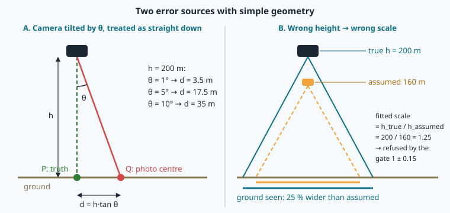

# Map-based localisation: from a photo to latitude and longitude

> [!NOTE] In short
> - NAVERA's day vision answers one question every one or two seconds: where on the map was this
>   photo taken, and how sure am I?
> - The chain has six steps: scale the photo, search near the last position, match features, fit
>   with RANSAC, apply the gates, convert the photo centre to lat/lon.
> - An **error budget** lists each error source in metres; independent errors combine as the root
>   sum of squares.
> - An honest evaluation reports four numbers: availability, median error, p90, and the number of
>   wrong fixes accepted.
> - In the lab you build the full chain, measure the errors of a wrong height and a tilted camera,
>   and test NAVERA's `LocalMatcher` on the same 13 photos.

⏱ Core reading ~16 min · optional deep-dives marked *Going further*.

A survey drone flies 250 m above a coastal road between two port cities. Halfway, its GPS
receiver starts to report nonsense: somebody is jamming the signal. The drone still has a camera
that looks down, an IMU that measures its attitude, a barometer, and — on its NAVERA box — a
satellite map of the area. Its last good GPS fix is 20 seconds old. The question of this lesson is
the one NAVERA's **day vision** answers every one or two seconds:

> "Here is the photo I just took. **Where on the map** was it taken — and how sure am I?"

Lesson 21 gave you keypoints and descriptors. Lesson 22 gave you the ratio test, the homography,
RANSAC and NAVERA's trust gates. This lesson assembles them into a complete **localisation chain**,
adds the geometry that links pixels to metres and to latitude/longitude, builds an **error budget**,
and shows how to **evaluate** such a system honestly.

> [!NOTE]
> NAVERA's test map covers **Sousse, Tunisia**, where NAVERA is developed. All the photos and map
> tiles of the lab come from that map. The examples in the text use places from around the world; the
> formulas are the same everywhere (only the map changes).

## 1. The problem, stated precisely


**Inputs**

| Symbol | Meaning | Where it comes from |
|---|---|---|
| `I` | the camera frame, already **straightened** to a straight-down (nadir) view | live camera + IMU attitude (lessons 16–20) |
| `h` | the **height above the ground** in metres (not the altitude above the sea!) | GPS minus ground elevation, barometer, or vision itself |
| `hfov` | the horizontal field of view of the lens | calibration (lesson 19) |
| `p0`, `σ0` | the **prior**: where the vehicle probably is, and the 1-sigma uncertainty of that guess | last GPS fix or last vision fix, carried forward |

**Output**: either a position `(lat, lon)` with a stated uncertainty `σ`, or **"no fix"** with a
reason. A wrong position stated with confidence is the worst possible output: the autopilot would
fly towards the wrong place, sure of itself. So the chain is built to say "no fix" whenever it
cannot prove its answer.

The chain has six steps: (1) bring the photo to the map's scale, (2) cut the map around the prior,
(3) match features, (4) fit a transformation with RANSAC, (5) apply the gates, (6) carry the photo
centre to latitude and longitude. We take them one by one.

## 2. Step 1 — The photo at the map's scale

The **ground sampling distance** (GSD) is the ground size of one pixel. For a nadir pinhole camera
(lesson 18) the footprint width is `W = 2 h tan(hfov / 2)`, so

```
GSD_photo = 2 · h · tan(hfov / 2) / width_px                 [m per photo pixel]
GSD_map   = 40 075 016.7 · cos(lat) / (2^z · 256)            [m per map pixel, Web Mercator, zoom z]
s         = GSD_photo / GSD_map                              [resize factor for the photo]
```

**Worked example.** A 640 × 480 photo taken from `h = 200 m` with `hfov = 75°`:

```
W         = 2 × 200 × tan(37.5°) = 2 × 200 × 0.7673 = 306.9 m
GSD_photo = 306.9 / 640                                = 0.4796 m/px
GSD_map   (Sousse, lat 35.83°, z = 17)                 = 0.9684 m/px
s         = 0.4796 / 0.9684                            = 0.495
```

The photo is resized to 49.5 % of its size: then a house 10 map pixels wide is also about 10 pixels
wide in the photo. Over Singapore (lat 1.35°) the same zoom gives 1.194 m/px, because `cos(lat)` is
larger near the equator: Web Mercator pixels cover more ground there.

Why resize at all, if SIFT is scale invariant? Two reasons. First, descriptors match best when both
images show the ground at the same scale (scale invariance is approximate). Second — and more
important — once the scale is fixed *before* matching, the scale fitted *after* matching must be
**1**. That gives us a free test of the answer (section 5).

<details class="further"><summary>Going further (optional) — Which zoom level?</summary>

**Which zoom?** NAVERA matches against **zoom 17**: about 1 m per pixel. Zoom 18 is twice as sharp
but has four times more pixels to search and to keep in memory; zoom 16 loses the small details
(cars, small buildings) that make features distinctive.

</details>

## 3. Step 2 — The prior and the search radius

**Why not search the whole map?** Because many places look alike. If the searched area is `A` and
the density of "look-alike" features is roughly constant, the number of wrong candidates grows with
`A`, so the chance that a wrong place fits by accident grows too.

<details class="further"><summary>Going further (optional) — How much worse is a whole-map search? (measured)</summary>

NAVERA measured this with its first day-vision method (DINOv2 tile retrieval, 33 labelled
aerial frames, from `docs/VALIDATION_STATUS.md`):

| Where it searched | Median error |
|---|---|
| the whole map, no prior | **1 696 m** |
| within 600 m of the previous true position | 442 m |

</details>

Whole-map search is therefore **disabled by default** (`allow_global_search: false`): day vision
waits for a prior.

<details class="further"><summary>Going further (optional) — How NAVERA sizes the search circle</summary>

**The search radius follows the uncertainty.** If the prior has a 1-sigma error `σ`, the true
position lies within `3σ` of it with a probability above 98 % (for a 2-D Gaussian, the probability
inside `kσ` is `1 − exp(−k²/2)`: 98.9 % for `k = 3`). NAVERA uses

```
r = clamp(k · σ_pred, 80 m, 1500 m)        with k = 3   (vision_nav.py, search())
```

and `σ_pred` grows with the time since the last fix (velocity error × t, plus a 5° heading error ×
distance, plus unseen accelerations — lesson 24 explains this "dead-reckoning"). A vehicle that has
been lost for a while is searched for in a wider circle.

</details>

**The margin.** The circle bounds the photo **centre**. The photo itself extends further: we add a
margin of half the photo's diagonal on the ground, so the whole photo fits in the map patch even
when the true position is on the circle's edge.


```
margin  = 0.5 · sqrt(w² + h²) · GSD_photo                 (640 × 480, 0.4796 m/px → 191.8 m)
half    = ceil((r + margin) / GSD_map)                    (r = 300 m → ceil(491.8 / 0.9684) = 508 px)
patch   = square of 2 · half pixels around the prior      (1016 × 1016 pixels ≈ 1 km²)
```

The cost of matching grows with the patch area, i.e. with `(r + margin)²`. Doubling the radius
from 300 m to 600 m multiplies the number of map pixels (and of map features) by about
`(791.8 / 491.8)² ≈ 2.6`. That is time, memory **and** risk of look-alikes. Keep the corner
`(x0, y0)` of the patch in **global pixels** (lesson 7): it links patch pixels to the world.

## 4. Step 3 — Matching and fitting

Matching is lesson 22 again: SIFT descriptors of the resized photo and of the patch, two nearest
neighbours for each photo descriptor, and the **ratio test** (`d1 < 0.8 · d2`) to drop ambiguous
matches.

**Which model?** In lesson 22 you fitted a **homography** (8 degrees of freedom), which describes
any view of a plane. Here the frame is already straightened to nadir and resized to the map's
scale, so the remaining transformation between photo and map is a **similarity**: a rotation `θ`
(the heading), a uniform scale `s` (≈ 1) and a translation `(tx, ty)` — 4 degrees of freedom:

```
[u]   [ s·cos θ   −s·sin θ   tx ] [x]
[v] = [ s·sin θ    s·cos θ   ty ] [y]        A = the 2 × 3 matrix, OpenCV: cv2.estimateAffinePartial2D
                                  [1]
s = hypot(A[0,0], A[1,0])        θ = atan2(A[1,0], A[0,0])
```

Because the image y axis points **down**, a positive `θ` turns clockwise on the screen — like a
compass heading. A photo whose top pointed 30° east of north gives `θ ≈ +30°`.

<details class="further"><summary>Going further (optional) — RANSAC cost: similarity against homography</summary>

Fewer parameters help RANSAC in two ways. A similarity needs a **minimal sample** of 2 matches,
a homography 4. With the iteration formula of lesson 22, `N = ⌈log(1 − p) / log(1 − w^m)⌉`
(rounded **up**, as in lesson 22) for a confidence `p = 0.999`:

| Inlier ratio `w` | similarity (`m = 2`) | homography (`m = 4`) |
|---|---|---|
| 0.3 | 74 iterations (73.2 → 74) | 850 iterations (849.4 → 850) |
| 0.1 | 688 iterations (687.3 → 688) | 69 075 iterations (69 074.1 → 69 075) |

Cross-date photos often have `w ≈ 0.1`: the similarity stays cheap. And a model with fewer
degrees of freedom has fewer ways to fit random matches at a wrong place. Use the homography only
when the frame could not be straightened (unknown attitude).

</details>

## 5. Step 4 — The gates

RANSAC **always** returns its best model, even over the sea, even when the true place is not in
the patch. The gates decide whether to believe it:

1. **Enough inliers**: at least 8 (`local_min_inliers`). Few inliers means a weak or random fit.
2. **The right scale**: `|s − 1| ≤ 0.15` (`local_scale_tol`). We fixed the scale before matching,
   so a correct fit has `s ≈ 1`. A random fit at a wrong place can have any scale.
3. In flight NAVERA adds more: the fitted rotation must agree with the IMU heading within ±20°
   (`local_heading_tol_deg`); a fix more than 3σ from the predicted position is refused unless it
   has ≥ 100 inliers; a weak fix whose inliers cover too little of the frame is refused; and a fix
   farther than the vehicle could have flown since the last one is refused (the **motion gate**).

<details class="further"><summary>Going further (optional) — What the scale gate was measured to do</summary>

The value of gate 2 was measured on the 33 aerial test frames (`docs/VALIDATION_STATUS.md`, search
within 600 m of the true position):

| Variant | Accepted | Worst error of the accepted | Wrong (> 50 m) accepted |
|---|---|---|---|
| prototype, no scale check, ≥ 12 inliers | 10/33 | 1 097 m | 1 |
| + scale check | 21/33 | 5 m | 0 |

</details>

A refusal is reported as `"no fix"` with a reason such as `"3 inliers (min 8)"`. That is not a
failure of the code: it is the code being honest.

## 6. Step 5 — From the photo centre to latitude and longitude

For a nadir camera the point under the vehicle is the photo **centre** `(cx, cy) = (w/2, h/2)` of
the resized photo. Carry it through the chain:

```
(u, v)   = A · [cx, cy, 1]ᵀ                          patch pixels
(X, Y)   = (x0 + u, y0 + v)                          global pixels at zoom z
n        = 256 · 2^z
lon      = X / n · 360° − 180°
lat      = atan( sinh( π · (1 − 2 Y / n) ) )         (inverse Web Mercator, lesson 7)
```

**Worked example** (photo p01 of the lab, old town of Sousse). The patch corner is
`(x0, y0) = (17 768 272, 13 195 992)` (the patch is centred on the **prior**, about 145 m from the truth) and
RANSAC carries the centre to `(u, v) = (384.3, 424.9)`.
Then `X = 17 768 656.3`, `Y = 13 196 416.9`, `n = 256 · 2^17 = 33 554 432`:

```
lon = 17 768 656.3 / 33 554 432 × 360 − 180 = 10.63700°
lat = atan(sinh(π × (1 − 2 × 13 196 416.9 / 33 554 432))) = 35.82560°
```

The error is the haversine distance (lesson 6) between this answer and the truth.

## 7. The error budget

Even a perfect match does not give the perfect position. An **error budget** lists every
independent error source as a 1-sigma value in metres, then combines them. For independent errors
the variances add, so the total is the **root sum of squares** (RSS):

```
σ_total = sqrt(σ_1² + σ_2² + … + σ_n²)
```



**a) Attitude (tilt) error → position offset.** If the camera is tilted by `θ` but the code believes
it looks straight down, the photo centre shows the ground point at distance

```
d = h · tan θ          dd/dθ = h / cos²θ ≈ h per radian = 0.01745 · h per degree
```

At 200 m, 1° costs 3.5 m; at 1 000 m it costs 17.5 m. This is why NAVERA straightens every frame
with the IMU attitude, and why the residual attitude error (a BNO085-class IMU: about 0.3° in tilt)
stays in the budget: `200 × tan(0.3°) = 1.0 m`. (Celestial navigation, lesson 26, has the same
problem at a much larger scale: 1° of attitude error costs 111 km there.)

**b) Height error → scale error, not position error.** The photo was resized with the assumed
height `h_a`, but the true footprint follows the true height `h_t`. The scale RANSAC fits is then

```
s_fit = GSD_true / GSD_assumed = h_t / h_a
```

The photo centre still lands on the right map pixel (the scale is fitted, not imposed), so a wrong
height does **not** move the position — but if `|h_t / h_a − 1| > 0.15` the scale gate refuses a
correct match. A wrong height costs **availability**. It also means vision can **measure** the
height: `h_t = h_a · s_fit`. NAVERA uses this: `locate_any_height()` tries a ladder of heights
when none is known, and the height filter in `vision_nav.py` is updated with `h · s_fit`.

<details class="further"><summary>Going further (optional) — A classic mistake over high ground</summary>

> [!WARNING]
> Over high ground this is the classic mistake. A drone at 4 100 m above sea level over the
> Altiplano near La Paz, Bolivia (about 3 800 m high) is only about 300 m above the ground. If the
> code used the altitude above the sea, it would expect a footprint 13.7 times too large and every
> match would fail the scale gate. NAVERA needs the **height above the ground**.

</details>

**c) Latency → along-track offset.** A photo processed `Δt` seconds after its exposure describes
where the vehicle *was*: `d = v · Δt`. NAVERA carries each vision position to the present along the
measured velocity (from `docs/VALIDATION_STATUS.md`: a photo processed 1.5 s after it was taken, at
40 m/s, is moved 60 m forward, and its stated accuracy becomes ±31.5 m). Only the residual timing error stays in the budget.

**d) Matcher noise.** Inlier positions are noisy by a few pixels; the fitted centre too.
`fix_sigma_m()` in NAVERA maps the inlier count to a 1-sigma error, measured in a bench campaign:
≥ 100 inliers → 4 map pixels, 50–99 → 8, 20–49 → 15, fewer → 25 (times `GSD_map`).

**e) Map registration.** Satellite imagery is not placed perfectly on the Earth: a whole area can be
shifted by a few metres. `vision_nav.py` learns this bias while GPS is still good (GPS minus vision,
sampled over several headings) and removes it afterwards, capped at 30 m.

**Worked budget — a survey drone 300 m above the rice fields near Bangkok** (lat 13.75°, `GSD_map` =
1.16 m at z17): tilt σ 0.3° → 1.6 m; matcher 8 px × 1.16 m → 9.3 m; residual lag 0.1 s × 20 m/s →
2.0 m; map registration → 5.0 m.

```
σ_total = sqrt(1.6² + 9.3² + 2.0² + 5.0²) = sqrt(2.56 + 86.49 + 4.0 + 25.0) = sqrt(118.05) = 10.9 m
```

The matcher term dominates: improving it (more inliers, a learned matcher) pays more than a better
IMU. That is the use of a budget: it tells you **where to spend effort**.

## 8. Evaluating a localiser honestly

Run the chain on `n` test photos with a known truth. Four numbers describe the result; one alone
is never enough:

| Metric | Definition | Why |
|---|---|---|
| **availability** | accepted / n | a perfect position once an hour is useless |
| **median error** | 50th percentile of the accepted errors | the typical error, not pulled by one outlier |
| **p90** | 90th percentile of the accepted errors | the tail: what the autopilot must survive |
| **wrong accepted** | number of accepted fixes with error > 50 m | the dangerous failures; must be 0 |

> [!NOTE]
> **The percentile rule of this course.** From here to lesson 33, "percentile" (median, p90, p95…)
> means **linear interpolation**, numpy's default, defined just below. There is one exception, and
> it is announced where it happens: in lesson 32 you reproduce the tables of NAVERA's tool
> `evaluate_session.py`, which uses the **nearest-rank** rule, so there you use that rule too
> (numbers that you compare must use the same rule). In every report, write the rule you used.

The **percentile** with linear interpolation (numpy's default): sort the `m` values `v[0] ≤ … ≤
v[m−1]`, compute the position `p = (m − 1) · q / 100`, and interpolate between `v[floor(p)]` and
`v[ceil(p)]`. Example: errors `[0.2, 0.4, 1.1, 5.0, 7.5, 30]`, q = 90: `p = 4.5`, so
`p90 = 7.5 + 0.5 × (30 − 7.5) = 18.75 m`.

<details class="further"><summary>Going further (optional) — Small samples: the rule of three</summary>

**Small samples.** "0 wrong out of 10" does not mean "never wrong". If the true rate of wrong fixes
were `ρ`, the probability of seeing 0 in `n` trials is `(1 − ρ)^n`. Setting it to 5 % gives the
**rule of three**: the 95 % upper bound is `ρ ≈ 3 / n`. With 10 photos, you can only claim
`ρ < 30 %`; with 300 photos, `ρ < 1 %`.

</details>

<details class="further"><summary>Going further (optional) — Test data: why photos cut from the map are too easy</summary>

**Test data.** Photos cut from the map itself match far too easily. NAVERA's validation document
quotes its bench result on **33 real aerial frames from another source and date** — 32/33 within
9 m, median 4 m, no wrong position accepted, 0.42 s per frame on the Jetson CPU — and says clearly
that these are **not** frames from NAVERA's own camera. Positions are therefore published with a
cautious 30 m (`local_sigma_m`) until they are measured with the real camera. In the simulator the
error is about 1 m, but the simulated camera is cut from the map's own imagery: optimistic. You will
see exactly this effect in the lab.

</details>

<details class="further"><summary>Going further (optional) — Learned matchers, DISK + LightGlue</summary>

SIFT is a hand-designed detector (lesson 21). **Learned** features replace it with neural networks
trained on many real image pairs: **DISK** detects keypoints and computes descriptors, and
**LightGlue** matches two sets of keypoints by attention (each keypoint "looks at" the others in
both images), instead of a nearest-neighbour search plus ratio test. They cope better when the photo
and the map differ in colour, shadows and date.

NAVERA has one: [learned_matcher.py](file:navera/day_pkg/day_pkg/learned_matcher.py) (kornia, on the
GPU). Its docstring reports a bench of 33 aerial frames (600 m search, position carried along the
velocity): **30/33 located, 0 wrong, 333 ms/frame** on the Orin Nano, against **22/33, 0 wrong,
720 ms** for SIFT in the same test. (This is a different protocol from the `LocalMatcher` table
above, so do not compare the two tables line by line.) Two practical points: DISK and LightGlue are
**not rotation invariant**, so the frame is first turned north-up with the heading; and when the
learned match fails, SIFT is tried as a fallback. The lab uses SIFT only: the learned models need a
GPU and their weights.

</details>

## 🐦 How birds do it

In the 1950s the German biologist Gustav Kramer proposed the **"map and compass"** model of bird
navigation. A **compass** tells a bird which way is which; a **map** tells it where it is. A
compass alone is not enough: if you do not know where you are, you do not know which way home is.
NAVERA's day vision has the same two parts: the IMU heading is the compass (it turns the frame
north-up and checks the fitted rotation), the satellite map is the map, and this lesson finds the
photo on it.

GPS tracking of homing pigeons near Oxford showed that, in familiar country, many birds follow
roads, rivers and field edges for long stretches instead of flying in a straight line: long,
contrasting lines are easy to recognise from above. Many migrating birds also follow **leading
lines** — coastlines and mountain ridges. Birds flying between Europe and Africa follow the
Atlantic coast of France, Spain and Morocco, or the line of the Alps and the Pyrenees. Navi the
swallow does the same as NAVERA: she does not scan a whole continent to recognise the place below her — she looks **around
where she believes she is**, in country she knows. That is the prior.

## In NAVERA

The real code is [local_matcher.py](file:navera/day_pkg/day_pkg/local_matcher.py), class
`LocalMatcher`, method `locate()`. Its core is almost what you write in the lab:

```python
s = frame_m_per_px / mpp_map                     # frame pixels → map pixels
q = self.clahe.apply(cv2.resize(grey, None, fx=s, fy=s, ...))
pm, dm = self.tiles.around(prior[0], prior[1], search_m + margin_m)   # cached tile features
kq, dq = self.sift.detectAndCompute(q, None)
idx, val = self._knn2(dq, dm)                    # 2 nearest map descriptors (GPU if available)
ok = val[:, 0] < self.ratio * val[:, 1]          # ratio test, 0.8
A, inl = cv2.estimateAffinePartial2D(src, dst, method=cv2.RANSAC, ransacReprojThreshold=self.ransac_px,
                                     maxIters=5000, confidence=0.999)
scale = math.hypot(A[0, 0], A[1, 0])            # 1.0 when the altitude/FOV prediction is right
px, py = A @ np.array([q.shape[1] / 2.0, q.shape[0] / 2.0, 1.0])
lat, lon = tile_px_to_latlon(float(px), float(py), self.z)
```

Differences with your lab pipeline:

- **Cached tile features** (`TileFeatures`): each 256 × 256 map tile gets its SIFT features once (at
  most 300 per tile, with a 48-pixel border from its neighbours), kept in an LRU cache and computed
  in the background ahead of the vehicle (`prefetch()`). Map points are stored directly in global
  pixels, so there is no `(x0, y0)` to add. The cost: only the 300 strongest features per tile —
  you will see the consequence in the lab.

<details class="further"><summary>Going further (optional) — Other differences: search window, height ladder, stated accuracy</summary>

- **Search window** (`vision_nav.py`, `search()`): `r = clamp(3 · σ_pred, 80 m, 1500 m)`.
- **Height** (`vision_nav.py`, `heights_to_try()`): the scale tolerance widens with the height
  uncertainty, `tol = min(0.35, max(0.15, 2 σ_h / h))`, and after 3 failures in a row the heights
  0.8 h and 1.25 h are tried too.
- **Stated accuracy** (`fix_sigma_m()`): from the inlier count, as in section 7.

</details>

## Words to remember

| Word | Meaning |
|---|---|
| **localisation chain** | the steps from a photo (and a prior) to a position or "no fix" |
| **GSD** (ground sampling distance) | ground size of one pixel, in metres |
| **prior** | where the vehicle probably is before looking, with its uncertainty σ |
| **search radius** | `k · σ` around the prior; the map is searched only there |
| **margin** | extra map around the search circle so that the whole photo fits |
| **similarity** | rotation + uniform scale + translation (4 degrees of freedom) |
| **gate** | a test a result must pass to be believed (inliers, scale, heading, motion) |
| **error budget** | the list of independent error sources and their combined total |
| **RSS** | root sum of squares: how independent 1-sigma errors combine |
| **availability** | the share of photos that give an accepted position |
| **percentile (p90)** | the value below which 90 % of the sorted errors lie |
| **rule of three** | with 0 failures in n trials, the 95 % upper bound of the failure rate is about 3/n |
| **learned matcher** | features and matching computed by trained neural networks (DISK + LightGlue) |

## Check what you learned

<details><summary>1. A 1 000-pixel-wide photo is taken from 100 m with a 90° lens over Reykjavik (lat 64.15°). What is its GSD, and by how much must it be resized to match zoom 17?</summary>
GSD = 2 × 100 × tan(45°) / 1000 = 0.2 m/px. GSD_map = 40 075 016.7 × cos(64.15°) / (2^17 × 256) =
0.521 m/px. Resize factor s = 0.2 / 0.521 = 0.384: the photo is shrunk to 38.4 % of its size (near
the equator the same photo would be shrunk much more, because map pixels are larger there).
</details>

<details><summary>2. The prior has σ = 120 m. What search radius does NAVERA use, and how many times larger is the patch area than with σ = 50 m (margin 190 m)?</summary>
r = 3 × 120 = 360 m (within [80, 1500]). With σ = 50 m, r = 150 m. Area ratio = ((360 + 190) /
(150 + 190))² = (550 / 340)² ≈ 2.6.
</details>

<details><summary>3. The barometer says 250 m above the ground, but the drone is really at 300 m. What scale will RANSAC fit, and what happens?</summary>
s_fit = h_true / h_assumed = 300 / 250 = 1.2. |1.2 − 1| = 0.2 > 0.15, so the scale gate refuses a
correct match: no fix (availability lost, not accuracy). The fitted scale also tells the true
height: 250 × 1.2 = 300 m — which is how NAVERA can re-estimate the height.
</details>

<details><summary>4. At 400 m, what position error does an uncorrected tilt of 2° cause? And 0.3°?</summary>
d = h · tan θ: 400 × tan(2°) = 14.0 m; 400 × tan(0.3°) = 2.1 m.
</details>

<details><summary>5. Your localiser accepted 12 of 15 test photos, all within 3 m, none wrong. Write the four evaluation numbers you would report, and what you can claim about wrong fixes.</summary>
Availability 12/15 = 80 %, the median and the p90 of the 12 errors, and "0 wrong accepted". By the
rule of three, the 95 % upper bound of the wrong-fix rate is about 3 / 12 = 25 %: far too few photos
to claim the system is safe. Also say what the photos were (cut from the map or real, same date or
not).
</details>

<details><summary>6. Why does NAVERA fit a similarity instead of a homography, and when would a homography be needed?</summary>
After straightening and resizing, only rotation, uniform scale and translation remain (4 DOF). The
minimal sample is 2 instead of 4, so RANSAC needs far fewer iterations at low inlier ratios, and a
wrong place has fewer ways to fit by chance. A homography is needed when the frame cannot be
straightened (unknown attitude, strong perspective).
</details>

Now open the **🛠️ Lab** tab.
