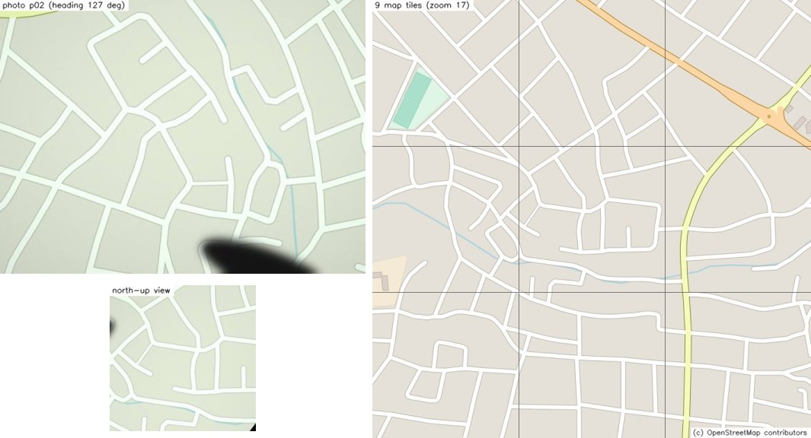
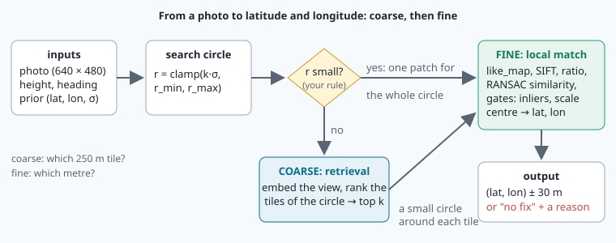
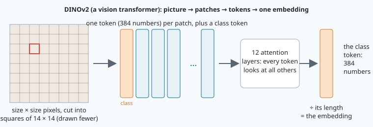
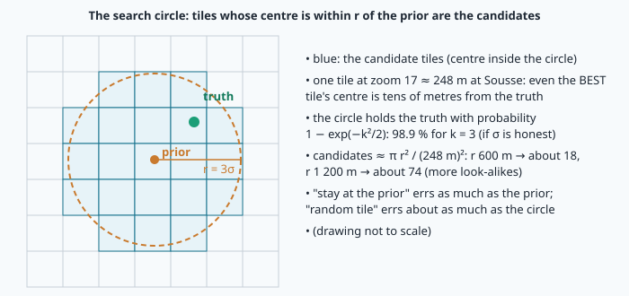
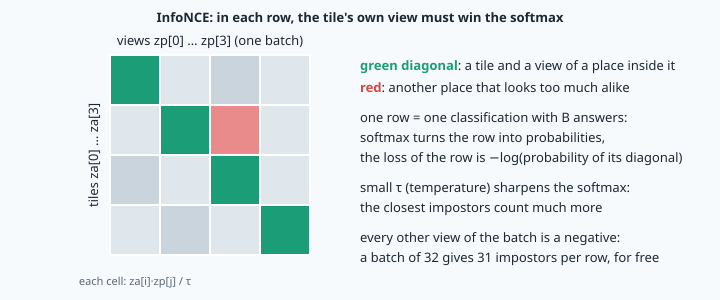

# Map-based localisation: from a photo to latitude and longitude



> [!NOTE] Mission brief
> **NAVERA's first day vision was an AI that barely beat doing nothing.** It compared each camera frame with the map
> tiles around the last known position, using **DINOv2**, a famous network pretrained on 142 million pictures. On 33
> labelled frames it placed the drone with a median error of **442 m**. Two "methods" that use no picture at all did
> almost as well: staying at the previous position, **480 m**, and picking a random tile in the same circle,
> **536 m** (NAVERA's validation report, 3 October 2026). In a simulated GPS loss the error grew to 4–5 km. IRIS
> replaced it with **local feature matching** (missions 21–22 turned into a position): 30 of 33 bench frames placed
> with a median error of 4 m. DINOv2 was kept, but only as a fallback.
>
> Was the AI useless, or was it used for the wrong job? Today you find out by building both halves of the answer.
> **Session 1 — Finder:** you run DINOv2 yourself, then train your own small network on views you make from the map,
> and you measure both against honest baselines. **Session 2 — Locator:** you turn the best candidate into an exact
> latitude and longitude with OpenCV, write the rule that decides when the AI is worth running, and evaluate the whole
> chain with four numbers. Each session ends with a badge: **Finder**, then **Locator**.
>
> **Start now:** open the 🛠️ **Lab** tab, do **Step 0** (five minutes, no code), then come back here for §1.

**Objectives.** After this mission you can:

1. explain what an **embedding** is, rank map tiles by **cosine similarity**, and feed a pretrained network
   (DINOv2) the input it was trained on;
2. evaluate a localiser honestly: against **baselines** and the **resolution limit**, with the median, the p90, the
   **availability** and the wrong positions accepted, and analyse where and why it fails;
3. train your own embedding network with a **contrastive loss** (InfoNCE) on data you generate, explain each design
   choice (positives, augmentation, split by place), and compare it with DINOv2 on accuracy **and** cost;
4. compute the **search radius** from the prior's σ, turn a fitted similarity into latitude and longitude through the
   **gates**, and decide, from measurements, when retrieval is worth running;
5. build an **error budget** (root sum of squares) and compare it with measured errors.

**You need:** tiles and `pixel_to_latlon` (mission 07), `like_map` (08), the ground sampling distance (18), PyTorch,
a training loop, the triplet loss and train/validation splits (21), the ratio test, RANSAC and the similarity fit
(22), linear percentiles (CONVENTIONS). ⏱ Reading: about 110 minutes with the ✏️ checks (Part A, §1–§6, before
session 1, about 70 minutes; Part B, §7–§9, before session 2). Reading and lab together: 5 h 30 to 8 h in two sessions (up to 10 h if PyTorch is still new).

**Before you start** — answer without looking (if you miss two, reread mission 07 §4, mission 21 §8 and mission 22 §3):

<details><summary>1. At zoom 17, how many metres of ground does one map pixel cover at the equator, and why fewer at Sousse (35.8° N)?</summary>
40 075 017 m / (2¹⁷ · 256) ≈ 1.19 m. Web Mercator stretches the map by 1 / cos(latitude): at 35.8° N one pixel covers
1.19 · cos 35.8° ≈ 0.97 m.
</details>

<details><summary>2. Triplet loss with d_pos = 0.4, d_neg = 0.7, margin 0.5: the loss, and what training does with it?</summary>
max(0, 0.5 + 0.4 − 0.7) = 0.2: the impostor is too close, so the gradient pulls the pair together and pushes the
impostor away.
</details>

<details><summary>3. Why fit a similarity (4 numbers) rather than a homography (8) when the photo is already turned north-up and brought to the map's scale?</summary>
What is left is a small turn, a scale near 1 and a shift: a similarity describes it. Fewer unknowns: a minimal sample of
2 matches instead of 4, far fewer RANSAC iterations, and fewer ways to fit random matches at a wrong place.
</details>

<details><summary>Workspace and words (open if you need them)</summary>

Your files are in `~/lessons/23-locate-on-map/`. The parts of NAVERA Lite you write are
[navera_lite/retrieval.py](file:./navera_lite/retrieval.py) and [navera_lite/locate.py](file:./navera_lite/locate.py).

| Word | Meaning | Français |
|---|---|---|
| **embedding** | a vector that summarises a whole picture; similar places → close vectors | plongement (embedding) |
| **cosine similarity** | a·b / (‖a‖ ‖b‖): 1 = same direction, 0 = unrelated, −1 = opposite | similarité cosinus |
| **retrieval** | finding, in a database, the items closest to a query | recherche par similarité |
| **pretrained model** | a network trained by someone else on other data, used as it is | modèle pré-entraîné |
| **baseline** | a simple method any new method must beat to be worth anything | méthode de référence |
| **prior** | where the drone believes it is before looking, with its σ | a priori |
| **contrastive loss** | a loss that pulls matching pairs together and pushes the others apart | perte contrastive |
| **temperature** τ | divides similarities before a softmax: small τ = sharper choice | température |
| **augmentation** | random changes of training pictures, so the network ignores them | augmentation de données |
| **availability** | the share of photos for which a position is given | disponibilité |
</details>

# Part A — Finding the tile (read before session 1)

## 1. One question, two scales



The drone's GPS is jammed. It has a downward photo, its height above the ground (barometer), its heading (IMU),
a camera calibration, the course map, and a **prior**: where it believes it is, (lat, lon), with a 1-σ uncertainty
σ that grows while it flies without a fix. The question is mission 01's: *where am I, and how sure am I?* The answer is
a position with a stated σ, or "no fix" with a reason, never a confident wrong position.

The answer comes in two scales. **Coarse:** which piece of map, a few hundred metres wide, is the photo in? **Fine:**
which exact pixel of that piece is under the camera? Local feature matching (missions 21–22) answers the fine
question very well, but only inside a small piece of map. When the prior is poor, the circle to search is large, and
a coarse step must first say where to look. That coarse step is **retrieval**, and it is where NAVERA used AI.

**Worked example — what one photo covers.** The lab's camera has a horizontal field of view of 60° and 640 × 480
pixels. From 360 m the footprint is 2 · 360 · tan 30° = **415.7 m** wide and 415.7 · 480/640 = **311.8 m** high,
0.650 m per photo pixel (mission 18's GSD). A zoom-17 map pixel at Sousse covers 0.968 m, so one 256-pixel **tile**
is **247.9 m** wide. Turned north-up at the map's scale (the photo shrunk by 0.650/0.968 = 0.671), the photo spans
about 429 × 322 map pixels: a little more than one tile in each direction, and almost never aligned with the tiles.

> [!QUESTION] ✏️ Check
> From 300 m, how wide is the footprint, and how many tile widths is that? If the photo's centre is 100 m east of a
> tile's centre, which share of that tile does a 248 m square view centred on the photo still overlap (east–west only)?

<details><summary>Answer</summary>
2 · 300 · tan 30° = <b>346.4 m</b>, 346.4 / 247.9 ≈ <b>1.4 tile widths</b>. Shifted by 100 m, a 248 m square overlaps
the tile on 248 − 100 = 148 m: <b>about 60 %</b> of its width. A view and its "own" tile are never the same picture.
</details>

## 2. Embeddings and cosine similarity

Comparing a photo with 100 map tiles pixel by pixel fails: the light, the turn, the blur and the offset all change the
pixels. Instead, a network turns each picture into an **embedding**: a vector of D numbers (D = 384 for DINOv2) built
so that pictures of the same kind of place give vectors pointing in nearly the same direction. Comparing two pictures
becomes comparing two vectors, with the **cosine similarity**:

```
cos(a, b) = a·b / (‖a‖ · ‖b‖)          1: same direction    0: unrelated (perpendicular)    −1: opposite
```

Only the direction counts, not the length. When every embedding is stored with length 1 (a **unit vector**), the
cosine is simply the dot product, and ranking 100 tiles is one matrix–vector product. **Retrieval** = embed the query,
compute its similarity with every candidate, sort, best first.

**Worked example.** Query q = (1, 2, 2), ‖q‖ = 3. Tile a = (2, 1, 2): a·q = 2 + 2 + 4 = 8, ‖a‖ = 3, cos = 8/9 =
**0.889**. Tile b = (0, 3, 0): b·q = 6, ‖b‖ = 3, cos = **0.667**. Tile c = (−1, −2, −2): cos = **−1**. The ranking is
a, b, c.

> [!QUESTION] ✏️ Check
> Add tiles d = (2, 4, 4) and e = (9, 0, 0). Their cosines with q, and the new ranking?

<details><summary>Answer</summary>
d·q = 18, ‖d‖ = 6: cos = <b>1.0</b> (d is q made twice longer: same direction). e·q = 9, ‖e‖ = 9: cos = 9/27 =
<b>0.333</b>. Ranking: d, a, b, e, c. A dot product alone would put e (9) above a (8) and b (6) only because e is long:
that is why the lengths must be divided out.
</details>

## 3. A pretrained model: DINOv2



**DINOv2** (Meta AI, 2023) is a **vision transformer**. It cuts a picture into squares of 14 × 14 pixels (the
"/14" of ViT-S/14), turns each square into a token of 384 numbers, adds one extra **class token**, and lets all tokens
exchange information in 12 attention layers. The class token at the end summarises the whole picture: that is the
embedding. ViT-S/14 has 22 million parameters. It was trained by **self-supervision**: no labels, only the task "give
the same answer for two crops of the same picture", on 142 million photos of the world. It was never shown a map.

A pretrained network expects its input exactly as it was trained. DINOv2's pictures were:

- **RGB** (OpenCV gives you BGR: the first channel is blue);
- scaled to 0..1, then normalised channel by channel with the ImageNet mean (0.485, 0.456, 0.406) and standard
  deviation (0.229, 0.224, 0.225), red first: x' = (x − mean) / std;
- square, with a side that is a multiple of 14 (the course uses 224);
- laid out **channels first**: (N, 3, H, W), not OpenCV's (H, W, 3).

**Worked example — one pixel.** OpenCV gives (B, G, R) = (30, 200, 120). Red: 120/255 = 0.4706, (0.4706 − 0.485)/0.229
= **−0.063**. Green: 200/255 = 0.7843, (0.7843 − 0.456)/0.224 = **1.466**. Blue: 30/255 = 0.1176,
(0.1176 − 0.406)/0.225 = **−1.282**. The tensor holds (−0.063, 1.466, −1.282) in the order red, green, blue.

> [!QUESTION] ✏️ Check
> A white pixel, (255, 255, 255): its three numbers? And a ViT-B/16 network on 224 × 224 pictures: how many patch tokens?

<details><summary>Answer</summary>
(1 − 0.485)/0.229 = <b>2.249</b>, (1 − 0.456)/0.224 = <b>2.429</b>, (1 − 0.406)/0.225 = <b>2.640</b> (red, green,
blue). 224/16 = 14 per side: <b>196</b> tokens (plus the class token).
</details>

> [!WARNING] What a wrong input does
> Feed BGR instead of RGB, or forget the /255, and DINOv2 still returns 384 numbers of length 1: **no error message**.
> The embeddings are simply worse, and nothing tells you. That is why lab Step 2 compares your embeddings of four map
> tiles with the course's index before it embeds the photos.

## 4. Measuring honestly: baselines and the limit

A median error of 180 m means nothing alone. Is it good? Compare it with methods that use **no picture at all**:

- **stay at the prior** — answer the prior itself. Its error is the prior's error. With σ on each axis (east and
  north), the distance has a median of σ · √(2 ln 2) ≈ **1.18 σ**.
- **random tile in the circle** — answer the centre of any candidate tile. Its error is about the size of the circle.

And with the best a tile-level answer can ever do: the **resolution limit**, the centre of the best tile of the
circle, which is still tens of metres from the truth (§1). A retrieval method is useful only if it beats both
baselines clearly, and its results should be read against the limit.

NAVERA's own table (validation report, 3 October 2026; 33 labelled replay frames, search within 600 m of the previous
true position):

| Method | Median error | Within 300 m |
|---|---|---|
| DINOv2 retrieval, search within 600 m | 442 m | 41 % |
| Random tile in the same circle (baseline) | 536 m | 17 % |
| Repeating the previous position (baseline) | 480 m | 31 % |
| DINOv2, whole map, no prior | 1 696 m | 12 % |
| Best tile available (resolution limit) | 107 m | 94 % |

For a full localiser (Part B) the course reports four numbers, plus "within 300 m" for retrieval:

| Number | Definition | Why |
|---|---|---|
| **availability** | positions given / photos | a perfect position once an hour is useless |
| **median** | 50th percentile of the errors of the positions given | the typical error |
| **p90** | 90th percentile of the same errors | the tail the autopilot must survive |
| **wrong** | positions given with an error > 50 m | the dangerous failures; must be 0 |

Percentiles are **linear** (numpy's default, CONVENTIONS §6): sort the m values, take the position p = (m − 1)·q/100,
interpolate between the values on either side.

**Worked example.** Five photos, errors [5, 9, refused, 120, 30] m. Availability 4/5 = 0.8. Sorted: [5, 9, 30, 120];
median: p = 1.5 → 9 + 0.5 · 21 = **19.5 m**; p90: p = 2.7 → 30 + 0.7 · 90 = **93 m**; within 300 m: 4/4; wrong: **1**.

> [!QUESTION] ✏️ Check
> Seven photos: [refused, 200, 40, refused, 600, 90, 10]. Availability, median, p90, wrong?

<details><summary>Answer</summary>
5/7 = <b>0.71</b>. Sorted [10, 40, 90, 200, 600]: median <b>90 m</b>; p90: p = 3.6 → 200 + 0.6 · 400 = <b>440 m</b>;
wrong (> 50 m): 90, 200, 600 = <b>3</b>.
</details>

## 5. The prior and the search circle



Where to look follows from the prior. If the prior's error is Gaussian with σ on each axis, the truth lies within kσ
of the prior with probability **1 − exp(−k²/2)**: 39 % for k = 1, 86 % for k = 2, **98.9 % for k = 3**. So the search
radius is r = k·σ with k = 3, but never below a floor r_min (the prior's own computation is never perfect) nor above a
ceiling r_max (a larger circle costs more and holds more look-alikes):

```
r = min(max(k · σ, r_min), r_max)          NAVERA: k = 3, r_min = 80 m, r_max = 1 500 m
```

**Worked example.** σ = 120 m → r = **360 m**. σ = 10 m → 30 m, raised to **80 m**. σ = 900 m → 2 700 m, cut to
**1 500 m**. The number of candidate tiles is about π r² / (247.9 m)²: **18** for r = 600 m, **74** for 1 200 m. With
18 candidates, a random tile is wrong by a few hundred metres; with 74, by about a kilometre. The prior's own error
grows with σ too (1.18 σ). Which of the two grows faster, and what it means for retrieval, is lab Step 5.

> [!QUESTION] ✏️ Check
> σ = 30 m and σ = 600 m: the radius, and about how many candidate tiles?

<details><summary>Answer</summary>
σ = 30 m: 90 m (above the 80 m floor), π · 90² / 247.9² ≈ 0.4: the circle is smaller than one tile; the truth's tile
and maybe a neighbour. σ = 600 m: 1 800 m → cut to <b>1 500 m</b>, ≈ <b>115 tiles</b>.
</details>

## 6. Your own embedding network

DINOv2 never saw a map. A network trained on **this** map, for **this** job, might do better, and run much faster on
the drone's small computer. You build one: **TileNet**, four convolution blocks (mission 21's kind), then a
**global average pooling** (the mean of each map over its width and height: one number per map), then one linear
layer and a division by the length. Global pooling makes the embedding the same wherever in the view a road or a block
appears: useful, since a photo's centre is never a tile's centre (§1).

**The data you generate.** No labelled photos are needed: the map makes its own pairs. An **anchor** is a map tile; its
**positive** is a view of a place *inside* that tile, offset by up to half a tile in x and y, as a real photo would be.
Then **augmentation**: a small turn (±6°, the heading error), a scale change (±8 %, the height error), changes of light
and colour, blur, a cloud, noise, and black corners where a turned photo does not cover the view. Each change teaches
the network to ignore it; a change you do not show, it will not ignore. Tiles that are almost uniform (sea, empty land)
are left out: all alike, they cannot teach which place is which. And the split is **by place**: training pairs from
the north of the map, validation pairs from the south, and the lab's photos from Sousse, which training never sees.

**The loss: InfoNCE.** In words: for each map tile, "which of the B views in this batch is mine?", a multiple-choice
question with B answers; the loss is small when the network puts its probability on the right one. The recipe: in a
batch of B pairs, compute every similarity za[i]·zp[j] (B × B numbers). Row i is a classification with B answers, and
the right answer is j = i (the diagonal). Divide the row by a **temperature** τ, turn it into probabilities with a
softmax, and take −log of the probability of the right answer. The loss is the mean over the rows. Every other view of
the batch is a negative, for free.



**Worked example** (B = 3, τ = 0.5). Row 0 of the similarities: [0.9, 0.5, 0.1] → divided by τ: [1.8, 1.0, 0.2].
e^1.8 = 6.050, e^1.0 = 2.718, e^0.2 = 1.221; the probability of answer 0 is 6.050 / 9.989 = 0.606; the loss of row 0
is −ln 0.606 = **0.50**. With τ = 0.1 the row becomes [9, 5, 1] and its loss **0.018**: this row is nearly solved, and
a smaller temperature says so more firmly.

> [!QUESTION] ✏️ Check
> Row [0.9, 0.85, 0.1] (an impostor almost as close as the right view): its loss with τ = 0.5 and with τ = 0.1? What
> does a small temperature do to such a row compared with the easy one above?

<details><summary>Answer</summary>
τ = 0.5: [1.8, 1.7, 0.2] → 6.050 / (6.050 + 5.474 + 1.221) = 0.475 → loss <b>0.745</b>. τ = 0.1: [9, 8.5, 1] →
8 103 / (8 103 + 4 915 + 3) = 0.622 → loss <b>0.474</b>. Small τ makes easy rows almost free (0.018) while the hard row
keeps a large loss: training spends its effort on the closest impostors.
</details>

**Counting parameters** (as in mission 21): a `Conv2d(3, 8, 5)` has 8 filters of 3 · 5 · 5 = 75 weights plus 8 biases:
**608**. A `Linear(64, 10)`: 64 · 10 + 10 = **650**. Global average pooling has none. TileNet's count is yours to
derive in lab Step 8.

> [!QUESTION] ✏️ Check
> After four blocks, a batch has the shape (N, 128, 4, 4). Its shape after global average pooling? And why would a
> network that flattens the 128 · 4 · 4 numbers instead struggle when the photo's centre is 100 m from the tile's?

<details><summary>Answer</summary>
(N, 128): one mean per map. Flattening keeps WHERE each feature was: the same road 100 m (about a quarter of the
view) away lands in other numbers, so the tile and the photo look different to the linear layer. The mean forgets the
position and keeps WHAT was seen.
</details>

> [!WARNING] Common wrong ideas (Part A)
> - "A famous pretrained model beats any baseline." Measure it: NAVERA's DINOv2 beat staying put by 38 m.
> - "Similar embeddings mean the same place." They mean the same *kind* of place: one city block looks like the next.
> - "Feed OpenCV's picture to the network as it is." BGR, 0..255 and (H, W, 3) give no error, only wrong embeddings.
> - "Validate on views of the training area." Neighbouring views share ground: that measures memory. Split by place.
> - "More augmentation is always better." Each one removes information; add what the real photos really vary in.

# Part B — From a tile to a position (read before session 2)

## 7. The fine step: local matching and the gates

The fine step is mission 22's chain, run by NAVERA Lite's given `local_match`: the photo is made like the map
(mission 08's `like_map`: grey, contrast stretched, north-up from the heading, at the map's metres per pixel); a map
patch is cut around a point, big enough for the search circle plus half the view; CLAHE on both, then SIFT keypoints
with NAVERA's contrast threshold 0.02 (map pictures are pale, mission 21 §6 and "In NAVERA"); for each
view descriptor its two nearest map descriptors, kept if the nearest is clearly closer (ratio 0.9: drawn maps repeat
the same corners, so one match per map keypoint is also kept); then a **similarity** fitted by RANSAC
(`cv2.estimateAffinePartial2D`): A, a 2 × 3 matrix that carries view pixels into patch pixels.

RANSAC always returns its best fit, even over the sea. The **gates** decide whether to believe it (NAVERA's values):

1. **enough inliers**: at least 6 (the value of NAVERA's validation report of 3 October 2026; its current setting is
   8, after more bench frames);
2. **the right scale**: the photo was brought to the map's scale from the height, so the right place fits with a scale
   s = ‖first column of A‖ ≈ 1. A random fit at a wrong place can have any scale: |s − 1| ≤ 0.15 or no fix.

Then the photo's centre goes through the chain of frames: the view's centre ((w − 1)/2, (h − 1)/2) through A into the
patch (u, v); OpenCV puts pixel centres at whole numbers, the map's continuous coordinates put pixel i between i and
i + 1, so add **0.5** to both; then mission 07's `pixel_to_latlon` with the patch's origin (x0, y0).

**Worked example.** A view of 449 × 449 px (centre (224, 224)) and A = [[0.98, −0.17, 512.4], [0.17, 0.98, 466.0]],
31 inliers. Scale √(0.98² + 0.17²) = **0.995**: both gates pass. u = 0.98 · 224 − 0.17 · 224 + 512.4 = 693.84,
v = 0.17 · 224 + 0.98 · 224 + 466.0 = 723.60. With the patch origin (x0, y0) = (69 390.5, 51 552.25) tiles at zoom 17,
`pixel_to_latlon(694.34, 724.10, 17, 69390.5, 51552.25)` = **(35.810957, 10.594150)**. Forgetting the 0.5 moves the
answer by 0.68 m: small, but a systematic error that never averages out.

> [!QUESTION] ✏️ Check
> The same A with 5 inliers? And a fit A = [[1.18, 0.10, …], [−0.10, 1.18, …]] with 40 inliers? What could cause the
> second one?

<details><summary>Answer</summary>
5 inliers: refused, "5 inliers (min 6)". Scale √(1.18² + 0.10²) = 1.18: refused, "scale 1.18 (expected 1 ± 0.15)".
Either a wrong place that happened to fit, or a height 18 % off: the true footprint is larger than assumed. A wrong
height costs <b>availability</b> (the scale gate refuses), not accuracy: the scale is fitted, so the centre still lands
on the right pixel when the fit is accepted.
</details>

## 8. When is retrieval worth it?

The fine step can search the whole circle at once: one patch of side about 2 · (r / 0.968 + half the view) pixels.
Its cost grows with the square of that side. For a photo from 360 m (view ≈ 537 px): r = 150 m → **848 px**;
r = 600 m → **1 778 px**; r = 1 200 m → **3 016 px**, 12.7 times the pixels of the first. SIFT works on a copy
enlarged twice, so a 3 000-pixel patch needs about a gigabyte: the fine step refuses patches wider than 2 000 px
(`max_patch_px`), and the time per photo grows too. A larger patch also holds more look-alike corners.

Retrieval turns one large search into a few small ones: rank the tiles of the circle, then run the fine step in a
small circle (180 m, a tile's half-diagonal) around each of the best k = 3. It is cheap, but coarse and often wrong
(§4), and that is fine as long as the gates refuse the wrong candidates, and the right tile is among the first three.

One more rule closes the chain: a position farther from the prior than r is refused, because the drone cannot be there
if σ is honest. Sometimes it *is* there (about 1 % of the time for k = 3: e^(−9/2) = 1.1 %): the rule then throws away a
correct fix. That is the price of never trusting a far jump.

So the question "is retrieval worth it?" has no answer in general: it depends on the radius, on the terrain and on the
finder. In lab Step 14 you measure both ways for four values of σ and **decide** the radius `direct_max_r_m` up to
which the fine step works alone. That number is yours: it goes into your settings and decides how your stack flies.

> [!QUESTION] ✏️ Check
> A retrieval method puts the right tile first for 50 % of the photos and among the first three for 70 %. With k = 3
> and a perfect fine step, which share of photos can get a position? What does k = 10 cost, and what does it risk?

<details><summary>Answer</summary>
At most <b>70 %</b>: the fine step only looks where retrieval points. k = 10 costs up to 10 fine steps per photo (time),
and gives the gates 10 chances to accept a wrong place: more availability, but more risk of a wrong position.
</details>

## 9. The error budget

Even a perfect match is not a perfect position. An **error budget** lists every independent error source as a 1-σ in
metres and combines them. Independent errors add as **variances** (mission 04), so the total is the **root sum of
squares** (RSS):

```
σ_total = √(σ₁² + σ₂² + … + σₙ²)
```

**Worked example.** Camera tilt left after straightening 1° at 250 m: 250 · tan 1° = 4.4 m; a photo 0.14 s old at
20 m/s: 2.8 m; map registration: 3 m. RSS = √(4.4² + 2.8² + 3²) = √35.9 = **6.0 m**, against a plain sum of 10.2 m.
The largest term dominates: improving it pays; improving a small one hardly shows.

> [!QUESTION] ✏️ Check
> Tilt 0.3° at 400 m, matcher noise 4 m, map 3 m: the total? Which term would you work on first?

<details><summary>Answer</summary>
400 · tan 0.3° = 2.09 m; √(2.09² + 4² + 3²) = √29.4 = <b>5.4 m</b>. The matcher term (4 m): halving it gives 4.2 m;
halving the tilt term only 5.1 m.
</details>

> [!WARNING] Common wrong ideas (Part B)
> - "RANSAC found a fit, so the drone is there." RANSAC always finds a fit; the gates decide.
> - "Search the whole circle, to be safe." A large circle costs memory and time, and holds more look-alikes.
> - "Errors add up." Independent errors add as squares: 3 m and 4 m make 5 m, not 7 m.
> - "Availability 100 % is the goal." Over the sea the right answer is "no fix".

## In NAVERA

NAVERA's day vision (IRIS's product, described in words) first used **DINOv2 tile retrieval** against zoom-17
satellite tiles (its numbers are in §4); its similarity score stayed high on wrong matches, so it could not flag them,
and over the whole map without a prior it was off by 1 696 m. Whole-map search is
therefore disabled: day vision waits for a prior. The default since 1 October 2026 is **local feature matching**: the
frame is scaled to the map's resolution from the altitude and the camera's field of view, its SIFT features are matched
with those of the tiles in the search circle, a rotation + scale + translation is fitted with RANSAC, and a match is
accepted only with at least 6 inliers (8 in its current setting) **and** a fitted scale within ±15 % of the one the altitude predicts. Measured on
33 aerial bench frames from another source than the map (not NAVERA's camera): 30/33 placed, median 4 m, worst 5 m,
no wrong position accepted, 0.11 s per frame on the GPU. The search radius is three times the predicted σ, between
80 m and 1 500 m. Positions are stated at 30 m until they are measured with the real camera. Over uniform terrain the
problem is the ground, not the method: in simulation near Gabès, retrieval gave a median of 351 m (p90 853 m) and the
autopilot failed safe after 45 s; "the terrain is the cause, not the size of the map" (validation report, 3 October
2026). DINOv2 retrieval is kept as the fallback when the frame's scale is unknown. NAVERA is Release 0.2, field
validation pending.

## In NAVERA Lite

| You write | It does | Lesson |
|---|---|---|
| `preprocess` (retrieval.py) | DINOv2's input, as it was trained | §3 |
| `rank` | cosine similarity, best first | §2 |
| `evaluate` (locate.py) | the honest numbers | §4 |
| `TileNet`, `info_nce` (retrieval.py) | your embedding network and its loss | §6 |
| `search_radius`, `place`, `locate`, `budget` (locate.py) | the circle, the gates, the chain with your rule, the budget | §5, §7–§9 |

Given: `north_up`, `load_dino`, `embed_dino`, `TileIndex` (the search in the circle, with your `rank`), `make_pairs`,
`train_tilenet`, `embed_tilenet`, `match_similarity` (OpenCV), `local_match` (with your `place`), `to_estimate`, and
the finished parts of missions 06, 07, 08 and 18. Your trained `my_tiles.pt` is part of your stack: Sim Lite (31) can
fly it.

## 🐦 How birds do it

In the 1950s Gustav Kramer proposed the **map and compass** model of bird navigation: a compass says which way is
which; a map says where the bird is. Homing pigeons tracked with GPS near Oxford and Rome follow familiar roads, rivers and field
edges (Biro et al., 2004; Lipp et al., 2004): they do not search the whole country, they look **around where they
believe they are**, and recognise places they have learned. Navi the swallow does the same: a prior first, then the
details.

## Summary

1. Two scales: retrieval (which tile?) and local matching (which pixel?). The prior's σ sets the search radius,
   r = clamp(3σ, r_min, r_max).
2. An embedding summarises a picture; retrieval ranks tiles by cosine similarity. A pretrained network needs its own
   input: RGB, its normalisation, its size, channels first.
3. A method is worth what it beats: baselines without pictures, the resolution limit, four numbers, failures by terrain.
4. Your own network learns what its data shows it: positives inside the tile, augmentation, a split by place, InfoNCE.
   Compare it with the pretrained one on accuracy **and** cost.
5. The gates turn a fit into a position or an honest refusal; the budget adds independent errors as squares.

**Next mission:** visual odometry. Between two map fixes the drone still moves; mission 24 measures how far from one
frame to the next.

## Check yourself

Answer without scrolling up.

<details><summary>1. Why can the similarity score of the best tile not tell you that the tile is wrong?</summary>
Similar embeddings mean the same kind of place; a look-alike block scores as high as the right one. NAVERA measured it:
the scores of good and bad matches overlap. Only an independent test (the fine step's gates) can refuse.
</details>

<details><summary>2. σ = 250 m, k = 3, r_max = 1 500 m: the radius, and about how many zoom-17 tiles at Sousse?</summary>
750 m; π · 750² / 247.9² ≈ 29 tiles.
</details>

<details><summary>3. Name three things DINOv2's input needs that OpenCV's picture does not have.</summary>
RGB order, values normalised with the ImageNet mean and std after /255, channels first (and a size multiple of 14).
</details>

<details><summary>4. Your network is trained on the north of the map and validated on the south. Why not validate on random pairs of the north?</summary>
Neighbouring views share ground: the score would measure memory of the training places, not the rule.
</details>

<details><summary>5. A fit has 30 inliers and scale 0.80 over a textured town. Accept? What may be wrong upstream?</summary>
Refuse (|s − 1| = 0.20 > 0.15). Either a wrong place, or the height used to scale the photo is off by about 25 %.
</details>

<details><summary>6. (Mission 07) Which tile number grows towards the south, x or y, and what does an MBTiles file store instead?</summary>
y (XYZ rows counted from the north); MBTiles stores TMS rows, counted from the south: row = 2^z − 1 − y.
</details>

<details><summary>7. (Mission 22) With an inlier ratio of 0.3 and a 2-point model, how many RANSAC iterations give p = 0.99?</summary>
log(0.01) / log(1 − 0.09) = 48.8 → 49.
</details>

Now open the **🛠️ Lab** tab.
