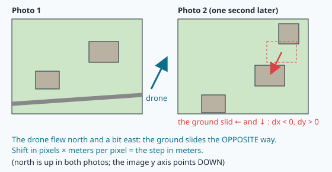
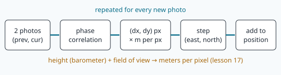
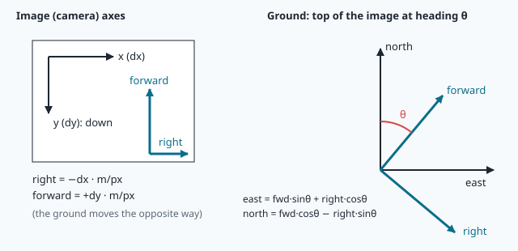
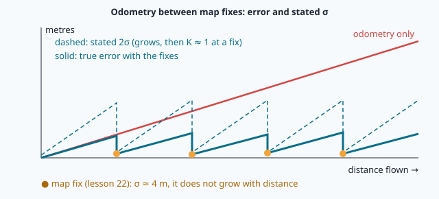

# Visual odometry: phase correlation, drift and fusion

> [!NOTE] In short
> - When no map match is accepted for some time, NAVERA can still follow the drone's motion with
>   **visual odometry**.
> - **Phase correlation** (with the FFT) measures how far the ground moved between two frames, in
>   pixels.
> - The camera scale and the heading turn this pixel shift into metres east and north.
> - Visual odometry tells you how you moved, not where you are, and its error always grows (random
>   walk plus bias).
> - A simple **Kalman update** with map fixes keeps this drift bounded.
> - In the lab you follow a drone through 80 frames, measure the drift, and run NAVERA's
>   `FrameOdometry` and `VisionNavigator` on the same flight.

⏱ Core reading ~17 min · optional deep-dives marked *Going further*.

A survey drone flies along a city ring road at 120 m, 20 m/s. Its GPS is jammed. Until now
NAVERA's day vision found the drone on the satellite map every second or two (lesson 22). Then the
drone crosses a new housing area on the edge of the city: the map imagery is three years old, the ground has
changed, and **no map match is accepted for 30 s**. That is 600 m flown without an absolute position.
Where is the drone now?

The camera still sees the ground. Two frames taken one second apart show mostly the **same** ground,
slightly moved. If we measure that motion in pixels, convert it to metres and add the steps, we can
carry the position through the gap. This is **visual odometry** (VO): estimating the camera's own
motion from consecutive images. It tells you **how you moved**, never **where you are**, and its error
always grows. This lesson gives you the maths of all three parts:

1. **measure** the image shift with **phase correlation** (an FFT method you will write in numpy);
2. **convert** pixels to metres east/north (pinhole scale + heading rotation);
3. **model** the error growth (a **random walk** plus a **bias**) and **bound** it with map fixes
   (a scalar **Kalman update**).

> [!NOTE]
> The lab flight is synthetic: 80 frames cut from NAVERA's satellite map, with exact ground truth.
> NAVERA's test map covers **Sousse, Tunisia**, where NAVERA is developed, so the flight is over
> Sousse. The examples in this text use places from around the world; the method is the same everywhere.

## 1. Two frames, one step

A **nadir** camera (looking straight down) at height *h* above the ground, with horizontal field of
view HFOV and an image *W* pixels wide, sees a strip of ground (lesson 17)

```
footprint width  = 2 h tan(HFOV / 2)
m_per_px         = 2 h tan(HFOV / 2) / W
```

Worked example (the lab camera): h = 114.25 m, HFOV = 70°, W = 320 px →
2 × 114.25 × tan 35° / 320 = 2 × 114.25 × 0.7002 / 320 = **0.500 m per pixel**. A frame of
320 × 240 px covers 160 m × 120 m. At 20 m/s and one frame per second, consecutive frames move
20 m = 40 px: they **overlap** by more than 80 % in the direction of flight (1 − 40/240 ≈ 83 % if the
frame's short side points forward). The more overlap, the
easier the measurement; below about 50 % it becomes unreliable.



The key fact: **the ground slides in the image the opposite way to the camera.** If the camera flies
towards the top of the image, the ground slides down.

## 2. Measuring the slide: phase correlation

### 2.1 Brute force is too slow

<details class="further"><summary>Going further (optional) — How slow is brute force?</summary>

The direct method: for every candidate shift (dx, dy), overlay the two frames and compute a
similarity (for example the correlation). With N = 320 × 240 = 76 800 pixels and all N possible
shifts that is N² ≈ 5.9 × 10⁹ multiplications per frame pair — far too slow for a Jetson at 1 Hz.

</details>

### 2.2 The Fourier shift theorem

<details class="further"><summary>Going further (optional) — Primer: complex numbers, waves and phase</summary>

> [!NOTE]
> **Primer: complex numbers, waves and phase (read this first if the DFT is new to you).**
> - A complex number z = a + i b (with i² = −1) is a point (a, b) in the plane. Its **magnitude**
>   is |z| = √(a² + b²), its **phase** is the angle φ of that point. Euler's formula:
>   **exp(iφ) = cos φ + i sin φ** is the point at angle φ on the circle of radius 1.
> - Multiplying by exp(iφ) **turns** a complex number by the angle φ and does not change its length.
> - The **complex conjugate** z* = a − i b has the same magnitude and the opposite phase. So
>   z₁ · z₂* has the magnitude |z₁| |z₂| and the phase φ₁ − φ₂: it measures the **phase difference**.
> - The DFT measures, for each frequency u, "how much of a wave cos/sin with u periods across the
>   image" the image contains: the magnitude says *how strong*, the phase says *where the wave's peaks
>   are*. Slide the image to the right and every wave slides too: its strength stays the same, only
>   its phase changes — and a fast wave (large u) changes phase more than a slow one for the same
>   slide. That is the whole idea of phase correlation.
>
> Example: the wave cos(2π · 2x / 8) has its peaks at x = 0 and 4. Shifted right by 1 sample, its
> peaks are at x = 1 and 5: the same wave, phase changed by 2π · 2 · 1 / 8 = 90°.

</details>

The **discrete Fourier transform** (DFT) writes an image as a sum of 2-D waves. For an image a(x, y)
of size W × H:

```
A(u, v) = Σx Σy a(x, y) · exp(−i 2π (u x / W + v y / H))
```

If b is a shifted copy of a, b(x, y) = a(x − dx, y − dy), the **shift theorem** says that only the
**phase** of each wave changes, by an amount proportional to the frequency:

```
B(u, v) = A(u, v) · exp(−i 2π (u dx / W + v dy / H))
```

So the shift is hidden in the phase difference between B and A. Build the **normalised cross-power
spectrum**:

```
R(u, v) = B(u, v) · A*(u, v) / | B(u, v) · A*(u, v) |   =  exp(−i 2π (u dx / W + v dy / H))
```

(A* is the complex conjugate.) Dividing by the magnitude keeps only the phase: every frequency gets
the same weight (this is called **whitening**). The inverse DFT of a pure phase ramp is a single
spike:

```
r(x, y) = IDFT(R) = δ(x − dx, y − dy)
```

The position of the maximum of r **is** the shift. With the **Fast Fourier Transform** (FFT) each
transform costs about N log₂N ≈ 76 800 × 16.2 ≈ 1.2 × 10⁶ operations; three transforms are ≈ 3.7 × 10⁶,
about **1600 times** less than brute force. That is why phase correlation tests "all shifts at once".



### 2.3 A tiny worked example (1-D)

<details class="further"><summary>Going further (optional) — A tiny worked example in Python</summary>

Take a = [0, 0, 1, 3, 1, 0, 0, 0] (8 samples) and b = a shifted right by 2:
b = [0, 0, 0, 0, 1, 3, 1, 0]. Then R(u) = exp(−i 2π u · 2 / 8) = exp(−i u π/2), i.e. the phases
0°, −90°, −180°, −270°, … The inverse DFT of this ramp is [0, 0, **1**, 0, 0, 0, 0, 0]: a spike at
index 2. Try it in Python:

```python
import numpy as np
a = np.array([0, 0, 1, 3, 1, 0, 0, 0], float); b = np.roll(a, 2)
R = np.fft.fft(b) * np.conj(np.fft.fft(a)); R /= np.abs(R)
print(np.round(np.real(np.fft.ifft(R)), 3))      # [0. 0. 1. 0. 0. 0. 0. 0.]
```

</details>

### 2.4 Three practical details

1. **Circularity and negative shifts.** The DFT treats the image as if it repeated forever, so a
   shift of −3 px appears at index W − 3. Rule: an index above W/2 (or H/2) means `index − W`
   (or `index − H`).
2. **The window.** A real frame does not repeat: its left and right borders do not match, and the
   jump at the border is a strong false "edge". Multiply both images by a **Hanning window**
   w(x, y) = hann(x) · hann(y), with hann(k) = 0.5 − 0.5 cos(2πk / (n − 1)), which fades the image to
   zero at its borders. In numpy: `np.outer(np.hanning(H), np.hanning(W))`. In OpenCV:
   `cv2.createHanningWindow((W, H), cv2.CV_32F)` — note **(width, height)**, the opposite order of
   a numpy shape.
3. **Sub-pixel refinement.** The peak lies between pixels when the shift is not an integer. Fit a
   parabola through the peak value c₀ and its two neighbours c₋ and c₊ (separately in x and y):

   ```
   δ = (c₋ − c₊) / (2 (c₋ − 2 c₀ + c₊))        (−0.5 ≤ δ ≤ 0.5)
   ```

   Example: c₋ = 0.20, c₀ = 0.60, c₊ = 0.40 → δ = (0.20 − 0.40) / (2 × (0.20 − 1.20 + 0.40)) =
   −0.20 / −1.20 = **+0.167 px**: the true peak is a sixth of a pixel to the right. OpenCV uses a
   weighted centroid around the peak instead. Both are approximations of a sinc-shaped peak, so
   they agree only to about 0.1–0.3 px; you will measure this.

The **peak value** (the **response**, between 0 and 1) says how much of the image moved together.
Two frames of the same textured ground give a clear peak; two frames of open sea, of uniform sand or
of pure noise give a low, flat correlation. Typical values with the numpy method of the lab: about
**0.1–0.3** for consecutive real frames of the lab's flight, about **0.02** for unrelated noise
(OpenCV's `phaseCorrelate` reports a different, larger number: see the lab, Step 4).

> [!WARNING]
> Phase correlation measures **only a translation**. If the second frame is also rotated or scaled
> (the drone turned, or climbed), the peak becomes weak or wrong. NAVERA therefore first turns the
> previous frame by the heading change (from the IMU) and rescales it by the height change, so that
> only a translation remains. (Rotation and scale can also be measured with phase correlation in
> **log-polar** coordinates — the Fourier–Mellin method — but NAVERA does not need it.)

<details class="further"><summary>Going further (optional) — Why not keypoints for odometry?</summary>

> [!NOTE]
> The features of lessons 20–21 (keypoints + RANSAC + `cv2.estimateAffinePartial2D`) can also measure
> the motion between frames, including rotation and scale. They are slower. NAVERA uses phase
> correlation for odometry because it is fast (a few ms) and the IMU already gives the rotation.

</details>

## 3. From pixels to metres east and north

Phase correlation gives (dx, dy): dx > 0 means the content moved **right**, dy > 0 means it moved
**down** (the image y axis points down). The camera moved the other way. In the camera's own frame:

```
right   = −dx · m_per_px
forward = +dy · m_per_px          (forward = towards the top of the image)
```

The top of the image points to the azimuth θ (the **heading**, from the IMU; θ = 0 for a north-up
image). A rotation by θ gives the ground motion:

```
| east  |   |  cos θ   sin θ | | right   |        east  = forward·sin θ + right·cos θ
| north | = | −sin θ   cos θ | | forward |        north = forward·cos θ − right·sin θ
```



Check with θ = 90° (the top of the image points east): forward motion becomes pure east. ✔

**Worked example** (frames 10 → 11 of the lab flight, north-up, θ = 0): phase correlation gives
dx = +15.73 px, dy = +36.89 px. With the barometer height 110.8 m, m_per_px = 0.4849:
right = −7.63 m, forward = +17.89 m → east = −7.63 m, north = +17.89 m. The truth is −7.33 m,
+18.60 m: the step is 0.8 m off — mostly because the barometer is 3 % low (next section).

> [!TIP]
> Typical mistakes: `math.tan` takes **radians** (`math.radians(hfov / 2)`); swapping the frames in
> `phaseCorrelate(cur, prev)` flips every sign; `cv2.phaseCorrelate` needs `float32` or `float64`
> images — a `uint8` image raises an OpenCV assertion error.

## 4. Adding up the steps: drift

The **track** is the running sum of the steps: p₀ = start, pₙ = pₙ₋₁ + sₙ. Sailors called this
**dead reckoning**. Each measured step sᵢ has an error εᵢ, so the position error after n steps is

```
eₙ = ε₁ + ε₂ + … + εₙ
```

Model each step error as a constant part (a **bias** b, the same at every step) plus a random part
wᵢ (independent, zero mean, standard deviation σ per axis): εᵢ = b + wᵢ. Then

```
E[ |eₙ|² ] = n² |b|²  +  2 n σ²        (2-D: σ² per axis)
RMS(eₙ)    = √( n² b² + 2 n σ² )
```

- With random errors only, RMS(eₙ) = σ √(2n): the error grows like **√n**. This is a **random walk**.
- With a bias only, RMS(eₙ) = b·n: the error grows **linearly**.
- The bias dominates after n* = 2σ² / b² steps. Example: σ = 0.5 m, b = 0.1 m → n* = 50 steps.

On a log-log plot, error ∝ nᵖ is a straight line of slope p: p = 0.5 for a random walk, p = 1 for a
bias. In the lab you will simulate both and fit p.


### Where the bias comes from — an error budget

| Cause | Effect on each step | Error per 100 m flown |
|---|---|---|
| height (scale) error Δh/h | every step too short/long by Δh/h | 100 × Δh/h m (3 % → 3 m) |
| heading error δψ | every step turned by δψ | 100 × sin δψ m sideways (2° → 3.5 m) |
| pixel noise, blur, JPEG | ~0.1–0.3 px random per step | small: grows like √n |
| frames without texture | step missing or wrong | depends on the gap |

The lab flight has exactly the first two: a barometer 3 % low and a 2° heading bias. On a straight
line they combine to √(3² + 3.5²) ≈ 4.6 m per 100 m; on the lab's curved path they partly cancel and
you will measure about 3.4 m per 100 m. Because these errors are **systematic**, VO quality is quoted
in **metres of error per 100 m flown** (or % of distance). A few % is good — fine for 500 m, useless
for 50 km (a 3 % drift gives 1.5 km).

<details class="further"><summary>Going further (optional) — Terrain that makes visual odometry harder</summary>

Over mountains such as the Alps or the Andes there is one more problem: the ground is not flat. A ridge 300 m below the
drone and a valley 600 m below it have different m_per_px in the **same** frame, so one scale is wrong
for part of the image. Over the Sahara's sand seas the dunes repeat and look alike; over the open sea
the water moves. In all three cases the VO error grows faster, or the response drops.

</details>

## 5. Bounding the drift: fusion with map fixes

Map matching (lesson 22) gives an **absolute** position with an error that does **not** grow (a few
metres), but only sometimes. VO gives a **relative** motion at every frame, with an error that grows.
Combine them with the simplest Kalman filter: one position x and one scalar variance P = σ².

**Predict** (each VO step s):

```
x ← x + s
σ ← σ + k·|s| + c          (NAVERA's day node: k = 0.1, c = 1 m)
```

NAVERA grows σ **linearly** with distance — the bias model, the cautious choice: random errors alone
would grow only like √n.

**Update** (a map fix z with standard deviation R):

```
K = P / (P + R²)           (Kalman gain, 0 … 1)
x ← x + K (z − x)
P ← (1 − K) P
```

Worked example: after 10 steps of 20 m, σ = 10 × (0.1 × 20 + 1) = 30 m. A fix arrives with R = 4 m:
K = 900 / (900 + 16) = 0.983, so x moves 98 % of the way to the fix, and σ = √(0.0175 × 900) = 3.97 m.
When the odometry is much less certain than the fix, the update is almost a **reset**; when both are
similar (K ≈ 0.5) it is an average weighted by the variances.



The error becomes a **saw-tooth** (shaped like the teeth of a saw: a slow rise, then a sudden drop): it grows between fixes and falls back at each one. Its maximum
depends on the distance **between fixes**, not on the length of the flight. Design rule: to stay
within 30 m with a 3.5 m / 100 m drift, you need a fix at least every ~850 m. A stated σ is
**honest** when the true error stays inside ±2σ about 95 % of the time; you will measure that too.

## 🐦 How birds do it

Counting your own motion to know where you are is **path integration**. Animals do it, and it has
the same weakness as visual odometry: small errors add up.

How do they measure the motion? Partly with their eyes, exactly like VO. The world sliding past the
eye is called **optic flow**. Honeybees measure the distance to a food source by the amount of image
motion they experience on the way: in experiments by Mandyam Srinivasan's group, bees that flew
through a narrow tunnel lined with a dense pattern "reported" (in their waggle dance) a much longer
distance than they had really flown — their visual odometer was fooled by the close, textured walls.
Budgerigars flying through tunnels keep to the middle by balancing the optic flow on their left and
right. A bird over the open sea has the same problem as NAVERA: no fixed texture, no flow.

Then the map fix. In the classic experiment of **A. C. Perdeck** (published 1958), thousands of
starlings caught in the Netherlands on autumn migration were moved by plane to Switzerland and
released. The **young** birds kept flying in their usual direction (south-west) for their usual
distance and ended up in Spain and southern France: pure dead reckoning, uncorrected. The **adults**
corrected towards their normal wintering area: they had a learned **map**.

Barn swallows from Europe fly to Africa every autumn, some as far as South Africa, and back every spring. Navi,
a young swallow on her first migration, flies like Perdeck's young starlings; as an adult she will
correct her course with a map. NAVERA does both from the first flight.

## In NAVERA

### `day_pkg/day_pkg/frame_odometry.py` — the visual odometry

Open [frame_odometry.py](file:navera/day_pkg/day_pkg/frame_odometry.py) (71 lines). The heart of
`FrameOdometry.step()`:

```python
g = cv2.resize(g, None, fx=self.scale, fy=self.scale, interpolation=cv2.INTER_AREA).astype(np.float32)
g = g - cv2.GaussianBlur(g, (0, 0), 8)            # high-pass: brightness gradients do not lock
...
dturn = (hdg - phdg + 180.0) % 360.0 - 180.0
R = cv2.getRotationMatrix2D((w / 2.0, h / 2.0), dturn, pmpp / m_per_px)
...
pg = cv2.warpAffine(pg, R, (w, h), flags=cv2.INTER_LINEAR)
(dx, dy), resp = cv2.phaseCorrelate(a, b, self._win)
if resp < self.min_response or abs(dx) > w / 4 or abs(dy) > h / 4:
    return None
dx, dy = dx + px0, dy + py0
right, fwd = -dx * mpp, dy * mpp                  # the ground moved the other way
de = fwd * math.sin(th) + right * math.cos(th)
dn = fwd * math.cos(th) - right * math.sin(th)
```

You can now read every line: the frame is halved (`scale = 0.5`) for speed; a **high-pass** filter
(the image minus its blur) removes slow brightness changes that would otherwise pull the peak to a
shift of zero (the same light gradient in both frames "matches" without moving); the previous frame is turned by the heading change and scaled by the height change; the step is
refused when the response is below `min_response` (**0.15**) or the shift exceeds a quarter of the
image; and the last two lines are your rotation by θ. The optional `predicted_en` argument shifts the
previous frame by the expected motion first, so that things that do not move in the image (the
vehicle's own legs, lens dirt) end up far from zero and are rejected.

<details class="further"><summary>Going further (optional) — `day_subscriber.py` — carrying the anchor</summary>

When a frame gives no map match, `_dead_reckon()` moves the last position (the **anchor**) by the VO
step and grows the stated σ exactly like your `fuse_with_fixes()`:

```python
de, dn, dt, q = vo
lat, lon = _move((self._anchor_lat, self._anchor_lon), de, dn)
sigma = self._dr_sigma + 0.1 * math.hypot(de, dn) + 1.0
if sigma <= self.dr_max_sigma_m:
    ...
```

The positions are published as **PROPAGATED**, never as measured. Dead-reckoning stops after
`max_dead_reckon_s` (**120 s**) or when σ exceeds `dead_reckon_max_sigma_m` (**500 m**). After an
accepted map match `_dr_sigma` is reset to the match's own σ — the update with K ≈ 1.

</details>

### `day_pkg/day_pkg/vision_nav.py` — the odometry gate and the growing search

[vision_nav.py](file:navera/day_pkg/day_pkg/vision_nav.py) (`VisionNavigator`) uses VO differently:
as a **velocity** measurement, accepted only if it agrees with the velocity the map fixes measured:

```python
v = (de / dt, dn / dt)
if self.vel is not None:
    dv = math.hypot(v[0] - self.vel[0], v[1] - self.vel[1])
    if dv > max(3.0 * self.vel_sigma, 0.3 * math.hypot(*self.vel), 3.0):
        self.vo_rejected += 1
        return False
```

This **gate** exists because phase correlation can lock onto something that does not move in the
image and report zero motion. `predict()` carries the last fix along the velocity (turning it with
the heading in a turn) and grows σ with time:
`sig + vel_sigma·dt + radians(5°)·speed·dt + ½·accel·dt²` (velocity error, 5° heading error, unseen
accelerations). `search()` makes the next map search circle 3σ wide (80 m … 1500 m), and `output()`
says **"unavailable"** when the fix is older than `max_dr_s` (120 s) or σ exceeds `max_sigma_m`
(300 m): no position is better than a wrong one. In the lab you will drive this class with your own
VO and watch it give up.

<details class="further"><summary>Going further (optional) — What has been measured (simulator only)</summary>

From `docs/VALIDATION_STATUS.md`, dead-reckoning along the measured track when no frame matches
(**simulator only**, GPS jammed): land route, error **median 10 m, max 33 m**, no autopilot failsafe;
across the bay, carried **90 s over the sea stating ±300 m, true error at most 146 m**. Those figures
are for carrying the position along the measured velocity; the frame-to-frame odometry was added
after them and has no separate figure in the document yet. Nothing
here has been measured on a real flight — NAVERA is Release 0.x, field validation pending.

</details>

## Glossary

| Term | Meaning |
|---|---|
| **visual odometry (VO)** | estimating the camera's own motion from consecutive images |
| **nadir camera** | a camera looking straight down |
| **overlap** | the part of the ground two consecutive frames both show |
| **DFT / FFT** | discrete Fourier transform (an image as a sum of waves) / the fast algorithm for it, O(N log N) |
| **shift theorem** | a translation changes only the phases of the DFT, proportionally to the frequency |
| **cross-power spectrum** | B·A* / \|B·A*\|: the phase difference of two images, whose inverse FFT peaks at the shift |
| **Hanning window** | a weight that fades an image to zero at its borders before the FFT |
| **response** | the height of the correlation peak (0–1): how much of the image moved together |
| **sub-pixel refinement** | locating the peak between pixels, here with a parabola through 3 values |
| **dead reckoning** | carrying a position forward by adding measured motions |
| **drift** | the growing error of dead reckoning, usually quoted in m per 100 m flown |
| **random walk** | a sum of independent random steps; its spread grows like √n |
| **bias (systematic error)** | the same error at every step; its effect grows like n |
| **Kalman gain K** | the weight P/(P + R²) given to a new measurement against the prediction |
| **gate** | a test that refuses a measurement that disagrees too much with the prediction |
| **PROPAGATED** | NAVERA's label for a carried (not measured) position |

## Check what you learned

<details><summary>1. Phase correlation of two frames gives a peak at index (x = 310, y = 5) in a 320 × 240 array. What is the shift?</summary>
x = 310 is above W/2 = 160, so dx = 310 − 320 = −10 px; y = 5 is below H/2, so dy = +5 px. The content moved 10 px left and 5 px down.
</details>

<details><summary>2. Why do we divide the cross-power spectrum by its magnitude, and why do we multiply by a Hanning window first?</summary>
Dividing keeps only the phase, where the shift is encoded; every frequency gets the same weight, which makes the peak sharp
(a plain correlation would be dominated by the strong low frequencies and give a broad peak). The window removes the false
edges created by the FFT's assumption that the image repeats: without it the borders correlate with themselves at zero shift.
</details>

<details><summary>3. The camera's heading is θ = 90° and the ground slid dy = +20 px, dx = 0, at 0.5 m/px. Where did the camera go?</summary>
forward = +10 m, right = 0. With θ = 90°: east = 10 · sin 90° = 10 m, north = 10 · cos 90° = 0. The camera moved 10 m east.
</details>

<details><summary>4. Per-step random error 0.4 m per axis, no bias. What is the RMS error after 100 steps? After 400 steps?</summary>
σ√(2n): 0.4 × √200 ≈ 5.7 m after 100 steps, 0.4 × √800 ≈ 11.3 m after 400 steps — four times more steps, only twice the error.
With a bias the error would be four times larger instead.
</details>

<details><summary>5. The barometer reads 5 % too low. What happens to the track, and can more careful phase correlation fix it?</summary>
m_per_px is 5 % too small, so every step is 5 % short: the track has the right shape but is 5 % too small, about 5 m of
error per 100 m. No: the pixels are measured correctly; the error is in the scale, a bias. Only a better height (or a map fix,
which also measures the scale) can remove it.
</details>

<details><summary>6. Odometry σ = 12 m when a map fix with R = 12 m arrives. What are K, the new position and the new σ?</summary>
K = 144 / (144 + 144) = 0.5: the new position is half-way between the prediction and the fix, and σ = √(0.5 × 144) ≈ 8.5 m —
smaller than both. With σ = 30 m and R = 4 m instead, K ≈ 0.98: almost a reset.
</details>

Now open the **🛠️ Lab** tab.
