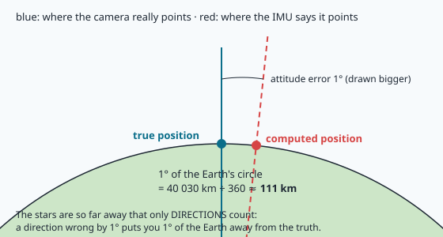

# Navigating at night and by the stars

It is 23:00. A drone is flying over the olive groves south of Sousse. GPS has been jammed for
ten minutes. In lessons 20–23 you taught it to find itself by matching its camera picture with
the satellite map. But now it is **dark**. The day camera sees nothing. What can it still use?

Two things that have guided travellers for thousands of years:

1. **Heat.** Roads, roofs, fields and water stay warmer or colder than their neighbours long after
   sunset. A **thermal camera** sees that heat, so the shapes of the town are still there.
2. **The stars.** Sailors crossed oceans with a star, a clock and a table of numbers. A camera
   pointed at the sky can do the same.

NAVERA has a source for each: **night vision** (`night_pkg`) and **celestial** navigation
(`cn_pkg`). In this lesson you will see how they work, why one gives meters and the other gives
tens of kilometers, and you will compute with NAVERA's own celestial code where the stars are
above Sousse tonight.

## Part 1 — Seeing heat

### What a thermal camera measures

Everything warm gives off light that our eyes cannot see: **infrared** light. The warmer the
object, the more infrared it sends. A **thermal camera** (or *infrared camera*) is a camera whose
sensor sees that light. Each pixel says "how warm is this spot?" instead of "what colour is it?".
The picture is usually shown in grey: **white = warm, black = cold**.

That is why it works in total darkness: it does not need sunlight bouncing off things, the
things themselves glow.


### Why it is hard to compare with the map

NAVERA's map is a **satellite photo**: colours, taken by day, in sunlight, months or years ago.
The thermal camera sees **temperatures**, now. The two pictures show the same streets, but:

| | Satellite photo | Thermal image |
|---|---|---|
| What a pixel means | colour of the reflected sunlight | temperature of the surface |
| Shadows | dark shadows next to every building | no sun shadows (but "heat shadows" can stay after sunset) |
| A road | grey | white at noon (hot asphalt), grey at night |
| Water, a pool | blue or dark | cold at noon, **warmer** than the ground at night |
| Trees | dark green | cooler by day, often warmer than bare soil at night |

Look at the last two lines: the brightness can **reverse** between noon and midnight. A dark
thing in the map can be bright in the thermal picture. The features of lesson 20 (SIFT, ORB)
describe the pattern of bright and dark around a point, so when the brightness flips, the
"fingerprints" do not match any more. Matching thermal to satellite with SIFT mostly fails.

### NAVERA's answer: a learned model, STHN

Instead of hand-made fingerprints, NAVERA uses a **neural network**: a program that learned from
many pairs of thermal images and satellite photos of the same places. It is called **STHN** (a deep
*homography* network made by researchers for thermal geo-localisation with satellite images). You give it the thermal frame and a square of satellite map around the
prior position; it answers with the **homography** (lesson 21) that lays the thermal frame onto
the map — so, where the frame's centre is on the map. Nobody wrote rules like "water flips at
night": the network learned what stays the same between the two kinds of picture.

The network is picky about its input, exactly like a human comparing two pictures would be: they
must be at the same scale and turned the same way. So before calling it, NAVERA's night localizer
(`night_pkg/night_pkg/nodes/night_localizer.py`, function `normalize_query`) prepares every frame:

```python
footprint_w = 2.0 * altitude_m * math.tan(math.radians(hfov_deg) / 2.0)
gsd_cam = footprint_w / w           # meters per pixel of the thermal frame
gsd_map = ground_resolution_m(lat, zoom)   # meters per pixel of the z17 map
scale = gsd_cam / gsd_map           # resize the frame by this
```

You know these lines: it is the **footprint** and **meters per pixel** of lesson 17! Then the frame
is turned **north-up** with the heading from the IMU (lesson 16) and cut to a 512-pixel square at
map resolution (`STHN_QUERY_PX = 512`), searched inside a 1536-pixel square of the z17 map
(`STHN_DATABASE_SIZE`). Two safety rules follow:

- **Minimum coverage.** If the turned frame covers less than 85 % of the square STHN expects
  (`MIN_QUERY_COVERAGE = 0.85`), the frame is refused — "fly higher". In tests, a frame covering
  only 77 % made the tracking run away by 2.4 km while the network still looked confident.
- **Motion gate.** A new position farther from the last one than the vehicle could fly
  (`max_speed_mps` × time + a margin, in `night_subscriber.py`) is rejected. The network's own
  "consistency" score does **not** detect wrong matches; the motion gate does.

> [!NOTE]
> You do not need to understand how a neural network works to use one well. What matters is what
> you just saw: **feed it what it was trained on** (scale, orientation, coverage) and **check its
> answers with physics** (the vehicle cannot jump 2 km in a second).

## Part 2 — The stars: a clock and a compass

### Where is a star in *your* sky?

Seen from the Earth, the stars seem stuck on a huge sphere turning around us once a day. Astronomers
give each star a fixed "address" on that sphere, like a latitude and longitude for the sky:
**declination** (how far north or south of the sky's equator, in degrees) and **right ascension**
(how far around, also in degrees here). These addresses are in star catalogues — NAVERA uses the
**Yale Bright Star Catalogue** (`/data/bsc5.dat`), 9 110 stars.

But when you look up, you describe a star with two other angles:

- **altitude**: how high above the horizon (0° on the horizon, 90° straight up — the **zenith**);
- **azimuth**: the compass direction, measured clockwise from north (90° = east, 180° = south).


The address of a star never changes (almost — see "precession" below). Its altitude and azimuth
change all the time: **with where you are** (from Tunis or from Paris, the same star is not at the
same height) and **with the time** (the sky turns 15° per hour). That is the whole trick of
celestial navigation:

> If I know the **time** and I measure **where the stars are in my sky**, there is only one place on
> Earth where they can look like that.

### The sky's clock: sidereal time

To go from the address (right ascension, declination) to your sky (altitude, azimuth), you need
to know how far the sky has turned. That is the **sidereal time** ("star time"): an angle that
grows by 360° every 23 h 56 min. NAVERA computes it at Greenwich with the `gast_deg` function
(*Greenwich Apparent Sidereal Time*), from the exact UTC time given by the box's clock (the RTC).
Then, for a place at longitude `lon` and a star at right ascension `ra`:

```
local sidereal time   LST = GAST + lon
hour angle            H   = LST − ra        (how far the star has turned past your south)
sin(altitude) = sin(dec)·sin(lat) + cos(dec)·cos(lat)·cos(H)
```

You will program this (and the azimuth) in the lab, and check it against NAVERA's own inverse
function. Don't worry about where the formula comes from: it is the "distance on a sphere" formula,
a cousin of the haversine of lesson 6.

> [!TIP]
> The time matters a lot: the sky turns 360° in a day, so **4 seconds of clock error = 1 minute of
> arc ≈ 1.85 km** of longitude at the equator. That is why NAVERA reads a precise clock (DS3231 RTC)
> and why sailors needed precise chronometers.

**Precession.** The Earth's axis wobbles slowly like a spinning top (one turn in 26 000 years). The
catalogue gives addresses for the year 2000; in 2026 they have moved by about 0.36° in right
ascension — tens of kilometers if ignored. NAVERA corrects them with `apparent_radec` (it uses the
astronomy library *astropy*). The lab does the same.

### The easiest star fix: your latitude from Polaris

One star is special: **Polaris**, the North Star. It sits about 0.6° from the point the whole sky
turns around (the **celestial north pole**). So it barely moves all night, and its altitude is
your **latitude**:


At the North Pole, Polaris is straight above your head (90°). At the equator, it is on the horizon
(0°). In Sousse (35.8° N), it is about 35.8° above the northern horizon. Sailors measured it with a
**sextant** to know how far north they were. You will do it in the lab — and see that the ~0.6°
between Polaris and the true pole costs up to ~70 km.

### How NAVERA does it: plate solving

NAVERA's star camera looks up and takes a photo with a few hundred stars. Which ones? It does not
know. A program called **astrometry.net** finds out: it looks at the shapes made by groups of four
stars (like a constellation, but tiny), compares them with an index built from star catalogues, and
answers "the centre of your photo points at right ascension 106.11°, declination 37.62°". That is
called **plate solving** (`cn_pkg/cn_pkg/nodes/solver.py` runs `solve-field`). It is the same idea
as lesson 21's matching, with stars instead of corners.

Now NAVERA knows **where the camera points in the sky** (from the photo). If it also knows **where
the camera points in its own surroundings** — altitude and azimuth, from the IMU — then the
formulas above, read backwards, give the position. That is `observer_candidates` in
[celestial_math.py](file:navera/cn_pkg/cn_pkg/nodes/celestial_math.py). And the IMU part is
`boresight_altaz`, which turns the IMU's orientation (a quaternion, lesson 16) into the
camera's altitude and azimuth:

```python
def boresight_altaz(q_xyzw, mount_elevation_deg=90.0, mount_azimuth_deg=0.0,
                    declination_deg=0.0):
    """Camera boresight (altitude above horizon, azimuth from true north) from the IMU."""
```

### Two answers, one prior

There is a catch. The equation for the latitude has **two** solutions in general: one camera
direction can be explained by two different places on Earth. Both are mathematically right.
`observer_candidates` returns both, and `choose_candidate` keeps the one within 5° of a **prior**
position (the operating area, the last GPS fix). If the prior cannot tell them apart, NAVERA
publishes **no position** rather than guess. (Before this was fixed, a camera facing the southern
half of the sky gave positions hundreds to thousands of km off.)

### Why one degree costs 111 km

Here is the big weakness. The stars are so far away that only **directions** matter. If the IMU
says the camera points straight up but it really leans 1° to the east, NAVERA computes the place
where the sky looks *straight up* like that — the place 1° of the Earth's circle further east.



The Earth's circumference is about 40 030 km, so 1° of it is 40 030 / 360 ≈ **111 km**. A small
drone IMU is good to a few tenths of a degree in tilt and one or two degrees in heading. That gives
tens of kilometers. The celestial node states its accuracy exactly like that:
`attitude_sigma_deg × 111 195 m` (`_sigma_m` in `cn_subscriber.py`).

## What NAVERA measured

All from `docs/VALIDATION_STATUS.md` — none of these comes from a real flight.

| Source | Test | Result |
|---|---|---|
| Night (STHN) | synthetic frames (grey renders of the map), 250–600 m, frames scaled and turned north-up | 8–13 m median |
| Night (STHN) | mission simulator, drone at 400 m, GPS jammed | 290 matches, median 6 m, max 37 m |
| Night (STHN) | real thermal images | **not validated yet** |
| Celestial | simulated star fields, **perfect attitude** | 5.5–6.5 km |
| Celestial | tilt error 0.5° | 53 km |
| Celestial | simulated BNO085-class IMU, drone in flight | 24–119 km, ~50 km typical |

The night results are **optimistic**: the "thermal" images were grey renders of the same map.
Real thermal imagery differs much more. The celestial results come from star fields drawn from the
catalogue for a known place, time and attitude (astrometry.net solved them for real).

So celestial is a **coarse fix**: good to know which region you are in, or to tell that a GPS
claiming you are in another country is lying — never a position to fly a mission on. NAVERA's output
does not even forward positions coarser than 1 km (`max_forward_sigma_m`) to the autopilot: in a QA
test, a celestial fix (±55 km) once moved the autopilot's position by 125 km. A levelled (gimballed)
star camera and a better attitude source are what would improve it.

> [!WARNING]
> The night frames in `/data/navera_data/camera_pkg/camera_pkg/data/thermal/` are a **replay set**.
> NAVERA's validation document says this set cannot be used for night vision, and you will see in
> the lab that the positions in their file names do not match the map. Use them as pictures only.

## Glossary

| Word | Meaning |
|---|---|
| **infrared** | light we cannot see, sent by every warm object |
| **thermal camera** | a camera that sees infrared: each pixel is a temperature |
| **STHN** | the neural network NAVERA uses to lay a thermal frame onto the satellite map |
| **declination / right ascension** | a star's fixed "latitude / longitude" on the sky |
| **altitude / azimuth** | where a star is in *your* sky: height above the horizon / compass direction |
| **zenith** | the point straight above your head (altitude 90°) |
| **sidereal time** | how far the sky has turned: 360° in 23 h 56 min |
| **precession** | the slow wobble of the Earth's axis that moves star addresses over the years |
| **Polaris** | the North Star, < 1° from the celestial north pole: its altitude ≈ your latitude |
| **plate solving** | finding which stars are in a photo, so where the camera points in the sky |
| **attitude** | the orientation of the camera / vehicle (tilt and heading), from the IMU |

## Check what you learned

<details><summary>1. Why does a thermal camera still see the town at midnight?</summary>
It measures the infrared light that warm things give off themselves. Roads, roofs and water keep
different temperatures after sunset, so their shapes stay visible without any sunlight.
</details>

<details><summary>2. Why does NAVERA resize the thermal frame before giving it to STHN?</summary>
The network was trained with frames at the satellite map's resolution (a 512 px square at ~1 m per
pixel). A frame at another scale gives wrong answers with a high confidence score. The scale comes
from the altitude and the camera's field of view, like the footprint of lesson 17.
</details>

<details><summary>3. You measure Polaris 33.9° above the horizon. Roughly where are you in Tunisia?</summary>
At about 33.9° N — the latitude of Gabès (give or take ~0.7°, Polaris is not exactly at the pole).
</details>

<details><summary>4. The IMU's tilt is wrong by 0.3°. How far off can a celestial fix be?</summary>
About 0.3 × 111 ≈ 33 km. That is why celestial is a coarse fix.
</details>

<details><summary>5. Why does NAVERA need a prior position to give a celestial fix?</summary>
One camera direction matches two possible places on Earth. The prior tells which one is right;
if it cannot, NAVERA reports no position instead of guessing.
</details>

Now open the **🛠️ Lab** tab.
