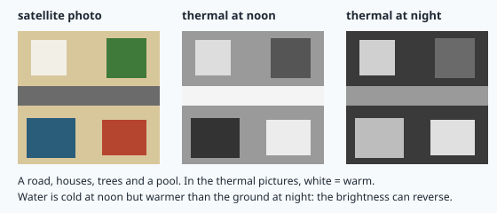
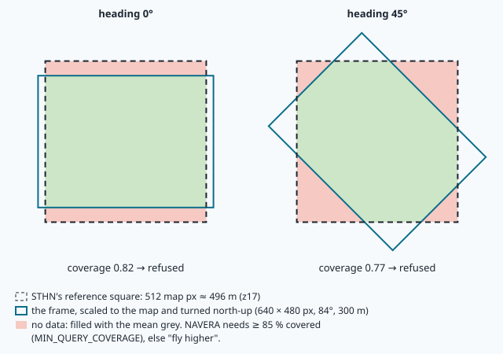
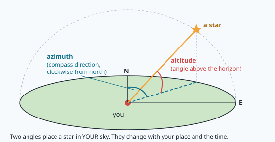
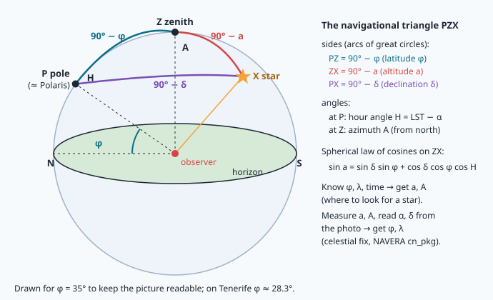
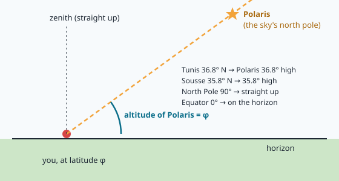

# Navigating at night: heat and stars

> [!NOTE] In short
> - At night the day camera sees nothing, but heat and the stars still give information about
>   position.
> - A thermal camera sees heat, and SIFT fails between thermal and day images, so NAVERA's night
>   vision uses a learned matcher (STHN).
> - Celestial navigation uses the exact time and a star camera: a **plate solver** finds where the
>   camera points.
> - Night vision gives metres, but celestial navigation gives tens of kilometres: one degree of
>   error costs 111 km.
> - In the lab you compute the sky (Julian date, sidereal time, altitude and azimuth) and
>   re-implement the geometry of NAVERA's night localizer.
> - NAVERA's night vision is **not yet validated** on real thermal images.

⏱ Core reading ~16 min · optional deep-dives marked *Going further*.

It is 21:00 in October. A survey drone flies over the foothills of a mountain range, far
from any city. GPS has been jammed for ten minutes. In lessons 20–23 the drone found
itself by matching its camera picture with the satellite map. Now it is **dark**: the day camera
sees nothing. Two things still carry information about position:

1. **Heat.** Roads, roofs, rock, sand and water keep different temperatures after sunset. A
   **thermal camera** sees them, so the shapes on the ground are still there — with different
   brightness.
2. **The stars.** For centuries, sailors crossed the Indian Ocean, the Atlantic and the Pacific by
   measuring the altitude of stars above the horizon. Much later, accurate clocks and printed star tables made this method
   precise. A camera pointed at the sky can do the same.

NAVERA has one source for each: **night vision** (`night_pkg`, a learned thermal-to-map matcher
called STHN) and **celestial navigation** (`cn_pkg`, a star camera with a plate solver). This
lesson gives the physics and the mathematics of both, and explains why the first gives metres
and the second gives tens of kilometres.

> [!NOTE]
> NAVERA's test map and recorded frames cover **Sousse, Tunisia**, where NAVERA is developed. The
> lab uses them as they are. The star computations use sites on several continents (Teide
> Observatory on Tenerife, New York, London, Paris), because the sky works the same everywhere.

> [!TIP]
> **How to study this lesson.** It has two independent parts: **Part 1, night vision** (about 1 h of
> reading) and **Part 2, celestial navigation** (about 1.5 h). The lab is split the same way
> (Part A = the sky, Part B = night vision). Plan **two sessions**, one per part; you can do them in
> either order. Sections marked **📖 Read, do not memorise** are background (folded into *Going further* blocks): understand the idea and
> the numbers; you do not need to reproduce their formulas. The lab only uses §2.1–2.3, §2.5, §2.7
> and the zenith case of §2.6.

## Part 1 — Night vision with a thermal camera

### 1.1 What a thermal camera measures

<details class="further"><summary>Going further (optional) — The physics: Stefan–Boltzmann, Wien and emissivity</summary>

Every surface emits electromagnetic radiation because of its temperature. For a perfect emitter
(a **black body**) the total power per square metre is the **Stefan–Boltzmann law**

```
M = ε · σ · T⁴          σ = 5.67e-8 W m⁻² K⁻⁴,  T in kelvin,  0 < ε ≤ 1 (emissivity)
```

and the wavelength of maximum emission follows **Wien's law**, `λ_max = 2898 µm·K / T`. For the
ground at night, T ≈ 290–300 K, so λ_max ≈ 10 µm: the **long-wave infrared** (LWIR, 8–14 µm).
A thermal camera is a camera whose sensor (usually a **microbolometer** array, 640 × 480 or
640 × 512 pixels) is sensitive to this band. Each pixel reports a **radiance**, which depends on
the temperature **and** on the **emissivity** ε of the surface: water (ε ≈ 0.98) looks like its
true temperature, a bare metal roof (low ε) reflects the cold sky and looks colder than it is.

Worked example: wet sand at 300 K and dry rock at 295 K, both ε ≈ 0.95. The ratio of their
emissions is (300/295)⁴ = 1.07: a 5 K difference gives 7 % more radiance, easily measured by a
sensor with 0.05 K sensitivity.

</details>

### 1.2 Why the night picture is not the day map

What makes thermal images hard to use is **thermal inertia**: how fast a material heats and cools.
Sand and dry soil cool fast after sunset; rock, concrete and buildings release stored heat for
hours; water barely changes. So the brightness of a place in a thermal image depends on the
material, the hour and the weather.



<details class="further"><summary>Going further (optional) — Satellite photo against thermal image, feature by feature</summary>

| | Satellite photo (the map) | Thermal image |
|---|---|---|
| What a pixel means | reflected sunlight (colour) | emitted radiance (temperature × emissivity) |
| Shadows | sharp sun shadows beside every building | none, but "heat shadows" can remain after sunset |
| A road | grey | bright at noon (hot asphalt), medium at night |
| Water, a canal or a pool | dark blue | cold at noon, **warmer** than the ground at night |
| Trees along a river | dark green | cooler than bare soil by day, often warmer at night |

</details>

Twice a day, near dawn and dusk, warm and cold materials pass through the **same** temperature:
the **thermal crossover**. The contrast then nearly disappears. In the sand seas of the Sahara the dunes are
almost uniform in temperature and texture: like the open sea, they give a thermal matcher very
little to hold on to.

### 1.3 Why SIFT fails across modalities

The features of lesson 20 describe the **gradients** around a point. If a road is darker than the
ground in the map but brighter in the thermal frame, every gradient across it turns by 180°. The
SIFT orientation histogram and the 128 descriptor values change completely, so the nearest
neighbour in the map is a wrong point and the ratio test (lesson 21) rejects most matches. This is
the general problem of **cross-modal matching**: the two images measure different physical
quantities, so their brightness is related by an unknown, non-monotonic, place-dependent function.

### 1.4 NAVERA's answer: a learned homography (STHN)

NAVERA uses **STHN**, a published deep network for **thermal-to-satellite homography** estimation.
The intuition, in four steps, is in the block below.

<details class="further"><summary>Going further (optional) — STHN's four steps</summary>

1. Two convolutional **encoders** turn the thermal frame and the satellite patch into feature
   maps. They are **trained** on many aligned thermal/satellite pairs, so they learn features that
   stay the same in both modalities (edges of roads and fields, block layouts), whatever the sign of
   the contrast.
2. A **correlation volume** compares every feature of the frame with every feature of the map
   around it.
3. An **iterative refinement** (a small recurrent network) moves the four corners of the frame on
   the map, step by step, to where the correlation is best.
4. The four corner displacements define a **homography** (8 degrees of freedom, lesson 21). The
   frame centre, carried through it, is the position.

</details>

A learned model does not tell you when it is wrong. In NAVERA's tests its **consistency score**
stayed near 0.9 on wrong matches. So NAVERA protects it in two ways: it gives the network exactly
the input it was trained on, and it checks the output with physics.

### 1.5 Preparing the frame: scale, north-up, coverage

STHN was trained on a **512 × 512 px** query at the map's resolution (zoom 17, ≈ 0.97 m/px at
Sousse), north-up, searched in a **1536 px** square of the map. A nadir camera at height h with a
horizontal field of view θ sees a strip of width

```
footprint_w = 2 · h · tan(θ / 2)        gsd_cam = footprint_w / width_px        scale = gsd_cam / gsd_map
```

(the footprint of lesson 17). The frame is resized by `scale`, turned by the heading so that north
is up, and cropped to 512 × 512. A turned rectangle does not fill a square: the corners stay
empty.



Worked example — a 640 × 480 thermal camera with θ = 84° at h = 300 m over Sousse:

```
footprint  = 2 · 300 · tan 42° = 540 m wide, 540 · 480/640 = 405 m high
in map px  = 540 / 0.968 = 558 px  ×  405 / 0.968 = 419 px
heading 0° : the 512 px square is covered on its full width, 419 of 512 rows → 0.82
heading 45°: the corners are empty                                        → 0.77
```

NAVERA refuses any frame covering less than 85 % of the square (`MIN_QUERY_COVERAGE = 0.85`):
"fly higher". This rule comes from a measurement: at 0.77 coverage (exactly this example), tracking
**ran away to 2.4 km** while the consistency stayed around 0.9. In the lab you will compute the
coverage for any height and heading, and find the minimum height by bisection.

### 1.6 Checking the answer: the motion gate

Between two accepted fixes, the vehicle cannot move faster than its maximum speed. NAVERA's night
node keeps the last accepted fix (the **anchor**) and rejects a new one when

```
jump = haversine(anchor, new fix)   >   reach = max_speed_mps · (t − t_anchor) + gate_margin_m
```

with `max_speed_mps = 30` and `gate_margin_m = 30` by default. A rejected frame does not move the
anchor: the next frame is tried again from the last good position.

### 1.7 What was measured (docs/VALIDATION_STATUS.md)

<details class="further"><summary>Going further (optional) — The measured numbers</summary>

| Test | Result |
|---|---|
| Synthetic frames (grey renders of the map), frames scaled and turned north-up, 250–600 m | 8–13 m median |
| One 320 m shift (synthetic) | failed: 238 m error, consistency 0.93 (not flagged) |
| Mission simulator, drone at 400 m, GPS jammed | 290 matches, median 6 m, p90 11 m, max 37 m |
| GPU time on the Jetson | ~225 ms per frame (fp32) |
| Real thermal imagery | **not validated** |

</details>

These numbers are **optimistic**: a grey render of the satellite map is much easier than a real
thermal image. The validation document also states that the replay set in
`camera_pkg/data/thermal/` cannot be used for night vision — in the lab you will find out why.

## Part 2 — Celestial navigation

### 2.1 Two coordinate systems on the sky

The stars are so far away that only **directions** matter. We place them on a unit sphere centred
on the observer, the **celestial sphere**.

- **Equatorial coordinates** are fixed to the stars: **declination** δ (angle north or south of the
  celestial equator) and **right ascension** α (angle along the equator, measured eastward from the
  **vernal equinox**). Catalogues give them; NAVERA uses the **Yale Bright Star Catalogue**
  (`/data/bsc5.dat`, 9 110 stars).
- **Horizontal coordinates** are fixed to the observer: **altitude** a (angle above the horizon,
  90° at the **zenith**) and **azimuth** A (clockwise from true north: 90° = east).



The link between them is the rotation of the Earth, measured by **sidereal time**.

### 2.2 Time: Julian date, GMST, GAST, hour angle

Astronomers count days continuously with the **Julian date** (JD): JD 2451545.0 is 2000-01-01
12:00 (the epoch J2000.0). Meeus' algorithm converts a calendar date (year Y, month M, day D,
with January and February counted as months 13 and 14 of the previous year):

```
A = floor(Y / 100)      B = 2 − A + floor(A / 4)
JD = floor(365.25 (Y + 4716)) + floor(30.6001 (M + 1)) + D + B − 1524.5  (+ hours / 24)
```

The **Greenwich Mean Sidereal Time** is the angle between the vernal equinox and the Greenwich
meridian (IAU 1982 formula, d = JD − 2451545.0, T = d / 36525):

```
GMST = 280.46061837° + 360.98564736629° · d + 0.000387933° · T² − T³ / 38 710 000     (mod 360°)
```

The sky turns 360.9856° per solar day: one turn in 23 h 56 min 4 s. The **apparent** sidereal time
adds the **equation of the equinoxes** (nutation, at most ≈ 1.2 s of time):
`GAST = GMST + Δψ cos ε`. Then for an observer at longitude λ (east positive) and a star at α:

```
LST = GAST + λ          (local sidereal time)
H   = LST − α           (hour angle: how far the star has turned west of your meridian)
```

<details class="further"><summary>Going further (optional) — UT1, UTC and the IERS</summary>

Strictly, the formula wants **UT1** (time by the Earth's rotation), not UTC (atomic time). The
difference UT1 − UTC is kept below 0.9 s by leap seconds and is published by the **IERS**.

</details>

### 2.3 From (α, δ) to (a, A): the navigational triangle

<details class="further"><summary>Going further (optional) — Primer: triangles on a sphere (London–Paris example)</summary>

> [!NOTE]
> **Primer: triangles on a sphere.** On a sphere of radius 1, the "straight lines" are **great
> circles** (circles whose centre is the centre of the sphere, like the equator or a meridian). A
> **spherical triangle** has three great-circle arcs as sides. Two facts are all you need:
> 1. **A side is an angle.** The length of an arc on a unit sphere equals the angle it makes at the
>    centre. So sides are written in degrees (on the Earth, 1° of arc = 111.2 km).
> 2. **The spherical law of cosines.** For sides a, b, c and the angle C between sides a and b
>    (C is the corner opposite side c):
>    **cos c = cos a · cos b + sin a · sin b · cos C**.
>    For a very small triangle, cos x ≈ 1 − x²/2 and sin x ≈ x, and this becomes the flat cosine
>    rule c² = a² + b² − 2ab cos C that you know from school.
>
> Example, London (51.51° N, 0.13° W) to Paris (48.86° N, 2.35° E): take the triangle North
> pole – London – Paris. Its sides from the pole are a = 90° − 51.51° = 38.49° and
> b = 90° − 48.86° = 41.14°, and the angle at the pole is the longitude difference
> C = 2.35° − (−0.13°) = 2.48°.
> cos c = 0.7827 · 0.7531 + 0.6224 · 0.6579 · 0.9991 = 0.99855, so c = 3.09° = **343 km** — the
> great-circle distance London–Paris. The navigational triangle below is the same idea with the
> pole, your zenith and a star.

</details>

Three points on the sphere — the celestial **pole** P, the **zenith** Z and the star X — form the
**navigational triangle**. Its sides are 90° − φ, 90° − a and 90° − δ; its angle at P is the
hour angle H, its angle at Z is the azimuth A.



The spherical law of cosines on the side ZX (with cos(90° − x) = sin x), and the sine/cosine rules
for the azimuth, give

```
sin a = sin δ · sin φ + cos δ · cos φ · cos H
A     = atan2( −cos δ · sin H ,  sin δ · cos φ − cos δ · sin φ · cos H )      (then mod 360°)
```

Equivalently, this is a rotation of the unit vector of the star by the matrix R_y(90° − φ) · R_z(H)
(lesson 16): the code with `atan2` keeps the right quadrant automatically.

**Worked example — Vega from Teide Observatory, Tenerife (φ = 28.30° N, λ = 16.51° W, so
λ = −16.51°), 2026-10-07 20:00 UTC (21:00 local time on Tenerife).**

```
JD   = 2461321.333333
GMST = 316.47786°     GAST (NAVERA gast_deg) = 316.48003°   (+0.52 s of time)
Vega, apparent of date: α = 279.45960°, δ = 38.81067°
LST  = 316.48003 + (−16.51) = 299.97003°      H = 299.97003 − 279.45960 = 20.5104°
sin a = 0.62675 · 0.47409 + 0.77922 · 0.88048 · 0.93661 = 0.29713 + 0.64259 = 0.93973
a = 70.01°
A = atan2(−0.77922 · 0.35038, 0.62675 · 0.88048 − 0.77922 · 0.47409 · 0.93661)
  = atan2(−0.27302, 0.20584) = −52.99°  →  307.01°   (north-west)
```

astropy gives 70.00612° and 307.01331°: the same to better than one arcsecond. Look up at
21:00 in October from Tenerife and Vega is there, high in the north-west. Note the sign: a
place **west** of Greenwich has a **negative** longitude, so its LST is smaller than GAST.

### 2.4 Catalogue positions, precession and the offline IERS problem — 📖 Read, do not memorise

<details class="further"><summary>Going further (optional) — Precession, nutation, aberration and the offline IERS tables</summary>

Catalogues give α, δ for the epoch J2000. The Earth's axis **precesses** (one turn in about
26 000 years) and also makes a small periodic "nodding" motion called **nutation** (at most about 17″, period 18.6 years), and the Earth's motion shifts apparent positions by up to
20″ (**aberration**). From 2000 to 2026 precession alone moves right ascensions by about 0.36° —
tens of kilometres if ignored. NAVERA converts with astropy (`apparent_radec`: ICRS → TETE, the
true equator and equinox of date) and pairs the result with GAST.

astropy wants the IERS tables (UT1 − UTC, polar motion) and normally **downloads** them. A drone in
flight, and your sandbox, have no internet. The lab uses the same workaround as NAVERA's offline
tests:

```python
from astropy.utils import iers
iers.conf.auto_download = False                 # never try the internet
iers.conf.iers_degraded_accuracy = "ignore"     # outside the bundled table: UT1 - UTC taken as 0
```

The cost is at most 0.9 s of UT1, i.e. 0.004° of sky rotation (0.9 × 0.464 km ≈ 0.42 km at most, on the equator): negligible next to the
attitude error below.

</details>

### 2.5 Latitude from Polaris

The celestial pole has altitude φ above the northern horizon (in the triangle, PZ = 90° − φ).
**Polaris** is close to the pole: in 2026 its declination is 89.374°, so its **polar distance**
is p = 90° − δ = 0.626°. As the sky turns it describes a small circle around the pole, and

```
φ ≈ a − p · cos H        (first order in p; H = Polaris' hour angle)
```

Without the correction, "latitude = altitude of Polaris" is wrong by up to p = 0.626° = 70 km. With
it, the remaining error is of order p² (you will measure about 0.3 km at most from New York).
In New York (40.7° N), Polaris is about 40.7° up, and a real measurement also needs the
**atmospheric refraction** correction (about 1′ · cot a ≈ 1.2′ ≈ 2 km at 41°; much more for a
low star, about 4 km at 23°) and, with a sextant,
the dip of the horizon.



### 2.6 Plate solving: where does the camera point?

NAVERA's star camera looks up and takes a photo with tens to hundreds of stars. **Plate solving**
finds which stars they are. astrometry.net (`solve-field`, called from `cn_pkg/.../solver.py`)
takes groups of four stars (**quads**), computes a code from their relative positions that does
not change with rotation, scale or translation (**geometric hashing**), and looks it up in an index
built from star catalogues. A match gives the **WCS** (World Coordinate System) of the image:
for every pixel, its (α, δ). NAVERA's settings expect a 50–70° wide field and skip two
astrometry.net steps that crash with NumPy ≥ 1.24.

The simplest fix: if the camera points **exactly** at the zenith, its centre has δ = φ and
α = LST. So

```
φ = δ_centre          λ = α_centre − GAST        (wrapped to −180°…180°)
```

<details class="further"><summary>Going further (optional) — The general case: a tilted camera and its two latitude solutions</summary>

📖 **Read, do not memorise (the rest of this section).** In general the camera is tilted. The IMU
gives the boresight's (a, A) (`boresight_altaz` turns the
IMU quaternion into them), the solver gives its (α, δ), and the triangle is solved for the observer
(`observer_candidates`):

```
sin δ        =  sin a · sin φ + cos a · cos φ · cos A      (1)  → two solutions for φ
cos δ · sin H = −cos a · sin A                              (2)
cos δ · cos H =  sin a · cos φ − cos a · sin φ · cos A      (3)  → H, then λ = α + H − GAST
```

Equation (1) has **two** latitude solutions in general, both geometrically valid. Why? With a and A
known, the right side of (1) is p · sin φ + q · cos φ (p = sin a, q = cos a · cos A), which can be
written R · sin(φ + ψ) with R = √(p² + q²) and ψ = atan2(q, p). And a sine takes the same value at
two angles: sin x = sin(180° − x). So φ + ψ has two possible values, hence two latitudes. (The
"Two answers" experiment at the end of the lab shows both solutions.)
`choose_candidate` keeps the one within 5° of a **prior** (the operating area, the last GPS fix);
if the prior cannot separate them, NAVERA publishes **no position**.

</details>

### 2.7 Error budget: why one degree costs 111 km

Only directions matter, so an error in the measured direction becomes the same angle on the
Earth's surface:

```
1°  of great circle = 2π · 6371 km / 360 = 111.2 km
1′  of great circle = 1.852 km = 1 nautical mile (this is how the nautical mile is defined)
```

| Error source | Size | Position error |
|---|---|---|
| tilt (pitch/roll) error of the IMU | 0.3° | 33 km |
| heading error, camera at altitude a | 1.5° | 1.5° · cos a · 111 km = 43 km at a = 75°, 0 at the zenith |
| clock error | 1 s | 15.04″ of longitude = 0.464 km · cos φ = 0.35 km at New York |
| UT1 ignored (offline IERS) | < 0.9 s | < 0.42 km |
| plate solution | ~3′ (measured, VALIDATION_STATUS) | ~5.5 km |

For a camera at 75° with a BNO085-class IMU (0.3° tilt, 1.5° heading, independent errors):
√(0.3² + (1.5 · cos 75°)²) = 0.49° → about 55 km RMS. NAVERA measured **24–119 km, ~50 km
typical** in simulation, and 5.5–6.5 km with a perfect attitude. The clock (a DS3231, ±2 ppm) is
far from being the limit; the **attitude** is.

So celestial is a **coarse fix**: it tells which region you are in and can expose a GPS that
claims you are in another country. It is never a position to fly a mission on. NAVERA states it
as `attitude_sigma_deg × 111 195 m` and does not forward positions coarser than 1 km
(`max_forward_sigma_m`) to the autopilot: in a QA test, a ±55 km celestial fix once moved the
autopilot's position by 125 km.

## 🐦 How birds do it

Many songbirds migrate **at night**. Each autumn, warblers, shrikes, flycatchers and wheatears
from Europe and Central Asia cross the Mediterranean and the Sahara towards Africa, and most of
them fly in the dark. How do they keep their direction?

In the 1960s and 1970s the biologist **Stephen Emlen** placed young **indigo buntings** (a North
American night migrant) under the artificial sky of a **planetarium**. The birds did not use one
star: they **learned** which part of the sky turns around a fixed point and took that point as
north. Birds raised under a sky that turned around Betelgeuse later treated Betelgeuse as north.
This is a learned, pattern-based solution — closer to plate solving and to STHN than to a single
sextant reading.

By day, pigeons and starlings use the **sun compass**, which needs an internal clock because the
sun's azimuth changes during the day. In **clock-shift** experiments, pigeons kept for days under
lights shifted by six hours flew off at a large angle from the correct direction — close to the
90° a six-hour error predicts. Navi, our swallow, flies mostly by day, but she follows the same
rule as NAVERA: a perfect sky is useless with a wrong clock or a wrong sense of "up".

## In NAVERA

**Night: preparing the frame** —
[night_localizer.py](file:navera/night_pkg/night_pkg/nodes/night_localizer.py), `normalize_query`:

```python
footprint_w = 2.0 * altitude_m * math.tan(math.radians(hfov_deg) / 2.0)
gsd_cam = footprint_w / w
gsd_map = ground_resolution_m(lat, zoom)
scale = gsd_cam / gsd_map
...
coverage = float(np.count_nonzero(out_mask)) / (q * q)
if coverage < MIN_QUERY_COVERAGE:
    info["reason"] = (f"camera footprint too small for night matching ... — fly higher")
    return None, info
```

**Night: the motion gate** —
[night_subscriber.py](file:navera/night_pkg/night_pkg/nodes/night_subscriber.py):

```python
jump = haversine_m(self._anchor_lat, self._anchor_lon, float(result["lat"]), float(result["lon"]))
reach = self.max_speed_mps * max(0.0, t_now - self._anchor_time) + self.gate_margin_m
if jump > reach:
    gated = (f"implausible jump {jump:.0f} m in {t_now - self._anchor_time:.1f} s "
             f"(max {reach:.0f} m) — rejected, retrying from the last position")
```

**Celestial** — [celestial_math.py](file:navera/cn_pkg/cn_pkg/nodes/celestial_math.py):
`apparent_radec` (ICRS → TETE with astropy), `gast_deg`, `observer_candidates` (equations 1–3,
both roots), `choose_candidate` (the prior), `local_to_radec` (the inverse, for tests) and
`boresight_altaz` (IMU quaternion → camera alt/az). The stated accuracy is in
[cn_subscriber.py](file:navera/cn_pkg/cn_pkg/nodes/cn_subscriber.py):

```python
def _sigma_m(self):
    """Stated 1-sigma horizontal accuracy: attitude error x ~111 km/deg (NaN = unknown)."""
    s = self.attitude_sigma_deg
    return s * 111_195.0 if math.isfinite(s) and s > 0 else None
```

## Glossary

| Word | Meaning |
|---|---|
| **LWIR** | long-wave infrared, 8–14 µm: where objects at ~300 K emit most |
| **emissivity** ε | how well a surface emits compared with a black body (0 to 1) |
| **thermal inertia** | resistance of a material to temperature change; sets how fast it cools at night |
| **thermal crossover** | the time near dawn/dusk when different materials have the same temperature: low contrast |
| **cross-modal matching** | matching two images of different physical quantities (heat vs reflected light) |
| **STHN** | the deep network NAVERA uses to fit a homography from a thermal frame to the satellite map |
| **coverage** | share of STHN's 512 px reference square filled by the scaled, north-up frame |
| **motion gate** | rejection of a fix farther than the vehicle could have travelled |
| **great circle** | a circle on a sphere whose centre is the centre of the sphere (the equator, a meridian): the "straight line" of the sphere |
| **spherical triangle** | three great-circle arcs; its sides are angles; cos c = cos a cos b + sin a sin b cos C |
| **nutation** | a small periodic "nodding" of the Earth's axis (about 17″, period 18.6 years) on top of precession |
| **declination δ / right ascension α** | a star's coordinates on the celestial sphere, fixed to the stars |
| **altitude a / azimuth A** | a star's direction in the observer's sky |
| **Julian date (JD)** | a continuous day count; JD 2451545.0 = 2000-01-01 12:00 |
| **GMST / GAST** | Greenwich mean / apparent sidereal time: the Earth's rotation angle relative to the stars |
| **hour angle H** | LST − α: how far a star has turned west of the local meridian |
| **precession, nutation** | slow motions of the Earth's axis that change α, δ over years |
| **IERS, UT1** | the service publishing the Earth's rotation; UT1 is time by that rotation |
| **plate solving** | identifying the stars in a photo to get the sky coordinates of every pixel |
| **nautical mile** | 1.852 km = 1′ of great circle |

## Check what you learned

<details><summary>1. Why do SIFT descriptors fail between a satellite photo and a night thermal image?</summary>
The two images measure different quantities. Where the contrast reverses (water warmer than the
ground at night, for example), the gradients turn by 180°, so the orientation and the 128 values of
the descriptor change. Nearest neighbours become wrong points and the ratio test rejects them. A
learned network trained on paired images learns features that survive the change.
</details>

<details><summary>2. A 640 × 480 thermal camera (84°) flies at 300 m with heading 45°. Will NAVERA's night localizer use the frame? What should the pilot do?</summary>
No. The scaled frame (558 × 419 map px) turned by 45° covers only 77 % of the 512 px square, below
the 85 % limit, so the frame is refused ("fly higher"). At about 335 m the coverage passes 85 % at
every heading.
</details>

<details><summary>3. Compute the hour angle of a star with α = 100° seen from New York (λ = 74.01° W) when GAST = 200°.</summary>
West longitudes are negative: λ = −74.01°. LST = 200 − 74.01 = 125.99°, H = 125.99 − 100 = 25.99°:
the star is a little west of the meridian (it crossed it about 1 h 44 min ago), so it is probably
high in the sky.
</details>

<details><summary>4. Polaris is measured at 41.30° from New York while its hour angle is 0° (p = 0.626°). What latitude do you get with and without the correction?</summary>
Without: 41.30°. With: 41.30 − 0.626 · cos 0° = 40.67° (New York is at 40.71° N). The correction is largest when Polaris is
on the meridian (H = 0° or 180°) and zero when H = ±90°.
</details>

<details><summary>5. Why does the heading error of the IMU hardly matter for a camera pointing straight up, but a lot for a camera at 30° altitude?</summary>
A heading error rotates the boresight around the vertical. At the zenith that rotation leaves the
direction unchanged (it only turns the picture). At altitude a, the boresight moves by
(heading error) · cos a: 87 % of the heading error at a = 30°, 26 % at 75°, 0 at 90°.
</details>

<details><summary>6. Your clock is 10 s wrong. How large is the celestial error at New York, and is it the main problem?</summary>
10 s × 15.04″/s = 150″ = 2.5′ of longitude, i.e. 2.5 · 1.852 · cos 40.7° ≈ 3.5 km. It is much smaller
than the 30–50 km from a typical IMU attitude error: the attitude is the main problem.
</details>

Now open the **🛠️ Lab** tab.
