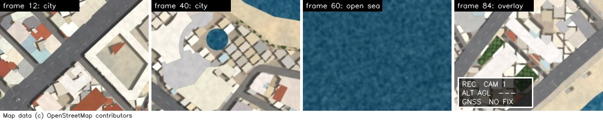
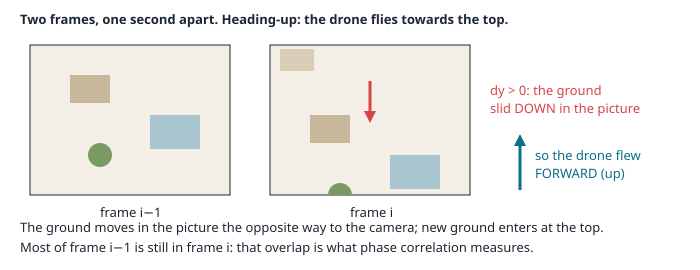
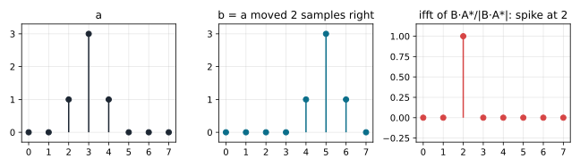
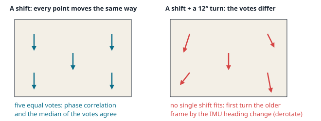
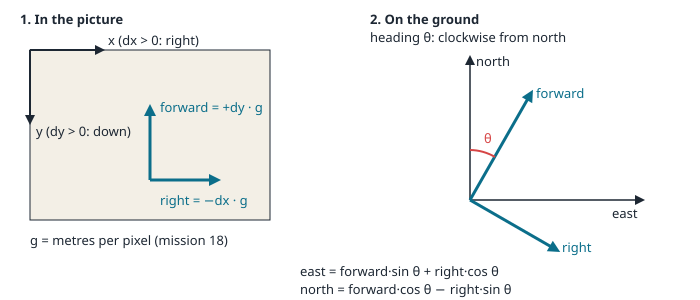
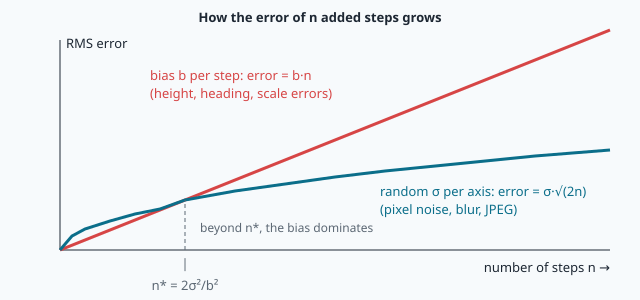
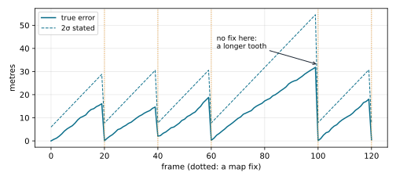
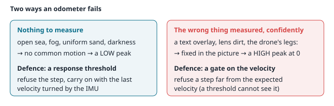

# Visual odometry: phase correlation, drift and fusion



> [!NOTE] Mission brief
> **22 May 2021, Jezero crater, Mars.** NASA's Ingenuity helicopter is on its sixth flight. It knows its motion by
> tracking ground features from one navigation-camera frame to the next, together with its IMU. About 54 seconds into the flight, one single
> frame is lost in the image pipeline. From then on every frame carries a wrong time stamp, the navigation compares
> pictures that do not belong together, and the helicopter starts to rock by more than 20° in roll and pitch. It
> lands safely, about 5 m from its target. (NASA, Mars Helicopter blog, Håvard Grip, 27 May 2021.)
>
> Measuring motion from consecutive frames is called **visual odometry**. NAVERA, IRIS's product, uses it to carry
> its position when no map match is accepted. Its validation report (3 October 2026, simulator only) says: carried
> **90 s over the sea, stating ±300 m, true error at most 146 m**. Today you build an odometer, find out why it
> drifts, and learn when to refuse what it says. **Session 1 — Odometer:** you write phase correlation with numpy's
> FFT, check it against OpenCV, turn pixels into metres east and north, and race it against keypoints and your own
> learned descriptor. **Session 2 — Navigator:** you model the drift, refuse the steps that lie, and bound the error
> with map fixes. Each session ends with a badge: **Odometer**, then **Navigator**.
>
> **Start now:** open the 🛠️ **Lab** tab, do **Step 0** (ten minutes, a calculation by hand), then come back to §1.

**Objectives.** After this mission you can:

1. **measure** the shift between two frames by **phase correlation** (the Fourier shift theorem) with numpy's FFT, and
   compare it, measured, with OpenCV's `phaseCorrelate`;
2. **convert** a pixel shift into metres east and north with the camera scale and the heading, and **integrate** the
   steps (dead reckoning);
3. **explain** why phase correlation needs the IMU's heading change, and **compare** it, measured, with keypoint
   odometry (ORB and your learned descriptor);
4. **model** drift as a random walk plus a bias, and **find** the biases of a flight from data;
5. **decide** when to refuse a step (threshold, gate) and **bound** the drift with map fixes by an inverse-variance
   blend, with a stated σ you can check.

**You need:** the ground size of a pixel (mission 18 §4), east/north (mission 06), mean and σ (mission 04 §5), ORB and
your PatchNet (mission 21). Complex numbers and "variances add" are refreshed in 🧰 boxes; the Fourier transform is taught
here. ⏱ Reading: about 100 minutes with the ✏️ checks (Part A, §1–§6, before session 1, about 60 minutes; Part B,
§7–§9, before session 2, about 40 minutes); up to 2 h 30 if the FFT and complex numbers are new to you — §2 is the
hardest part: read it with its 1-D example running. Lab: 4 h 30 to 6 h in two sessions.

**Before you start** — answer without looking (if you miss two, reread mission 18 §4 and mission 21 §5):

<details><summary>1. A camera looks straight down from 100 m, HFOV 90°, 960 px wide. How many metres of ground does one pixel cover?</summary>
2 · 100 · tan 45° / 960 = 0.208 m.
</details>

<details><summary>2. A drone heading 30° (clockwise from north) flies 10 m forward. How far east and how far north?</summary>
East 10 · sin 30° = 5.0 m, north 10 · cos 30° = 8.66 m.
</details>

<details><summary>3. Two ORB descriptors of 256 bits differ in 30 bits. The same ground point, probably?</summary>
Probably yes: unrelated descriptors differ in about 128 bits.
</details>

<details><summary>Workspace and words (open if you need them)</summary>

Your files are in `~/lessons/24-visual-odometry/`. The part of NAVERA Lite you write is
[navera_lite/vo.py](file:./navera_lite/vo.py), plus one function in [drift_sim.py](file:./drift_sim.py).

| Word | Meaning | Français |
|---|---|---|
| **visual odometry (VO)** | measuring your own motion from consecutive camera frames | odométrie visuelle |
| **dead reckoning** | carrying a position forward by adding measured steps | navigation à l'estime |
| **heading-up frame** | a picture whose top points to the drone's heading | image orientée cap |
| **Fourier transform (DFT, FFT)** | a picture written as a sum of waves; the FFT is the fast way to compute it | transformée de Fourier |
| **phase correlation** | finding a shift from the phase differences of two pictures' waves | corrélation de phase |
| **Hann window** | a weight that fades a picture to zero at its borders | fenêtre de Hann |
| **sub-pixel** | a position between two pixels | sous-pixel |
| **response** | the height of the correlation peak: how much of the picture moved together | réponse (pic) |
| **drift** | the growing error of dead reckoning, often in metres per 100 m flown | dérive |
| **bias** | an error that is the same at every step | biais |
| **random walk** | a sum of independent random steps | marche aléatoire |
| **gate** | a test that refuses a measurement too far from what was expected | porte (test de cohérence) |

</details>

# Part A — The odometer (read before session 1)

## 1. Two frames, one step

A camera under the drone looks straight down. It is fixed to the drone, so the **top of the picture points to the
drone's heading**: a **heading-up** frame. Between two frames the drone moves forward, and the ground slides in the
picture **the other way**: towards the bottom.



How far? Mission 18 gave the ground size of one pixel, the **ground sampling distance** g:

```
g = 2 h tan(HFOV / 2) / W          (h: height above the ground, W: picture width in pixels)
```

**Worked example.** h = 100 m, HFOV = 60°, W = 400 px: g = 2 · 100 · tan 30° / 400 = **0.289 m per pixel**. At
15 m/s and one frame per second the drone moves 15 m = 15 / 0.289 = **52 px** between frames. A frame 300 px tall
then shares 1 − 52 / 300 = 83 % of its ground with the next one: the **overlap**. The more overlap, the easier the
measurement; below about half it becomes unreliable.

Visual odometry (VO) measures that slide, turns it into metres, and adds the steps. It tells you **how you moved**,
never **where you are**.

> [!QUESTION] ✏️ Check
> The same drone flies twice as fast. What happens to the slide in pixels and to the overlap? What could you change
> to keep the overlap?
> <details><summary>Answer</summary>The slide doubles (104 px) and the overlap falls to 1 − 104/300 = 65 %. Take more
> frames per second, or fly higher (a larger g: fewer pixels per metre).</details>

## 2. The Fourier shift theorem

The obvious method is brute force: try every possible shift (dx, dy), overlay the two frames, and keep the shift where
they agree best. For a 320 × 240 frame (N = 76 800 pixels) and every shift, that is N² ≈ 5.9 × 10⁹ multiplications per
pair. Too slow at one frame per second on a small computer. The Fourier transform tests all the shifts at once.

> [!TIP] 🧰 Complex numbers in five lines
> - A complex number z = a + i b (i² = −1) is a point (a, b) of the plane. Its **magnitude** is |z| = √(a² + b²), its
>   **phase** φ is its angle.
> - Euler's formula: **e^{iφ} = cos φ + i sin φ** is the point at angle φ on the circle of radius 1.
> - Multiplying by e^{iφ} **turns** a number by φ and keeps its magnitude.
> - The **conjugate** z* = a − i b has the opposite phase. So z₁ · z₂* has the phase φ₁ − φ₂: a **phase difference**.
> - In numpy: `1j` is i, `np.exp(1j * phi)`, `np.conj(z)`, `np.abs(z)`, `np.angle(z)`, `np.real(z)`.

The **discrete Fourier transform** (DFT) writes a picture a(x, y) of W × H pixels as a sum of 2-D waves. The wave of
frequency (u, v) has u periods across the width and v down the height; its complex amplitude is

```
A(u, v) = Σx Σy a(x, y) · e^{−i 2π (u x / W + v y / H)}
```

The magnitude |A| says how strong that wave is; the phase says **where its crests are**. Now slide the picture: b is a
copied by dx to the right and dy down, b(x, y) = a(x − dx, y − dy). Every wave slides too: its strength stays the same,
only its phase changes, and a fast wave (large u) changes more than a slow one for the same slide. This is the **shift
theorem**:

```
B(u, v) = A(u, v) · e^{−i 2π (u dx / W + v dy / H)}
```

So the shift hides in the phase differences. Keep **only** the phase difference of every wave, the **normalised
cross-power spectrum**:

```
R(u, v) = B · A* / |B · A*|  =  e^{−i 2π (u dx / W + v dy / H)}
```

and transform it back. A pure "phase ramp" like this is the transform of a single spike: the inverse DFT of R is zero
everywhere except at (dx, dy). **The position of the peak is the shift.** Dividing by the magnitude gives every
frequency the same weight (**whitening**): fine details count as much as large shapes, so the peak is sharp.

**Worked example (1-D).** a = [0, 0, 1, 3, 1, 0, 0, 0], and b = a moved 2 samples right = [0, 0, 0, 0, 1, 3, 1, 0].
R(u) = e^{−i 2π u · 2/8}: phases 0°, −90°, −180°, −270°, … one quarter turn more for every frequency. Its inverse
transform is [0, 0, **1**, 0, 0, 0, 0, 0]: a spike at index 2.

```python
import numpy as np
a = np.array([0, 0, 1, 3, 1, 0, 0, 0], float); b = np.roll(a, 2)
R = np.fft.fft(b) * np.conj(np.fft.fft(a)); R /= np.abs(R)
print(np.round(np.real(np.fft.ifft(R)), 3))     # [ 0.  0.  1.  0.  0.  0.  0.  0.]
```



A shift of 2.5 samples gives a peak **split** between indices 2 and 3 (0.63 each, with ripples of −0.19 on either side): the shift lies
between two samples, and §3 shows how to find it.

**Why it is fast.** The **FFT** (fast Fourier transform) computes a DFT in about N log₂ N operations instead of N².
Phase correlation needs three transforms: 3 · 76 800 · 16.2 ≈ 3.7 × 10⁶ operations instead of 5.9 × 10⁹, about
**1 600 times** less.

> [!QUESTION] ✏️ Check
> 1-D, 8 samples: b is a moved 3 samples to the **left**. At which index is the spike?
> <details><summary>Answer</summary>At index 5. The transform repeats every 8 samples, so −3 and 8 − 3 = 5 are the same
> place (§3, detail 1).</details>

## 3. Phase correlation in practice

The recipe for two frames a and b (2-D numpy arrays of the same shape), the one you write in the lab:

1. remove each picture's mean and multiply it by a **Hann window** (below);
2. `np.fft.fft2` of both: A and B;
3. R = B · conj(A), divided by its magnitude (add a tiny number such as 1e-12, so that a zero cannot divide);
4. r = the real part of `np.fft.ifft2(R)`: the **correlation surface**, one value per possible shift;
5. the peak: `np.argmax` gives a flat index, `np.unravel_index` turns it into **(row, column) = (y, x)**;
6. refine x and y between pixels (detail 3);
7. turn indices past the middle into negative shifts (detail 1);
8. the **response** is the peak's value r(peak).

Three details make the difference between a toy and a working odometer.

**Detail 1 — negative shifts.** The DFT treats the picture as if it repeated forever, so a shift of −3 px appears at
index W − 3. Rule: an index above W/2 (or H/2) means `index − W` (or `index − H`).

**Detail 2 — the window.** A real frame does not repeat: its left border does not continue its right border, and the
FFT sees that jump as a strong edge that does not move (it belongs to the picture's frame, not to the ground). It pulls
the peak towards zero. The **Hann window** fades each picture to zero at its borders:
w(x, y) = hann(x) · hann(y), with hann(k) = 0.5 − 0.5 cos(2πk / (n − 1)). In numpy:
`np.outer(np.hanning(h), np.hanning(w))` — shape (h, w), like the picture. OpenCV's
`cv2.createHanningWindow((w, h), cv2.CV_32F)` (note **(width, height)**, the opposite order of a numpy shape) is **not**
the same: it is the square root of that product, a gentler fade. Use the numpy window in your `phase_shift`; the lab's
thresholds are measured with it.

**Detail 3 — sub-pixel.** The true shift is rarely a whole number. Fit a parabola through the peak value c₀ and its two
neighbours c₋ (left, or above) and c₊ (right, or below), separately in x and in y; its top is at

```
δ = (c₋ − c₊) / (2 (c₋ − 2 c₀ + c₊))          (between −0.5 and +0.5 pixel)
```

Example: c₋ = 0.20, c₀ = 0.60, c₊ = 0.40 → δ = (0.20 − 0.40) / (2 · (0.20 − 1.20 + 0.40)) = −0.20 / −1.20 = **+0.17 px**:
the true peak lies a sixth of a pixel right of the integer peak. At the picture's edge, the neighbour of index 0 is
index W − 1 (the picture repeats): use `% w`.

**The response.** The peak's height (0 to 1) says how much of the picture moved together. Two frames of the same
textured ground give a clear peak; two frames of open sea or of pure noise give a low, flat surface. What counts is the
peak **compared with noise**, and you will measure both on the lab's flight.

**OpenCV.** `cv2.phaseCorrelate(a, b, window)` does the same in one call (float32 or float64 pictures only: a uint8
picture raises an assertion error) and returns `((dx, dy), response)`. It refines the peak with a weighted
**centroid** of the 5 × 5 values around it, not a parabola, and its "response" is a sum around the peak, not the peak
value: on good frames it is near 1 where yours is near 0.2. Compare **shifts** with OpenCV, never responses. On
textured ground both methods find the same integer peak; their sub-pixel answers differ a little, and you will measure
by how much. (On ground with very little texture the gentler OpenCV window can keep edges that yours fades away, and
the two can disagree.) Careful: with a window, `phaseCorrelate` overwrites the two pictures you pass (OpenCV 4.11 here);
pass copies (`a.copy()`), as the given `opencv_shift` does.

> [!QUESTION] ✏️ Check
> A 320 × 240 frame pair gives its peak at index (row 5, column 310). What is the shift (dx, dy)? Which way did the
> ground slide?
> <details><summary>Answer</summary>Column 310 > 160: dx = 310 − 320 = −10 px; row 5 < 120: dy = +5 px. The ground slid
> 10 px left and 5 px down.</details>

> [!WARNING] Common mistakes (phase correlation)
> - **(row, column) read as (x, y).** `np.unravel_index` returns (row, column) = (y, x): the result looks transposed.
> - **A · conj(B) instead of B · conj(A).** Every sign is reversed: the drone flies backwards.
> - **No division by the magnitude.** The peak is no longer between 0 and 1, and blurry: large shapes dominate.
> - **Shifts of 310 px.** The negative-shift rule (detail 1) was forgotten.
> - **`np.hanning(w)` × `np.hanning(h)` in the wrong order.** "operands could not be broadcast": the window must have
>   the picture's shape (h, w).

## 4. Turns, and keypoints that vote

Phase correlation measures a **translation**, nothing else. If the drone turned between the two frames, the second
picture is not a shifted copy: a 4° turn moves the left and right edges of a 320 px frame by 160 · sin 4° ≈ 11 px, in
opposite directions, and the single peak breaks up. Two cures:

- **Derotate.** The IMU (mission 17) measures the heading change between the two frames very well. Turn the older
  frame by that change about its centre first; then only a translation is left. The lab's given `derotate(img,
  turn_deg)` does it (`cv2.getRotationMatrix2D` + `cv2.warpAffine`).
- **Keypoints.** Find keypoints in both frames and match them (mission 21). Each match (p₁ → p₂) **votes** for a
  shift p₂ − p₁. With a pure translation all the right votes agree; the wrong matches vote for nonsense.



How do you count the votes? Not with the **mean**: one wrong match can pull it anywhere. The **median** (the middle
value once sorted, in x and in y separately) ignores up to half of wrong votes.

**Worked example.** Votes in x: 3.0, 3.2, 2.9, 40.0, 3.1. Mean 10.44 px (wrong); median **3.1 px** (right). The number of
votes within 1 px of the median, here 4, tells how much the answer can be trusted.

After a turn the votes are not equal any more (the picture above), so a median of votes needs derotation too, or a fit
of a turn **and** a shift (mission 22 fits such models with RANSAC; OpenCV's `cv2.estimateAffinePartial2D` does it in
one call). Which descriptor should describe the keypoints: ORB's 256 bits, or the **PatchNet you trained** in
mission 21? And is any of them better than phase correlation for consecutive frames? That is a measurement, Step 5 of
the lab. Keep one question in mind: keypoints need corners. What happens over a beach?

> [!QUESTION] ✏️ Check
> Five matches vote for dx = 3.0, 3.2, 2.9, −31.0, 40.0 px. What do the mean and the median say, and how many votes
> are within 1 px of the median?
> <details><summary>Answer</summary>Mean 3.62 (close by luck: the two wrong votes cancel); median 3.0; three votes
> within 1 px. Two wrong votes of five are fine for the median, not for the mean in general.</details>

## 5. From pixels to metres east and north

Phase correlation gives (dx, dy): dx > 0 when the ground moved **right** in the picture, dy > 0 when it moved
**down**. The drone moved the other way. In the drone's own directions, with g metres per pixel:

```
right   = −dx · g
forward = +dy · g          (forward = towards the top of the picture; the picture's y axis points down)
```

The top of the picture points to the heading θ (clockwise from north). Turning (forward, right) by θ gives the motion
on the ground:

```
east  = forward · sin θ + right · cos θ
north = forward · cos θ − right · sin θ
```



Check with θ = 90° (the top of the picture points east): forward motion becomes pure east, right becomes south. ✔

**Worked example.** θ = 30°, dx = +4 px, dy = +50 px, g = 0.3 m/px: right = −1.2 m, forward = +15 m;
east = 15 · 0.5 + (−1.2) · 0.866 = **6.46 m**, north = 15 · 0.866 − (−1.2) · 0.5 = **13.59 m**.

> [!QUESTION] ✏️ Check
> θ = 180°, dx = 0, dy = +20 px, g = 0.5 m/px. Where did the drone go?
> <details><summary>Answer</summary>Forward 10 m, right 0; east = 10 · sin 180° = 0, north = 10 · cos 180° = −10 m:
> 10 m south, as a drone heading south should.</details>

> [!TIP] Python details that bite
> `math.sin` takes **radians**: `math.radians(heading_deg)`. A result like `3.06e-16` is a zero with rounding:
> cos 90° is not exactly 0 in floating point.

## 6. Dead reckoning, and why it drifts

The **track** is the running sum of the steps: p₀ = start, pₙ = pₙ₋₁ + sₙ. Sailors called it **dead reckoning**. Each
measured step has an error, and the errors **add up**: nothing in the odometer itself ever brings the track back. VO
quality is therefore quoted as **metres of error per 100 m flown**.

Where do step errors come from? The pixel shift is usually measured within a few tenths of a pixel. The larger errors
come from what turns pixels into metres:

| Cause | Effect on every step | Error per 100 m flown |
|---|---|---|
| height error Δh/h (barometer) | every step too short or too long by Δh/h (g ∝ h) | 100 · Δh/h m along the track |
| heading error δψ (IMU) | every step turned by δψ | 100 · sin δψ m sideways |
| pixel noise, blur, JPEG | a small random error per step | small, and grows more slowly (§7) |
| ground that is not flat | g differs inside the picture | depends on the terrain |

**Worked example.** A barometer 2.5 % low and a heading 1.5° off: 2.5 m along and 100 · sin 1.5° = 2.6 m sideways per
100 m, together √(2.5² + 2.6²) = **3.6 m per 100 m**. After 5 km that is 180 m.

These are **biases**: the same error at every step, so they never cancel. How do you find them? Compare your steps with
true steps (or, in flight, with map fixes): if one scale k and one rotation turn all your steps into the true ones, k
says the height is wrong by a factor k, and the rotation says the heading is off by that angle. The lab's runner fits
both for you.

> [!QUESTION] ✏️ Check
> Your steps are all 4 % too long. Is the barometer reading too high or too low? Can a better phase correlation fix
> it?
> <details><summary>Answer</summary>Too high: g ∝ h, so a height 4 % too large makes every step 4 % too long. No: the
> pixels are measured correctly, the error is in the scale. Only a better height, or a fix that measures the scale,
> removes it.</details>

> [!WARNING] Common wrong ideas (Part A)
> - "VO says where the drone is." It says how it moved. Without a start position, a track is a shape, not a place.
> - "A better peak finder removes the drift." The pixel shift is the smallest error; height and heading biases dominate.
> - "Phase correlation handles turns." It measures translations only: derotate with the IMU first.
> - "The mean of the keypoint votes is fine." One wrong match can move the mean anywhere: use the median.
> - "OpenCV's response and mine are the same number." They are different measures of the same peak.

# Part B — The navigator (read before session 2)

## 7. Drift: a random walk plus a bias

Model each step's error, in one axis, as a **bias** b (the same at every step) plus a random part wᵢ (independent, mean
0, standard deviation σ). After n steps the error is eₙ = n·b + (w₁ + … + wₙ).

> [!TIP] 🧰 Variances add
> For **independent** random errors, the **variances** (σ²) add, not the standard deviations. The sum of n errors of
> standard deviation σ has variance n·σ², so standard deviation σ·√n. Example: 100 steps of σ = 0.4 m → σ_sum =
> 0.4 · 10 = 4 m, not 40 m. The **RMS** (root mean square: square the errors, take their mean, take the root) of an
> error with mean m and standard deviation s is √(m² + s²).

So the RMS error after n steps, in one axis, is

```
RMS(n) = √( n² · b²  +  n · σ² )
```

- random errors only: RMS = σ·√n — a **random walk**: four times more steps, twice the error;
- a bias only: RMS = b·n — linear: four times more steps, four times the error;
- the two parts are equal when n²·b² = n·σ², at **n\* = σ² / b²** steps.

**Worked example.** σ = 0.4 m, b = 0.05 m: after 100 steps RMS = √(100² · 0.0025 + 100 · 0.16) = √(25 + 16) = **6.4 m**;
n\* = 0.16 / 0.0025 = 64 steps.

On log-log axes a power law error ∝ nᵖ is a straight line of slope p: p = ½ for a random walk, p = 1 for a bias.
In the lab you check the formula with a **Monte Carlo** simulation: simulate thousands of flights with random errors
(`np.random.default_rng(seed).normal(0, σ, size)`), add up the steps of each (`np.cumsum`), and take the RMS over the
flights.



**In 2-D.** With the same σ in east and north, the distance error has an RMS √2 times larger. And "within 2σ" does not
mean 95 % any more: for a round 2-D normal error, the distance stays below 2σ (σ per axis) with probability
1 − e⁻² = **86 %**. Keep that number: it is how you will judge whether a stated σ is honest. But one flight gives
correlated frames (an error that is too large now is still too large one second later), so a coverage measured on
90 frames is a hint, not a proof.

> [!QUESTION] ✏️ Check
> σ = 0.3 m per step and no bias. RMS after 25 steps? After 400 steps?
> <details><summary>Answer</summary>0.3 · 5 = 1.5 m; 0.3 · 20 = 6 m: sixteen times more steps, four times the
> error.</details>

## 8. Bounding the drift: blending in a map fix

Map matching (mission 23) gives an **absolute** position with an error that does not grow, but only sometimes: where
the ground looks like the map. VO gives a **relative** step at every frame, with an error that grows. Combine them.

Two independent estimates of the same quantity: x₁ with variance v₁, x₂ with variance v₂. The best combination weights
each one by the **other's** variance (the more certain one counts more):

```
x = (x₁ · v₂ + x₂ · v₁) / (v₁ + v₂)          v = v₁ · v₂ / (v₁ + v₂)
```

The blended variance is smaller than both. This **inverse-variance blend** is the update step of the Kalman filter in
one dimension (mission 28 builds the whole filter).

**Worked example.** VO says east = 412 m with σ = 12 m (v = 144 m²); a map fix says 400 m with σ = 4 m (v = 16 m²):
x = (412 · 16 + 400 · 144) / 160 = **401.2 m**, v = 144 · 16 / 160 = 14.4 m², σ = **3.8 m**. When the odometry is much
less sure than the fix, the blend is almost a reset to the fix; when both are equally sure, it is the average.

Between fixes the stated variance grows again: v(n) = v_after_fix + RMS(n)², with RMS(n) from §7 (the odometry's
error since the fix is independent of the fix's error, so the variances add). The true error and the stated σ make a
**saw-tooth**: a slow rise, a drop at each fix. The highest tooth depends on the longest stretch without a fix, not on
the length of the flight. Design rule: with a drift of 3.5 m per 100 m and a 30 m budget, a fix is needed at least
every 850 m.



> [!QUESTION] ✏️ Check
> A position with σ = 10 m is blended with a fix of σ = 10 m. The new σ? And the trap: someone puts σ (10) instead of
> σ² (100) into the formula. What σ do they state?
> <details><summary>Answer</summary>v = 100 · 100 / 200 = 50 m², σ = 7.1 m. With σ's: "v" = 10 · 10 / 20 = 5, taken as
> a σ of 5 m (or √5 = 2.2 m): too confident.</details>

## 9. When the odometer lies

An odometer fails in two very different ways.



**Nothing to measure.** Over open sea the waves move between frames: nothing fixed slides with the drone, and the
correlation surface is flat noise. The same happens over fog, uniform sand or in darkness. The peak is **low**, and its
position is random. Defence: a **response threshold** — refuse a step whose response is below it.

**The wrong thing measured, confidently.** A telemetry overlay burnt into the video, dirt on the lens, the drone's own
legs: they stay **fixed in the picture**. Phase correlation can lock onto them, even over textured ground: whitening
gives their sharp, high-contrast edges as much weight as the ground's details, and they match perfectly from frame to
frame. It then reports "no motion" with a **high** peak. A threshold cannot see it. Defence: a **gate** on the velocity. Compare the
odometry's velocity v_vo with the expected velocity v_ref, and accept it only if

```
| v_vo − v_ref |  ≤  k · σ          (the distance between the two VECTORS, east and north; k = 3)
```

Compare the vectors, not only the speeds: a drone does not reverse in one second at the same speed.

**Which v_ref?** The last accepted odometry velocity, **turned by the heading change the IMU measured since**: a drone
in a steady turn keeps its speed while its direction changes. Use it only while it is recent: after a long gap the
drone may have turned or slowed, and a stale reference would refuse every new step, for ever (a **lock-out**).

**What to do with a refused step?** Not a step of zero: the drone did not stop. Carry on with the reference velocity,
and say you are less sure (add variance for every carried step).

**Worked example.** v_ref = (20, 0) m/s, σ = 2 m/s, k = 3: the gate accepts any velocity within 6 m/s. (19, 1) is
1.4 m/s away: accepted. (0, 0), a lens-dirt step, is 20 m/s away: refused.

> [!QUESTION] ✏️ Check
> Same gate. Is (14, 3) accepted? And (−20, 0)?
> <details><summary>Answer</summary>(14, 3) is √(36 + 9) = 6.7 m/s away: refused (6 allowed). (−20, 0) is 40 m/s away:
> refused, although its speed is right.</details>

> [!WARNING] Common wrong ideas (Part B)
> - "Errors grow linearly, so σ = n · σ_step." Random errors add their variances: √n. Only a bias grows like n.
> - "Blend with σ's." The formula takes variances (σ²); with σ's the stated accuracy is far too optimistic.
> - "A high response means a right step." A static overlay gives a high response at zero shift.
> - "A refused step is a zero step." The drone kept flying: carry the last velocity, turned by the IMU.
> - "2σ covers 95 % of the errors." In 2-D, the distance is within 2σ only 86 % of the time.

## In NAVERA

NAVERA's day vision, IRIS's product, has a frame-to-frame odometer built on the same ideas (described in words). It
works on the straightened frames, turns the previous frame by the heading change the IMU measured and rescales it by
the change of height, so that only a translation is left, then runs OpenCV's phase correlation at half resolution on a
**high-passed** picture (the picture minus its own blur, so that slow brightness changes do not lock the peak at zero).
A step is refused when OpenCV's response is below **0.15** or when the shift is larger than a quarter of the frame. It
can also shift the previous frame by the motion it expects before correlating: then anything fixed in the picture ends
up far from zero and is refused, another defence against overlays than your gate. Its own description says it cannot
work over open water.

When a frame gives no map match (sea, uniform ground, a frame too tilted), NAVERA carries its last measured position
along the ground velocity fitted to the measured fixes of the last 20 s, **turned by the heading change the IMU
measures**, and publishes it as PROPAGATED (dead-reckoned), never as measured, with a stated accuracy that grows
(velocity error × time + 5° heading error × distance), for at most 120 s, or until its stated accuracy reaches 500 m. Measured in simulation (validation
report, 3 October 2026): over a land route, median error 10 m, maximum 33 m; across the bay, 90 s over the sea stating
±300 m with a true error of at most 146 m, and no autopilot failsafe. It has not been measured with a real camera or a
real IMU, the frame odometry has no separate published figure yet, and the dead-reckoned position is never used to check
the GPS. NAVERA is Release 0.2, field validation pending.

## In NAVERA Lite

| You write (navera_lite/vo.py, drift_sim.py) | It does | Lesson |
|---|---|---|
| `phase_shift` | phase correlation with numpy's FFT | §2–§3 |
| `median_shift` | the shift from keypoint votes | §4 |
| `px_to_en`, `integrate` | pixels → metres east/north; dead reckoning | §5–§6 |
| `drift_sigma`, `simulate_drift` | the drift model, and its Monte Carlo check | §7 |
| `blend` | a map fix blended in | §8 |
| `vo_gate` | refuse a step that disagrees with the expected velocity | §9 |

Given: `to_gray32`, `derotate`, `opencv_shift`, `keypoint_matches` (ORB, or your PatchNet from `my_desc.pt`), and the
finished `camera.py` (18) and `features.py`, `learned_desc.py` (21). The runner carries the position through refused
steps and blends the fixes with your functions. Mission 33's project menu has a drift alarm built on them.

## 🐦 How birds do it

Counting your own motion is **path integration**, and animals measure it partly with their eyes, like VO. Honeybees
judge the distance to food by the image motion they see on the way: bees trained to fly through a narrow tunnel lined
with a dense pattern "reported" a much longer flight in their waggle dance (Srinivasan and colleagues, *Science*, 2000).
Their odometer had been fooled by the close, textured walls — a 6 m tunnel "felt" like more than 150 m: a scale error,
like a wrong height. And the map fix: in A. C. Perdeck's experiment (1958), young starlings moved by plane from the
Netherlands to Switzerland kept flying in their inborn direction, as if nothing had happened — a compass-and-clock
programme with no position check — while the adults corrected towards their usual winter area. Navi the swallow, on her first migration, flies like the young starlings.

## Summary

1. Phase correlation finds a shift from phase differences: normalised cross-power spectrum, inverse FFT, one peak. A
   Hann window, negative shifts and a sub-pixel parabola make it work on real frames; OpenCV gives the same peak.
2. It measures translations only: derotate with the IMU's heading change, or fit a turn with keypoints. Keypoint votes
   are counted with the median.
3. Pixels → metres: right = −dx·g, forward = +dy·g, turned by the heading. Dead reckoning adds the steps, and their
   errors.
4. Drift = random walk (σ√n) + bias (b·n). Height and heading biases dominate; find them by fitting a scale and a
   rotation against true steps or fixes.
5. Refuse weak steps (threshold) and confidently wrong ones (gate on the velocity vector); blend fixes with
   inverse-variance weights; check that the true error stays within 2σ about 86 % of the time.

**Next mission:** night. A thermal camera, a map that shows no heat, and a small network that learns to match them.

## Check yourself

Answer without scrolling up.

<details><summary>1. Why do we divide the cross-power spectrum by its magnitude?</summary>
The shift lives in the phase only. Dividing keeps the phase and gives every frequency the same weight, so the inverse
transform is a sharp spike instead of a broad hill dominated by large shapes.
</details>

<details><summary>2. The heading is 90°, the ground slid dx = 0, dy = +30 px at 0.4 m/px. Where did the drone go?</summary>
Forward 12 m, right 0: east 12 · sin 90° = 12 m, north 0. 12 m east.
</details>

<details><summary>3. σ = 0.5 m per step, no bias: RMS after 100 steps? With a bias of 0.1 m and no noise?</summary>
0.5 · √100 = 5 m; 0.1 · 100 = 10 m. They are equal at n* = 0.25 / 0.01 = 25 steps.
</details>

<details><summary>4. VO: 250 m with v = 100 m²; fix: 240 m with v = 25 m². The blend?</summary>
x = (250 · 25 + 240 · 100) / 125 = 242 m, v = 20 m² (σ 4.5 m).
</details>

<details><summary>5. Why can a response threshold not catch a step locked on a text overlay?</summary>
The overlay is fixed in the picture and strongly textured: it gives a high peak, at zero shift, even when the ground
is textured too. Only a comparison with
the expected motion (a gate) shows that "no motion" is impossible.
</details>

<details><summary>6. (Mission 21) Your PatchNet was trained with heading errors of ±20°. Would you expect it to match keypoints after a 30° turn?</summary>
Not reliably: it learned what it saw. It was trained within ±20°; beyond that, derotate first (as the lab does) or measure.
</details>

<details><summary>7. (Mission 18) The barometer reads 3 % too high. What happens to the ground size of a pixel, and to every VO step?</summary>
g ∝ h, so g is 3 % too large and every step 3 % too long.
</details>

Now open the **🛠️ Lab** tab.
