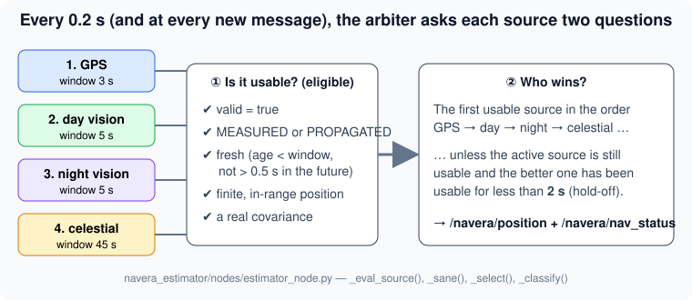
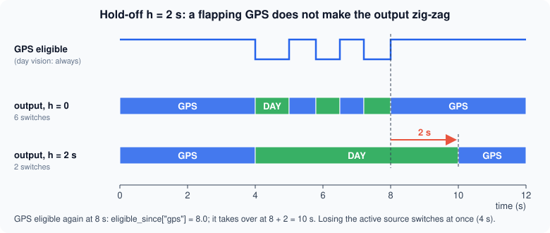
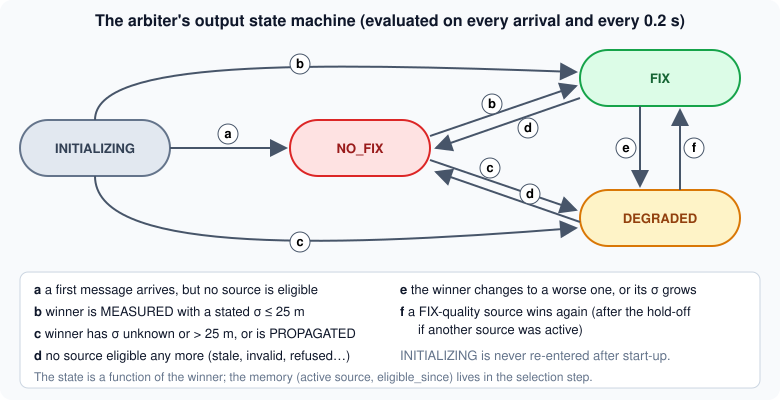

# Who to trust? The arbiter as a state machine

> [!NOTE] In short
> - The autopilot needs **one** position and an honest uncertainty every 0.2 s, but NAVERA's
>   sources disagree.
> - The **arbiter** is a state machine: it checks that each source is eligible (valid, fresh,
>   finite), then picks the first one in priority order.
> - **Hysteresis** (a 2 s hold-off) stops the output from switching back and forth when the GPS
>   flips between valid and invalid.
> - NAVERA **selects** one source instead of fusing them: the gain is small, errors can be
>   correlated, and a spoofed GPS would pull the fused position.
> - In the lab you build the arbiter as a `decide()` function, prove it matches the real
>   `estimator_node`, and measure its trade-offs.

A survey drone flies north along a coast towards a harbour at 40 m/s. Its GPS says
*"you are here, σ = 3 m"*. Its day camera, matching the ground against a satellite map, says
*"you are 40 m further inland, σ = 30 m"*. The star camera says *"you are somewhere in a circle
of tens of kilometres"*. Then the GPS starts to drop out: valid, invalid, valid, every second or two.

The autopilot cannot fly on four opinions. Every 0.2 s it needs **one** position and an honest
statement of how much to trust it. In NAVERA the component that decides is the **arbiter**
(ROS 2 package `navera_estimator`, node `estimator_node`). It measures nothing itself. It applies
a written **decision policy** to the messages of the sources, the same way every time.

In this lesson you treat the arbiter as an engineer would: as a **state machine** with inputs,
memory and outputs; with **eligibility predicates**, a **priority** rule, **hysteresis**, and
**freshness** windows chosen by measuring trade-offs. You will also see why NAVERA **selects** one
source instead of **fusing** them all.

> [!NOTE]
> NAVERA's recorded data and its simulator area cover **Sousse, Tunisia**, where NAVERA is
> developed. The examples in this lesson use generic places; the code does not care where it flies.

## 1. The problem, stated precisely

Four sources publish the same message type, `navera_msgs/PositionEstimate` (lesson 12), each on
its own topic:

| Source | Topic | Accuracy it states today |
|---|---|---|
| GPS (`gps_node`) | `/navera/estimate/gps` | from the HDOP: a few metres |
| Day vision | `/navera/estimate/day` | 30 m, until measured with NAVERA's own camera |
| Night vision | `/navera/estimate/night` | not validated on real thermal images |
| Celestial | `/navera/estimate/cn` | tens of km (bounded by the IMU attitude) |

Let `z_s` be the **latest** message received from source `s`, and `t` the current time. The
arbiter computes an output

```
y(t) = ( state, active source, reason )        state ∈ {INITIALIZING, NO_FIX, DEGRADED, FIX}
```

If `y(t)` depended only on the current inputs, the arbiter would be a pure function. It does not:
it also depends on a small **memory** `m` — which source won last time, and since when each source
has been usable. A system whose output depends on its inputs *and* a memory that the inputs
update is a **state machine** (more precisely a *Mealy machine*):

```
y_k     = g(m_k, z_k, t_k)        (decide)
m_{k+1} = f(m_k, z_k, t_k)        (remember)
```

Every NAVERA rule below is either part of `g` (eligibility, priority, classification) or of `f`
(active source, `eligible_since`). Keeping the memory **small and explicit** is what makes the
arbiter testable: you can replay the same inputs and must get the same outputs — which is
exactly what you will do in the lab against the real node.



## 2. Eligibility predicates

A **predicate** is a function that returns true or false. For each source the arbiter evaluates

```
E_s(t) = V_s ∧ M_s ∧ F_s(t) ∧ P_s ∧ C_s
```

(`∧` = logical AND). All five must be true:

| Symbol | Condition | Why |
|---|---|---|
| `V_s` | `valid == true` | the source itself says "use me" (a GPS without lock sends `valid=false`) |
| `M_s` | `mode` is MEASURED or PROPAGATED | a HELD echo or REPLAYED test data must never win |
| `F_s(t)` | `−τ ≤ a_s(t) < T_s` | fresh: see §3 |
| `P_s` | latitude/longitude finite, in range, not (0, 0) | (0, 0) is "Null Island", where broken software puts things |
| `C_s` | the covariance is a covariance | a consumer's filter would break on anything else |

The same five conditions apply to **every** source. There is no `if source == "day"` anywhere in
the arbiter. That is a design rule: a new source can be added without touching the decision code.

### Is a 3×3 matrix really a covariance?

The message carries `position_covariance`, 9 numbers (row-major, East/North/Up, in m²). A
**covariance matrix** must be symmetric and **positive semi-definite** (PSD): `vᵀ P v ≥ 0` for
every vector `v` (a variance can never be negative, in any direction). For the horizontal block

```
P_h = | a  c |        a = σ_E² ,  b = σ_N² ,  c = ρ σ_E σ_N
      | c  b |
```

the eigenvalues are `λ = ( (a+b) ± sqrt((a−b)² + 4c²) ) / 2`. Both are ≥ 0 exactly when
`a ≥ 0`, `b ≥ 0` and `det P_h = a·b − c² ≥ 0`. The last condition is the same as `|ρ| ≤ 1`: a
correlation can never exceed 1. NAVERA's `_sane()` checks precisely this, with a small numerical
tolerance `tol = 1e-9 · max(1, a, b, P_33)`:

1. all 9 numbers finite;  2. diagonal ≥ 0;  3. symmetric within `tol`;  4. `a·b − c² ≥ −tol`.

**Worked example.** `a = 9`, `b = 4`, `c = 7` m². Then `det = 36 − 49 = −13 < 0`, so
`ρ = 7 / (3·2) = 1.17`: impossible. The message is **not eligible at all** — not just
"degraded". A wrong error description is treated as a wrong message.

### The stated accuracy σ

From a valid covariance the arbiter derives one number, the **stated horizontal σ**:

```
σ = sqrt( max(P_11, P_22) )      only if covariance_type ∈ {APPROXIMATED, DIAGONAL_KNOWN, KNOWN}
                                 and σ ≥ 1 cm;  otherwise σ is "unknown"
```

Why is σ = 0 "unknown"? A zero would mean *perfect*, and nothing is perfect: an all-zero
covariance almost always means "nobody filled the field". On the bench, a GPS with an all-zero
covariance used to be reported FIX "with accuracy 0"; it is now DEGRADED "uncertainty unknown"
(`docs/VALIDATION_STATUS.md`, *Robustness*).

> [!NOTE]
> `max(P_11, P_22)` is the larger *diagonal* variance. When East and North errors are correlated,
> the largest eigenvalue `λ_max` is larger still (lesson 26 draws it as an error ellipse). For the
> diagonal covariances NAVERA's sources publish today, the two are equal.

## 3. Freshness, latency and staleness error

The **age** of a message is measured from the instant of the *measurement*, not of the publication:

```
a_s(t) = t − t_meas         t_meas = sensor_stamp (photo exposure, NMEA sentence),
                            or header.stamp if the producer did not fill sensor_stamp
```

A fix computed slowly from an old photo is as old as the photo. A stamp more than `τ = 0.5 s` in
the **future** (`a < −τ`) is refused: a clock is wrong, so the age cannot be trusted.

Each source has its own **freshness window** `T_s` (`estimator_params.yaml`):

| Source | `T_s` | Reason |
|---|---|---|
| GPS | 3 s | the receiver sends 1 fix per second (measured 1.000 Hz); tolerates 2 lost fixes |
| Day vision | 5 s | frames come every 1–4 s under load |
| Night vision | 5 s | same idea |
| Celestial | 45 s | a star solve takes ~15 s and fixes are rare |

Choosing `T_s` is a **trade-off** between two errors:

- **Staleness error.** Using a fix of age `a` while flying at speed `v` puts the position up to
  `e = v · a` behind the vehicle. At 40 m/s with `T = 5 s`, `e` can reach **200 m**.
- **Availability.** A short window turns every slow frame into a gap (NO_FIX if nothing else is
  available).

**A model of availability.** Suppose the gaps `G` between frames are independent with the same
distribution. In each gap the source is fresh for `min(G, T)` seconds, so (a result of **renewal theory**, the probability theory of events that repeat with random
gaps; you do not need more of it than this formula)

```
availability(T) = E[min(G, T)] / E[G]
```

**Worked example.** Gaps uniform between 1 and 4 s: `E[G] = 2.5 s`. For `T = 3 s`,
`E[min(G,3)] = (1/3)·( ∫₁³ g dg + ∫₃⁴ 3 dg ) = (1/3)·(4 + 3) = 2.33 s`, so the availability is
`2.33 / 2.5 = 93 %`. For `T = 2 s`: `(1/3)·(1.5 + 4) = 1.83 s`, only **73 %**. The day window
used to be 3 s; in the mission simulator, under load, NAVERA then alternated FIX / NO_FIX on
20–60 % of samples and the autopilot landed during a 6.7–9.2 s gap. It is 5 s since
(`VALIDATION_STATUS.md`, **simulator only**). The staleness error is handled elsewhere: the output
carries a vision fix to the present and grows its stated accuracy with its age.

**Detection latency.** A source that goes *silent* sends no message to say so. The arbiter
therefore decides on **two triggers**: on every arrival (no added delay), and on a clock at
`f = 5 Hz` (`publish_rate_hz`). A silent GPS is noticed at most `T_gps + 1/f = 3 + 0.2 = 3.2 s`
after its last measurement.

## 4. Priority: a lexicographic choice

Among the eligible sources, the winner is the **first** one in a fixed order:

```
w(t) = first s in (gps, day, night, cn) such that E_s(t)          (none → NO_FIX)
```

This is a **lexicographic** policy (like the order of words in a dictionary: compare the first
letter first, and look at the next letter only when the first ones are equal): GPS always beats day vision when both are eligible, whatever
their stated σ. The order is the order of quality *when the source works*: a GPS lock is metres,
day vision tens of metres (stated), night vision fewer landmarks, celestial tens of km.

## 5. Hysteresis: the hold-off

Pure priority has a weakness. A GPS at the edge of a jammer's range flips valid / invalid every
second. The output jumps between GPS and a vision fix maybe 50 m away, twice a second, and the
autopilot sees its position teleport. This rapid switching is called **chattering**. The classic
cure is **hysteresis**: the condition to *enter* a state is stricter than the condition to stay.
(An electronic Schmitt trigger and a home thermostat use the same idea.)

NAVERA's rule, with hold-off `h = switch_holdoff_s = 2 s`:

```
the active source a stays the winner while E_a(t) is true, UNLESS a higher-priority source b
has been eligible CONTINUOUSLY on [t − h, t];   if E_a(t) is false, switch at once.
```

The memory needed is one time per source, `eligible_since[s]`: set when `s` becomes eligible,
deleted as soon as it is not. In Python, `dict.setdefault(s, now)` keeps the *first* time and
`dict.pop(s, None)` forgets it — that is how "continuously" is implemented.



**Why asymmetric?** Keeping a source that is *gone* means flying on nothing. Keeping a worse but
*valid* source for `h` more seconds only costs some accuracy. So losses switch immediately and
gains wait.

**How much does it help?** Model a flapping GPS whose "on" periods are exponential with mean `μ`.
GPS takes over only if an on-period lasts longer than `h`, which happens with probability

```
P(D_on > h) = exp(−h / μ)
```

With `μ = 2 s` and `h = 2 s`, only `e⁻¹ = 37 %` of the returns produce a switch. And a GPS that
flaps every 0.5 s (`D_on = 0.5 s < h`) never takes over: on the bench, a GPS flapping every 0.5 s
gave **one source switch in 8 s, no zig-zag** (`VALIDATION_STATUS.md`, *Robustness*). The cost:
after each real return, `h` seconds of good GPS are not used. In the lab you will measure both
sides of this trade-off on a simulated 10-minute flight.

## 6. From winner to state

The `state` tells the operator and the autopilot how much to trust the position.



`_classify()` applies these rules **in this order** to the winner:

| Winner | State | Reason (real text) |
|---|---|---|
| MEASURED, stated σ > 25 m | DEGRADED | `GPS fix, uncertainty 40 m > 25 m` |
| MEASURED, stated σ ≤ 25 m | **FIX** | `GPS fix` |
| MEASURED, σ unknown | DEGRADED | `day vision fix, uncertainty unknown` |
| PROPAGATED (dead-reckoned) | DEGRADED | `night vision solution is propagated (dead-reckoned)` |
| no eligible source | **NO_FIX** | `GPS: stale (4.2s>3.0s); day: none received; …` |
| nothing ever received | INITIALIZING | `waiting for first source message` |

The threshold is `fix_max_sigma_m = 25 m`. A GPS with poor satellite geometry (HDOP 20) states
σ ≈ 40 m: it still wins, but it is DEGRADED. The rule is **self-correcting**: when day vision's
accuracy is measured and stated below 25 m, day vision becomes FIX without changing one line of
the arbiter. Promotion is the reward for *measuring*, never a decision.

The `reason` is for humans (the operator view shows it). Programs never parse it; they use the
typed fields. For NO_FIX it gives one clause per source, in priority order — one line that tells an
engineer what went wrong:

```
GPS: stale (10.8s>3.0s); day: stale (8.3s>5.0s); night: stale (6.3s>5.0s); cn: timestamp 54.7s in the future (clock problem)
```

## 7. Selection or fusion?

Why choose **one** source? Two independent measurements `x₁, x₂` of the same quantity, with
standard deviations `σ₁, σ₂`, can be combined with the **inverse-variance** (minimum-variance)
weights (lesson 26 derives them):

```
x̂ = (x₁/σ₁² + x₂/σ₂²) / (1/σ₁² + 1/σ₂²)          σ̂² = 1 / (1/σ₁² + 1/σ₂²)
```

**Worked example.** GPS `σ₁ = 3 m`, vision `σ₂ = 30 m`. Weights: `w₁ = 100/101 = 0.990`,
`w₂ = 0.010`. Fused `σ̂ = 2.985 m` — a gain of **0.5 %** over GPS alone. Now three problems:

1. **Correlation.** NAVERA's vision takes its search prior from the arbiter's output while GPS is
   active (`docs/ARCHITECTURE.md`), so the two errors are not independent. With correlation `ρ`
   the true variance of the same `x̂` is
   `var = w₁²σ₁² + w₂²σ₂² + 2 w₁ w₂ ρ σ₁ σ₂`. For `ρ = 0.8` you will find σ ≈ 3.2 m: **worse
   than GPS alone**, while the formula claims 2.985 m. The fused output is over-confident.
2. **Unknown σ.** Day vision's accuracy is not yet validated with NAVERA's camera. A weight
   built from a guessed σ is a guess presented as a measurement.
3. **Faults spread.** If GPS is spoofed 2 km away, the fused position moves `0.99 × 2000 = 1980 m`
   with it. Fusion needs consistency tests *before* it fuses (lessons 26–27). A single winner can be
   checked, refused and explained in one `reason` line.

Finally, the autopilot downstream (ArduPilot's EKF) already fuses NAVERA's position with its IMU.
NAVERA's job is to deliver **one honest measurement** with its covariance, not a second filter
with hidden correlations. Fusion may come later — when the σ of each source is measured and the
correlations are known.

## 🐦 How birds do it

A migrating bird also has several sources: a **sun compass** by day, a **star compass** at night,
a **magnetic compass** at any time, and landmarks. Every autumn many songbirds that breed in Europe
cross the Mediterranean Sea and the Sahara on their way to Africa — long flights over
desert and sea where landmarks are few. Which compass do they trust?

A classic field experiment (Cochran, Mouritsen and Wikelski, *Science*, 2004) followed wild
**thrushes** in North America with small radio transmitters. Before departure, some birds were
exposed at sunset to a magnetic field turned towards the east. That night they flew in the wrong
direction, as if their compass had been rotated. The next night, after a normal sunset, they flew
correctly again. The interpretation: the birds steered with their **magnetic compass** during the
night, but **recalibrated it every evening against the sunset**. One cue was the reference; the
other was the everyday tool, checked once a day.

Researchers still debate how the cue hierarchy differs between species and seasons. The
engineering lesson is the same as NAVERA's: a navigator needs an explicit rule for **which source
is the reference**, and for when another one must be checked or ignored. Navi the swallow would
not change her heading at every flicker of one cue — that is hysteresis too.

## 8. In NAVERA

| What | Where in your copy (`~/navera/…`) |
|---|---|
| The node | `navera_estimator/navera_estimator/nodes/estimator_node.py` |
| Its settings | `navera_estimator/navera_estimator/config/estimator_params.yaml` |
| Integration test (real node, scripted inputs) | `navera_tools/tests/test_estimator.py` |
| The documented rules | `docs/ARCHITECTURE.md` §3 |
| The messages | `navera_msgs/msg/PositionEstimate.msg`, `NavStatus.msg` |

Eligibility, one rule for every source (`_eval_source`):

```python
def _eval_source(self, now, last, timeout):
    if last is None:
        return False, False, None
    age = self._age_s(now, self._measured_at(last))
    alive = -self._future_tol <= age < timeout
    eligible = (alive and last.valid and last.mode in _ELIGIBLE_MODES
                and self._sane(last))
    return alive, eligible, age
```

Priority and hold-off (`_select`) — the memory `m` of §1 is `_eligible_since` and `_active_source`:

```python
def _select(self, now, candidates):
    for src, eligible, _ in candidates:          # remember since when each source is usable
        if eligible:
            self._eligible_since.setdefault(src, now)
        else:
            self._eligible_since.pop(src, None)
    eligible = [(src, msg) for src, ok, msg in candidates if ok]
    if not eligible:
        self._active_source = None
        return None                               # -> NO_FIX
    best_src, best_msg = eligible[0]              # candidates are in priority order
    active = next(((s, m) for s, m in eligible if s == self._active_source), None)
    if active is not None and best_src != self._active_source:
        dwell = (now - self._eligible_since[best_src]).nanoseconds / 1e9
        if dwell < self._holdoff:
            return active[1]                      # keep the active source for now
    self._active_source = best_src
    return best_msg
```

Other methods to know: `_sane()` (§2), `_stated_sigma()` and `_classify()` (§6),
`_source_reason()` and `_no_fix_reason()` (the reason text), `_on_gps()` (drops a GPS fix older
than the newest one received — buffering, DDS reordering), and `_tick()`, called by the 5 Hz
timer **and** at the end of every `_on_*` callback. `/navera/position` carries each winning
measurement **once** (bench: "one measurement → published once; it was re-published at 5 Hz"),
because a downstream filter would otherwise fuse the same fix many times. The real node also
protects GPS against spoofing (kinematic gate, vision cross-check): that is lesson 27.

## Glossary

| Term | Meaning |
|---|---|
| **arbiter** | the component that elects one position among several sources (`navera_estimator`) |
| **state machine** | a system whose output depends on its inputs and on a memory that the inputs update |
| **predicate** | a function that returns true or false |
| **eligible** | usable now: valid, usable mode, fresh, sane position, sane covariance |
| **positive semi-definite (PSD)** | a symmetric matrix with `vᵀPv ≥ 0` for all `v`; every covariance is PSD |
| **stated σ** | the horizontal 1-sigma accuracy the source declares (m) |
| **age / freshness window** | time since the measurement / the largest age still accepted |
| **staleness error** | distance moved since the measurement, `v · age` |
| **availability** | fraction of time a source (or the output) is usable |
| **lexicographic priority** | a fixed order: the first eligible source wins, whatever the others |
| **chattering / flapping** | rapid back-and-forth switching / a source going on and off |
| **hysteresis, hold-off** | a stricter condition to switch than to stay; NAVERA: 2 s of continuous eligibility |
| **inverse-variance fusion** | the weighted mean with weights `1/σ²`; optimal only for independent errors |
| **FIX / DEGRADED / NO_FIX / INITIALIZING** | the four states of `/navera/nav_status` |

## Check what you learned

<details><summary>1. A GPS message has P_11 = 16, P_22 = 9, P_12 = P_21 = 13 (m²), type APPROXIMATED. Eligible? If yes, which σ does it state?</summary>
Not eligible: det = 16·9 − 13² = 144 − 169 = −25 &lt; 0, so ρ = 13/12 &gt; 1. The matrix is not a
covariance; the whole message is refused (no σ is computed).
</details>

<details><summary>2. Day-vision frame gaps are uniform between 2 and 6 s. What availability does a 5 s window give (model of §3)?</summary>
E[G] = 4 s. E[min(G,5)] = (1/4)(∫₂⁵ g dg + ∫₅⁶ 5 dg) = (1/4)(10.5 + 5) = 3.875 s.
Availability = 3.875 / 4 = 96.9 %.
</details>

<details><summary>3. The GPS goes silent at t = 20.0 s (last measurement). The clock ticks at 5 Hz. When, at the latest, does the arbiter stop using it?</summary>
At 20.0 + 3.0 + 0.2 = 23.2 s: the window is 3 s, and the next tick can come up to 0.2 s later.
</details>

<details><summary>4. Day vision is active. GPS becomes eligible at 50.0 s, invalid at 51.5 s, eligible again at 52.0 s and stays. When does GPS take over?</summary>
At 54.0 s. The invalid message at 51.5 s removed eligible_since["gps"]; it restarts at 52.0 s, and
the hold-off needs 2 s of continuous eligibility.
</details>

<details><summary>5. With on-periods exponential of mean 4 s, what fraction of GPS returns still cause a switch with h = 2 s?</summary>
exp(−2/4) = e^(−0.5) ≈ 0.61, so about 61 %. The hold-off helps less when the on-periods are long
— but then the GPS is genuinely usable most of the time.
</details>

<details><summary>6. Give two reasons why fusing GPS (σ 3 m) and day vision (σ 30 m) would not improve NAVERA today.</summary>
The gain is only 0.5 % even if both σ were right; vision's σ is not validated; the errors are
correlated (vision's prior comes from the arbiter output), so the fused σ would be over-confident;
a spoofed GPS would drag the fused position with weight 0.99; and the autopilot's EKF already fuses
NAVERA's output with the IMU.
</details>

Now open the **🛠️ Lab** tab.
