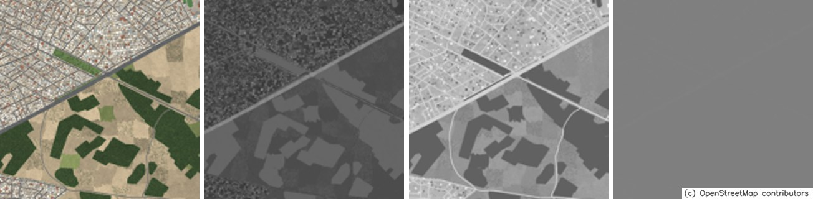
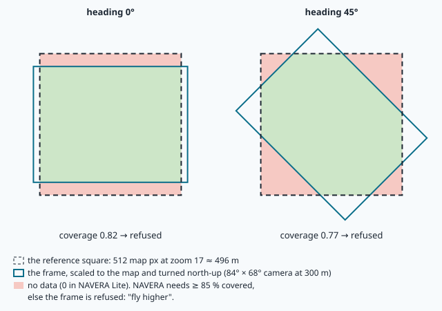
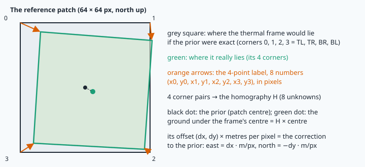
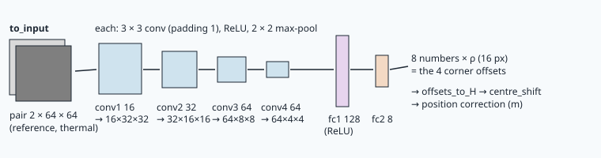

# Night vision: matching a thermal camera to the map



> [!NOTE] Mission brief
> **Until 28 September 2026, NAVERA's night vision ran with random weights.** Its network, STHN, was loaded from a
> checkpoint whose layer names did not match the code, with an option that tells PyTorch to ignore names that do
> not match (`strict=False`). Nothing crashed: night frames went in and homographies came out, computed by a network
> that had learned nothing. A code review found it (backlog item LOC-6); since
> then the product refuses to start if the weights do not load. Its validation report (3 October 2026) still says
> it plainly: night vision is **not validated on real thermal images**.
>
> Today you do NAVERA's night job yourself, and you check every step. **Session 1 — Night watch:** you audit a
> "thermal" dataset, compute what a thermal camera sees from a given height, find a frame on the map with
> normalised cross-correlation, and guard the result with a motion gate. **Session 2 — Night navigator:** you make
> your own training pairs from the map, build and train a small network that predicts a homography, measure it
> against the classic method, and then sabotage it the way LOC-6 did. Each session ends with a badge: **Night
> watch**, then **Night navigator**.
>
> **Start now:** open the 🛠️ **Lab** tab, do **Step 0** (five minutes, no code), then come back here for §1.

**Objectives.** After this mission you can:

1. explain what a thermal camera measures, why a night frame is not a dark day photo (contrast that reverses,
   thermal crossover, no sun shadows), and **audit** a dataset that claims to be thermal;
2. compute the **normalised cross-correlation** (NCC), find a template with it, and show where it fails when the
   two pictures come from different sensors;
3. **prepare** a frame for matching: its ground footprint, its scale, north-up, its **coverage** of the reference
   square, and the minimum height that gives 85 %;
4. explain a **4-point homography network** (what its 8 outputs mean, how its input is normalised, its loss, its
   overfitting) and **train** one on pairs you generate, **measured** against NCC;
5. check a fix with the **motion gate**, and state the honest limits of a learned matcher (conditions it never
   saw, loading mistakes, a gate that locks onto a wrong anchor).

**You need:** the homography and the camera footprint (mission 18), contrast normalisation (mission 08), and the
training loop of mission 21 (tensors, loss, Adam, train/validation, overfitting). ⏱ Reading: about 100 minutes
with the ✏️ checks (Part A, §1–§5, before session 1, about 50 minutes; Part B, §6–§9, before session 2). Lab: 4 h 30
to 6 h in two sessions.

**Before you start** — answer without looking (if you miss two, reread mission 18 §6 and mission 21 §8–§9):

<details><summary>1. A nadir camera with an 84° horizontal field of view flies 300 m above flat ground. How wide is the strip it sees?</summary>
2 × 300 × tan 42° ≈ 540 m: half the field of view on each side of the centre (mission 18).
</details>

<details><summary>2. How many point pairs fix a homography, and why?</summary>
Four (no three on a line): H is 3 × 3 but defined up to a scale, so it has 8 unknowns, and each point pair gives two
equations (x and y).
</details>

<details><summary>3. Training loss falls every epoch; validation loss stopped falling at epoch 6 and now rises. What is happening, and which weights do you keep?</summary>
Overfitting: the network learns its training examples by heart. Keep the weights of the epoch with the lowest
validation loss, or train with more varied data.
</details>

<details><summary>Workspace and words (open if you need them)</summary>

Your files are in `~/lessons/25-thermal-night/`. The parts of NAVERA Lite you write are
[navera_lite/night.py](file:./navera_lite/night.py) and [navera_lite/homography_net.py](file:./navera_lite/homography_net.py).

| Word | Meaning | Français |
|---|---|---|
| **thermal infrared** (LWIR) | light of wavelength 8–14 µm, emitted by every warm surface | infrarouge thermique |
| **emissivity** | how well a surface emits (0–1); a low one reflects its surroundings instead | émissivité |
| **thermal crossover** | the moments (dawn, dusk) when different materials have the same temperature | inversion thermique |
| **modality** | the kind of sensor a picture comes from; **cross-modal** = between two kinds | modalité, intermodal |
| **NCC** | normalised cross-correlation: a similarity from −1 to +1 that ignores brightness and contrast | corrélation croisée normalisée |
| **template matching** | sliding a small picture over a larger one to find where it fits best | appariement de gabarit |
| **footprint** | the piece of ground a camera sees | empreinte au sol |
| **coverage** | the share of the reference square that the footprint covers | couverture |
| **regression** | a network that outputs numbers (here 8), not a class | régression |
| **distribution shift** | test data unlike the training data (other time, other place, other sensor) | changement de distribution |
</details>

# Part A — Night watch (read before session 1)

## 1. What a thermal camera sees

Every surface emits light because it is warm. At the temperature of the ground at night (about 290 K), most of that
light has a wavelength near 10 µm (**Wien's law**: λ_max = 2 898 µm·K / T = 2 898 / 290 ≈ 10 µm), far beyond what
eyes or a normal camera see. A **thermal camera** has a sensor for the **long-wave infrared**, 8–14 µm: a grid of
tiny thermometers (a microbolometer, often 640 × 512 pixels). Each pixel reports how much the surface emits, which
depends on its temperature **and** its **emissivity**. Water, soil and plants have emissivities near 0.95 and look
like their temperature. A bare metal roof (emissivity about 0.1) emits little and reflects the cold night sky: it
looks colder than it is.

What makes night pictures hard is **thermal inertia**: how fast a material heats in the sun and cools after sunset.


| Material | Day photo (the reference) | Thermal, night | Thermal, noon |
|---|---|---|---|
| dry soil, sand | bright | **cold**: it cools fast | **hot** |
| asphalt road | dark | **warm**: it keeps its heat | hottest |
| trees, crops | dark green | between | cool (they evaporate water) |
| water | dark blue | **warmer than the land** | **cold** |
| concrete roof | bright | warm | hot |
| metal roof | grey | very cold (reflects the sky) | hot |
| sun shadows | sharp, beside every building, all on one side | **none** | faint "heat shadows" at most |

Two consequences. First, the brightness of the same place **changes order**: the road is darker than the soil in
the day photo and brighter at night, while trees are dark in both. Second, twice a day, near dawn and dusk, warm and
cold materials pass through the same temperature: the **thermal crossover**. The picture then has almost no
contrast. A thermal camera also sets its own gain all the time (**AGC**, automatic gain control): it stretches
whatever range of temperatures it sees to its 256 grey levels, so a grey level says "warmer or colder than the rest
of this picture", never "20 °C". At the crossover, AGC stretches the sensor's noise.

> [!QUESTION] ✏️ Check
> A dataset sold as "night thermal frames" shows sharp dark shadows on the north-west side of every building, and
> every frame has the same pattern of bright roofs and dark roads as a day photo. What do you suspect?

<details><summary>Answer</summary>
Sun shadows do not exist at night, and at night roads are warmer than most roofs' surroundings: these frames look
like <b>day photos made darker</b>. Before you train or test on a dataset, check that it is what its name says.
Lab Step 2 asks you to check NAVERA's own night replay set.
</details>

## 2. Normalised cross-correlation

To find a frame on the map, the oldest method compares pixels directly. Take two pictures of the same size, a and b.
Subtract each picture's mean, multiply them pixel by pixel, add, and divide by the "size" of each:

```
NCC(a, b) = Σ (a − ā)(b − b̄)  /  √( Σ (a − ā)² · Σ (b − b̄)² )          ā, b̄ = the means
```

It always lies between −1 and +1 (it is the cosine of the angle between the two pictures seen as vectors, after the
means are removed). **+1** means b = gain · a + offset with a positive gain: a darker or paler copy is still a
perfect match. **−1** is the negative. Near **0**: unrelated. If one picture is uniform, the denominator is 0:
there is nothing to compare, and NAVERA Lite's `ncc` returns 0.

**Worked example.** Four pixels of the day photo: soil, road, tree, roof = (200, 80, 60, 220). The same ground at
night: (40, 200, 100, 150). Means 140 and 122.5; deviations (60, −60, −80, 80) and (−82.5, 77.5, −22.5, 27.5).
Σ products = −4 950 − 4 650 + 1 800 + 2 200 = −5 600; Σ squares 20 000 and 14 075; NCC = −5 600 / √(20 000 · 14 075)
= **−0.33**. Not +1, not −1: no gain and no inversion turns this day into this night.

> [!TIP] 🧰 Why the gain and the offset cancel
> If b = g·a + c with g > 0, then b − b̄ = g·(a − ā): the numerator is g·Σ(a − ā)² and the denominator is
> √(Σ(a − ā)² · g²·Σ(a − ā)²) = g·Σ(a − ā)². The ratio is exactly 1, whatever g and c. This is the same idea as
> mission 08's `normalise`, and the reason a thermal camera's automatic gain does not hurt NCC.

**Template matching.** To find a small picture (the **template**) inside a larger one (the **search area**),
compute the NCC at every position and keep the best. OpenCV does it in one call,
`cv2.matchTemplate(search, template, cv2.TM_CCOEFF_NORMED)`, which returns the map of NCC scores;
`cv2.minMaxLoc` gives the best score and the **top-left corner** (x, y) of the best place. A 32 × 32 template in a
64 × 64 area has 33 × 33 = 1 089 positions: a fraction of a millisecond. NAVERA Lite's `ncc_locate` reports where
the template's **centre** lies relative to the search area's centre: that is a position correction.

> [!QUESTION] ✏️ Check
> The same four pixels at noon read (230, 250, 90, 190). Compute the NCC with the day photo. Then: would taking |NCC|
> (accepting −1 as a match) solve the night problem in general?

<details><summary>Answer</summary>
Deviations from the mean 190: (40, 60, −100, 0); Σ products = 2 400 − 3 600 + 8 000 + 0 = 6 800; Σ squares 20 000 and
15 200; NCC = 6 800 / 17 436 ≈ <b>0.39</b>. |NCC| only helps if the night is an exact negative of the day. It is not:
trees are dark in both, the road reverses. The relation between the two pictures is <b>not monotonic</b>, and NCC can
only undo a gain and an offset. Lab Step 6 measures how often NCC still finds the right place.
</details>

## 3. The footprint and the coverage of the reference square

A night matcher compares the frame with a **reference square** of map around the prior position. NAVERA's network
expects a square of 512 map pixels at zoom 17, about **496 m** at Sousse (0.968 m per pixel), north-up, with the
frame's centre on the square's centre. The frame must first cover that square.

A nadir camera at height h with fields of view θ_h × θ_v sees a rectangle (mission 18):

```
width = 2 · h · tan(θ_h / 2)          height = 2 · h · tan(θ_v / 2)
```

Turned by the heading, the rectangle covers part of the square. The **coverage** is the area of the overlap divided
by the area of the square. NAVERA refuses a frame whose coverage is below **85 %** ("fly higher").



**Worked example** — NAVERA's simulated thermal view, 84° × 68°, at 300 m: width 2 · 300 · tan 42° = 540 m, height
2 · 300 · tan 34° = 405 m. Heading 0°: the frame is wider than the square (540 > 496) but not as high: coverage
405 / 496 = **0.82**. Heading 45°: the corners of the square stick out of the turned rectangle: **0.77** (the
overlap of a turned rectangle and a square; your `coverage` computes it). Both are refused.

The 85 % rule comes from a measurement. Tracking along a route at 300 m with a diagonal heading, exactly this
case with 77 % coverage, **ran away to 2.4 km** while the network's own consistency score stayed around 0.9
(validation report, 3 October 2026). The minimum height depends on the camera: coverage grows with height, so a
**bisection** finds it (halve the interval [low, high] until it is short; NAVERA Lite's `min_altitude` does it with
your functions). For the 84° camera it is about 310 m at heading 0° and 330 m at 45°: NAVERA states "≥ ~350 m".

> [!QUESTION] ✏️ Check
> Same camera, same 300 m, heading 90°. Coverage? Why is a heading of 90° no worse than 0°, while 45° is worse?

<details><summary>Answer</summary>
At 90° the rectangle is 405 m east–west and 540 m north–south: the square is fully covered north–south, 405 of 496 m
east–west, so again <b>0.82</b>. Turning by 90° swaps width and height; turning by 45° puts the square's corners
outside the rectangle. Lab Steps 3–4 do this for other cameras.
</details>

## 4. Preparing a frame: scale, north-up, centre

The network was trained on north-up squares at the map's metres per pixel. So each frame is resampled **once**,
with one affine warp that does three things together:

1. **scale**: a frame pixel covers width / w_px metres (e.g. 1.03 m for a 640 px wide, 75° frame at 430 m:
   2 · 430 · tan 37.5° / 640); the reference covers 7.75 m per pixel in the lab, so the scale factor is
   1.03 / 7.75 = 0.133;
2. **turn** by the heading, so that north is up (mission 08's `like_map` did the same for day photos);
3. **shift**, so that the frame's centre point lands on the output's centre point.

Pixels outside the frame stay 0, and the coverage decides whether the result is used.

> [!QUESTION] ✏️ Check
> Why one warp, and not "resize, then rotate, then crop" with three OpenCV calls?

<details><summary>Answer</summary>
Each resampling interpolates and blurs a little, and each step must get its centre right; one matrix (the product
of the three) interpolates once and puts the centre exactly where it belongs. It is also faster.
</details>

## 5. The motion gate: physics checks the match

A matcher can be confidently wrong. In NAVERA's synthetic test, a 320 m shift came back with a **238 m** error and a
consistency score of **0.93**, as high as for correct matches; the validation report concludes that "the
consistency score does not detect a wrong match, the motion gate does". The gate keeps the last **accepted** fix,
the **anchor** (position and time), and refuses a new fix when

```
jump = distance(anchor, new fix)   >   reach = v_max · (t − t_anchor) + margin          v_max = 30 m/s, margin = 30 m
```

A refused fix does **not** move the anchor: the next frame is compared with the same anchor, and its reach has grown.

**Worked example.** Anchor accepted at t = 10 s. A fix at t = 12 s lies 120 m away: reach = 30 · 2 + 30 = 90 m →
refused. The next fix, at t = 15 s, lies 150 m from the anchor: reach = 30 · 5 + 30 = 180 m → accepted, and it
becomes the anchor.

> [!QUESTION] ✏️ Check
> The drone flies at 25 m/s. No frame is usable for 12 s (clouds of steam over a factory), then a wrong match 300 m
> off arrives. Does the gate refuse it?

<details><summary>Answer</summary>
Reach = 30 · 12 + 30 = 390 m; the drone moved about 300 m and the fix is 300 m off that, so the jump is between
0 and 600 m depending on directions: it <b>may pass</b>. The longer the gap, the weaker the gate. Lab Step 7 shows
what happens next.
</details>

> [!WARNING] Common wrong ideas (Part A)
> - "A thermal frame is a dark photo." The brightness order of materials changes, and sun shadows disappear.
> - "NCC = 1 means the right place." NCC = 1 means the same pattern up to brightness: a repeated pattern (rows of
>   houses, field strips) gives high scores in several places.
> - "Higher is always fine." Higher gives more coverage but fewer pixels per metre; NAVERA's camera also has a
>   ceiling (the simulated drone flies at most 400 m).
> - "A confident matcher is a right matcher." The score of a wrong match can be as high as a right one (0.93).
> - "`math.tan(42)`." Trigonometry in Python takes **radians**: `math.tan(math.radians(42))`.

# Part B — Night navigator (read before session 2)

## 6. A homography from four corners

Between a north-up reference patch and a prepared night frame of flat ground, what is left is a small homography
(mission 18): the prior is off by tens of metres (a **shift**), the heading by a few degrees (a **turn**), the height
by a few percent (a **zoom**), the camera a little tilted (**perspective**). H has 8 unknowns. Instead of asking a
network for the 9 entries of H, DeTone, Malisiewicz and Rabinovich (2016) asked for **4 corners**: where do the
frame's 4 corners lie in the reference patch? That is 8 numbers, the **4-point parametrisation**:



```
offsets = (x0, y0, x1, y1, x2, y2, x3, y3)       corner k of the frame lies at corner k of the square + (xk, yk)
corners of a 64 px patch: 0 = (0, 0), 1 = (63, 0), 2 = (63, 63), 3 = (0, 63)        (pixel centres)
```

Why corners? The 9 entries of H have very different sizes: the turn-and-zoom part is about 1, the shift is tens of
pixels, the perspective terms about 0.0001. One loss on the 9 entries would be dominated by the shift and blind to
the rest. Corner offsets are all pixels, all of the same size, and bounded: a regression network learns them well.
From the 4 corner pairs, `cv2.getPerspectiveTransform` solves H exactly (mission 18's 8 equations), and H sends the
frame's centre point to the reference: that is where the drone is.

**Worked example.** The frame is shifted by (5, −3) px and turned 2° clockwise about its centre (31.5, 31.5). The
corner (0, 0) is 31.5 px left and up of the centre; turned by 2°, it moves by (1.12, −1.08) px; with the shift, its
offset is (6.12, −4.08). All four: (6.12, −4.08, 6.08, −1.88, 3.88, −1.92, 3.92, −4.12). The four offsets differ
(the turn), but their average is (5, −3), and the centre moves by exactly (5, −3): a turn about the centre does not
move the centre. At 7.75 m per pixel this is 39 m east and 23 m **north** (y grows downwards: dy = −3 is north).

> [!QUESTION] ✏️ Check
> All eight offsets are (−2, 0, −2, 0, −2, 0, −2, 0). What happened between the prior and the truth, and what are
> H and the position correction, at 7.75 m/px?

<details><summary>Answer</summary>
A pure shift of 2 px to the left: H = [[1, 0, −2], [0, 1, 0], [0, 0, 1]]; the drone is 15.5 m <b>west</b> of its
prior.
</details>

## 7. The network and its input

The network takes the two patches **stacked** as two channels of one 64 × 64 picture: its first convolution sees, at
every pixel, the reference and the frame together, so it can learn local comparisons from the very first layer.
Four blocks of mission 21's kind (3 × 3 convolution, ReLU, 2 × 2 max-pooling) shrink 64 × 64 to 4 × 4 with 64
maps; two linear layers turn those 1 024 numbers into 8.



Three design decisions you will meet in the code:

- **Input normalisation.** Each channel of each pair is shifted to mean 0 and divided by (its standard deviation
  + 1). The thermal camera's automatic gain makes its absolute grey levels meaningless, and the reference is pale:
  like NCC, the network should not depend on gain and offset, so we remove them before it sees the picture. The
  "+ 1" (one grey level) stops a uniform patch, a calm sea, from turning its noise into strong patterns.
- **Output scale.** The network outputs offsets / ρ, with ρ = 16 px, the largest offset in the training pairs: the
  targets are numbers of about ±1, the size the freshly initialised layers produce.
- **No ReLU at the end.** Offsets can be negative.

**Worked example — parameters.** `conv3 = Conv2d(32, 64, 3)`: 64 filters of 32 × 3 × 3 = 288 weights and 1 bias:
64 × 289 = **18 496**. The whole network has 192 600, a fifth of a million: it trains in under a minute on the
Jetson's GPU. NAVERA's STHN is far larger: on the Jetson's 8 GB, NAVERA's day and night pipelines cannot both
be loaded, so one GPU vision pipeline runs at a time.

> [!QUESTION] ✏️ Check
> Without the normalisation, the thermal channel of one pair has mean 180, the reference 230. A colleague says
> "the network will learn to subtract the means". Why is it still better to normalise?

<details><summary>Answer</summary>
The means change from frame to frame (the camera's gain, the place, the season): the network would have to learn
that they do not matter, from examples, and might learn the opposite from a biased training set. Removing them is
free and exact. A good input design removes what you know is irrelevant, and leaves the network the hard part.
</details>

## 8. Training data you make yourself

There is no labelled thermal-to-map dataset of Sousse. So, as the HomographyNet authors did with photos, you
**make** the pairs, with an exact label for free:

1. A **scene**: a 160 × 160 px square of ground (7.75 m per pixel, 1.24 km) drawn twice from the OpenStreetMap
   data of NAVERA's test area: a day aerial view (the reference, with sun shadows) and a night "temperature" picture
   from a material model like the table of §1 (no shadows). Both come from the same drawing: they are aligned pixel
   for pixel. (A drawing, not a photograph: thermal-like, not thermal.)
2. A **square** of 64 px at a random place of the reference scene: the reference patch.
3. Random **offsets**: a common shift of ±12 px for the four corners (the prior's error, up to ±93 m) plus ±4 px per
   corner (heading, height and tilt errors). The four shifted corners are where the thermal frame lies.
4. The **thermal patch**: the night scene inside those four corners, warped onto a 64 px square; then the camera:
   sensor noise, a column pattern, automatic gain.
5. The **label** is the offsets you drew. Nobody had to label anything.

The **loss** is the mean squared error between the network's 8 outputs and offsets / ρ. A network that always
answers 0 ("the prior is right") scores the mean of (offset / 16)²: the shift's variance 12²/3 = 48 plus the
jitter's 4²/3 ≈ 5.3, divided by 256: **≈ 0.21**. Any useful network must go clearly below that.

Training and validation pairs come from **different places** (no ground shared): the question is "does it find the
frame over ground it has never seen?". Lab Step 12 tests what happens when all the pairs come from a few places. Each training scene is also turned by a random multiple of 90° and mirrored half of the time
(**augmentation**): the task, aligning two pictures of the same ground, does not care which way is north, so this
multiplies the variety for free.

> [!QUESTION] ✏️ Check
> The network outputs 0.25 for x0 when the true offset is 6 px. What is this output's term of the loss, and how many
> pixels is it off?

<details><summary>Answer</summary>
Target 6 / 16 = 0.375; error 0.125; squared 0.0156. In pixels: 0.25 × 16 = 4 px instead of 6, 2 px off.
</details>

## 9. Measuring honestly, and what a network does not know

Measure what navigation needs: the error of the **position**, the ground under the frame's centre, in pixels and
metres, on pairs from validation places. Compare with two baselines: **prior only** (answer 0: how far the prior
already was) and **NCC** (the thermal patch's centre searched in the reference). A result means something only next
to them.

A network always answers. Give it a picture unlike its training data, a **distribution shift**, and it returns
8 numbers with the same confidence: a frame at noon when it learned nights, a dawn picture with no contrast, open
sea, a prior that is wrong by more than the ρ it was trained for. It has no "I don't know". The lab measures each of
these cases; the defences are outside the network: refusing frames before (coverage, contrast), checking fixes
after (the motion gate), and never trusting a network whose weights you did not check.

That last point is LOC-6. A PyTorch model's weights are saved as a **state_dict**: a dictionary from layer names
(`conv1.weight`, `conv1.bias`, …) to tensors. `model.load_state_dict(d)` copies each tensor into the layer with
the same name and, by default (`strict=True`), raises an error if a name is missing or unexpected. With
`strict=False` it copies what matches and silently keeps the **random initial values** of everything else. A
checkpoint saved by another script (one that wrapped the model and prefixed every name) matches nothing.

> [!QUESTION] ✏️ Check
> Your night matcher's median error is 10 m on synthetic pairs. Name three things you would measure before calling
> it validated for a real drone.

<details><summary>Answer</summary>
For example: real thermal frames with surveyed truth (not drawings of the map); other times of night, seasons and
weather, including the crossover; other places and terrains (sea, desert); frames at the real heights, headings and
tilts; and how often a wrong fix gets past the gate. NAVERA's report lists exactly these as not validated.
</details>

> [!WARNING] Common wrong ideas (Part B)
> - "Predict H directly." Its 9 entries have wildly different scales; predict 4 corners and let OpenCV solve H.
> - "The training loss went down, so it works." Only validation places, and then a test set, say that.
> - "A low error at night means it works by day." It never saw day: measure each condition separately.
> - "`strict=False` is a harmless way to load old checkpoints." It can load **nothing** without a word.
> - "Augment by turning the picture 37°." Then the corners of the patch hold black: the network learns black corners.
>   Turns of 90° and mirrors keep the whole square.

## In NAVERA

NAVERA's night vision, IRIS's product, uses **STHN**, a published network for thermal-to-satellite homography
(Xiao et al., 2024), trained by its authors on aerial thermal frames and satellite images. Where your network answers in one pass, STHN builds a
**correlation volume** (every feature of the frame compared with every feature of the map around it) and moves the
four corners in several **refinement** steps; the four corners give the homography and the frame's centre the
position. In words and numbers, from its documents (validation report of 3 October 2026, engineering backlog):

- **Until 28 September 2026 it ran with random weights** (LOC-6: the checkpoint's names never matched, loaded with
  `strict=False`). The same review found its two inputs swapped, its output read with the wrong layout and units,
  and the wrong configuration (LOC-7). It is now rebuilt exactly as trained, and it refuses to start if the weights
  do not load.
- **Scale and heading (LOC-16, fixed 30 September 2026):** each frame is resampled from the height and the camera's
  field of view, turned north-up, and refused below **85 %** coverage of the 512 px reference square; a fix implying
  more than **30 m/s** is rejected.
- **Measured on synthetic frames** (grey renders of the satellite map, 250–600 m, any heading): **8–13 m median**; at
  400 m, worst 13 m over 5 headings × 30 frames; a 320 m shift failed (238 m error, consistency 0.93). In the mission
  simulator at 400 m with GPS jammed: median 6 m, p90 11 m, max 37 m.
- **Speed:** about **225 ms** per frame on the Jetson's GPU (about 1.5 s on the CPU).
- **Not validated:** real thermal imagery, real camera calibration, any confidence calibration. The night replay
  set "cannot be used for night vision": its frames cover only about 190–300 m of ground.

NAVERA is Release 0.2, field validation pending.

## In NAVERA Lite

| You write | It does | Lesson |
|---|---|---|
| `ncc`, `ncc_locate` (night.py) | NCC and template matching | §2 |
| `footprint_m`, `coverage`, `prepare` | the frame's ground, its coverage, the north-up patch | §3–§4 |
| `motion_gate` | the physics check of every fix | §5 |
| `cut_pair` (homography_net.py) | one training pair with its exact 4-point label | §6, §8 |
| `to_input`, `HomographyNet`, `offsets_to_H`, `train` | the network, its input, its output as H, its training | §6–§8 |

Given: `min_altitude`, `thermal_camera`, `random_pair`, `make_pairs`, `centre_shift`, `predict`, `corner_error`,
`centre_error`, `load_weights` (strict!), and mission 06's `geo.py`. Your trained `my_homography.pt` is a part of
your stack: Sim Lite (mission 31) can fly it at night.

## 🐦 How birds do it

Most songbirds migrate at night. In the 1960s Stephen Emlen raised young indigo buntings in a planetarium: birds
that grew up under a sky turning around a **different** star later steered by that star (Emlen, 1970). They are not
born with a star map; they **learn** which point the sky turns around during their first months, from examples, as
your network learns alignment from pairs. And like your network, a bird raised under the wrong sky is confidently
wrong. Navi the swallow, who migrates by day, has it easier.

## Summary

1. A thermal camera measures emitted light (temperature × emissivity): the order of brightness changes between day
   and night, the crossover removes contrast, and there are no sun shadows. Check that a "thermal" dataset is one.
2. NCC ignores gain and offset, so it survives a camera's automatic gain, but not a non-monotonic change between
   two modalities.
3. A frame is prepared before matching: scaled to the map, turned north-up, centred, and refused below 85 %
   coverage of the reference square; the minimum height depends on the camera's field of view.
4. A 4-point network predicts where the frame's corners lie (8 numbers in pixels, scaled by ρ); you make its pairs
   with an exact label, normalise its input per channel, and validate it on other places.
5. A network always answers: measure each condition, gate every fix with physics, and load weights strictly.

**Next mission:** the stars. When there is no map to match at all, a camera pointed at the sky still gives a
position, and an attitude error of one degree costs 111 km.

## Check yourself

Answer without scrolling up.

<details><summary>1. Day pixels (10, 20, 30); night pixels (50, 40, 30). NCC? What does it say?</summary>
Deviations (−10, 0, 10) and (10, 0, −10): NCC = −200 / √(200 · 200) = −1: an exact negative. Here |NCC| would match;
real night frames are rarely that simple.
</details>

<details><summary>2. A 75° × 63° camera at 350 m, heading 0°: does it cover 85 % of a 496 m square?</summary>
Width 2 · 350 · tan 37.5° ≈ 537 m (more than 496), height 2 · 350 · tan 31.5° ≈ 429 m: coverage 429 / 496 ≈ 0.86. Just.
</details>

<details><summary>3. What do the 8 outputs of the 4-point network mean, and why divide them by ρ?</summary>
Where the frame's 4 corners lie in the reference patch, as (x, y) offsets in pixels from the square's corners; divided
by ρ (16 px) so that the targets are about ±1.
</details>

<details><summary>4. Anchor at t = 0. Fixes: t = 2 s, 200 m away; t = 4 s, 130 m away. Which are accepted (30 m/s, 30 m)?</summary>
t = 2: reach 90 m, refused (the anchor stays at t = 0). t = 4: reach 150 m, accepted.
</details>

<details><summary>5. Why can loading weights with strict=False give a working-looking but useless network?</summary>
Layers whose names do not match keep their random initial weights, without any error: the network runs and answers.
</details>

<details><summary>6. (Mission 21) Your network scores 0.02 on its training loss and 0.15 on validation. What do you change first?</summary>
More varied training data (more places) or fewer epochs: the gap is overfitting. A smaller network can also help.
</details>

<details><summary>7. (Mission 18) Why is a homography enough to map one nadir view of flat ground to another?</summary>
All the ground points lie on one plane, and the image of a plane in two pinhole cameras is related by a 3 × 3
homography.
</details>

Now open the **🛠️ Lab** tab.
