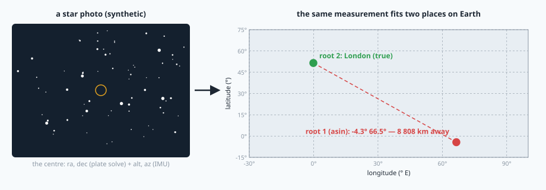
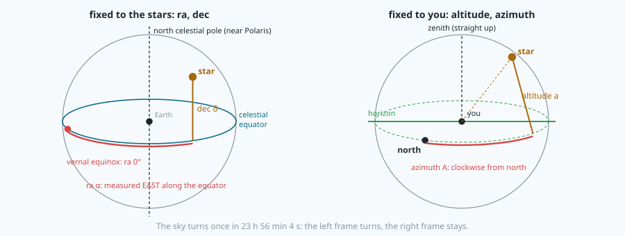
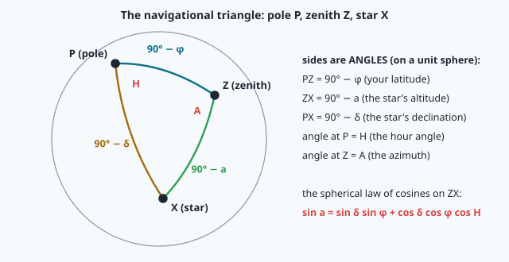
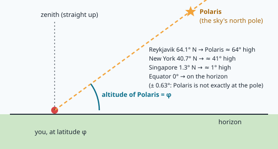
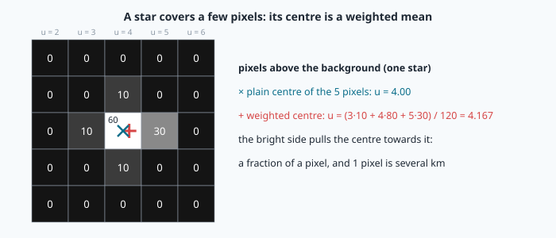
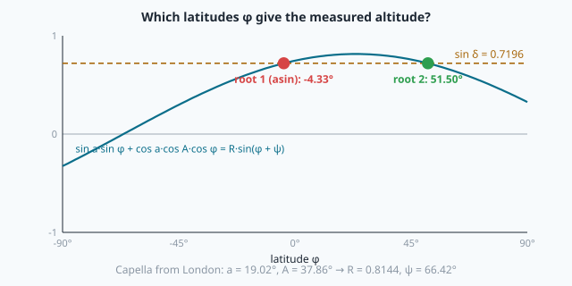
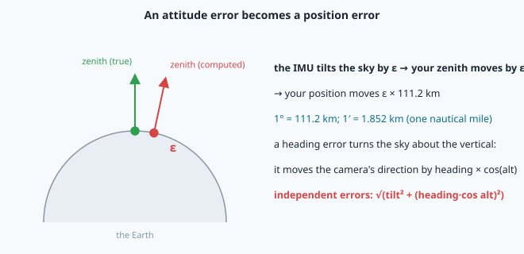

# Navigating by the stars



> [!NOTE] Mission brief
> **30 September 2026, NAVERA's first end-to-end celestial test.** NAVERA's star fix had never been run
> from photo to position. Its validation document (2026-10-03) and engineering backlog (items LOC-10 and
> CN-1) list what that run and the code reviews before it found. The latitude formula kept **one** root of
> an equation that has **two**: any camera facing the southern half of the sky gave positions **hundreds to
> thousands of kilometres** off. The plate solver's fit was anchored near an image edge and came out about
> **1° off at the centre: 111 km**. The star coordinates were not corrected for the slow turn of the Earth's
> axis: about **0.4° in 2026, tens of km**. All three were fixed. The next day, a real sky photo was
> identified **1.7′ (arcminutes)** from an independent solution.
>
> Today you build NAVERA Lite's star fix and meet each of these traps yourself. **Session 1 — Stargazer:**
> the clock of the sky, where a star appears, and your latitude from Polaris. **Session 2 — Star
> navigator:** find the stars in a photo with OpenCV, identify them, turn them into a position with the
> IMU, choose between two roots, and measure what one degree of attitude costs.
>
> **Start now:** open the 🛠️ **Lab** tab, do **Step 0** (two minutes, no code), then come back here for §1.

**Objectives.** After this mission you can:

1. **convert** a UTC time into a Julian date and a sidereal time, and **explain** why a star rises
   3 min 56 s earlier every night;
2. **compute** where a star stands in your sky (altitude, azimuth), and your **latitude from Polaris**
   with its hour-angle correction;
3. **find** stars in a night photo with OpenCV and **measure** their centres to a fraction of a pixel;
   **explain** what a plate solver does;
4. **turn** one camera direction, known on the sky and in the IMU's frame, into a position: **two
   roots**, and a prior that chooses or **refuses**;
5. **budget** the position error from attitude errors (1° ≈ 111 km) and **check** the budget by simulation.

**You need:** missions 16–17 (quaternions, `q_rotate`, true north and the declination, `q_true_north`),
18 (the pinhole camera and K), 08 (grey images, uint8), 06 (the great circle: 1° of arc on the Earth),
04 (numpy masks). ⏱ Reading: about 90 minutes with the ✏️ checks: §1–§3 before session 1, §4–§7 before
session 2. Lab: 4 h to 5 h.

**Before you start.** Answer without looking; if you miss two, reread mission 17 §5 and mission 06 §1.

<details><summary>1. (Mission 17) An IMU chip reports heading 80° magnetic where the declination is −5°. True heading?</summary>
80 + (−5) = 75°. True = magnetic + D, with D positive east.
</details>
<details><summary>2. (Mission 16) q is the attitude (body → world). Which call gives the world direction of the body's nose?</summary>
`q_rotate(q, (1, 0, 0))`: rotate the body vector by q. (In mission 18 the camera's axis was turned the same way.)
</details>
<details><summary>3. (Mission 06) How long is 1° of great circle on a sphere of radius 6 371 km?</summary>
2π · 6371 / 360 = 111.2 km. One arcminute (1/60°) is 1.853 km: almost exactly the nautical mile (1.852 km).
</details>

<details><summary>Words of this lesson (open if you need them)</summary>

| Word | Meaning | Français |
|---|---|---|
| **celestial sphere** | the sky drawn as a sphere around you; only directions matter | sphère céleste |
| **right ascension α, declination δ** | a star's "longitude" and "latitude" on the sky, fixed to the stars | ascension droite, déclinaison |
| **altitude, azimuth** | a direction in YOUR sky: angle above the horizon, angle clockwise from north | hauteur, azimut |
| **sidereal time** | the sky's clock: which right ascension is crossing your meridian | temps sidéral |
| **hour angle H** | how far a star has turned west of your meridian | angle horaire |
| **precession** | the slow turn of the Earth's axis that shifts every catalogue position | précession |
| **centroid** | the brightness-weighted centre of a star's pixels | centroïde, barycentre |
| **plate solving** | finding which stars a photo shows, hence where the camera points | résolution astrométrique |
| **boresight** | the direction the camera's centre looks at | axe de visée |
| **prior** | a position you already roughly know (the operating area, the last fix) | a priori |
</details>

## 1. The sky as a sphere, and its clock

The stars are so far away that only their **directions** matter: draw them on a sphere around you, the
**celestial sphere**. Two coordinate systems live on it (figure).

- **Fixed to the stars.** The Earth's axis, extended, meets the sky at the celestial poles; the Earth's
  equator, extended, is the **celestial equator**. A star's **declination δ** is its angle north (+) or
  south (−) of that equator, like a latitude. Its **right ascension α** is its angle along the equator,
  measured **eastward** from a reference point called the vernal equinox, like a longitude. Catalogues
  list (α, δ); they do not change during the night.
- **Fixed to you.** Your **zenith** is straight up; your **horizon** is the plane at right angles to it.
  A star's **altitude a** is its angle above the horizon (90° at the zenith); its **azimuth A** is
  measured clockwise from **true** north (90° = east), like a heading.



The Earth turns under the sky, so the link between the two frames is a **time**. Relative to the stars,
the Earth turns once in **23 h 56 min 4 s** (a **sidereal day**), not 24 h: in 24 h it also moves about
1/365 of its orbit around the Sun, so it must turn about 361° for the Sun to come back to the same place.
The extra degree costs 24 h / 365 ≈ 3 min 56 s. So every star rises, culminates and sets **3 min 56 s
earlier** each night, and the night sky slowly changes through the year.

**The sky's clock.** To use formulas, astronomers count time in days without months: the **Julian date**
(JD), the number of days since noon on 1 January 4713 BC. Noon, 1 January 2000 is JD 2451545.0 (a moment
called J2000.0). From a UTC calendar date, a recipe from Meeus' *Astronomical Algorithms* gives it. Its
constants look strange; each has a job. January and February count as months 13 and 14 of the previous
year (so the leap day falls at the end of the "year"); `30.6001` gives the right number of days before each
month; `B` corrects for the Gregorian calendar's skipped leap years:

```
if month ≤ 2:   year = year − 1,   month = month + 12
A = floor(year / 100)          B = 2 − A + floor(A / 4)
JD = floor(365.25·(year + 4716)) + floor(30.6001·(month + 1)) + day + hours/24 + B − 1524.5
```

(`hours` includes the minutes and seconds: h + mi/60 + s/3600.) Then the **Greenwich Mean Sidereal Time**,
the angle between the vernal equinox and the Greenwich meridian (IAU 1982), with d = JD − 2451545.0 and
T = d / 36525 (centuries):

```
GMST = 280.46061837° + 360.98564736629°·d + 0.000387933°·T² − T³/38 710 000     (mod 360°)
```

The second term is the sidereal day: 360.9856° per solar day. For an observer at longitude λ (**east
positive**), the **local** sidereal time is LST = GMST + λ, and a star's **hour angle** H = LST − α: how far
it has turned west of your meridian (0° = due south of the pole, at its highest).

**Worked example: London (51.50° N, 0.12° W), 7 October 2026, 20:00 UTC.** year 2026, month 10:
A = 20, B = 2 − 20 + 5 = −13; floor(365.25 · 6742) = 2 462 515; floor(30.6001 · 11) = 336; day + hours/24 =
7.833333. JD = 2462515 + 336 + 7.833333 − 13 − 1524.5 = **2 461 321.333333**. Then d = 9 776.333333 and
GMST = 280.46062 + 360.98564737 · 9776.333333 = 3 529 396.4778… → mod 360 = **316.4778°** (the T² term adds
0.00003°). LST = 316.4778 + (−0.12) = **316.3578°**. Capella (α = 79.6672° of date) has H = 316.3578 −
79.6672 = **236.6906°**: it is still in the east, rising.

> [!QUESTION] ✏️ Check
> Sirius rises at 22:10 local time on 1 November. At about what time does it rise on 1 December? Why does
> nobody see Orion in a June night sky?

<details><summary>Answer</summary>
30 days × 3 min 56 s = 118 min earlier: about 20:12. In June the Sun stands in the part of the sky where
Orion is (the 3 min 56 s add up to 12 h in half a year): Orion is up during the day.
</details>

**Catalogue positions move too.** The Earth's axis turns slowly like a spinning top's, once in about
26 000 years (**precession**). The equator and the equinox move with it, so the (α, δ) of a catalogue
made for **J2000** are a little wrong in 2026. NAVERA Lite gives you `precess(ra, dec, jd)`, which turns
J2000 positions to the date (IAU 1976 formulas). You measure how far Vega moved in lab Step 2.

## 2. Where is that star in my sky?

Three points on the celestial sphere make a triangle: the **pole P**, your **zenith Z** and the **star X**.
Its sides are **angles** (on a sphere of radius 1, an arc's length is the angle it spans): PZ = 90° − φ
(φ your latitude: the pole stands φ above your horizon), ZX = 90° − a, PX = 90° − δ. Its angle at P is the
hour angle H; its angle at Z is the azimuth A.



The **spherical law of cosines** (the curved cousin of a² = b² + c² − 2bc cos A) on the side ZX, with
cos(90° − x) = sin x, gives the altitude; the azimuth comes from the same triangle with `atan2`, which
keeps the right quadrant:

```
sin a = sin δ · sin φ + cos δ · cos φ · cos H
A     = atan2( −cos δ · sin H ,  sin δ · cos φ − cos δ · sin φ · cos H )      then mod 360°
```

**Worked example: Capella from London**, same moment (δ = 46.0254° of date, φ = 51.50°, H = 236.6906°):

```
sin a = 0.71965 · 0.78261 + 0.69434 · 0.62251 · (−0.54916) = 0.56320 − 0.23737 = 0.32583   →  a = 19.02°
A = atan2( −0.69434 · (−0.83572),  0.71965 · 0.62251 − 0.69434 · 0.78261 · (−0.54916) )
  = atan2( 0.58027,  0.74640 )  =  37.86°                                                (north-east)
```

Capella is 19° up in the north-east: rising, as its hour angle said. (Astropy, the astronomers' Python
library, agrees within 0.01°; the difference is two small effects we leave out, nutation and aberration,
each under 20″.)

> [!QUESTION] ✏️ Check
> A star culminates (H = 0) at altitude 90° − |φ − δ|. Can you ever see Canopus (δ = −52.7°) from London
> (φ = 51.5°)? From Quito (φ = −0.2°)?

<details><summary>Answer</summary>
London: 90 − |51.5 + 52.7| = −14.2°: never above the horizon. Quito: 90 − 52.5 = 37.5°: yes, 37° up in the
south. From the equator you can see every star of the sky during a year.
</details>

## 3. Latitude from Polaris

The celestial pole stands exactly **φ** above your northern horizon: that is why sailors measured
Polaris. But Polaris is not exactly at the pole: in 2026 it is **p = 90° − δ ≈ 0.63°** away, and it turns
around the pole on a small circle once a sidereal day. When its hour angle is H, it stands p·cos H above
(or below) the pole. To first order in p:

```
φ ≈ a − p · cos H
```



**Worked example.** From a ship you measure Polaris at a = 47.20°, at a moment when its hour angle is 140°:
φ ≈ 47.20 − 0.6253 · cos 140° = 47.20 + 0.479 = **47.68°**. Taking a = φ would have put you 0.479° too
far south: 53 km.

The formula leaves out terms of order p², the **refraction** of the air (it lifts
every star, about 1′ at 45° altitude and much more near the horizon) and, at sea, the dip of the horizon.
And Polaris is useless south of the equator: no bright star marks the south pole. A general method is
needed: §6.

> [!QUESTION] ✏️ Check
> Without a clock you cannot know H. What is then the largest latitude error, in km, of "φ = altitude of
> Polaris"? And with a perfect clock?

<details><summary>Answer</summary>
Up to p = 0.63°, i.e. 0.63 × 111 = about 70 km (when H = 0° or 180°). With the clock, the error drops to the
p² terms (lab Step 4 measures them).
</details>

<details><summary>Read this after lab Step 4</summary>
The second-order term is about (p²/2)·sin²H·tan φ: with p = 0.0109 rad it is under 0.01° at mid latitudes, but
tan φ grows quickly towards the pole, so the high-latitude places keep the largest residual.
</details>

## 4. Finding stars in a photo

A star is a point, but its image is a small blob of a few pixels: the lens and the air spread its light.
A night photo also holds **noise** (every pixel jitters), a **background** that is not flat (town glow, the
Moon), **hot pixels** (single sensor pixels that always read bright) and sometimes an **aircraft trail**.
A star detector must keep the first and refuse the others. Five steps, all OpenCV and numpy:

1. **Background.** A median filter over a window much larger than a star (e.g. 21 × 21 pixels) gives the
   local sky level; subtract it. A star is too small to move a median.
2. **Noise σ.** Use a **robust** spread that the stars themselves cannot inflate: the median absolute
   deviation (MAD) × 1.4826 equals σ for Gaussian noise.
3. **Threshold.** Keep the pixels brighter than k·σ above the background (k = 5: noise alone almost never
   does that).
4. **Groups.** Touching pixels form one object (`cv2.connectedComponentsWithStats`). Refuse objects that
   are too small (a hot pixel is 1 pixel) or too large (a trail is hundreds).
5. **Centre and flux.** The **centroid** is the brightness-weighted mean of the object's pixel positions;
   the flux is the sum of their brightness (above the background). Sort the stars brightest first.

<details><summary>🧰 Robust σ, and three OpenCV/numpy tools</summary>

```python
x = np.array([20, 21, 19, 22, 18, 20, 95.0])     # six noisy pixels and one star
x.std()                                          # 26.3 — the star inflates it
1.4826 * np.median(np.abs(x - np.median(x)))     # 1.48 — the noise only

bg = cv2.medianBlur(img, 21)                     # img: 2-D uint8; ksize odd; result uint8
n, labels, stats, cents = cv2.connectedComponentsWithStats(mask.astype(np.uint8), connectivity=8)
#   labels: the object number of every pixel (0 = background); stats[i, cv2.CC_STAT_AREA]: its size
#   cents: the PLAIN centres (not weighted by brightness)
np.bincount([0, 1, 1, 2], weights=[5.0, 1.0, 2.0, 4.0])   # array([5., 3., 4.]) — sums per label
```
Careful: `img - bg` on two uint8 arrays wraps around below 0 (3 − 5 = 254). Convert to float first.
</details>

**Why weight the centre?** Look at one star's pixels above the background:



The plain mean of the five lit pixels is u = 4.00; the weighted mean is (3·10 + 4·80 + 5·30) / 120 =
**4.167**: the bright side pulls it. The weighted centre finds the true centre of the light to a tenth of a
pixel or better. Why that matters: for a camera 40° wide on 1 000 pixels, one pixel is 0.04° = 2.4′ on the
sky, i.e. **4.4 km** on the Earth (§7).

> [!QUESTION] ✏️ Check
> A faint star is only 2 pixels above the threshold, and your detector refuses objects smaller than 3 pixels.
> What happens to it? Is that a problem for navigation?

<details><summary>Answer</summary>
It is refused, like a hot pixel. Not a problem: a plate solver needs tens of stars, and the brightest are the
most precise (more light, less noise). The size limit trades a few faint stars for zero hot pixels.
</details>

## 5. Plate solving: which stars are these?

A list of bright dots says nothing until you know **which** stars they are. **Plate solving** answers that
without knowing where the camera points ("lost in space"). The key fact: the **angle between two stars**
does not depend on where the camera points or how it is turned. With the camera matrix K (mission 18), every
pixel becomes a direction, so every pair of detections gives an angle (e.g. Vega–Deneb: 23.85°) that can be
looked up in a table of catalogue angles.

- **astrometry.net**, the solver NAVERA uses, takes groups of four stars ("quads"), computes a code from their
  shape that does not change with rotation and scale, and looks it up in a large index built from star
  catalogues.
- **NAVERA Lite's `plate_solve`** (given, course-written) is simpler: each pair angle that matches a
  catalogue pair "votes" for the identities of its two stars; the best-voted identities give a first
  **rotation** from the camera frame to the sky (the 3-D cousin of mission 22's similarity fit); then every
  catalogue star is projected into the image with it, matched, and the rotation fitted again on all
  matches.

The result is where the **image centre** points on the sky: the **boresight** (α, δ), of date. An error at
this step goes straight into the position (§7): NAVERA's first fit, anchored near the image edge, missed the
centre by about 1°, i.e. 111 km; fixed to 2.9′.

## 6. One direction, two frames: a position

The plate solve gives the boresight **on the sky**: (α, δ). The IMU gives it **in your local frame**: rotate
the camera's axis by the vehicle's attitude (`q_rotate`, mission 16), and read its altitude and azimuth. Mind
the north: an IMU chip with a compass works in a **magnetic**-north frame, so turn it to true north first
(`q_true_north` with the WMM declination, mission 17). Knowing the same direction in both frames, at a known
time, is enough to find where you are.

**The easy case first.** A camera pointing exactly at the zenith sees, at its centre, δ = φ and α = LST:

```
φ = δ_centre          λ = α_centre − GMST      (wrapped to [−180°, 180°))
```

**The general case.** The altitude equation of §2, with your latitude φ now the unknown:

```
sin δ = sin a · sin φ + cos a · cos A · cos φ       =  p·sin φ + q·cos φ
with p = sin a,  q = cos a · cos A,  R = √(p² + q²),  ψ = atan2(q, p):     p·sin φ + q·cos φ = R·sin(φ + ψ)
```

So sin(φ + ψ) = sin δ / R, and a sine takes each value **twice**: φ + ψ = x or 180° − x, with
x = asin(sin δ / R). Two latitudes, φ₁ = x − ψ and φ₂ = 180° − x − ψ (keep those in [−90°, 90°]). For each,
the hour angle comes from the other two triangle equations, and then the longitude:

```
H = atan2( −cos a · sin A ,  sin a · cos φ − cos a · sin φ · cos A )
λ = α + H − GMST            (wrapped to [−180°, 180°))
```



**Worked example: pretend the camera's centre is on Capella** (seen from London at a = 19.0162°, A =
37.8624°; α = 79.6672°, δ = 46.0254°, GMST 316.4778°). p = 0.32584, q = 0.74640, R = 0.81442,
ψ = 66.42°; sin δ / R = 0.71965 / 0.81442 = 0.88364, so x = 62.08°:

| root | φ | H | λ = α + H − GMST |
|---|---|---|---|
| 1: x − ψ | 62.08 − 66.42 = **−4.33°** | −56.69° | 79.67 − 56.69 − 316.48 = −293.50 → **66.50°** |
| 2: 180° − x − ψ | 180 − 62.08 − 66.42 = **51.50°** | −123.31° | −360.12 → **−0.12°** |

Root 2 is London. Root 1, the one `asin` gives, is in the Indian Ocean, **8 808 km** away: the same
measurement fits both places. Code that keeps one root is right for half of the cameras' directions and
wildly wrong for the others: NAVERA's item CN-1.

**Choosing.** A navigator usually knows roughly where she is: the operating area, the last GPS fix. NAVERA
keeps the root that matches such a **prior**, and reports **no position** when the prior cannot tell the two
apart. NAVERA Lite's rule: keep the roots within **5°** (about 550 km) of the prior; exactly one → that root;
both, or none → no position. No position is honest; a wrong one is dangerous.

> [!QUESTION] ✏️ Check
> 1. A camera pointing at the zenith sees α = 120°, δ = 35° at its centre when GMST = 100°. Where are you?
> 2. The two roots are 300 km apart and your prior is "the middle of the operating area", 200 km from each.
>    What does the rule return, and why is that right?

<details><summary>Answer</summary>
1. φ = 35° N, λ = 120 − 100 = 20° E.<br>
2. Both roots are within 5°: no position. The prior cannot tell them apart, so any choice would be a coin
toss with a 300 km error half of the time.
</details>

## 7. The error budget: one degree costs 111 km

The fix is a direction turned into a place, so **angles become distances**: an error of ε in the computed
zenith moves the position by ε along the Earth, 111.2 km per degree, **1.852 km per arcminute** (that is why
the nautical mile exists).



- A **tilt** error (roll or pitch) of the IMU moves the camera's direction by the same angle.
- A **heading** error turns the direction about the vertical: it moves it by heading × cos(alt). A camera at
  the zenith does not care about the heading; one near the horizon does fully.
- Independent errors add as squares: **error ≈ 111.2 km × √(tilt² + (heading · cos alt)²)**.

**Worked example.** Tilt error 0.5°, heading error 2°, camera 75° high: √(0.25 + (2 · 0.259)²) = 0.720° →
**80 km**. With the tilt error alone: 0.5 × 111.2 = 55.6 km. NAVERA's simulations measured 53 km for a 0.5°
tilt error and 91 km with a 2° heading error added (2026-09-30): a rule of thumb, close but not exact. You
compare yours with a simulation in the lab.

The other terms are much smaller: a clock error of 1 s turns the sky by 15″, i.e. 0.46 km × cos φ;
precession left out costs tens of km (§1); the plate solve's own error (NAVERA: 2.9′) a few km. The
**attitude** dominates.

> [!QUESTION] ✏️ Check
> How good must the tilt be for a 10 km star fix? Does a 2° heading error matter for a camera pointing at
> the zenith?

<details><summary>Answer</summary>
10 / 111.2 = 0.09°: far better than a small drone's IMU. At the zenith cos 90° = 0: the heading does not
matter (but the image's rotation then carries no information about the azimuth either).
</details>

<details><summary>Read this after lab Step 9</summary>
The rule treats a sideways error of the direction like an error along the vertical. It is not always so.
The longitude comes from the hour angle, and near the celestial pole a small sideways move of the direction
changes its right ascension a lot: the sideways part of the error is stretched by about cos φ / cos δ. For a
camera looking near the pole it can be several times larger; on the celestial equator it shrinks a little.
That is one reason the measured RMS and the formula differ, and why photos taken towards the pole give the
worst fixes.
</details>

> [!WARNING] Common wrong ideas
> - "The stars give the position by themselves." A star photo gives the camera's direction on the **sky**.
>   Without the attitude (the same direction in **your** frame) and the time, there is no position.
> - "One `asin`, one latitude." The altitude equation has **two** roots; `asin` returns only the one in
>   [−90°, 90°] for φ + ψ.
> - "Sidereal time is clock time." The sky's clock gains 3 min 56 s a day on yours.
> - "The magnetic heading is fine for the stars." Every degree of declination you forget is a heading
>   error: × cos(alt) × 111 km.
> - "The mean error is the typical error." With a long tail, the median is smaller than the RMS; quote which
>   one you mean.

## In NAVERA

From NAVERA's validation and architecture documents (Release 0.2, 2026-10-03) and its engineering backlog,
in words:

- The celestial source photographs the sky, finds which stars it shows with **astrometry.net** (a plate
  solve against index files built from the Tycho-2 catalogue), takes the IMU attitude **at the frame's exposure** (CN-2: it used to
  be read at processing time, degrees off on a moving drone), and solves for the position. It computes
  **both** latitude roots and keeps the one that matches a prior; when the prior cannot tell them apart, it
  reports no position. A round trip over 20 000 random camera pointings gave **0 wrong positions, 1–2 %
  ambiguous**. Without a measured attitude it reports nothing.
- Star coordinates are corrected for precession to the date of the photo (the error had been about 0.4° in
  right ascension in 2026).
- **End to end, 2026-09-30**, on star fields drawn from the Yale Bright Star Catalogue, 60° camera: with a
  **perfect attitude, 5.5–6.5 km** (solve 3–13 s); tilt error 0.5°: 53 km; plus 2° of heading: 91 km; a
  simulated **BNO085-class IMU (0.3° / 1.5°)** in flight: **24–119 km, about 50 km typical**. In NAVERA's
  words: each degree of attitude error costs about **111 km**; celestial is a **coarse fix** (which region,
  is the GPS lying by a whole country?), never a position to fly a mission on. A levelled star camera and a
  better attitude source are what would improve it.
- In the arbiter, celestial comes **last** in priority (GPS > day > night > celestial) and stays fresh for
  **45 s**. In a test (QA-2), a ±55 km celestial fix was forwarded to the autopilot, whose own position jumped
  125 km; positions coarser than 1 km are no longer forwarded.
- **Not validated**: a real sky photo with a known time, place and attitude; clouds and town light; a real
  IMU. The first real photo (2026-10-01) checked the star identification only (1.7′ from Siril's solution).

## In NAVERA Lite

[navera_lite/stars.py](file:./navera_lite/stars.py) is NAVERA Lite's star part. You write `julian_date`,
`gmst_deg`, `altaz`, `lat_from_polaris`, `detect_stars`, `boresight_altaz`, `both_roots`, `choose` and
`error_km`. Given: the catalogue reader, `precess`, the vector helpers and `plate_solve`. The catalogue is
a public one (a subset of the Yale Bright Star Catalogue, `/data/academy/26-stars/bright_stars.csv`); the
IMU part (`q_true_north`, `declination_deg`) is your mission 17, shipped finished. Mission 29's arbiter will
take the star fix as its last source.

## 🐦 How birds do it

Many songbirds migrate at night. In the 1960s Stephen Emlen put young **indigo buntings** under a planetarium
sky. They did not follow one star: they **learned** which part of the sky turns around a fixed point and took
that point as north. Birds raised under a sky that turned around Betelgeuse later flew "north" towards
Betelgeuse. Like NAVERA, they read the sky's rotation, not a single star; unlike NAVERA, they use it for a
**direction** only. A position from the stars needs a precise clock and a precise "up", which no bird is
known to have.

## Summary

1. The sky turns once in 23 h 56 min 4 s. Julian date → GMST → LST = GMST + λ → hour angle H = LST − α.
2. Altitude and azimuth come from the navigational triangle: sin a = sin δ sin φ + cos δ cos φ cos H, A with
   atan2. Catalogues are J2000: precess them to the date.
3. Polaris: φ ≈ a − p cos H (p ≈ 0.63°); "φ = altitude" is up to 70 km off; no pole star in the south.
4. A star detector: background (median), robust σ (MAD), threshold, connected components, size limits,
   brightness-weighted centroid. A plate solver turns star angles into the camera's pointing on the sky.
5. The same direction on the sky (plate solve) and in your frame (IMU, true north) gives the position: **two
   roots**, a prior to choose, or no position. 1° of attitude ≈ 111 km; the attitude dominates the budget.

**Next mission:** uncertainty. A star fix stated as "±55 km" and a GPS fix as "±3 m" must be compared and
combined; that needs covariance.

## Check yourself

Answer without scrolling up.

<details><summary>1. Why does a star rise 3 min 56 s earlier every night?</summary>
The Earth turns about 361° per solar day relative to the stars (it also moves along its orbit), so the sky's
clock gains 1/365 of a day: 3 min 56 s.
</details>
<details><summary>2. Write the altitude formula and say what each angle is.</summary>
sin a = sin δ sin φ + cos δ cos φ cos H: δ the star's declination, φ your latitude, H its hour angle (LST − α).
</details>
<details><summary>3. Why does a star detector refuse objects of 1 pixel, and of 500 pixels?</summary>
A star's image covers several pixels: 1 pixel is a hot pixel; 500 pixels in a line is an aircraft or a
satellite trail.
</details>
<details><summary>4. A camera points 60° high. The IMU has a 0.3° tilt error and a 2° heading error. Expected error?</summary>
111.2 × √(0.09 + (2 · 0.5)²) = 111.2 × 1.04 = 116 km.
</details>
<details><summary>5. (Mission 17) Why must the IMU's attitude be turned to true north before the star fix?</summary>
The sky's azimuths are measured from true north; a magnetic-north attitude adds the declination to the
heading, an error of D × cos(alt) × 111 km.
</details>

Now open the **🛠️ Lab** tab.
