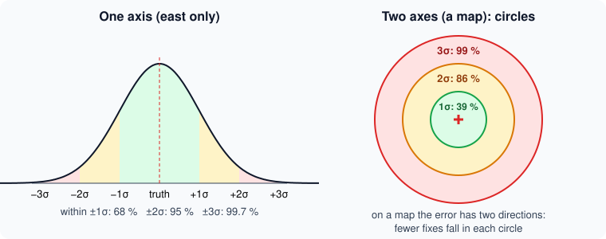
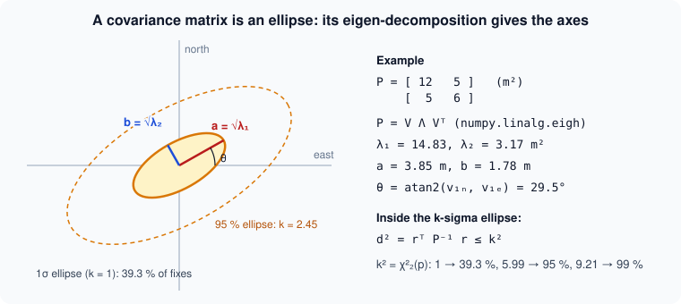

# How sure are we? Errors, sigma and covariance

Ask two people the time. One says *"10:42"*. The other says *"about a quarter to eleven"*. Both are
useful — but the second one also told you **how sure** she is. If you have a train at 10:44, that
difference matters a lot.

A navigation system has the same duty. A position alone is not enough: the autopilot must also know
*how far from the truth it might be*. A drone that believes it is exactly above the runway when it
could be 300 m away will land in a field. In NAVERA, that "how sure" travels with every position,
inside `PositionEstimate`, as a **covariance**. This lesson explains what it means — with dice, circles
and one beautiful formula.

## 1. Error and uncertainty are not the same thing

- The **error** is the distance between the position you give and the **true** position. You can only
  compute it when you know the truth — in a test, a simulation, or with a better reference.
- The **uncertainty** is what the source **says** about its own error *before* anyone knows the truth:
  *"I am probably within about 3 m"*.

In flight nobody knows the truth (otherwise we would not need NAVERA!). So the autopilot has to rely
on the stated uncertainty. That is why it must be **honest**: an uncertainty that is too small is a
lie that the autopilot will believe.

| | Error | Uncertainty |
|---|---|---|
| Who knows it | only someone who knows the truth | the source itself |
| When | after the test | at every fix, live |
| Example | "this fix was 4.2 m off" | "my fixes are within ±3 m, usually" |
| In NAVERA | `evaluate_session.py`, the simulator's "error vs truth" | `position_covariance` |

## 2. Describing many measurements: mean, median, spread

Throw a die ten times: `3 5 2 6 6 1 4 4 2 5`.

- The **mean** (average) is the sum divided by the count: 38 / 10 = **3.8**.
- The **median** is the middle value once sorted: `1 2 2 3 4 4 5 5 6 6` → between 4 and 4 → **4**.
  Half of the values are below it, half above.
- The **standard deviation** (σ, "sigma") measures the **spread**: how far, typically, values are from
  the mean. Recipe: take each value minus the mean, square it, average those squares, take the square
  root. For our throws: **σ ≈ 1.66**.

### Outliers: why engineers love the median

Now imagine that, among 300 good vision fixes about 8 m from the truth, **three** are wrong matches
150 m away. In the lab you will see it on the dataset:

| | Median error | Mean error |
|---|---|---|
| 300 vision fixes, 3 of them wrong | 8.3 m | 10.2 m |

Three bad values out of 300 (1 %) moved the mean by 2 m, while the median barely noticed. That is why
NAVERA's measurements are reported as **median, p90 and max** — never as a mean alone. Lesson 29
comes back to this.

## 3. Sigma circles

When many small causes add up (noise in the radio, the atmosphere, vibrations), errors follow the
famous **bell curve** — the *normal* or *Gaussian* distribution. Its width is σ.



On **one axis** (only east, say), 68 % of the values fall within ±1σ, 95 % within ±2σ, 99.7 % within
±3σ. But a position on a map has **two** axes, east and north, and the error is the distance
`√(east² + north²)`. Fewer points fall in each circle:

| Circle radius | 1σ | 2σ | 3σ |
|---|---|---|---|
| Share of 2-D fixes inside | **39 %** | **86 %** | **99 %** |

So a GPS that states σ = 3 m is **not** saying "always within 3 m". It says: *about 4 fixes in 10
within 3 m, 86 % within 6 m, nearly all within 9 m*. NAVERA's own `evaluate_session.py` uses exactly
these three numbers to check whether a source's stated σ is honest:

```python
print("\nstated accuracy vs truth (honest 2-D sigma: ~39 / 86 / 99 %)")
...
honest = pct([e for e, _ in es], 86) / 2.0       # the sigma that WOULD be honest
```

If far fewer than 86 % of the errors are within 2 × the stated σ, the tool prints
`<- stated sigma too optimistic`. That is how accuracy claims must be produced, from real data.

## 4. Covariance: an ellipse in disguise

Errors are not always the same in every direction. A camera looking forward may be good sideways but
poor in distance; two errors may be **linked** (when east is wrong, north tends to be wrong too). The
**covariance matrix** captures all of it. For the horizontal plane it is a 2 × 2 table:

```
[ σ_east²          c   ]
[   c          σ_north² ]
```

- On the diagonal, the **variances**: σ squared (in m²). σ = 3 m → variance 9 m².
- Off the diagonal, `c` says how much east and north errors move together (0 = independent).

Don't worry about computing with it: just remember that **a covariance is a picture — an ellipse**,
the "1σ zone" around the position.



`PositionEstimate` carries a **3 × 3** matrix (east, north, up), written as 9 numbers row by row —
the same convention as the standard ROS message `NavSatFix`:

```
position_covariance = [σe², 0,   0,
                       0,   σn², 0,
                       0,   0,   σu²]
```

A real covariance must make sense: finite numbers, no negative variance (a σ² is never negative), the
same value above and below the diagonal (symmetric), and an ellipse that exists (mathematicians say
*positive semi-definite*). The arbiter's `_sane()` checks all of that, and a message that fails is not
used at all — a consumer's filter would break on it.

### The covariance *type*

Next to the 9 numbers, `position_covariance_type` says how far to trust them:

| Value | Name | Meaning |
|---|---|---|
| 0 | `UNKNOWN` | "I don't know my accuracy" — the 9 numbers mean nothing |
| 1 | `APPROXIMATED` | an estimate (GPS from HDOP) |
| 2 | `DIAGONAL_KNOWN` | the variances are known, no correlation |
| 3 | `KNOWN` | the full matrix is known |

The message's own comment says it best: *"Publish UNKNOWN rather than an invented matrix: a fabricated
covariance is indistinguishable from a measured one downstream."*

## 5. Why "uncertainty unknown" is DEGRADED

You saw it in lesson 25: a MEASURED position whose covariance type is UNKNOWN (or whose σ is below
1 cm, i.e. not filled in) is never FIX. Now you can see why. FIX means *"you may rely on this position
**and on its stated error**"*. With an unknown error, nobody — not the operator, not the autopilot —
can tell if the position is 5 m or 500 m off. Calling it green would let a guess wear the same label as
a metric GPS lock. That is precisely the mistake the contract was designed to prevent.

Today, day vision **states 30 m** (`local_sigma_m`) until its accuracy is measured with NAVERA's real
camera — so it is DEGRADED (30 m > 25 m). The rule rewards measuring: an honest, measured σ ≤ 25 m
would make it FIX with no code change.

## 6. Two measurements are better than one

Two sources measure the same thing. A says **100 m** (σ 10 m), B says **110 m** (σ 5 m). What do you
believe? Not 105 (the plain average): B is twice as precise, so it should count more. The best
combination is the **weighted average** with weights **w = 1/σ²**:

```
w_A = 1/10² = 0.01          w_B = 1/5² = 0.04
x   = (0.01 × 100 + 0.04 × 110) / (0.01 + 0.04) = 108 m
σ   = 1 / √(0.01 + 0.04) ≈ 4.47 m
```

Look at the new σ: **4.47 m, better than both inputs** (10 and 5). Two independent measurements,
combined honestly, always give something more precise than the best of them. In the lab, source A
(σ 6 m) and source B (σ 9 m) give a fused position whose median error is better than both.

This little formula is the **seed of sensor fusion** — the idea behind the Kalman filter that runs in
the autopilot and that a future NAVERA could use (the message already reserves `SOURCE_FUSED`). Two
warnings, though:

- It only works if the σ are **honest**. A source that states 5 m but is really 50 m off drags the
  result away — with a *small* stated σ, so nobody notices.
- It only works if the errors are **independent**, and without **outliers**. One wrong vision match
  150 m away, fused with weight, moves the answer. That is why NAVERA today chooses **one** winner, and
  why it checks GPS against vision before trusting it (lesson 27).

## 7. In NAVERA

| What | Where in your copy (`~/navera/…`) |
|---|---|
| GPS σ from HDOP: `σ = HDOP × 2 m`, vertical 2 × that | `gps_pkg/gps_pkg/nodes/gps_node.py` (`_publish_fix`) |
| The covariance contract and its types | `navera_msgs/msg/PositionEstimate.msg` |
| "Is this a real covariance?" | `estimator_node.py`, `_sane()` |
| "What σ does the source state?" (the larger of east and north, ≥ 1 cm) | `estimator_node.py`, `_stated_sigma()` |
| FIX only with a stated σ ≤ 25 m | `_classify()`, `fix_max_sigma_m` in `estimator_params.yaml` |
| Is the stated σ honest? (39 / 86 / 99 %) | `navera_tools/evaluate_session.py` |

Two more examples of honest uncertainty in the product (VALIDATION_STATUS.md, unit tests and
simulator only): a vision position carried to the present from a 1.5 s old photo at 40 m/s is moved
60 m and its stated accuracy grows to ±31.5 m; and a GPS "in doubt" (lesson 27) gets an accuracy no
better than its disagreement with vision.

## Glossary

| Word | Meaning |
|---|---|
| **error** | distance between an estimate and the truth (needs the truth) |
| **uncertainty** | what a source says about its own likely error |
| **mean / median** | the average / the middle value once sorted |
| **outlier** | a value far away from the others (a wrong match) |
| **standard deviation, σ** | the typical spread around the mean |
| **variance** | σ², in m² for a position |
| **Gaussian (normal) distribution** | the bell curve of errors made of many small causes |
| **covariance matrix** | the table of variances (and links between axes); a picture: an ellipse |
| **covariance type** | UNKNOWN / APPROXIMATED / DIAGONAL_KNOWN / KNOWN |
| **weighted average** | an average where precise values count more (weight 1/σ²) |
| **sensor fusion** | combining several sources into one better estimate |

## Check what you learned

<details><summary>1. A GPS states σ = 3 m. Is a fix 5 m from the truth a sign that it lies?</summary>
No. With an honest 2-D Gaussian error, about 14 % of the fixes are beyond 2σ = 6 m and about 60 % beyond
3 m. A single 5 m error is normal; you judge honesty on many fixes (39 / 86 / 99 %).
</details>

<details><summary>2. Why does NAVERA report median and p90 rather than only the mean?</summary>
Because a few outliers (wrong matches) pull the mean a lot, while the median barely moves. The p90 and
max then show the bad cases honestly.
</details>

<details><summary>3. What does a covariance of [25, 0, 0, 0, 4, 0, 0, 0, 100] say?</summary>
σ east = 5 m, σ north = 2 m, σ up = 10 m, no correlation: an ellipse stretched east–west.
</details>

<details><summary>4. A source states position_covariance = [0, 0, 0, 0, 0, 0, 0, 0, 0] with type APPROXIMATED. What does the arbiter do?</summary>
It treats the uncertainty as unknown (a σ below 1 cm is not an accuracy): the position is usable but DEGRADED, and it is never used as an independent reference to check GPS.
</details>

<details><summary>5. A (σ 4 m) says 50 m, B (σ 4 m) says 60 m. Fused value and σ?</summary>
Equal weights: 55 m, and σ = 4 / √2 ≈ 2.8 m.
</details>

Now open the **🛠️ Lab** tab.
