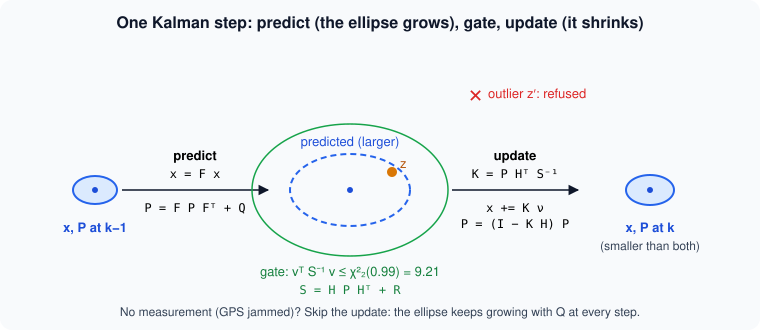

# How sure are we? Covariance, gating and the Kalman filter

> [!NOTE] In short
> - When GPS comes back after a gap, NAVERA must decide if a fix is plausible, so it needs to know
>   how wrong each position may be.
> - This "how wrong" is the **covariance**: you draw it as an ellipse and propagate it with J P
>   Jᵀ.
> - The **chi-square gate** tests if a measurement is plausible, and inverse-variance fusion
>   combines two estimates.
> - A **Kalman filter** carries the covariance from second to second, and the **NEES** test checks
>   if the filter is honest.
> - In the lab you build a 2-D Kalman filter with a chi-square gate, and prove that your 1-D
>   filter is NAVERA's real height filter.

A survey drone leaves Mutrah and flies west along the Muscat coast. Every second its GPS says
*"you are here, ±5 m"*. Then, near the port, a jammer silences the GPS for 40 seconds. When the
fixes come back, the first one is 150 m away from where the drone thinks it is. Is the drone lost,
or is this fix wrong? To answer, the navigation software needs more than positions: it needs to
know **how wrong each position may be**, in every direction, and how that uncertainty **grows**
when no measurement arrives.

That "how wrong" is the **covariance**. In this lesson you will treat it as a mathematical object:
you will draw it as an ellipse with an eigen-decomposition, propagate it through a function, use it
to test whether a measurement is plausible (the **chi-square gate**), combine two estimates with it
(**inverse-variance fusion**), and run a **Kalman filter** that carries it from second to second.
Finally you will check whether a filter is *honest* about its own error (the **NEES test**). All of
this exists in NAVERA's code, and you will compare your filter with NAVERA's real one.

## 1. Error, uncertainty and random variables

- The **error** is `estimate − truth`. You can only compute it when the truth is known: in a test,
  in a simulation, or with a much better reference.
- The **uncertainty** is what the estimator *states* about its error, before anyone knows the truth.

In flight nobody knows the truth, so the autopilot must trust the stated uncertainty. A stated
uncertainty that is too small is dangerous: the autopilot believes it.

We model the error as a **random variable** `e`: a quantity whose value changes from one trial to
the next, described by a probability distribution. For a 2-D position error `e = (e_east, e_north)`:

```
mean        μ = E[e]                         (E[·] = the expected value, the "long-run average")
covariance  P = E[(e − μ)(e − μ)ᵀ]  =  [ σe²    ρ σe σn ]
                                        [ ρ σe σn   σn²  ]
```

- The diagonal holds the **variances** `σe²`, `σn²` (m²). Their square roots are the standard
  deviations σ.
- The off-diagonal term is the **covariance** of east and north. `ρ` (the **correlation
  coefficient**, between −1 and 1) says how much the two errors move together. ρ = 0: independent.
- P is always **symmetric** and **positive semi-definite** (PSD): `vᵀ P v ≥ 0` for every vector v,
  because `vᵀ P v` is the variance of the error in direction v, and a variance is never negative.

From N samples we estimate P with the **sample covariance**:

```
x̄ = (1/N) Σ xᵢ            P̂ = 1/(N − 1) · Σ (xᵢ − x̄)(xᵢ − x̄)ᵀ
```

Dividing by `N − 1` instead of N makes the estimate **unbiased** (one degree of freedom was used to
compute x̄). `numpy.cov` does exactly this.

Most navigation errors are modelled as **Gaussian** (normal): many small independent causes add up
(receiver noise, atmosphere, vibration). A Gaussian is fully described by μ and P. That is why
"how sure are we?" fits in a 2 × 2 (or 3 × 3) matrix.

## 2. The covariance is an ellipse

A symmetric matrix can always be **eigen-decomposed**:

```
P = V Λ Vᵀ         Λ = diag(λ1, λ2)   (eigenvalues, λ1 ≥ λ2 ≥ 0)
                   V = [v1 v2]        (eigenvectors, orthonormal columns)
```

The eigenvectors are the **principal directions** of the error; the eigenvalues are the variances
along them. So the points at "one sigma" form an **ellipse** with

```
semi-major axis  a = √λ1        along v1
semi-minor axis  b = √λ2        along v2
angle            θ = atan2(v1_north, v1_east)     (from east towards north)
```


**Worked example.** `P = [[12, 5], [5, 6]]` m². The trace is 18 and the determinant 12·6 − 5·5 = 47,
so `λ = 9 ± √(81 − 47) = 9 ± 5.83`: λ1 = 14.83, λ2 = 3.17. The ellipse has a = 3.85 m, b = 1.78 m,
and its long axis points θ = 29.5° north of east. Notice: the largest *diagonal* term is 12
(σe = 3.46 m), smaller than λ1 = 14.83. For a tilted ellipse, **no single axis of the map shows the
worst direction** — only the eigenvalue does. Keep this in mind for the "In NAVERA" section.

### How many points fall inside?

The **Mahalanobis distance** measures a vector `r` in units of its own uncertainty:

```
d² = rᵀ P⁻¹ r
```

For a Gaussian error in n dimensions, `d²` follows a **chi-square distribution with n degrees of
freedom** (written χ²ₙ). The "k-sigma ellipse" is the set `d² ≤ k²`. In 2-D the probability has a
closed form, `P(d² ≤ k²) = 1 − exp(−k²/2)`:

| k (ellipse "size") | 1 | 2 | 2.45 | 3 | 3.03 |
|---|---|---|---|---|---|
| share of 2-D points inside | 39.3 % | 86.5 % | 95 % | 98.9 % | 99 % |

On **one** axis the familiar numbers are 68 / 95 / 99.7 % for 1 / 2 / 3 σ. In 2-D the same circles
hold fewer points, because the error has two chances to be large:


So a GPS that states σ = 3 m per axis says: *about 4 fixes in 10 within 3 m, 86 % within 6 m*. And
for a **correlated** error, use the ellipse (`d²`), not a circle: a circle sized for the long axis
is far too pessimistic across it.

## 3. Propagating a covariance: J P Jᵀ

Often we know the uncertainty of some quantities `x` and need the uncertainty of `y = f(x)`. If f
is **linear**, `y = A x`, then exactly:

```
Cov(y) = A P Aᵀ
```

If f is **non-linear**, we linearise it around the estimate with its **Jacobian** `J = ∂f/∂x`
(the matrix of first derivatives) and use the same formula, `P_y ≈ J P Jᵀ`. This is first-order
error propagation; it is good when the errors are small compared with the curvature of f.

**Worked example — a coastal radar.** Imagine a radar station near Ras al Hadd that measures a boat at range
r = 2000 m (σr = 5 m) and bearing b = 60° from north, clockwise (σb = 0.5°). Then
`east = r sin b`, `north = r cos b`, and

```
J = [ ∂e/∂r  ∂e/∂b ]   = [ sin b    r cos b ]   = [ 0.866   1000 ]
    [ ∂n/∂r  ∂n/∂b ]     [ cos b   −r sin b ]     [ 0.5    −1732 ]

P_polar = diag(σr², σb²) = diag(25, (0.5·π/180)²) = diag(25, 7.62e-5)

P_en = J P_polar Jᵀ = [  94.9  −121.1 ]  m²
                      [ −121.1   234.7 ]
```

σ_east = 9.7 m, σ_north = 15.3 m, strongly correlated. The bearing error (0.5°) dominates: at 2 km
it is 2000 × 0.0087 = 17.5 m across the line of sight, three times the range error. **The ellipse is
long across the line of sight and thin along it.** In the lab you check this formula with a Monte
Carlo simulation of 20 000 random radar measurements. Two classic mistakes: forgetting to convert σb
to **radians** (the derivative of sin is cos only in radians), and writing `J P J` instead of `J P Jᵀ`.

## 4. Is this measurement plausible? The chi-square gate

A new measurement `z` arrives. We predicted `ẑ` with covariance `P_pred`, and the measurement has
its own noise covariance R. If both are honest and independent, the **innovation** `ν = z − ẑ`
(the "surprise") has covariance

```
S = P_pred + R          (in general S = H P Hᵀ + R, see section 6)
```

and `d² = νᵀ S⁻¹ ν` follows χ² with n = dim(z) degrees of freedom. The **chi-square gate** accepts
the measurement when

```
d² ≤ χ²ₙ(p)          e.g. n = 2:  p = 0.95 → 5.99,   p = 0.99 → 9.21
```

**Worked example.** Predicted position (0, 0) with `P_pred = [[12, 5], [5, 6]]`; a measurement
(6, −2) m with R = 0 for simplicity. `d² = 8.17`. With p = 0.99 (threshold 9.21) it is accepted;
with p = 0.95 (threshold 5.99) it is refused. The same 6.3 m offset in the direction of the long
axis would be much more plausible than across it: the gate is **direction-aware**, a distance
threshold is not.

The choice of p is a trade-off you will measure in the lab:

- a gate at probability p refuses a fraction **1 − p of good measurements** (false alarms), by
  definition;
- a wider gate lets more **outliers** (wrong map matches, spoofed fixes) through.

And a warning: the gate is only as good as S. If the filter is **overconfident** (P too small), the
gate refuses good measurements — and a filter that refuses every measurement never corrects itself.
You will see this failure in the lab.

## 5. Combining two estimates: inverse-variance fusion

Two independent unbiased estimates of the same quantity, `x1` (variance P1) and `x2` (variance P2).
The **minimum-variance** linear combination weights each by its **information** (inverse variance):

```
P = (P1⁻¹ + P2⁻¹)⁻¹
x = P (P1⁻¹ x1 + P2⁻¹ x2)
```

**1-D worked example.** A says 100 m (σ 10 m, variance 100), B says 110 m (σ 5 m, variance 25).
Information 0.01 and 0.04: `x = (0.01·100 + 0.04·110) / 0.05 = 108 m`, `P = 1/0.05 = 20 m²`,
σ = 4.47 m — **better than both inputs**. Information adds up; that is why fusion helps.

In 2-D the same formula works with matrices, and it does something a scalar weight cannot: a GPS
ellipse long in one direction, fused with a round vision error, is corrected mostly **along its long
axis**, where it is weak.

Three conditions, all necessary:

1. the stated covariances are **honest** (a source stating 5 m while being 50 m off pulls the result
   away, with a small stated σ, so nobody notices);
2. the errors are **independent** (fusing the same information twice makes you overconfident);
3. **no outliers**: gate first, then fuse. One wrong match 150 m away, fused with weight, moves the
   answer by tens of metres.

These conditions are why NAVERA's arbiter today **selects** one source (lesson 25) and uses the other
sources to **check** the GPS (lesson 27) rather than averaging them.

## 6. The Kalman filter

A **Kalman filter** applies sections 3–5 recursively, every time step. It holds a **state** `x`
(for example position and velocity) and its covariance `P`, and alternates two steps.



**Model.** For a vehicle at roughly constant velocity, on one axis, with state `[p, v]`:

```
x_k = F x_{k-1} + w,      F = [ 1  dt ]       w ~ N(0, Q)
                              [ 0   1 ]

Q = q · [ dt⁴/4   dt³/2 ]     (white-noise acceleration of spectral density q, m²/s³)
        [ dt³/2   dt²   ]
```

(The **spectral density** q measures how strong the random acceleration is: in one step the
velocity changes by a random amount whose variance is the bottom-right entry of Q. A larger q lets the velocity change faster.)

Q says how much the vehicle can change its velocity between two steps (a turn, a gust). For two
axes with state `[e, n, ve, vn]`, `F = kron(F1, I₂)` and `Q = kron(Q1, I₂)` (the **Kronecker product**
`kron(A, I₂)` replaces each entry a of A by the block a·I₂, so it copies the 1-axis model for each axis).

**Predict** (propagation, section 3 with J = F):

```
x ← F x
P ← F P Fᵀ + Q              (the ellipse grows)
```

**Update** with a measurement `z = H x + noise`, noise covariance R (for a position fix,
`H = [I₂ 0]`, it picks the position out of the state):

```
ν = z − H x                 innovation
S = H P Hᵀ + R              innovation covariance  (use it for the gate, section 4)
K = P Hᵀ S⁻¹                Kalman gain
x ← x + K ν
P ← (I − K H) P             (the ellipse shrinks)
```

With `H = I` the update is exactly the fusion of section 5 between the prediction and the
measurement. The gain K is "how much to believe the measurement": in 1-D, `K = P / (P + R)`.

**Worked example (1-D, height above ground).** State `[h, climb] = [80 m, 0]`, `P = diag(9, 4)`,
dt = 1 s, q = 0.3.

```
predict:  x = [80, 0]
          P = [[9 + 2·0 + 4 + 0.075,  0 + 4 + 0.15], [4.15, 4 + 0.3]] = [[13.075, 4.15], [4.15, 4.3]]
update with a barometer height z = 83 m, σ = 1.5 m (R = 2.25):
          ν = 3,  S = 13.075 + 2.25 = 15.325,  K = [13.075, 4.15] / 15.325 = [0.853, 0.271]
          x = [80 + 0.853·3, 0 + 0.271·3] = [82.56 m, 0.81 m/s]
          P = [[1.92, 0.61], [0.61, 3.18]]
```

Notice two things. The height σ fell from √13.1 = 3.6 m to √1.92 = 1.4 m, better than the barometer
alone (1.5 m). And the filter learned a **climb rate** (0.81 m/s) that nobody measured: the
correlation term in P (4.15) carried the information from height to climb rate.

**No measurement?** Only predict. P grows by Q at every step. During a 40 s GPS outage at
q = 0.3 the position σ grows from about 3 m to about 90 m — the honest answer to "where am I?" after
40 s without a fix.

## 7. Is the filter honest? NEES

A filter is **consistent** when its P describes its real error. In a simulation, where the truth is
known, compute at every step the **Normalised Estimation Error Squared**:

```
NEES_k = e_kᵀ P_k⁻¹ e_k        e_k = estimate − truth  (position: n = 2)
```

If the filter is consistent, `NEES_k ~ χ²ₙ`, so its **average is n**. For the mean over N steps,
`N · mean ~ χ²_{nN}` (if the steps were independent), which gives a 95 % band:

```
[ χ²_{nN}(0.025) / N ,  χ²_{nN}(0.975) / N ]      n = 2, N = 361:  [1.80, 2.21]
```

- mean NEES **above** the band: the filter is **overconfident** (P too small — q too small, R too
  small, or outliers accepted);
- mean NEES **below** the band: it is **pessimistic** (P too large) — safe but wasteful: gates too
  wide, fusion that trusts the measurements too much.

Successive errors of a filter are correlated, so the band is approximate; it is still the standard
first test. The same idea, with real flights, is what `evaluate_session.py` does in NAVERA (below).

## 🐦 How birds do it

Every winter, Barr Al Hikman on Oman's central coast hosts very large numbers of migrating
shorebirds and flamingos; it is one of the most important wintering wetlands of the region. Many of
these birds arrive in flocks after flights of thousands of kilometres. How precise is one bird?

Release homing pigeons one by one from the same place and their vanishing directions are
**scattered**: each bird's estimate of "home is that way" is a random variable with a spread.
Biologists measure it with a mean direction and a measure of dispersion — the circular version of
μ and σ.

The **"many wrongs" hypothesis** (proposed by Andrew Simons in 2004) says that if each bird's error
is independent, a flock that pools its members' opinions should navigate more accurately than any
single bird — this is section 5, where information adds up. Experiments with homing pigeons found
that small flocks often fly home on more efficient routes than single birds.

But a study of pigeon **pairs** (Biro and colleagues, 2006) adds the important condition. When the
two birds' preferred routes were close, they flew a compromise. When the routes were very different,
they did **not** average: one bird led and the other followed, or they split up. Averaging two very
different opinions would put both birds on a route neither believed in. In our words: when the
Mahalanobis distance between two estimates is small, fuse; when it is large, the gate says "these
cannot both be right" — choose. Navi, NAVERA's swallow, would agree.

## 8. In NAVERA

NAVERA's real data covers **Sousse, Tunisia**, where NAVERA is developed; the data of this lab is
simulated in Oman. The ideas are the same.

| What | Where in your copy (`~/navera/…`) |
|---|---|
| GPS covariance from HDOP: `σ = HDOP × 2 m`, vertical variance 4 × horizontal, type APPROXIMATED | `gps_pkg/gps_pkg/nodes/gps_node.py` |
| The covariance contract (9 numbers, ENU, row-major) and its 4 types | `navera_msgs/msg/PositionEstimate.msg` |
| "Is this a real covariance?" — finite, variances ≥ 0, symmetric, horizontal block PSD | `navera_estimator/…/nodes/estimator_node.py`, `_sane()` |
| "Which σ does the source state?" | `estimator_node.py`, `_stated_sigma()` |
| GPS "in doubt": covariance inflated to the disagreement with vision | `estimator_node.py`, `_in_doubt()` |
| A 2-state Kalman filter on [height, climb rate] | `day_pkg/day_pkg/vision_nav.py`, `_height_predict()` / `_height_update()` |
| A 3-sigma gate on vision fixes | `vision_nav.py`, `gate_k` |
| Are stated σ honest on a real flight? (39 / 86 / 99 %) | `navera_tools/evaluate_session.py` |

The arbiter's covariance checks (a consumer's filter would break on anything else):

```python
cov = list(msg.position_covariance)
if not all(math.isfinite(c) for c in cov):
    return False
if not all(cov[i] >= 0.0 for i in (0, 4, 8)):                 # variances
    return False
tol = 1e-9 * max(1.0, cov[0], cov[4], cov[8])
if any(abs(cov[i] - cov[j]) > tol for i, j in ((1, 3), (2, 6), (5, 7))):
    return False                                               # symmetric
return cov[0] * cov[4] - cov[1] * cov[3] >= -tol               # 2x2 PSD: det >= 0
```

For a 2 × 2 symmetric matrix with non-negative diagonal, `det ≥ 0` is exactly "both eigenvalues
≥ 0". And `_stated_sigma()`:

```python
sigma = math.sqrt(max(msg.position_covariance[0], msg.position_covariance[4]))
return sigma if sigma >= MIN_STATED_SIGMA_M else None          # < 1 cm: "unknown"
```

It reads the larger **diagonal** term. Section 2 showed that, for a tilted ellipse, the largest
eigenvalue is larger than both diagonal terms: in the lab you will measure how much this
underestimates the worst direction for a correlated covariance. (Today NAVERA's GPS covariance is
diagonal, so the two agree.)

The height filter of the day-vision navigator is the filter of section 6, written out by hand:

```python
def _height_predict(self, t):
    (h, v), P, th = self._h
    dt = max(0.0, t - th)
    q = self.climb_accel ** 2                     # 0.5 m/s² -> q = 0.25
    P = [[P[0][0] + dt * (P[0][1] + P[1][0]) + dt * dt * P[1][1] + q * dt ** 4 / 4,
          P[0][1] + dt * P[1][1] + q * dt ** 3 / 2],
         [P[1][0] + dt * P[1][1] + q * dt ** 3 / 2, P[1][1] + q * dt * dt]]
    return (h + v * dt, v), P, t

def _height_update(self, t, z, sigma, source):
    ...
        S = P[0][0] + sigma * sigma
        k0, k1 = P[0][0] / S, P[1][0] / S
        r = z - h
        self._h = ((h + k0 * r, v + k1 * r),
                   [[(1 - k0) * P[0][0], (1 - k0) * P[0][1]],
                    [P[1][0] - k1 * P[0][0], P[1][1] - k1 * P[0][1]]], t)
```

Expand `F P Fᵀ + Q` for `F = [[1, dt], [0, 1]]` and you get exactly these lines. In the lab, your
matrix version must give the same heights to 10⁻⁶ m.

The vision gate refuses a weak fix when its distance to the prediction exceeds
`gate_k · hypot(σ_pred, σ_fix)` with gate_k = 3. With round errors, that is `d² > 9` on a χ²₂
variable: a gate at probability 1 − exp(−4.5) — you will compute it. NAVERA's estimator uses the same
reasoning to cross-check GPS against an independent source: a disagreement beyond 3σ makes GPS
"in doubt", beyond 5σ (plus margins) refuses it (lesson 27).

Honest numbers from VALIDATION_STATUS.md (**unit tests and simulator only**): a vision position
carried to the present from a 1.5 s old photo at 40 m/s is moved 60 m and its stated accuracy grows
to ±31.5 m; a GPS "in doubt" gets an accuracy no better than its disagreement with vision.

## Glossary

| Word | Meaning |
|---|---|
| **random variable** | a quantity whose value varies from trial to trial, described by a distribution |
| **covariance matrix P** | `E[(e − μ)(e − μ)ᵀ]`: variances on the diagonal, co-variations off it |
| **positive semi-definite (PSD)** | `vᵀPv ≥ 0` for every v; all eigenvalues ≥ 0 |
| **eigen-decomposition** | `P = V Λ Vᵀ`: principal directions (V) and variances along them (Λ) |
| **error ellipse** | the set `d² ≤ k²`; semi-axes `k√λ` |
| **Jacobian J** | the matrix of first derivatives of a function; `P_y ≈ J P Jᵀ` |
| **Mahalanobis distance** | `d² = rᵀ S⁻¹ r`: a distance measured in sigmas, direction-aware |
| **chi-square χ²ₙ** | the distribution of d² for an n-dimensional Gaussian |
| **gate** | accept a measurement only if `d² ≤ χ²ₙ(p)` |
| **innovation ν, S** | `z − Hx` and its covariance `HPHᵀ + R` |
| **information** | inverse covariance; it adds up when independent estimates are fused |
| **Kalman gain K** | `P Hᵀ S⁻¹`: how much the update believes the measurement |
| **process noise Q, q** | how much the model allows the state to change unpredictably |
| **NEES** | `eᵀ P⁻¹ e`; its mean should equal the dimension n for an honest filter |
| **consistent / overconfident / pessimistic** | P matches / is smaller than / is larger than the real error |

## Check what you learned

<details><summary>1. P = [[25, 0], [0, 4]] m². Give a, b and θ of the 1-sigma ellipse, and the share of fixes inside the 2-sigma ellipse.</summary>
The matrix is already diagonal: λ1 = 25, λ2 = 4, so a = 5 m, b = 2 m, θ = 0° (the long axis points
east). Inside k = 2: 1 − exp(−2) = 86.5 %.
</details>

<details><summary>2. The radar of section 3 now sees the boat at 4000 m, same σr and σb. Which σ changes most, and roughly by how much?</summary>
The cross-range error r·σb doubles (from 17.5 m to 35 m) while the range error stays 5 m. The ellipse
becomes longer across the line of sight; its area roughly doubles.
</details>

<details><summary>3. A gate at p = 0.99 is applied to 300 good measurements from a consistent filter. How many are refused, roughly? And if the filter's P is 4 times too small?</summary>
About 1 %, so 3. If P (and so S, when R is small compared with P) is 4 times too small, every d² is
about 4 times too large: a good measurement is refused when its true d² > 9.21/4 = 2.3, which happens
with probability exp(−1.15) ≈ 32 % in 2-D — about 95 good measurements refused.
</details>

<details><summary>4. Fuse 50 m (σ 4 m) and 60 m (σ 4 m). Then fuse 50 m (σ 4 m) and 90 m (σ 4 m). What should you do differently in the second case?</summary>
Both give the average with σ = 4/√2 = 2.8 m: 55 m and 70 m. But in the second case the difference
40 m has σ = √(16 + 16) = 5.66 m, so d² = (40/5.66)² = 50 ≫ 6.63 (χ²₁ at 99 %): the two estimates are
not compatible. Gate first: one of them is wrong; do not fuse.
</details>

<details><summary>5. After a 40 s GPS outage the first fix is 150 m from the prediction. The filter's σ is 90 m per axis, R is 5 m. Accept it?</summary>
S ≈ (90² + 5²) per axis. If the 150 m is along one axis, d² ≈ 150² / 8125 = 2.8 &lt; 9.21: accept. The
large P after the outage makes the gate wide, which is right: the filter itself says it may be 150 m
off. With a filter that kept σ = 10 m (too small q), d² = 180: refused, and every later fix too.
</details>

<details><summary>6. A filter's mean NEES over 361 steps is 12. What does it tell you, and what two causes would you check first?</summary>
Far above the band [1.80, 2.21]: the filter is overconfident, its real error is about √(12/2) ≈ 2.4
times larger than it states. Check the process noise q (too small for how the vehicle really moves)
and outliers that were accepted (no gate, or a gate too wide).
</details>

Now open the **🛠️ Lab** tab.
