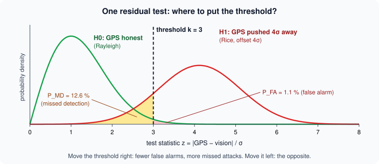
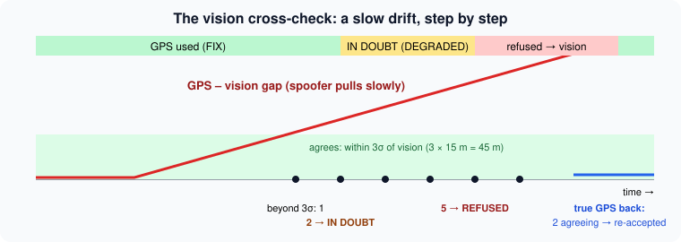

# Detecting GPS spoofing: hypothesis tests in the arbiter

> [!NOTE] In short
> - A spoofer sends fake satellite signals and the receiver still says "fix OK", so only reasoning
>   about the positions can detect it.
> - NAVERA treats detection as a **hypothesis test**, with a false-alarm probability and a
>   missed-detection probability.
> - Test 1, the **kinematic gate**, refuses a jump that the vehicle could not fly.
> - Test 2 compares GPS with an independent source (vision), and refuses it only after several
>   disagreements in a row.
> - The tests have limits: with no independent source, a slow and patient spoofer is not caught.
> - In the lab you build a GPS guard, measure its ROC curve, and attack NAVERA's real arbiter with
>   a scripted fake GPS.

A survey drone flies east along a straight coastline, with the sea to the north, at 15 m/s. At t = 20 s its
GPS suddenly reports a position **2 km north, over the open sea**. Nothing else changed: the
motors, the wind, the camera picture of the coast below. If the autopilot believes the GPS, it will
"correct" its course and fly 2 km the wrong way, sure that it is going home.

This is **spoofing**: a transmitter on the ground sends fake satellite signals, slightly stronger
than the real ones, and the receiver computes the position the attacker chose. The receiver does not
know. Its "fix OK" flag stays on. Only a system that **reasons about the positions it receives** can
notice.

GNSS interference — jamming and spoofing — is a known problem for civil aviation and shipping in
several regions of the world; aviation and maritime authorities have published warnings about it.
A navigation product that only trusts its receiver is not safe there.

In this lesson you will treat spoofing detection as an engineer and a statistician would: as a
**hypothesis test**. You will see the two tests NAVERA runs (a physical reachability test and a
residual test against an independent source), compute their false-alarm and missed-detection
probabilities, and learn their limits honestly.

> [!NOTE]
> NAVERA's test data and its simulator area cover **Sousse, Tunisia**, where NAVERA is developed. The
> lab's scripted attacks use Sousse coordinates; the examples in this text use generic places.

## 1. Threat model: jamming vs spoofing

The GPS signal is weak. At the Earth's surface it arrives at about **−130 dBm** (10⁻¹⁶ W), below the
thermal noise of the receiver; the receiver finds it only because it knows the code to correlate
with. The civil GPS code is public and the navigation message is not authenticated. So:

| | Jamming | Spoofing |
|---|---|---|
| What the attacker transmits | noise on the GPS frequency | fake satellite signals with the public code |
| What the receiver reports | "no fix" (GGA quality 0) | a **wrong** position, "fix OK" |
| Does the receiver know? | **yes** | **no** |
| In NAVERA | `valid = false` → simply not eligible (lesson 25) | must be **detected** by the arbiter |

Jamming is loud but honest. Spoofing is the dangerous case. A classic sequence is **jam, then
spoof**: after a few seconds of jamming the receiver searches again and locks on the strongest
signal — the fake one.

We describe the attacker by what it does to the reported position **p_GPS(t)**:

- **jump**: a sudden offset (2 km in one fix);
- **patient spoofer**: a jump, then it waits;
- **slow drift**: the offset grows slowly, `b(t) = u · t` with u a few m/s, so no single step is large;
- **jam then spoof**: an outage, then a wrong position.

## 2. Detection is a hypothesis test

At every GPS fix the arbiter must choose between two hypotheses:

```
H0 : the GPS is honest      (its error is only noise, sigma of a few metres)
H1 : the GPS is spoofed     (its error contains an attacker's offset b)
```

It computes a **test statistic** T from the data and compares it with a **threshold** γ:
"alarm" when T > γ. Two errors are possible:

| | truth H0 (honest) | truth H1 (spoofed) |
|---|---|---|
| **no alarm** | correct | **missed detection** (probability P_MD) |
| **alarm** | **false alarm** (probability P_FA) | correct detection (P_D = 1 − P_MD) |

You cannot make both errors small with one threshold: a lower γ catches more attacks (P_D ↑) and
refuses more honest fixes (P_FA ↑). Plotting P_D against P_FA for all thresholds gives the **ROC
curve** (Receiver Operating Characteristic). Choosing a point on it is an engineering decision: what
does a false alarm cost (a good GPS refused, the vehicle flies on a less accurate source) compared
with a missed attack (the vehicle is pulled away)?

A third quantity matters for a moving vehicle: the **detection delay** — how far the attacker has
already pulled the vehicle when the alarm comes.



## 3. Test 1 — reachability (the kinematic gate)

The first test uses physics only. A vehicle with top speed v_max cannot be farther than

```
R(Δt) = v_max · Δt + m
```

from its last **trusted** fix, Δt seconds ago; m is a margin for receiver noise. The test statistic
is the distance d between the new fix and the last trusted fix:

```
accept  if  d ≤ v_max · Δt + m        refuse ("implausible jump")  otherwise
```


This is not a statistical threshold but a **bound**: under H0 a fix can only fail if the receiver
error exceeds m, so P_FA ≈ 0 when m is generous (NAVERA: m = `gps_jump_margin_m` = 50 m). v_max is
set **per vehicle** (`NAVERA_MAX_SPEED_KMH`): a boat, a drone and an aircraft differ by ten times.

**Worked example (coastal survey drone).** v_max = 30 m/s, m = 50 m, one fix per second. A good fix
1 s after the last one: R = 30 · 1 + 50 = 80 m, and the drone moved 15 m → accepted. The spoofed fix
2 km north: d ≈ 2 000 m > 80 m → refused, with the reason
`implausible jump 2002 m in 1.0 s (max 80 m at 30 m/s) — possible spoofing`.

### The holes in the gate

Look at R(Δt): the circle **grows with time**. Three attacks use this.

1. **Patient spoofer.** The spoofer jumps by D sideways and stays there. While the vehicle flies on
   at speed s, the spoofed fix is at distance `sqrt((s·Δt)² + D²)` from the last trusted fix. It
   becomes "reachable" when

   ```
   v_max·Δt + m ≥ sqrt((s·Δt)² + D²)
   ⇔ (v_max² − s²)·Δt² + 2·v_max·m·Δt + (m² − D²) ≥ 0
   ```

   a quadratic in Δt. With v_max = 30, s = 15, m = 50, D = 2 000:
   675·Δt² + 3 000·Δt − 3 997 500 ≥ 0 → **Δt ≈ 74.8 s**. After that the spoof is accepted, and worse:
   when the true GPS comes back it is 2 km from the (fake) trusted fix, so the **honest receiver is
   refused as a jump**. NAVERA's mission simulator found exactly this before the cross-check existed:
   *"a 2 km spoof accepted after 33 s, then the true GPS locked out"* (comment in `estimator_node.py`).
2. **Slow drift.** With u < v_max every step is reachable. The gate never fires.
3. **Jam then spoof.** After an outage of 60 s at v_max = 30 m/s, R = 1 850 m: almost any spoof is
   reachable.

The gate catches jumps. For the rest we need a second, **independent** measurement.

## 4. Test 2 — residual against an independent source

Day vision matches the camera image with the satellite map: it measures the position **without**
using GPS, and a radio transmitter cannot change what the camera sees. While GPS is good, NAVERA's day
vision checks one frame every 2 s around the current position (`gps_check_period_s`) and publishes an
estimate with its **stated** σ_v.

The **residual** is the distance between the two measurements of the same instant:

```
r = | p_GPS − p_vision |              z = r / σ_v        (test statistic)
```

### Its distribution under H0

Under H0, p_GPS = p + e_g and p_vision = p + e_v, with independent Gaussian errors of σ_g and σ_v per
axis (lesson 26). The difference e_g − e_v is a 2-D Gaussian with variance s² = σ_g² + σ_v² per axis,
and its length r follows a **Rayleigh distribution**:

```
P(r > ρ) = exp(−ρ² / (2 s²))
```

(This is the χ² test of lesson 26 with 2 degrees of freedom: r²/s² ~ χ²₂, whose tail is exp(−x/2).)
With the threshold ρ = k·σ_v and, as NAVERA does, σ_v only:

| k | P(one fix beyond kσ), σ_g = 0 | with σ_g = 3 m, σ_v = 15 m |
|---|---|---|
| 2 | exp(−2) = 0.135 | 0.146 |
| 3 | exp(−4.5) = **0.0111** (≈ 1 in 90) | 0.0132 |
| 5 | 3.7·10⁻⁶ | 6.0·10⁻⁶ |

Note the 2-D trap: in 1-D, "beyond 3σ" happens 0.27 % of the time; in 2-D it is 1.1 %, four times
more. A single vision fix beyond 3σ is therefore **not** evidence of an attack.

### Persistence: n in a row

A single wrong map match happens (a repeated texture, a new building). So NAVERA asks for **n
distinct vision fixes in a row** beyond 3σ. If the fixes are independent:

```
P_FA(streak) = p^n        p = 0.0111, n = 5  →  1.7 · 10⁻¹⁰
```

The code comment says *"chance: < 1e-12"*: that is the 1-D figure (0.0027⁵ ≈ 1.4·10⁻¹³). Both are
tiny. But both assume **independence**, and the lab will show that a vision error that persists from
one frame to the next (the same map misalignment) makes streaks far more likely than p^n.

### Detection delay under H1 (worked example)

A drift of u = 4 m/s north, σ_v = 15 m, one vision fix every T = 2 s. The offset crosses 3σ = 45 m
after 45 / 4 ≈ 11 s; five fixes in a row beyond it take (5 − 1) · 2 = 8 s more. Expected refusal near
**t ≈ 19 s, offset ≈ 77 m** (noise moves this by a few metres either way). NAVERA's mission simulator,
with a gimbal camera and a 4 m/s drift: *refused at ~140 m and held; NAVERA error median 15 m, max
143 m (before the cross-check: median 417 m, max 902 m, never refused)* — `docs/VALIDATION_STATUS.md`,
**simulation**. The simulator's vision is not ideal, so the refusal comes later than the formula.

### The rule set (ARCHITECTURE.md §3)

"Beyond 3σ" in the code is `3·σ_v + v_max · gap`, where gap is the time between the vision photo and
the GPS fix it is compared with (a photo taken 1 s earlier describes a place the vehicle has left).

| Rule | Effect |
|---|---|
| **In doubt** — 2 distinct vision fixes in a row beyond 3σ, gap ≤ 500 m | GPS still used, but its stated σ becomes no better than the gap → DEGRADED, reason `GPS IN DOUBT: day vision disagrees by N m` |
| **Refused, slow drift** — 5 distinct fixes in a row beyond 3σ | `GPS drifting away from day vision: 5 independent fixes in a row beyond 3 sigma …` |
| **Refused, clear disagreement** — beyond 5σ + 50 m for 3 s, ≥ 2 distinct fixes | `GPS drifting away from day vision: N m apart for 3 s …` |
| **Never on one fix** | one wrong match never refuses a good GPS |



"In doubt" is a soft decision: the autopilot already weighs the GPS less (its stated σ grows), so a
later switch to vision is not a surprise. A gap above 500 m is more likely a wrong vision match than a
spoofer this patient, so no doubt is applied there.

## 5. Re-acceptance: a state machine with hysteresis

A refused GPS must come back some day — the attacker leaves, the vehicle flies out of range. The
re-acceptance rule is **asymmetric** on purpose (hysteresis, as in lesson 25):

- refuse after 5 disagreeing fixes (or 3 s far beyond 5σ + 50 m);
- re-accept only when **2 distinct vision fixes agree within 3σ**;
- a GPS returning after an **outage** (no trusted fix for `gps_timeout_s` = 3 s) needs the same
  confirmation: this closes "jam then spoof";
- without an independent source of stated σ, a GPS refused by the gate comes back when it is
  reachable again (the patient-spoofer hole); a GPS refused **by the cross-check** stays refused for
  120 s without any independent fix, because comparing GPS with its own spoofed past proves nothing.

The states of the guard you will write: **TRUSTED → IN_DOUBT → REFUSED → (2 agreeing fixes) →
TRUSTED**.

## 6. The honest limits

From ARCHITECTURE.md: *"All three protections need an independent source with a stated accuracy. With
vision of unknown accuracy only the kinematic gate applies: a sudden jump is caught, a patient or
gradual spoofer is not."*

- **No landmark, no test.** Over the open sea far from the coast, or over the uniform dunes of a sand
  desert such as the Sahara, vision cannot match the map: there is no independent source, only the gate.
- **Unknown or dishonest σ.** If vision does not state its σ, a 100 m disagreement proves nothing. If
  it states a σ that is too small, the test refuses a **good** GPS (P_FA explodes). Day vision states
  σ 30 m today — **not yet measured with NAVERA's camera** (VALIDATION_STATUS.md, limitation 7).
- **A spoofer below the threshold.** An attacker who knows the rule can keep the offset just under
  3σ + v_max·gap and is never detected. The test does not remove the error; it **bounds** it.
- **Correlated errors.** p^n assumes independent fixes; real map-matching errors are correlated.
- **Other defences exist** outside NAVERA: signal-level checks in the receiver (power, several
  antennas measuring the direction of arrival) and authenticated signals such as Galileo's OSNMA
  service. They need receiver hardware support; NAVERA's arbiter works with any receiver.

## 🐦 How birds do it

Birds can be fooled too, and the ways look a lot like jamming and spoofing.

**False light (spoofing).** Many songbirds migrate at night — on the routes between Europe and Africa,
most of the small birds that cross the Mediterranean fly in the dark. Bright artificial
lights (lit towers, buildings, offshore platforms) are well documented to **attract and trap** night
migrants: birds circle the lights for hours, lose energy, or hit lit glass. To the bird the light is a
false signal much stronger than the faint stars — like a spoofer's signal above the real satellites.

**Radio noise (jamming).** In 2014 researchers in Oldenburg, Germany (Engels and colleagues, *Nature*)
found that European robins on their campus could not use their magnetic compass. The cause was weak
human-made radio-frequency noise. Inside huts screened with grounded aluminium, the robins oriented
correctly again: a natural sensor jammed, and restored.

**Cross-checking.** Experiments with conflicting cues (a turned magnetic field at sunset, as in the
thrush study of lesson 25) show that birds compare their compasses and recalibrate one against
another. A swallow like Navi, crossing the Pyrenees at dawn, has the sun, the magnetic field
and landmarks: one fooled sense is dangerous; three senses that must agree are much harder to fool.
That is the residual test.

## 7. In NAVERA

| What | Where in your copy (`~/navera/…`) |
|---|---|
| Kinematic gate, re-acceptance | `navera_estimator/navera_estimator/nodes/estimator_node.py`, `_check_gps_plausibility()` |
| Cross-check while GPS is trusted | `_drifting_away()`, `_refuse()`, `_in_doubt()` |
| The independent reference (fresh, stated σ, same instant) | `_independent_reference()`, `_gps_near()` |
| Constants | `STREAK_N = 5`, `DOUBT_MAX_M = 500.0`, `gps_crosscheck_sigmas` (5), `gps_crosscheck_persist_s` (3 s) |
| Top speed | `max_speed_mps`, from `NAVERA_MAX_SPEED_KMH` (`navera_common/navera_common/vehicle.py`) |
| Vision checking GPS every 2 s | `day_pkg` (`gps_check_period_s`, `gps_check_radius_m` 600 m) |
| Integration test (jump, patient spoof, jam-then-spoof, drift, one wrong vision fix) | `navera_tools/tests/test_estimator.py` |

The heart of the streak test, from `_drifting_away()` (shortened):

```python
name, d, tol, ref_stamp, tol_strict = ref        # tol_strict = 3 sigma + max_speed x gap
if d > tol_strict:
    self._streak.add(ref_stamp)                   # a SET of photo stamps: one photo counts once
else:
    self._streak = set()                          # one agreeing fix resets the streak
self._gps_doubt = (d, name) if len(self._streak) >= 2 and d <= DOUBT_MAX_M else None
if len(self._streak) >= STREAK_N:
    self._refuse(stamp, f"GPS drifting away from {name}: {STREAK_N} independent fixes in a row "
                        f"beyond 3 sigma ...")
    return True
```

And re-acceptance after a refusal or an outage, from `_check_gps_plausibility()`:

```python
self._agree_refs = self._agree_refs | {ref_stamp} if d <= tol_strict else set()
if len(self._agree_refs) >= 2:
    self.get_logger().warn(f"GPS confirmed by {name} (... 2 fixes) — re-accepted")
    self._gps_suspect = None
    self._gps_trusted = (msg.latitude, msg.longitude, stamp)
```

One more protection: vision takes its search centre from the **arbiter's output**
(`/navera/position`), never from the raw GPS, so a refused GPS cannot drag the vision search away. A
QA campaign once found the opposite (vision followed the spoofed GPS and the drone landed); it is
fixed (VALIDATION_STATUS.md, *QA campaign 2026-09-30*).

## Glossary

| Term | Meaning |
|---|---|
| **spoofing** | transmitting fake GNSS signals so the receiver computes a wrong position |
| **jamming** | drowning the GNSS signals in noise: the receiver has no fix |
| **hypothesis test** | deciding between H0 (honest) and H1 (attack) by comparing a statistic with a threshold |
| **test statistic** | the number computed from the data, here z = \|GPS − vision\| / σ_v |
| **false alarm (P_FA)** | an alarm while H0 is true (a good GPS refused) |
| **missed detection (P_MD)** | no alarm while H1 is true; P_D = 1 − P_MD |
| **ROC curve** | P_D as a function of P_FA, one point per threshold |
| **kinematic gate** | refuse a fix farther than v_max·Δt + m from the last trusted fix |
| **residual** | the difference between two measurements of the same quantity |
| **Rayleigh distribution** | the law of the length of a 2-D Gaussian vector; tail exp(−ρ²/2s²) |
| **persistence** | requiring n alarms in a row before deciding |
| **hysteresis** | different conditions to enter and to leave a state |
| **independent source** | a position measured without GPS (vision, stars) |

## Check what you learned

<details><summary>1. v_max = 30 m/s, m = 50 m, last trusted fix 3 s ago. Is a fix 150 m away accepted?</summary>
No. R = 30 · 3 + 50 = 140 m < 150 m: refused ("implausible jump"). Always compute; intuition is not enough.
</details>

<details><summary>2. Why is one vision fix beyond 3σ not enough to refuse the GPS?</summary>
In 2-D, P(r > 3σ) = exp(−4.5) ≈ 1.1 % under H0: about one honest fix in 90 is beyond 3σ, and wrong
map matches add more. Refusing on one fix would refuse good GPS often. With 5 independent fixes in a row
the probability falls to about 1.7·10⁻¹⁰.
</details>

<details><summary>3. A patient spoofer offsets the GPS 1 km to the side of a hovering drone (s = 0), v_max = 20 m/s, m = 50 m. After how long is the spoof "reachable" by the gate alone?</summary>
v_max·Δt + m ≥ D → Δt ≥ (1000 − 50) / 20 = 47.5 s. With vision of stated σ the spoof is never accepted,
because re-acceptance then needs two agreeing vision fixes.
</details>

<details><summary>4. A drift of 2 m/s, σ_v = 15 m, one vision fix every 2 s, NAVERA's rule (3σ, n = 5). Estimate the offset at refusal.</summary>
The offset reaches 45 m after 22.5 s; 4 more fixes take 8 s: about 30 s, offset ≈ 61 m. A slower drift is
caught later in time but at a similar offset: the test bounds the offset, not the time.
</details>

<details><summary>5. Why does correlation between successive vision errors increase the false-alarm rate of the streak test?</summary>
p^n assumes n independent chances. If the vision error stays the same for several frames (same map
misalignment), one bad error produces several "beyond 3σ" fixes in a row: the streak is almost one event,
with probability close to p, not p^n.
</details>

<details><summary>6. Over the open sea far from the coast, which protection is left, and which attacks get through?</summary>
Vision has no landmark, so there is no independent source: only the kinematic gate. A sudden jump is caught;
a slow drift, a patient spoofer and jam-then-spoof are not. This is documented (VALIDATION_STATUS.md, limitation 7).
</details>

Now open the **🛠️ Lab** tab.
