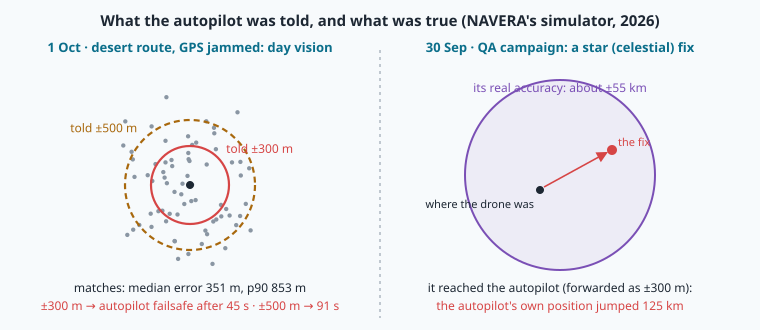
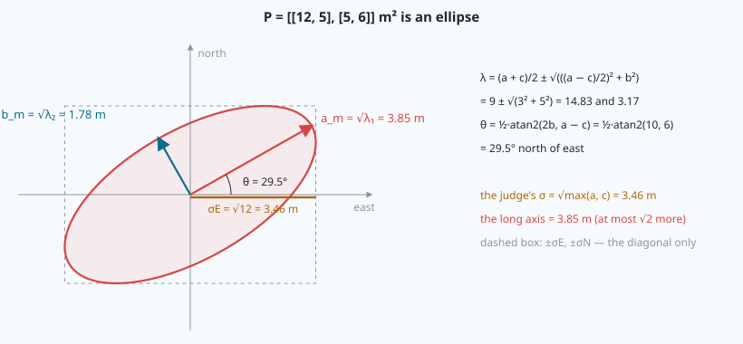
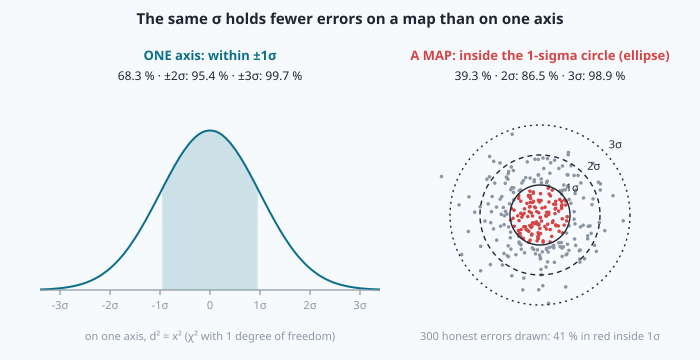
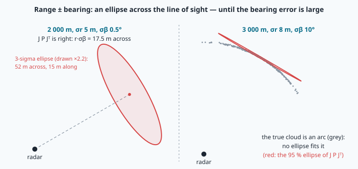
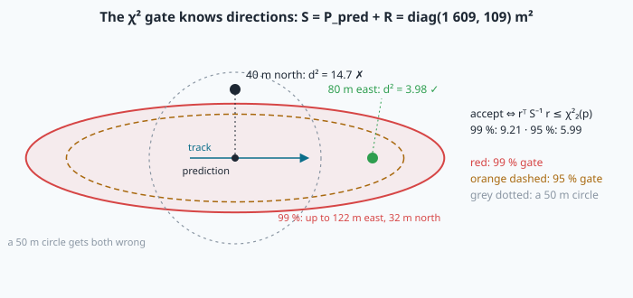
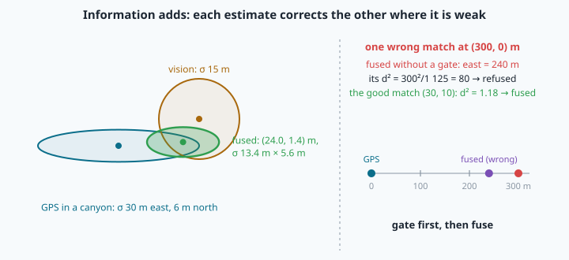

# How sure are we? Covariance, gating and fusion



> [!NOTE] Mission brief
> **1 October 2026, NAVERA's mission simulator, a desert route in southern Tunisia.** GPS is jammed. Day
> vision matches the camera's frames against the map, but over uniform terrain its median error is **351 m**,
> with a long tail (p90: **853 m**), and NAVERA's own motion gate refused 44 more frames that jumped 360–570 m.
> NAVERA forwards it as **±300 m**, and the autopilot
> uses at most **±100 m** of any accuracy it is told. After **45 s** the autopilot's navigation filter gives
> up and the drone lands. A second flight, forwarded at ±500 m, lasted **91 s**. A day earlier, in the QA
> campaign of **30 September**, a star fix good to about **±55 km** reached the autopilot as ±300 m: the
> autopilot's own position jumped **125 km**. (NAVERA's validation report, ArduPilot guide and backlog. The
> 125 km jump is fixed: such positions are no longer forwarded. The desert flight was saved only later, in the
> simulator, by a better vision matcher.)
>
> The receiver of a σ does arithmetic with it: it **weighs** positions by it and **refuses** positions that
> disagree too much with what it expects. A wrong σ is not a cosmetic error. Today you learn that arithmetic.
> **Session 1 — Ellipse maker:** you turn a cloud of fixes into a matrix, the matrix into an ellipse, and
> you discover by simulation how many honest errors an ellipse holds. **Session 2 — Gatekeeper:** you judge
> six fixes after a GPS outage, attack your own gate, fuse GPS with vision on a city drive, and publish the
> result in the contract of mission 12. Badges: **Ellipse maker**, then **Gatekeeper**.
>
> **Start now:** open the 🛠️ **Lab** tab, do **Step 0** (two minutes, no code), then come back for §1.

**Objectives.** After this mission you can:

1. compute a **covariance** from a cloud of fixes and draw its **error ellipse** (axes, angle), by hand and
   in code, and say what a single σ misses;
2. measure a surprise in sigmas (**Mahalanobis d²**) and say, from the **χ²** law you simulate, how many
   honest errors fall inside an ellipse;
3. carry a covariance through a function with **J P Jᵀ**, and check it — and its limits — by Monte Carlo;
4. **gate** a fix with a χ² threshold and **fuse** two estimates by their information, and name what each
   costs (refused truths, accepted lies, over-confidence);
5. **publish** the result honestly in the position contract of mission 12.

**You need:** mission 12 (the covariance a, b, c, the judge's σ), 24 (the 1-D variance blend), 11 (the
noise of a speed from two fixes), 01 (a Jacobian). ⏱ Reading: 70 to 100 minutes with the ✏️ checks
(eigenvalues and χ² are new for many). Lab: 3 h to 5 h in two sessions.

**What you already know** — answer without looking; if you miss two, reread the mission named.

<details><summary>1. Mission 12: is a = 25, b = 30, c = 16 a covariance? And what σ does the judge read from a = 400, b = 0, c = 144?</summary>
No: a·c − b² = 400 − 900 &lt; 0 (ρ = 1.5). The judge reads √max(a, c) = √400 = 20 m.
</details>

<details><summary>2. Mission 24: blend 20 m (variance 4 m²) with 26 m (variance 12 m²). Result and its variance?</summary>
(20 × 12 + 26 × 4) / (4 + 12) = 21.5 m, variance 4 × 12 / 16 = 3 m²: closer to the better estimate, and
better than both.
</details>

<details><summary>3. Mission 11: two fixes 1 s apart, each off by σ = 3 m per axis, independently. σ of the speed per axis?</summary>
√2 × 3 / 1 = 4.24 m/s: the variances of the two errors add (9 + 9 = 18).
</details>

<details><summary>Words of this lesson</summary>

| Word | Plain meaning | Français |
|---|---|---|
| **covariance matrix** P | the 2 × 2 table [[a, b], [b, c]] of variances and covariance of an error (m²) | matrice de covariance |
| **eigenvector, eigenvalue** | a direction a matrix only stretches, and by how much | vecteur propre, valeur propre |
| **error ellipse** | the curve "one sigma away" in every direction; k-sigma: k times larger | ellipse d'erreur |
| **Mahalanobis distance** d² | a squared distance counted in sigmas of a covariance | distance de Mahalanobis |
| **χ² (chi-square) law** | the law of d² for honest Gaussian errors | loi du khi-deux |
| **degrees of freedom** | how many independent error components are added in d² (2 on a map) | degrés de liberté |
| **Monte Carlo** | checking a formula by simulating thousands of random cases | Monte-Carlo |
| **innovation** | the surprise: measured minus predicted | innovation |
| **gate** | accept a measurement only if its d² is below a threshold | porte (test de validation) |
| **information** | the inverse of a covariance, P⁻¹: it adds up when estimates are fused | information |
| **coverage** | the share of cases where the truth lies inside the stated ellipse | taux de couverture |
</details>

## 1. One cloud, one matrix

**Why.** A receiver says "±3 m". On a map an error has two components, east and north, and they can be
linked: a wall that reflects signals stretches the errors along one line. One number cannot say that.

**The idea.** Mission 12 gave you the language: a = σE², c = σN² and the covariance b, in one symmetric
matrix P = [[a, b], [b, c]]. From N recorded errors **eᵢ** = (eE, eN) we **estimate** it: subtract the mean
error **ē**, multiply each deviation by itself as a column times a row (an **outer product**, a 2 × 2
matrix), add them up and divide by N − 1:

```
P̂ = 1/(N − 1) · Σᵢ (eᵢ − ē)(eᵢ − ē)ᵀ          a = Σ dE² / (N − 1),  b = Σ dE·dN / (N − 1),  c = Σ dN² / (N − 1)
```

Why N − 1 and not N? The mean ē was computed from the same points, so the deviations are a little smaller
than the true errors; dividing by N − 1 corrects that exactly (numpy's `np.cov` does the same). With N = 1
there is no spread to see at all: N − 1 = 0, and the formula refuses to answer.

**Worked example.** Four errors (m): (2, 1), (−1, −2), (3, 2), (−4, −1). Their mean is (0, 0).
Sum of dE² = 4 + 1 + 9 + 16 = 30; sum of dE·dN = 2 + 2 + 6 + 4 = 14; sum of dN² = 1 + 4 + 4 + 1 = 10.
Divided by N − 1 = 3: **P̂ = [[10, 4.67], [4.67, 3.33]]** m², ρ = 4.67 / √(10 × 3.33) = **0.81**: when the
error is east it is mostly north too.

> [!QUESTION] ✏️ Check
> Three errors: (1, 0), (−1, 0), (0, 3). Compute P̂. Which axis is worse, and are the errors correlated?

<details><summary>Answer</summary>
Mean (0, 1). Deviations (1, −1), (−1, −1), (0, 2). Sums: dE² = 2, dE·dN = −1 + 1 + 0 = 0, dN² = 1 + 1 + 4 = 6.
÷ 2: P̂ = [[1, 0], [0, 3]] m². North is worse (σN = 1.73 m against 1 m); b = 0, no correlation. Forgetting to
subtract the mean gives dN² = 9 and a wrong c = 4.5.
</details>

## 2. The covariance is an ellipse

**Why.** The judge of mission 12 reads one σ = √max(a, c). Is that the worst direction?

**The idea.** Mission 12 gave the variance along any unit direction u = (uE, uN):
`a·uE² + 2b·uE·uN + c·uN²`. Turn u all around: the variance is largest along one direction and smallest along
the perpendicular one. These two directions are the **eigenvectors** of P, and the two extreme variances are
its **eigenvalues** λ₁ ≥ λ₂. The points one sigma away in every direction form an **ellipse** with semi-axes
**a_m = √λ₁** and **b_m = √λ₂** (metres; the names of the code, not to be confused with the matrix entries a and
b); the **k-sigma ellipse** is k times larger.



> [!TIP] 🧰 Maths toolbox — the eigenvalues of a symmetric 2 × 2 matrix, by hand
> For P = [[a, b], [b, c]]:
> ```
> λ₁, λ₂ = (a + c)/2 ± √( ((a − c)/2)² + b² )           θ = ½ · atan2(2b, a − c)
> ```
> θ is the angle of the long axis, from **east towards north** (like an ENU yaw, CONVENTIONS §3), between
> −90° and 90°: an axis has no arrow (θ and θ + 180° are the same line). If b = 0 and a = c, the ellipse is a
> circle and θ = 0 by convention. Check: λ₁ + λ₂ = a + c and λ₁·λ₂ = a·c − b² (the **determinant** of P):
> that is why mission 12's rule a·c − b² ≥ 0 means "no negative variance". You do not need to derive these
> formulas: use them, and check them with λ₁ + λ₂ = a + c.

**Worked example.** P = [[12, 5], [5, 6]] m². (a + c)/2 = 9; (a − c)/2 = 3; √(3² + 5²) = √34 = 5.83. So
λ₁ = 14.83, λ₂ = 3.17 m²: the ellipse has **a_m = √λ₁ = 3.85 m** and **b_m = √λ₂ = 1.78 m**. Its angle:
θ = ½ · atan2(10, 6) = ½ × 59.04° = **29.5°** north of east. Check: along u = (cos 29.5°, sin 29.5°) =
(0.870, 0.493) the variance is 12 × 0.757 + 2 × 5 × 0.429 + 6 × 0.243 = 14.83 ✓.

The judge's σ is √max(12, 6) = **3.46 m**, shorter than a_m = 3.85 m. A diagonal term is the variance along
east or north only; when the ellipse is **tilted**, the worst direction is neither. How bad can it get?
λ₁ ≤ λ₁ + λ₂ = a + c ≤ 2·max(a, c), so √max(a, c) misses the long axis by **at most a factor √2**
(the worst case is a thin ellipse at 45°). For a round or axis-aligned ellipse the two agree.

**Reading the angle as a compass direction.** θ is counted from east towards north; a bearing is counted from
north, clockwise: bearing = 90° − θ (CONVENTIONS §3). A negative θ points south of east: θ = −57° is the line
towards bearing 147° (south-south-east), and, since an axis has no arrow, also 327° (north-north-west).

> [!QUESTION] ✏️ Check
> 1. P = [[10, 6], [6, 10]] m². Give a_m, b_m, θ, and the judge's σ.
> 2. P = [[4, 0], [0, 25]]. Give a_m, b_m, θ. Why is θ = 90° and not −90°?

<details><summary>Answer</summary>
1. λ = 10 ± √(0 + 36) = 16 and 4 → a_m = 4 m, b_m = 2 m; θ = ½ atan2(12, 0) = 45°. The judge reads √10 = 3.16 m:
21 % short of the long axis.<br>
2. λ = 25 and 4 → a_m = 5 m (north), b_m = 2 m; θ = ½ atan2(0, −21) = ½ × 180° = 90°. −90° is the same line; the
range (−90°, 90°] keeps one name for it, so two programs print the same angle.
</details>

## 3. How far is a surprise? Mahalanobis distance and the χ² law

**Why.** A fix lands 6 m from where you expected it. Is that a lot? Along the long axis of the ellipse
above, 6 m is 1.6 sigma; across it, 3.4 sigma. A distance in metres does not know the ellipse.

**The idea.** Count the distance **in sigmas**, direction by direction. For a surprise vector r and a
covariance P:

```
d² = rᵀ P⁻¹ r            (the squared Mahalanobis distance; d is in sigmas)
```

On a round error of σ per axis, d² = |r|²/σ²; in general, d² = (part of r along v₁)²/λ₁ + (part along v₂)²/λ₂.
The k-sigma ellipse is exactly the curve d² = k².

**Worked example.** r = (6, −2) m, P = [[12, 5], [5, 6]]. The inverse of a 2 × 2 matrix:
P⁻¹ = 1/(a·c − b²) · [[c, −b], [−b, a]] = 1/47 · [[6, −5], [−5, 12]]. Written out for r = (rE, rN):

```
d² = (c·rE² − 2b·rE·rN + a·rN²) / (a·c − b²)
   = (6·6²  −  2·5·6·(−2)  +  12·(−2)²) / 47 = (216 + 120 + 48) / 47 = 384 / 47 = 8.17      d = 2.86 sigmas
```

**How many honest errors fall inside an ellipse?** Take an error that is exactly as large as its covariance
says. Measured in sigmas along its own axes, it is a pair (x, y) of independent standard normal numbers
(mean 0, σ 1), and d² = x² + y². On ONE axis, ±1σ holds 68 % of the errors. On a map, what share has d² ≤ 1?
Below which d² do 95 % of the errors stay? Do not guess from one axis: **go to lab Step 3 now**, square and add
two such numbers 10 000 times, and come back.

<details><summary>Read this after lab Step 3: the χ² law, and the length of a round error</summary>

Your simulation found about **39 %** of the results ≤ 1, **86 %** ≤ 4, **99 %** ≤ 9; 95 % of them stay below
about **5.99**, 99 % below **9.21**. This is the **χ² law with 2 degrees of freedom**. For two dimensions it has a
closed form:

```
share inside the k-sigma ellipse = 1 − exp(−k²/2)          95 % ⇔ k² = 5.99,   99 % ⇔ k² = 9.21
```



| k | 1 | 2 | 2.45 | 3 | 3.03 |
|---|---|---|---|---|---|
| on ONE axis, within ±kσ | 68.3 % | 95.4 % | 98.6 % | 99.7 % | 99.8 % |
| on a MAP, inside the k-sigma ellipse | **39.3 %** | 86.5 % | 95 % | 98.9 % | 99 % |

On a map the error has two chances to be large, so the same "1 sigma" holds far fewer fixes. A GPS that states
σ = 3 m per axis puts only about 4 fixes in 10 within 3 m. (The mean of d² is the number of dimensions: 2
on a map, 1 on one axis.) We write **χ²₂(p)** for "the χ² threshold with 2 degrees of freedom for probability
p": the d² that a share p of honest 2-D errors stays below (5.99 for 95 %, 9.21 for 99 %). On ONE axis it is
**χ²₁(p)**: 3.84 for 95 %, 6.63 for 99 % (1.96² and 2.58²).

**The length of a round error.** When σ is the same on both axes and b = 0, the distance r = σ·d from the
truth follows the **Rayleigh law**: mean **1.25 σ** (√(π/2)), median **1.18 σ** (√(2 ln 2)), 90 % within
**2.15 σ**, 95 % within **2.45 σ**. It explains mission 11's parked car: each 1-s step had noise √2 × 3 = 4.24 m
per axis, so the "speed" of a car standing still averaged 1.25 × 4.24 = **5.3 m/s**. Mission 32 measures
accuracy with it.

> [!QUESTION] ✏️ Check — back to the mission brief
> Day vision was forwarded as ±300 m (round) and measured a median error of 351 m, p90 853 m. 1. Was ±300 m
> wrong about the median? 2. About the tail? 3. The autopilot used ±100 m. What median did it expect, and how
> many of its sigmas were typical errors and the tail?

<details><summary>Answer</summary>
1. No: a round σ = 300 m predicts a median of 1.18 × 300 = 353 m, about what was measured.<br>
2. Yes: it predicts a p90 of 2.15 × 300 = 644 m, but 853 m was measured. These errors are not Gaussian (wrong
matches, jumps): the tail is fatter than any σ says.<br>
3. A median of 1.18 × 100 = 118 m. Typical errors (351 m) were then about 3.5 of its sigmas and the tail (853 m)
about 8.5. A 99 % χ² gate (§5) would refuse even the typical errors. ArduPilot's own gate is set in standard deviations
(EK3_POS_I_GATE, 1 to 10 σ in ArduPilot's parameter list; several σ wide), so it can accept the typical errors as if they were good to 100 m
(its position jumps by hundreds of metres) and refuse the tail. Either way its consistency tests stay far above
normal and its failsafe trips. Both the stated σ and what the receiver does with it matter.
</details>

</details>

> [!QUESTION] ✏️ Check
> 1. With P = [[12, 5], [5, 6]], compute d² for r = (−2, 6). Same length as (6, −2): why so different?
> 2. (After lab Step 3.) A receiver states a round σ = 4 m. Within what radius are half of its fixes? 95 %?

<details><summary>Answer</summary>
1. (6 × 4 − 2 × 5 × (−2) × 6 + 12 × 36) / 47 = (24 + 120 + 432) / 47 = 12.3, against 8.17. (−2, 6) points
north-north-west, close to the short axis of an ellipse tilted 29.5° north of east: few sigmas fit in that
direction.<br>
2. Median 1.18 × 4 = 4.7 m; 95 %: 2.45 × 4 = 9.8 m.
</details>

## 4. Carrying a covariance: J P Jᵀ

**Why.** We often know the noise of what we **measure** (a range, a bearing, a speed) but need the noise of
what we **want** (east, north).

**The idea.** If y = A x and the error of x has covariance P, then the error of y is A times the error of
x, and

```
Cov(y) = E[(A e)(A e)ᵀ] = A E[e eᵀ] Aᵀ = A P Aᵀ
```

Example: the difference of two independent fixes (mission 11's speed), A = [1, −1], P = diag(9, 9) →
A P Aᵀ = 9 + 9 = 18 m², σ = 4.24 m ✓. If y = f(x) is **not** linear, use its **Jacobian** J = ∂f/∂x at the
estimate (the derivatives you met in mission 01) in place of A: **P_y ≈ J P Jᵀ**. It is a straight-line
approximation of f, good while the errors are small compared with the curvature of f.

**Worked example — a coastal radar.** A radar on a headland sees a boat at range r = 2 000 m (σr = 5 m),
bearing β = 60° clockwise from north (σβ = 0.5°). Then east = r sin β, north = r cos β, and

```
J = [ ∂e/∂r  ∂e/∂β ]  = [ sin β    r cos β ]  = [ 0.866    1000 ]        (β and σβ in RADIANS)
    [ ∂n/∂r  ∂n/∂β ]    [ cos β   −r sin β ]    [ 0.5     −1732 ]

P_polar = diag(σr², σβ²) = diag(25, (0.5 × π/180)²) = diag(25, 7.62e-5)

P_en = J P_polar Jᵀ = [  94.9  −121.1 ]   m²          ellipse: a_m = 17.5 m (across the line of sight), b_m = 5.0 m
                      [ −121.1   234.7 ]
```

The bearing error, 0.5° = 0.0087 rad, becomes r·σβ = 2 000 × 0.0087 = **17.5 m** across the line of sight,
3.5 times the range error. The ellipse is **long across the line of sight and thin along it**. Two classic
mistakes: σβ left in degrees (the derivative of sin is cos only in radians: the ellipse becomes 57 times too
long), and J P J instead of J P Jᵀ.



**Where the straight line stops.** With σβ = 10°, the boat's possible positions lie on an **arc** of the
circle of radius r, which bends away from the straight tangent of J P Jᵀ. No ellipse fits a banana: lab
Step 4 counts how many simulated positions still fall inside the 95 % ellipse.

> [!QUESTION] ✏️ Check
> Same radar (σr = 5 m, σβ = 0.5°), boat at 500 m. Which σ dominates now, and what shape is the ellipse?

<details><summary>Answer</summary>
Across: 500 × 0.0087 = 4.4 m; along: 5 m. About equal: the ellipse is almost a circle of radius 4.4–5 m. The
cross-range error grows with distance; the range error does not.
</details>

## 5. Is this fix plausible? The χ² gate

**Why.** After 40 s of GPS jamming, the drone flew on visual odometry (mission 24). GPS comes back with a
fix 80 m from the prediction. Believe it, or is it a spoofer?

**The idea.** Compare the **innovation** r = z − ẑ (measured minus predicted) with its covariance. The
prediction's error (P_pred) and the measurement's error (R) are independent, so §4 with A = [I, −I] gives

```
S = P_pred + R                accept the fix  ⇔  d² = rᵀ S⁻¹ r ≤ χ²_n(p)      n = the length of r (§3)
                                                     2-D: 5.99 for p = 95 %, 9.21 for 99 %;  1-D: 3.84, 6.63
```

**Worked example.** The drone flew east; odometry drifts mostly along the track: P_pred = diag(40², 10²) m².
GPS states σ = 3 m: R = diag(9, 9), so S = diag(1 609, 109). Fix 1 is **80 m east**:
d² = 6 400/1 609 = **3.98** → accepted at 95 % and 99 %. Fix 2 is **40 m north**: d² = 1 600/109 = **14.7**
→ refused. The nearer fix is refused: across the track, the drone cannot be 40 m off. A distance rule
("refuse beyond 50 m") would get both wrong.



**What a gate costs.**

- An honest fix is refused in a share **1 − p** of the cases, by definition: 1 % at p = 99 %.
- A false fix inside the ellipse is **accepted**. The attacker's best place is the far end of the long axis:
  the largest offset the gate accepts in a direction of eigenvalue λ is **√(χ²₂(p) · λ)** — here
  √(9.21 × 1 609) = **122 m** east, but only √(9.21 × 109) = **32 m** north.
- The gate is only as good as S. A predictor that forgets to **grow** its covariance during the outage (an
  over-confident one) refuses the true GPS when it comes back — and the next fix, and the next: it never
  corrects itself. This is the most dangerous failure of a gate: it locks the truth out.

> [!QUESTION] ✏️ Check
> Same S. 1. Is a fix 30 m north accepted at 95 %? 2. With a 95 % gate, what is the largest accepted offset
> due east?

<details><summary>Answer</summary>
1. d² = 900/109 = 8.26 &gt; 5.99: refused (at 99 %: 8.26 ≤ 9.21, accepted).<br>
2. √(5.99 × 1 609) = 98 m.
</details>

## 6. Fusing two estimates

**Why.** Two witnesses saw the same position. Can we do better than either?

**The idea.** Mission 24 blended two numbers by their variances. With matrices, each estimate counts with
its **information** P⁻¹, and information adds:

```
P = (P₁⁻¹ + P₂⁻¹)⁻¹             x = P (P₁⁻¹ x₁ + P₂⁻¹ x₂)
```

In 1-D this is exactly mission 24's blend: x = (x₁/v₁ + x₂/v₂)/(1/v₁ + 1/v₂) = (x₁v₂ + x₂v₁)/(v₁ + v₂). In 2-D
it does what a single weight cannot: each estimate corrects the other **where the other is weak**.

**Worked example.** In a street canyon running east–west, GPS is good across the street and bad along it:
x₁ = (0, 0), P₁ = diag(900, 36) (σ 30 m east, 6 m north). Day vision states a round 15 m: x₂ = (30, 10),
P₂ = diag(225, 225). Both matrices are diagonal, so each axis is a mission-24 blend:

```
east:  P = 1/(1/900 + 1/225) = 180 m² (σ 13.4 m)    x = 180 × (0/900 + 30/225) = 24.0 m      (vision wins)
north: P = 1/(1/36 + 1/225)  = 31.0 m² (σ 5.6 m)    x = 31.0 × (0/36 + 10/225) = 1.4 m       (GPS wins)
```

The fused ellipse is smaller than both inputs in every direction.



**Three conditions, all necessary.**

1. **Honest σ.** A source that states 5 m while it is off by 15 m pulls the result towards itself and makes
   the fused σ small: nobody notices. The test is **coverage**: over many cases, the truth must fall inside
   the stated 95 % ellipse about 95 % of the time.
2. **Independent errors.** Fuse a fix with itself: P halves, the error does not change. Over-confidence for
   free. Two sources that share an input (a map, a prior, a clock) are not independent.
3. **No outliers: gate first, then fuse.** A wrong vision match at (300, 0) would give an east value of
   180 × 300/225 = **240 m**. Its innovation has S = P₁ + P₂ = diag(1 125, 261): d² = 300²/1 125 = **80** →
   refused. The good match (30, 10) has d² = 900/1 125 + 100/261 = 1.18 → fused.

> [!QUESTION] ✏️ Check
> You fuse GPS (σ 3 m, round) with vision (σ 15 m, round), both honest. 1. Fused σ? Is it worth it?
> 2. Vision secretly uses the last GPS fix as the centre of its search. Which condition breaks?

<details><summary>Answer</summary>
1. 1/(1/9 + 1/225) = 8.65 m² → σ 2.94 m instead of 3: a 2 % gain, plus a risk if vision is ever wrong. In open
sky, selecting GPS is nearly as good; fusion pays when one source is weak in some direction (the canyon).<br>
2. Independence: vision's errors now follow GPS's errors, and so does a spoofed GPS. Fusing them counts the
same information twice.
</details>

## 7. Publishing it honestly

**Why.** A fused covariance is only useful if the next program can read it: the judge (mission 29), an
autopilot. Mission 12's contract carries it as 9 numbers, ENU, row-major, m², with a **type**.

**The idea.** `make_covariance` (lab TODO 9) writes P into the contract and says how much of it is known:

| You know | 9 numbers | Type |
|---|---|---|
| nothing (P is None) | nine 0.0 | `COV_UNKNOWN` (0): never invent a value |
| P and the up σ, with an east-north term | a, b, 0, b, c, 0, 0, 0, σU² | `COV_KNOWN` (3) |
| P and the up σ, b = 0 | a, 0, 0, 0, c, 0, 0, 0, σU² | `COV_DIAGONAL_KNOWN` (2) |
| P, but the up σ is a guess (the course's rule since mission 10: twice the horizontal σ, so 4·max(a, c)) | a, b, 0, b, c, 0, 0, 0, 4·max(a, c) | `COV_APPROXIMATED` (1) |

And it **refuses**: if the 9 numbers fail mission 12's `is_covariance`, it raises ValueError instead of
"repairing" them. A matrix that cannot be a covariance means a bug upstream; publishing it would break the
next filter.

Mission 12's type 2 says "correlations not known". We also use it when b came out exactly 0, the usual choice of
GNSS drivers: a consumer reads the same 9 numbers either way.

**What the judge reads.** Mission 12's judge reads √max(a, c) and shows FIX up to 25 m. From §2 it can miss
the long axis by up to √2. Example: a GPS ellipse with a_m = 28 m, b_m = 6 m at 45° has a = c = (28² + 6²)/2 = 410 m²: the
judge reads **20.2 m → FIX**, while in one direction the error is 28 m. Lab Step 8 counts how often that
happens on a real-looking drive.

> [!WARNING] Common wrong ideas
> - "σ = 3 m means within 3 m." On one axis, 68 % of the time; on a map, inside the 1-sigma ellipse, 39 %.
> - "The largest diagonal term is the worst direction." Only when the ellipse is not tilted (§2).
> - "A bigger gate is safer." It lets more lies in. A smaller gate, or a too-small S, refuses the truth and
>   can lock it out for good (§5).
> - "Fusing always helps." Only honest, independent and gated estimates (§6): an outlier or a liar pulls the
>   result towards itself and shrinks its σ at the same time.
> - In code: σβ in degrees, `J @ P @ J` without `.T`, comparing d (not d²) with 9.21, dividing by N.

## In NAVERA

NAVERA, IRIS's product, publishes every position with a covariance in m², ENU, row-major, and "UNKNOWN rather
than an invented value"; its judge refuses a covariance that is not one ("it would break a consumer's
filter") and shows FIX only for a stated σ ≤ 25 m, read from the horizontal variances (mission 12's rule).
Its validation report (2026-10-03) and engineering backlog describe how σ is made honest — in words:

- **σ grows when nothing is measured.** When day vision cannot match (sea, uniform ground), it carries its
  last position along the measured ground velocity and states an accuracy that grows with "velocity error ×
  time + 5° heading error × distance", for at most 120 s and 500 m (simulator, 2026-10-02). The second term
  is §4's cross-range error r·σβ: 5° is 8.7 % of the distance flown. NAVERA **adds** the two terms, which is
  larger than the root-sum-square of independent errors: a cautious choice. Across a bay it was carried 90 s
  stating ±300 m with a true error of at most 146 m. A vision position carried to the present grows too: a
  1.5 s old photo at 40 m/s is moved 60 m, and its accuracy grows by the speed error × its age: ±30 m → ±31.5 m
  (unit tests, simulator).
- **σ grows when sources disagree.** From 2 vision fixes in a row beyond 3 σ, GPS is shown "in doubt": its
  published accuracy is made no better than the gap, up to 500 m (2026-10-03). Its cross-check counts
  distances in sigmas (3 σ, 5 σ + 50 m): mission 30 studies it.
- **σ is capped where it is useless.** Since the QA campaign of 2026-09-30, positions coarser than 1 km are
  never forwarded to the autopilot (the 125 km jump), and a forwarded position carries the larger of its
  own σ and the configured one (the ±55 km star fix was sent as ±300 m). After the 2026-10-01 review, vision
  is forwarded at ±500 m by default (it had been ±300 m against a 442 m median on replay frames). With ±500 m
  the desert flight lasted 91 s instead of 45 s: one flight each, and both reached the autopilot as ±100 m
  (next point), so the cause is not proven. The desert problem itself is still open in NAVERA's backlog.
- **The receiver does arithmetic too.** ArduPilot uses at most **100 m** of any stated accuracy (NAVERA's
  ArduPilot guide), so every forwarded position stated above 100 m reaches its filter as more confident than
  stated. NAVERA's troubleshooting guide names the result: "the EKF rejects positions that jump more than it
  was told" — §5's lock-out, caused by the consumer.
- **Selection, not fusion.** NAVERA's judge selects one source by priority (missions 01, 29) and uses the
  others to check GPS. §6's conditions explain why: day vision takes its search area from the judge's own
  output, so it is not independent of GPS, and its stated 30 m is not yet measured with NAVERA's own camera.

## In NAVERA Lite

Eight of your nine functions live in [navera_lite/uncertainty.py](file:./navera_lite/uncertainty.py); the
ninth, `d2_samples` (TODO 4), is in `chi2_sim.py`. `make_covariance` calls mission 12's `estimate.is_covariance`.
Mission 28's Kalman filter repeats §4 (F P Fᵀ + Q) and §5 (a gate on its innovation) at every time step,
mission 29 compares selection with your `fuse`, and mission 30's cross-check is a gate on two sources.

## 🐦 How birds do it

Homing pigeons released one by one leave in scattered directions: each bird's "home is that way" has a
spread. The **"many wrongs"** idea (A. Simons, 2004) says a flock that pools independent errors should
navigate better than one bird: information adds up (§6). Pigeon **pairs** (D. Biro and colleagues, 2006) add
the condition: when the two birds' habitual routes were close, they flew a compromise; when they were far
apart, they did not average — one led, or they split. Small disagreement: fuse. Large disagreement: gate.

## Summary

1. A cloud of errors gives a **covariance** P (÷ N − 1); P **is** an ellipse: semi-axes √λ₁, √λ₂, angle
   ½·atan2(2b, a − c). One σ = √max(a, c) can miss the long axis by up to √2.
2. **d² = rᵀ P⁻¹ r** counts a surprise in sigmas. For honest 2-D errors it follows **χ²₂**: 39 % inside the
   1-sigma ellipse, 95 % below 5.99, 99 % below 9.21.
3. **J P Jᵀ** carries a covariance through a function; it is a straight-line approximation — check it by
   Monte Carlo when the errors are large.
4. A **gate** accepts a fix when d² ≤ χ²₂(p), with S = P_pred + R: direction-aware, it refuses 1 − p of the
   truths, accepts lies inside its ellipse, and locks the truth out if S is too small.
5. **Fusion** adds information: P = (P₁⁻¹ + P₂⁻¹)⁻¹. Only for honest, independent, gated estimates. Then
   publish the result with an honest **type**, and never a matrix that is not a covariance.

**Next mission:** the Kalman filter — §4, §5 and §6, repeated every time step.

## Check yourself

Answer without scrolling up.

<details><summary>1. P = [[25, 0], [0, 4]] m². a_m, b_m and θ of the 1-sigma ellipse, and the share of fixes inside the 2-sigma ellipse?</summary>
a_m = 5 m (east), b_m = 2 m, θ = 0°. Inside k = 2: 1 − exp(−2) = 86.5 %.
</details>

<details><summary>2. The radar of §4 sees the boat at 4 000 m (same σ). Which axis of the ellipse changes, and by how much?</summary>
The cross-range one doubles: 4 000 × 0.0087 = 35 m. The range one stays 5 m.
</details>

<details><summary>3. A 99 % gate sees 300 honest fixes from an honest predictor. About how many are refused? And if S is 4 times too small?</summary>
About 1 %: 3. With S 4 times too small every d² is 4 times too large: an honest fix is refused when its true
d² &gt; 9.21/4 = 2.3, which happens in exp(−2.3/2) = 32 % of the cases: about 95 refused truths.
</details>

<details><summary>4. Fuse 50 m (σ 4 m) and 60 m (σ 4 m), then 50 m (σ 4 m) and 90 m (σ 4 m), on one axis. What should you do differently in the second case?</summary>
Both give the average with σ = 4/√2 = 2.8 m: 55 m and 70 m. But the second difference, 40 m, has σ = √(16 + 16)
= 5.66 m: d² = (40/5.66)² = 50, far above χ²₁(99 %) = 6.63. The two cannot both be right: gate, do not fuse.
</details>

<details><summary>5. (Mission 12) Why does make_covariance raise ValueError for [[4, 1], [2, 4]] instead of using b = 1.5?</summary>
The 9 numbers would not be symmetric: is_covariance says "not symmetric". A non-symmetric "covariance" is a bug
upstream; averaging hides it and publishes a number nobody measured.
</details>

<details><summary>6. (Mission 24) Your odometry blend weighted two speeds by their variances. What is that, in today's words?</summary>
Inverse-variance (information) fusion in one dimension: x = (x₁/v₁ + x₂/v₂)/(1/v₁ + 1/v₂), variance
1/(1/v₁ + 1/v₂). Its conditions are the same: honest, independent, gated first (mission 24's vo_gate).
</details>

Now open the **🛠️ Lab** tab.
