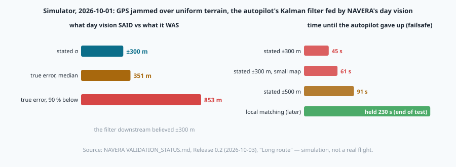
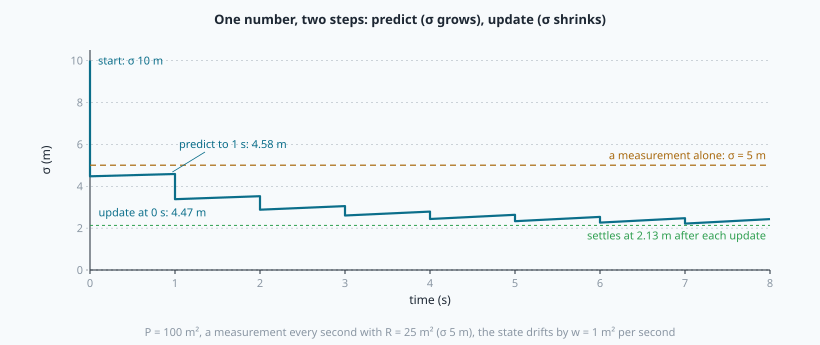
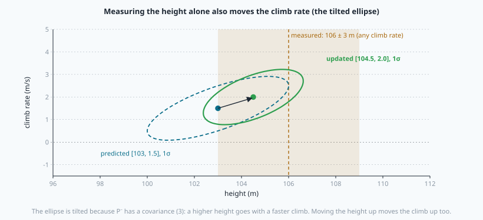
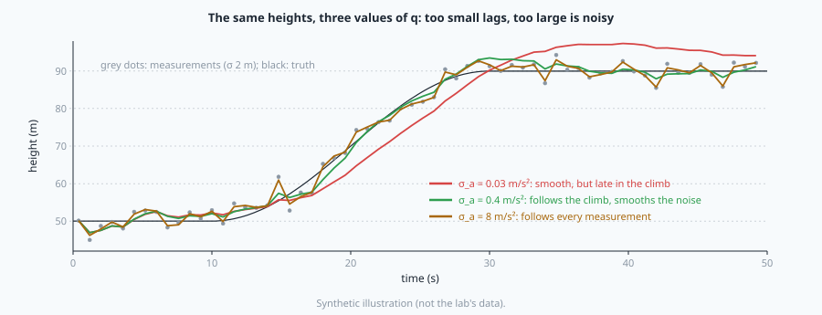
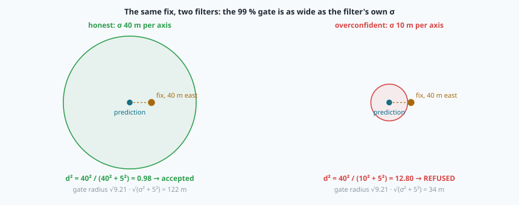

# The Kalman filter: predict, update, and stay honest



> [!NOTE] Mission brief
> **1 October 2026, NAVERA's long-route test in the simulator.** GPS is jammed over flat, uniform ground near
> Gabès (southern Tunisia). The drone's autopilot keeps flying on NAVERA's day-vision positions. Each position
> arrives with a stated accuracy, **±300 m**. Its true error had a median of **351 m**, and 10 % of the
> positions were more than **853 m** off. The autopilot runs a **Kalman filter** (its EKF, the extended
> Kalman filter of ArduPilot): it weighed every position as ±300 m, the positions were worse than that, its
> own consistency checks kept failing, and after **45 seconds** it gave up and landed the drone (a **failsafe**). Stating ±500 m
> delayed the failsafe to 91 s; only a better vision method (local feature matching) kept the drone flying,
> 230 s to the end of the test. (Source: NAVERA's validation document, Release 0.2, 2026-10-03.)
>
> The lesson: a Kalman filter is only as good as the uncertainties it is given, and the uncertainty it
> **states** is a promise that others will use. Today you build the filter and you test that promise.
> **Session 1 — Height keeper:** a filter on height and climb rate, built from two steps, predict and update,
> that must give **exactly** the same numbers as the course's reference (the model NAVERA's day vision uses
> for its height). **Session 2 — Tracker:** a 2-D filter that follows a drone through a 40-second jam and six
> wrong fixes, a **gate** that refuses the wrong ones, and the **NEES** test that tells an honest filter from
> a liar.
>
> **Start now:** open the 🛠️ **Lab** tab, do **Step 0** (two minutes, no code), then come back here for §1.

**Objectives.** After this mission you can:

1. **run** the two steps of a Kalman filter, predict and update, **by hand** in 1-D and 2-D and **in code**,
   and **explain** the gain as the inverse-variance blend of mission 24;
2. **build** the constant-velocity model (F and Q) and **give** q and R a physical meaning with numbers;
3. **reproduce** a filter described in words to 10⁻⁶ m, and **explain** why every start value matters;
4. **write** a 2-D tracker with a χ² gate that survives an outage and wrong fixes, and **explain** how an
   overconfident filter locks itself out;
5. **test** a filter's honesty with NEES, using a band you obtain by simulation, and **tune** q with it.

**You need:** mission 24 §8 (the inverse-variance blend: `blend`), mission 27 (covariance, J P Jᵀ, the
Mahalanobis d² and the χ² gate), the 🧰 Maths 5 box (variance and standard deviation), numpy's `@` and `.T`
(mission 16). ⏱ Reading: about 90 minutes with the ✏️ checks: §1–§4 before session 1, §5–§7 before
session 2. Lab: 4 h 30 to 6 h.

**Before you start.** Answer without looking; if you miss two, reread mission 24 §8 and mission 27.

<details><summary>1. (Mission 24) blend(100.0, 9.0, 106.0, 3.0): the blended value and its variance?</summary>
x = (100·3 + 106·9) / (9 + 3) = 104.5; v = 9·3 / 12 = 2.25. The more certain input (variance 3) counts three
times more, and the result is more certain than both.
</details>
<details><summary>2. (🧰 Maths 5) Two independent errors of σ 3 m and 4 m add up. The σ of the sum?</summary>
√(9 + 16) = 5 m: independent errors add their VARIANCES, not their σ.
</details>
<details><summary>3. (Mission 27) A 2-D innovation r = (3, 4) m with S = diag(9, 16) m². Its d²? Does a 99 % gate accept it?</summary>
d² = rᵀ S⁻¹ r = 9/9 + 16/16 = 2. The 99 % threshold for 2 dimensions is 9.21: accepted.
</details>

<details><summary>Words of this lesson (open if you need them)</summary>

| Word | Meaning | Français |
|---|---|---|
| **state** x | the numbers the filter estimates (height and climb rate; position and velocity) | état |
| **covariance** P | how sure the filter is about its state: variances on the diagonal | covariance |
| **predict** | move the state forward in time with a model; P grows | prédiction |
| **update** | correct the state with a measurement; P shrinks | mise à jour, correction |
| **innovation** ν, S | the surprise z − H x, and its covariance H P Hᵀ + R | innovation |
| **Kalman gain** K | how much of the surprise the update believes | gain de Kalman |
| **process noise** q, Q | how much the true motion may differ from the model in one step | bruit de processus |
| **measurement noise** R | the measurement's own covariance (σ²) | bruit de mesure |
| **NEES** | errᵀ P⁻¹ err: the true error measured in the filter's own σ | NEES (erreur normalisée) |
| **consistent / overconfident / pessimistic** | P matches / is smaller than / is larger than the real error | cohérent / trop sûr / trop prudent |
| **gate** | refuse a measurement whose d² is too large | porte (test de validation) |
</details>

## 1. One number, two steps

**The problem.** A drone's height comes from a barometer once per second, with σ 5 m. Between two readings
the height may change. One reading alone is ±5 m. Can we do better by keeping a running estimate?

**The idea.** Keep two numbers: the estimate x and its variance P (how sure we are). Then repeat two steps.

- **Predict.** Time passes; the true height may have drifted. The estimate stays where it is, but we are less
  sure: P grows. In the simplest model (a **random walk**: the state drifts by a random amount, with variance w
  per second), after dt seconds

  ```
  x⁻ = x          P⁻ = P + w·dt
  ```
  (The minus sign ⁻ means "predicted, before the measurement".)

- **Update.** A measurement z arrives, with variance R. Blend it with the prediction, exactly as in mission 24
  (§8): each one weighted by the **other's** variance. Written with a **gain** K:

  ```
  K = P⁻ / (P⁻ + R)          x = x⁻ + K·(z − x⁻)          P = (1 − K)·P⁻
  ```

  This is mission 24's `blend` written differently: x = (x⁻·R + z·P⁻)/(P⁻ + R). K is the share of the
  **surprise** z − x⁻ that we believe: near 1 when the prediction is vague (P⁻ ≫ R), near 0 when the
  measurement is vague. The new variance is smaller than both P⁻ and R.

That is the whole **Kalman filter**: predict, update, predict, update. Rudolf Kálmán published it in 1960. One
of its first practical uses was the navigation of the Apollo spacecraft to the Moon: Stanley Schmidt's team at
NASA Ames adapted it for the on-board computer in the early 1960s (the history is told by McGee and Schmidt,
NASA TM-86847, 1985).

**Worked example.** Start: x = 50 m, P = 100 m² (σ 10 m). A reading z = 60 m with R = 25 m² (σ 5 m).

```
K = 100 / (100 + 25) = 0.8          x = 50 + 0.8·(60 − 50) = 58 m          P = (1 − 0.8)·100 = 20 m²  (σ 4.47 m)
one second later, w = 1 m²/s:       x⁻ = 58 m                               P⁻ = 20 + 1 = 21 m²       (σ 4.58 m)
```

Repeat it every second and σ draws a **sawtooth**: up a little in each predict, down in each update. It
settles where what the update removes equals what the prediction adds: here σ = 2.13 m just after each update,
better than any single reading (5 m), and K settles near 0.18.



> [!QUESTION] ✏️ Check
> Same filter, but the sensor gets worse: R = 100 m² (σ 10 m). Does the settled gain go up or down? Does the
> filter follow a real change of height faster or slower?

<details><summary>Answer</summary>
Down: each reading is trusted less, so K is smaller (it settles near 0.095). The estimate is smoother but
follows a real change more slowly. What matters is the ratio of w (how much the truth may move) to R (how
noisy the sensor is), not each number alone.
</details>

## 2. A state with a velocity: F, Q and the prediction

**The problem.** A random walk does not know that a climbing drone keeps climbing. When it climbs at 2 m/s, the
1-D filter is always behind. Better: estimate the **climb rate** too, and use it to predict.

**The idea.** The state is a vector, x = [h, v] (height in m, climb rate in m/s), with a 2 × 2 covariance P.
Over a time step dt, at constant velocity, the height moves by v·dt:

```
x⁻ = F x          F = | 1  dt |          (h⁻ = h + v·dt,   v⁻ = v)
                      | 0   1 |
```

The covariance moves with the same matrix. You know this from mission 27: a linear function y = F x turns a
covariance P into F P Fᵀ. Then we add **Q**, what the model cannot know: real accelerations.

```
P⁻ = F P Fᵀ + Q
```

**Where Q comes from.** Suppose that during each step the vehicle has an unknown acceleration a, constant during
the step, random from one step to the next, with mean 0 and variance q = σ_a² (σ_a in m/s²). Over dt it moves
the height by a·dt²/2 and the velocity by a·dt. So the step adds the random vector a·g, with g = [dt²/2, dt]:

```
Q = q · g gᵀ = q · | dt⁴/4   dt³/2 |
                   | dt³/2   dt²   |
```

The off-diagonal terms are not zero: the same acceleration pushes height and velocity together. With several
axes (east and north) each axis gets the same model; with the state ordered [e, n, v_e, v_n], the 4 × 4 F and Q
are built with `np.kron(F1, np.eye(2))`, which copies each number of the 2 × 2 block onto a 2 × 2 identity.

<details><summary>🧰 numpy: outer product and Kronecker product</summary>

```python
import numpy as np
g = np.array([1.0, 2.0])
np.outer(g, g)                       # [[1. 2.] [2. 4.]] — every g[i]·g[j]: the matrix g gᵀ
A = np.array([[1.0, 3.0], [0.0, 1.0]])
np.kron(A, np.eye(2))                # 4 × 4: [[1 0 3 0] [0 1 0 3] [0 0 1 0] [0 0 0 1]]
```
`np.kron(A, np.eye(2))` puts the block a·I₂ in place of each number a of A. The order matters:
`np.kron(np.eye(2), A)` gives another matrix (the two copies of A side by side on the diagonal).
</details>

**Worked example.** A drone at 100 m climbs at 1.5 m/s: x = [100, 1.5], P = diag(4, 1) (σ 2 m and 1 m/s).
Predict over dt = 2 s with σ_a = 0.5 m/s² (q = 0.25 m²/s⁴):

```
x⁻ = [100 + 1.5·2, 1.5] = [103, 1.5]
F P Fᵀ = | 4 + 2·2·0 + 2²·1    0 + 2·1 |  = | 8  2 |        g = [2, 2],   Q = 0.25 · | 4  4 |  = | 1  1 |
         | 0 + 2·1             1       |    | 2  1 |                               | 4  4 |    | 1  1 |
P⁻ = | 9  3 |        σ of the height: 2 m → 3 m;   covariance 3 m²/s: a higher height goes with a faster climb
     | 3  2 |
```

Without any measurement, the prediction repeats and P keeps growing, and **not** in a straight line: the velocity
error multiplies time, and the random accelerations add up on top. How fast? You will measure it (lab Step 1).

> [!QUESTION] ✏️ Check
> In the worked example, where does the 3 in P⁻[0][1] come from? And why can the height's σ grow even when
> q = 0?

<details><summary>Answer</summary>
2 from F P Fᵀ (dt × the velocity variance: the height error now contains dt × the velocity error) and 1 from Q
(q·dt³/2 = 0.25·4). With q = 0 the velocity error alone still grows the height error: P[0][0] gains dt²·P[1][1].
</details>

## 3. The update with matrices

**The problem.** The measurement z is a height only, but the state has two numbers. How does a height correct
a climb rate nobody measured?

**The idea.** Say what the sensor measures with a matrix H: here z = H x + noise with H = [1, 0] ("the first
number of the state"), noise covariance R. Then the 1-D update of §1 becomes:

```
ν = z − H x⁻               the innovation (the surprise)
S = H P⁻ Hᵀ + R            its covariance: the prediction's uncertainty, seen by the sensor, plus the sensor's
K = P⁻ Hᵀ S⁻¹              the gain: one number per state entry
x = x⁻ + K ν
P = (I − K H) P⁻
```

Compare with §1: with one state number and H = 1 it is exactly K = P⁻/(P⁻ + R). With H = [1, 0], S is a single
number, P⁻ Hᵀ is the **first column** of P⁻, and K = [P⁻₀₀/S, P⁻₁₀/S]. The second gain is not zero when P⁻₁₀
is not zero: the update moves the climb rate **through the covariance**. The tilted ellipse below shows why: a
height above the prediction is more likely if the drone climbed faster.



**Worked example** (continuing §2). A height z = 106 m arrives, with σ 3 m (R = 9 m²):

```
ν = 106 − 103 = 3 m         S = 9 + 9 = 18 m²          K = [9/18, 3/18] = [0.5, 0.167]
x = [103 + 0.5·3, 1.5 + 0.167·3] = [104.5 m, 2.0 m/s]
P = (I − K H) P⁻ = | 9 − 0.5·9      3 − 0.5·3   |  = | 4.5  1.5 |       σ height: 3 m → 2.12 m
                   | 3 − 0.167·9    2 − 0.167·3 |    | 1.5  1.5 |       σ climb: 1.41 m/s → 1.22 m/s
```

The climb rate learned 0.5 m/s from a height measurement. The number νᵀ S⁻¹ ν = 3²/18 = 0.5 is the
**normalised innovation squared** (**NIS**): mission 27's d², computed **before** the update. It says how
surprising the measurement is, in the filter's own σ; your `kf_update` returns it, so that a caller can still
refuse the measurement (§5).

<details><summary>🧰 numpy: inverse, solve, and the 2 × 2 inverse by hand</summary>

```python
S = np.array([[4.0, 1.0], [1.0, 2.0]]); nu = np.array([1.0, 3.0])
np.linalg.inv(S)                     # [[ 0.2857 -0.1429] [-0.1429  0.5714]]
nu @ np.linalg.solve(S, nu)          # 5.0 — νᵀ S⁻¹ ν without forming the inverse
```
By hand: the inverse of [[a, b], [c, d]] is [[d, −b], [−c, a]] / (ad − bc). Here 1/7 · [[2, −1], [−1, 4]].
`H.T` is the transpose; a Python list has no `.T`, so convert inputs with `np.asarray(x, dtype=float)` first.
A one-number measurement is still an array: z = [106.0], H = [[1.0, 0.0]], R = [[9.0]].
</details>

> [!QUESTION] ✏️ Check
> Same prediction (x⁻ = [103, 1.5], P⁻ = [[9, 3], [3, 2]]), but the height comes from a much better sensor:
> R = 1 m². Is the new height closer to 103 or to 106? Does the climb rate move more or less than 0.5 m/s?

<details><summary>Answer</summary>
S = 10, K = [0.9, 0.3]: the height becomes 105.7 (close to the measurement) and the climb rate moves by
0.3·3 = 0.9 m/s, more than before. A better sensor is believed more, for both numbers.
</details>

## 4. What q and R mean, and a race

**R** is the easy one: the variance the sensor states for its measurement. A barometer with σ 1.5 m: R = 2.25 m².
A height from the camera with σ 3 % of the height, at 120 m: σ 3.6 m, R = 12.96 m². Each measurement may come
with its own R: the filter weighs each one by its own quality.

**q** is the model's honesty about motion: σ_a = √q is the typical random acceleration in one step. With σ_a
= 0.5 m/s² and one-second steps, the climb rate's variance grows by q = 0.25 (m/s)² per step: after 10 s without
a measurement, σ of the climb rate has grown by √(10·0.25) = 1.6 m/s. A small drone that goes from level flight
to a 3 m/s climb in 5 s accelerates at 0.6 m/s².

**The trade-off.** A filter with too small a q believes its model too much: it is smooth, but **late** in every
climb, and it states a small σ while its error is large (**overconfident**). Too large a q believes every
measurement: it follows the noise and states a large σ (**pessimistic**). You will measure both (lab Step 4).



**The race.** NAVERA's day vision (Release 0.2) keeps the drone's **height above the ground** in a filter of
exactly this form. Described in words:

- state [height, climb rate]; constant climb rate with random climb accelerations of **σ_a = 0.5 m/s²**, so
  q = 0.25 m²/s⁴, predicted over the true time since the last height;
- the **first** height starts the filter at [that height, 0] with P = diag(σ², 4): the climb rate is unknown
  (σ 2 m/s);
- every independent height (GPS altitude minus the ground's, the barometer, a rangefinder, and the height the
  camera measures, stated at **3 % of the height**, 5 % when few features matched) is an update with H = [1, 0]
  and R = σ²;
- a height that is not positive ("no reading") is ignored; there is no gate on heights.

NAVERA Lite's `Height1D` (TODO 4) is that model. The course ran it once on the lab's heights and saved the
outputs in `reference_heights.csv`: in lab Step 3 your filter must give the **same numbers to 10⁻⁶ m**. That is
how filters are checked in industry: the same model, the same start, the same inputs, the same outputs. One
detail wrong (σ instead of σ², q = 0.5 instead of 0.25, a start climb variance of 0 instead of 4) and the race
is lost.

> [!QUESTION] ✏️ Check
> Why does the start covariance say 4 for the climb rate and not 0? What would a filter that starts with a climb
> variance of 0 do during the first climb?

<details><summary>Answer</summary>
0 would mean "I know the climb rate is exactly 0". Then K's second number starts at 0 and the climb rate can only
grow through q, slowly: the first climb would be followed late. 4 (σ 2 m/s) says honestly "I do not know yet".
</details>

> [!TIP] 🏅 End of session 1 reading. Do lab Steps 1–4, then read §5–§7.

## 5. A 2-D tracker, a gate, and how a filter locks itself out

**The tracker.** For a drone on a map the state is x = [e, n, v_e, v_n] (east and north in m, velocities in
m/s), F and Q from §2 with two axes, and a position fix measures H = [I₂ 0] (the first two numbers) with
R = σ_z² I₂. The first fix starts the filter at [e₀, n₀, 0, 0] with P = diag(σ_z², σ_z², 20², 20²) (the velocity
is unknown: σ 20 m/s). Then, at every time step: predict; if a fix arrived, update. When there is no fix (a
jammed second), only predict: the state moves on at the estimated velocity and P grows. That is **dead
reckoning with an honest σ**.

**The gate.** A wrong fix (a bad map match 150 m away, a spoofed position) pulls a filter off the track, and
because P shrinks after every update, the filter then **believes** its wrong position. Mission 27's gate stops
it: compute the NIS d² = νᵀ S⁻¹ ν (S includes P⁻ **and** R), and refuse the fix when d² is larger than the χ²
threshold for 2 dimensions: −2 ln(1 − p), 9.21 for p = 0.99 (NAVERA Lite's `gate_threshold(p)`). A refused fix
changes nothing: the state stays the prediction.

**Worked example.** The filter predicts a position with σ 40 m per axis (P⁻ = 1600 I); a fix with σ 5 m
(R = 25 I) arrives 40 m east of the prediction. S = 1625 I, d² = 40²/1625 = 0.98: accepted. Another filter states
σ 10 m for the same prediction: S = 125 I, d² = 1600/125 = 12.8 > 9.21: **refused**.



The gate is as wide as the filter's own σ. That is its strength (a confident filter refuses wild fixes) and
its danger. Picture an **overconfident** filter after a jam: its stated σ is small, its true error large. The
first good fix is "too far": refused. The prediction moves on, still confident, still wrong; the next fix is
farther: refused. Every later fix is refused and the filter never comes back. This is a **lock-out** (also
called divergence). It is why the filter must be **honest first**: a small q looks smooth on a plot and can lose
the aircraft.

> [!QUESTION] ✏️ Check (the judge)
> After a jam, a filter states σ 60 m per axis. The first fix (σ 5 m) is 150 m north of the prediction. Accept it
> with a 99 % gate? With a 95 % gate (5.99)? And if the filter had stated σ 20 m?

<details><summary>Answer</summary>
S = 3600 + 25 = 3625 per axis, d² = 150²/3625 = 6.2: accepted at 99 % (9.21), refused at 95 % (5.99). With σ 20 m:
d² = 22 500/425 = 53: refused, and very likely the next ones too — the lock-out.
</details>

## 6. Is the filter honest? NEES

**The problem.** P is what the filter **says** about its error. Is it true? In flight nobody knows the truth.
In a simulation (or a test with a much better reference), we do.

**The idea.** At each step, measure the true error in the filter's own σ's: the **normalised estimation error
squared**

```
NEES = errᵀ P⁻¹ err          err = estimate − truth   (here the position: 2 numbers, P its 2 × 2 block)
```

It is mission 27's d², applied to the error the filter does not know. If the filter is honest, err behaves like
a Gaussian with covariance P, so NEES follows a χ² distribution with n = 2 degrees of freedom: its **average
is n = 2**.

- mean NEES clearly **above** n: the filter is **overconfident** (P too small). A mean NEES of 8 says the true
  errors are about √(8/2) = 2 times the stated σ.
- mean NEES clearly **below** n: **pessimistic** (P too large): safe, but its gates are too wide and it
  believes measurements too much.

**How close to 2 is "clearly"?** One step's NEES spreads widely: for 2-D, 95 % of honest values lie between
0.05 and 7.38 (mission 27's χ² table). The **mean** over N steps spreads much less, and the more steps, the
narrower. Rather than a formula, get the band **by simulation**: draw thousands of honest "flights" (N steps of
n standard normal numbers squared and summed), average each flight, and keep the middle 95 % of those averages
(lab Step 5, TODO 6). If your filter's mean NEES falls outside the band of your flight's length, it is very
unlikely to be honest.

Two remarks. First, the errors of a filter from one step to the next are **correlated** (today's error is
yesterday's, moved), so the real spread of the mean is wider than the simulated band: the band is the standard
first test, not a proof. Second, in flight, without the truth, the NIS of the fixes plays the same role: for an
honest filter its average is the dimension of z (2 for a position fix). A filter whose NIS keeps averaging 10
is overconfident, and the autopilot downstream would like to know.

> [!QUESTION] ✏️ Check
> A filter's mean NEES over a long test is 0.5 for a 2-D position. What does it tell you, and is it
> dangerous?

<details><summary>Answer</summary>
Pessimistic: the true errors are about √(0.5/2) = half the stated σ. Not dangerous in itself, but wasteful: the
gate is twice too wide (wrong fixes get through) and a consumer that fuses this position gives it too little
weight.
</details>

## 7. Tuning: honest first, then accurate

**Your role in session 2: the tuner.** You get a flight with the truth, and one knob, q. The method:

1. sweep q over a wide range (factors of 3);
2. for each value, compute the mean NEES and the error;
3. **keep only the honest values** (mean NEES in the band); among them, take the smallest error.

Why honest first? Because the filter's σ is used by others: by its own gate (§5), and by every consumer
downstream. NAVERA's arbiter forwards a position to the autopilot with its stated σ, and the autopilot's own
Kalman filter weighs it with that σ: the mission brief showed what an overconfident ±300 m did. A slightly
larger error with an honest σ is safe; a slightly smaller error with a lying σ is not.

<details class="further"><summary>Going further: the Joseph form and one big step</summary>

`P = (I − K H) P⁻` is exact only with the optimal K, and rounding can make it slightly asymmetric over thousands
of steps. Long-running filters often use the **Joseph form** P = (I − KH) P⁻ (I − KH)ᵀ + K R Kᵀ, which stays
symmetric and positive. And the Q of §2 assumes the acceleration is constant during the step: one prediction of
40 s is not the same as forty predictions of 1 s (try it in the lab's Going further). Predict at the rate the
vehicle really changes its acceleration.
</details>

> [!WARNING] Common wrong ideas
> - "The filter averages the measurements." It weighs them by their variances and by how much the truth may have
>   moved since (q). A good sensor and a fast-changing truth give a large K; a noisy sensor a small one.
> - "A smaller q gives a better filter, look how smooth it is." Smooth, late, and overconfident. With a gate, it
>   can lock itself out for good.
> - "P is the error." P is what the filter **claims**; NEES compares the claim with the truth.
> - "The climb rate needs its own sensor." It is learned through the covariance P⁻₁₀ (§3).
> - "R = σ." R is a **variance**: σ² (m²). With R = σ the filter trusts a 3 m sensor as if it were 1.7 m.
> - "Gate with the distance |ν| < 3σ_z." The gate uses S = H P⁻ Hᵀ + R: after a jam, the filter's own
>   uncertainty is most of S.

## In NAVERA

From NAVERA's validation and architecture documents (Release 0.2, 2026-10-03) and its engineering backlog, in
words:

- **NAVERA's arbiter selects; it does not fuse.** It forwards the position of one source at a time (GPS, day
  vision, night vision, celestial), with that source's stated accuracy. The arbiter runs no Kalman filter on the
  position: the filter that fuses NAVERA's position with the vehicle's own sensors is the **autopilot's**
  (ArduPilot's EKF in NAVERA's tests). So NAVERA's most important number is an **honest σ**. After the tests of
  the mission brief, the default accuracy stated for forwarded vision positions was raised to **±500 m**, with a
  warning below 450 m (backlog R-10: ±300 m had been stated while the measured median of the former vision method
  was 442 m). Mission 29 compares selecting and fusing.
- **A Kalman filter on the height above ground.** Day vision keeps its height in the two-state filter of §4
  (σ_a 0.5 m/s², start diag(σ², 4), independent heights, the camera's height at 3 %). Your `Height1D` is the
  same model, written by the course.
- **Dead reckoning without a Kalman filter** (implemented 2026-10-02, **simulator only**). When day vision finds
  no match (sea, uniform ground), it carries the last measured position along the ground velocity fitted to the
  last 20 s of fixes, turned by the heading change the IMU measured, and states an accuracy that **grows by a
  rule**: velocity error × time + a 5° heading error × distance, for at most 120 s or 500 m. Land route: no
  failsafe, median error 10 m, max 33 m. Across a bay: carried 90 s over the sea stating ±300 m; the true error
  stayed below 146 m. Compare with your tracker's jam: the same idea (predict, let σ grow), with σ from a rule
  instead of from P.
- **A position carried to the present.** A vision position from a photo 1.5 s old, at 40 m/s, is moved 60 m and
  its stated accuracy grows to ±31.5 m (unit tests and simulator): one predict step, done by hand.
- **No inertial navigation.** NAVERA does **not** integrate its IMU's accelerations into a position: the IMU gives
  the attitude (to straighten camera frames and to aim the star camera) and heading changes, and the arbiter
  watches the IMU topic only to know that the sensor is alive. "IMU dead-reckoning" is an open backlog item
  (FEAT-2). An inertial navigator is the Kalman filter of this lesson with a 100–400 Hz prediction driven by the
  measured accelerations; it is what would bridge the gaps where vision has no match. NAVERA does not have one
  yet.

## In NAVERA Lite

[navera_lite/kalman.py](file:./navera_lite/kalman.py) is NAVERA Lite's Kalman part. You write `cv_model`,
`kf_predict`, `kf_update`, `Height1D.update`, `nees` and `run_filter`; `gate_threshold` is given. The NEES band
is a lab experiment ([band_sim.py](file:./band_sim.py)), not part of the stack. Mission 29's arbiter will select
between sources the way NAVERA does, and rely on the honest σ you tested here; in mission 33 your `run_filter` can
bridge the gaps of a vision source.

## 🐦 How birds do it

Pigeons navigate with several cues: a sun compass (the sun's direction, corrected by their internal clock), a
magnetic sense, and familiar landmarks near home. In **clock-shift** experiments, biologists shift a pigeon's
internal clock by six hours: its sun compass is then about 90° wrong, and pigeons released far from home, over
unfamiliar ground, fly off about 90° away from home. Released over landscape they know well, many pigeons
deviate **less**: they weigh a second cue against the compass. Like a filter, they do not trust one sense
blindly; how they weigh the cues is still being studied, and nobody claims birds compute a gain.

## Summary

1. A Kalman filter alternates **predict** (x⁻ = F x, P⁻ = F P Fᵀ + Q: σ grows) and **update** (ν, S = H P⁻ Hᵀ + R,
   K = P⁻ Hᵀ S⁻¹, x = x⁻ + K ν, P = (I − K H) P⁻: σ shrinks). In 1-D the update is mission 24's blend.
2. Q comes from random accelerations: q·g gᵀ, g = [dt²/2, dt], q = σ_a². R is the measurement's variance. Small q:
   smooth, late, overconfident; large q: noisy, pessimistic.
3. A state you do not measure (the climb rate, the velocity) is learned through the covariance.
4. A gate on the NIS refuses wrong fixes; an overconfident filter's gate refuses the good ones too and locks out.
5. NEES = errᵀ P⁻¹ err averages n for an honest filter; get its band by simulation; tune q **honest first**.

**Next mission:** the arbiter. NAVERA does not fuse its sources into one Kalman filter: it **selects** one, with
rules for freshness, honesty and switching. You will write that judge.

## Check yourself

Answer without scrolling up.

<details><summary>1. Write the five update equations and say in one sentence what K means.</summary>
ν = z − H x⁻; S = H P⁻ Hᵀ + R; K = P⁻ Hᵀ S⁻¹; x = x⁻ + K ν; P = (I − K H) P⁻. K is how much of the surprise ν the
filter believes, for each state number.
</details>
<details><summary>2. dt = 1 s, q = 4 m²/s⁴. Write Q for one axis.</summary>
g = [0.5, 1], Q = 4·[[0.25, 0.5], [0.5, 1]] = [[1, 2], [2, 4]].
</details>
<details><summary>3. Why can an overconfident filter with a gate lose the track for good after a jam?</summary>
Its small P makes S small, so the first good fix after the jam has a large d² and is refused; the prediction
drifts on, the next fix is farther still: every fix is refused.
</details>
<details><summary>4. A 2-D filter's mean NEES is 18 over a long test. How much larger are its true errors than its stated σ?</summary>
About √(18/2) = 3 times. It is overconfident: raise q (or find the outliers it accepted).
</details>
<details><summary>5. (Mission 17) The complementary filter mixes gyro and accelerometer with a fixed time constant. What does a Kalman filter do differently?</summary>
Its gain is computed from P and R at every step (large at the start, when it knows little; smaller once it is
sure), and it states its own uncertainty. A Kalman filter that has settled has a nearly fixed gain: a complementary
filter is close to a settled Kalman filter, without the σ.
</details>

Now open the **🛠️ Lab** tab.
