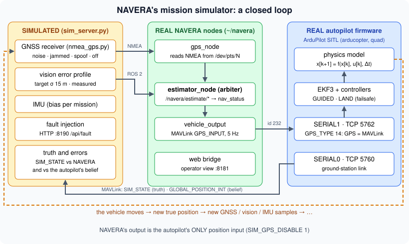

# Fly a mission in the simulator

Airline pilots spend hundreds of hours in simulators before they touch a real aircraft — and they keep
going back, to practise the failures that must never happen for real: an engine fire, a frozen sensor,
a wrong instrument. Engineers do the same with their software. Before NAVERA guides a real drone, it
flies **simulated** missions where you can jam the GPS, fake it, kill the camera… as often as you like,
and nobody gets hurt.

So far you tested NAVERA's parts one by one: a GPS driver, a matcher, the arbiter. In this lesson you
run **the whole system at once**: a real autopilot, NAVERA's real nodes and a simulated world, and you
watch what happens when things go wrong.

## 1. What runs in the simulator



The simulator is started by one command, `navera_tools/run_sim.sh`. It launches:

| Real (the same code as on the box) | Simulated |
|---|---|
| `gps_node` — reads NMEA sentences from a pseudo serial port, exactly as from a real receiver | the GPS receiver (`sim/nmea_gps.py`): good fixes with ~1.5 m noise, or **jammed**, **spoofed** (2 km jump or 4 m/s drift), **off** |
| `estimator_node` — the arbiter of lessons 25–27, with the product's own `estimator_params.yaml` | the IMU (BNO085-class errors) and clock samples |
| `vehicle_output` — sends NAVERA's position to the autopilot over MAVLink (`GPS_INPUT`) | the camera images (cut from the same satellite map vision searches), **or** a vision error profile |
| the web bridge and the **operator view** (:8181) | the vehicle's true motion — computed by ArduPilot's physics |
| **ArduPilot** SITL ("Software In The Loop"): the real autopilot firmware, running on the Jetson, for a drone (Copter 4.5), a boat or a ground robot (Rover) | |
| optionally the real day vision (`day_subscriber`, GPU) | |

The key sentence of the simulator's documentation: the autopilot's **only position input is NAVERA's
output**. Its own simulated GPS is disabled (`GPS_TYPE 14`, `SIM_GPS_DISABLE 1` in `sim/autopilot.py`).
So if NAVERA gives a wrong position, the autopilot flies wrong; if NAVERA gives nothing, the autopilot
loses its position and falls back on its own **failsafe** (a drone lands, a rover stops). It is the
honest way to test: NAVERA is judged by what the vehicle actually does.

> [!WARNING]
> **Simulated results are behaviour results, not accuracy results.** The world, the GPS errors and the
> vision errors are simulated — the camera images are cut from the very map vision matches against, so
> vision looks *better* than with a real camera. VALIDATION_STATUS.md says it plainly: *"these are
> behaviour results, not accuracy results"*. Lesson 29 comes back to this.

## 2. Ports and pages

| Port | What | In the academy |
|---|---|---|
| **8190** | the simulator's control page (plan, faults, flight monitor) | tab **🛩️ Simulator** |
| 8443 | the same page over HTTPS (for "My location" on a phone) | — |
| **8181** | NAVERA's **operator view** — the product's own screen, with a red SIMULATION banner | tab **🧭 Operator view** |
| 5760 | the autopilot's ground-station link (the simulator reads the truth and the autopilot's belief) | — |
| 5762 | the autopilot's serial port where NAVERA sends `GPS_INPUT` | — |

A port can be used by **one** program at a time. That is why there is **one simulator for the whole
class**: you **take** it (the **Hardware** button), you use it, you stop it and release it. It also uses
about 2–3 GB of the Jetson's 8 GB of memory. And since its control page has **no password**
(README: *"Development tool — no authentication"*), it must never run on a box installed on a vehicle.

## 3. A mission, step by step

The control page has three screens: **pre-flight setup**, **mission planner**, **flight monitor**.

1. **Vehicle**: drone, boat or ground robot (plane too).
2. **Route**: click the map — first click the departure **A**, second click the destination **B** (or
   type a place). The page checks that the onboard map covers a corridor around the route.
3. **Conditions**: day or night, cruise speed, altitude (the camera footprint is shown).
4. **Advanced settings** — *Position when GPS is lost*:
   - **Real NAVERA vision**: the real day vision on simulated camera images. Needs the **map
     preparation** step (DINOv2 descriptors on the GPU) — heavy; the teacher may prefer the profiles.
   - **Simulated — former day vision**: errors like the former DINOv2 method, *measured* on real frames
     (median ~440 m), uncertainty unknown → DEGRADED.
   - **Simulated — target**: 15 m — *the goal, not a measured performance*. It states its σ (15 m), so it
     is FIX, and it can cross-check the GPS (lesson 27).
   - *Give vision positions to the autopilot*: NAVERA's default is **no** for DEGRADED positions — then
     the autopilot's own failsafe acts when GPS is lost.
5. **Launch mission**. Then the flight monitor shows the phases:

| Phase | What happens | Typical time |
|---|---|---|
| `starting` | ArduPilot and NAVERA's nodes (re)start — like powering the box on | a few s |
| `waiting_gps` | the autopilot's navigation filter (EKF) aligns on NAVERA's GPS position | 30–60 s |
| `arming` | motors armed | 1 s |
| `takeoff` | climb to the altitude (drone: ~5 m/s) | ~30 s for 150 m |
| `enroute` | flying to the destination | depends on the route |
| `arrived` / `failsafe` | holding at the destination / the autopilot left the mission by itself | |

> [!NOTE]
> **NAVERA needs one real GPS fix to start** (VALIDATION_STATUS.md, known limitation 9). If you jam the GPS
> before the autopilot has aligned, the mission stays blocked in `waiting_gps` — the page says so.
> Jam it **in flight**.

## 4. Faults you can inject

In the flight monitor, tab **Faults**:

| Fault | What the simulated receiver / sensor does | What NAVERA should do |
|---|---|---|
| GPS **Jammed** | keeps talking, no fix (GGA quality 0) | GPS `valid=false` → vision takes over at once |
| GPS **Spoof jump** | positions suddenly 2 km away | kinematic gate: "implausible jump" → refused |
| GPS **Spoof drift** | pulled away at 4 m/s | cross-check: IN DOUBT, then refused (needs vision with a stated σ) |
| GPS **Off** | silent (cable cut) | stale after 3 s → vision |
| Camera **Failed** | no more frames | no vision; if GPS is lost too → NO FIX → autopilot failsafe |
| Light **Night** | night pipelines (thermal + stars) | lesson 24 |

The measured behaviour, in VALIDATION_STATUS.md (*Autopilot in the loop*, ArduPilot SITL, **simulation**):

| Scenario | Result |
|---|---|
| Drone, GPS OK, 120 m, 10–15 m/s | NAVERA error 1–4 m; autopilot position error 1–3 m |
| Drone, GPS jammed in flight, vision at the target accuracy (15 m σ, simulated) | mission continues on NAVERA's vision fix; autopilot error 2–18 m for 2.5 min, no failsafe |
| Drone, GPS jammed 30 s then spoofed 2 km for 30 s | spoof refused throughout; true GPS re-accepted 3 s after it returns |
| GPS jammed + camera failed | NAVERA: NO FIX → autopilot failsafe (Copter LAND, Rover HOLD) |

## 5. Reading the logs

What you see on the page is a summary. What really happened is in the **logs**, in `~/.navera_sim/`:

| File | Who writes it | Look for |
|---|---|---|
| `estimator.log` | the arbiter | `[ERROR] … GPS refused: implausible jump …`, `[WARN] … GPS confirmed by day vision … re-accepted` |
| `gps_node.log` | the GPS driver | `FIX #…`, `No fix (qual=0)` (jammed) |
| `vehicle_output.log` | the output to the autopilot | what was sent, and when it stopped |
| `web_bridge.log` | the operator view's server | |
| `sitl.log` | ArduPilot SITL | its start-up |
| your terminal (and `events.log` from `sim_ctl.py record`) | the simulator itself | `FAULT INJECTED: GPS receiver → jammed`, `NAVERA: FIX — DAY VISION (…)`, `autopilot: EKF3 IMU0 is using GPS` |

Each node's log starts with a line `===== <date> start: ros2 run …` at every (re)start, and every ROS
log line looks like:

```
[ERROR] [1791033732.442688751] [estimator_node]: GPS refused: GPS drifting away from day vision: …
 level    time (seconds since 1970)  node        message
```

Reading logs is half of an engineer's job: when a test fails, the first question is always *"what does
the log say, and at what time?"*. In the lab, you will write a few small functions that answer such
questions automatically.

## 🐦 How birds do it

Biologists cannot ask a bird how it navigates. So, like NAVERA's engineers, they build **controlled
worlds** where they decide what the bird senses — and watch what it does.

- **The Emlen funnel** (1966). A migrating songbird held in captivity becomes restless at migration
  time and keeps trying to fly in its migration direction. Put it in a paper funnel with an **ink
  pad** at the bottom: every hop up the sloping wall leaves a footprint. In the morning, the inky
  marks show which way the bird wanted to go. A cheap, simple "log file"!
- **The planetarium.** Stephen Emlen projected artificial skies over buntings, then **changed the
  sky** — rotated it, hid some stars — and watched whether the birds changed direction (lesson 24).
- **Magnetic coils.** The Wiltschkos surrounded robins' cages with large coils that can **turn the
  Earth's magnetic field** by any angle, or switch parts of it off (lesson 16).

Each of these is a **fault injection**: change **one** thing the bird senses, keep everything else
the same, and see how the "system" reacts. That is exactly what you do in the simulator when you jam
the GPS but leave the camera running.

And biologists know the limit of their simulators too. A bird in a funnel is not a bird in the sky,
so the big results are checked later on wild, free-flying birds — with radio tags and GPS loggers.
Simulation first, reality after: the same rule as NAVERA's.

## 6. In NAVERA

| What | Where in your copy |
|---|---|
| The launcher (ports check, lock, ROS domain, logs folder) | `navera_tools/run_sim.sh` |
| The world, sensors, missions, HTTP API (`/api/state`, `/api/mission`, `/api/fault`) | `navera_tools/sim/sim_server.py` |
| ArduPilot SITL: start, parameters, MAVLink | `navera_tools/sim/autopilot.py` |
| The simulated GPS receiver (jam, spoof) | `navera_tools/sim/nmea_gps.py` |
| The control page | `navera_tools/sim/sim.html` |
| How to use it | `navera_tools/README.md`, *Mission simulator* |

## Glossary

| Word | Meaning |
|---|---|
| **simulator** | a program that imitates the world so the real software can be tested safely |
| **SITL** | Software In The Loop: the real autopilot firmware running on a computer instead of a flight board |
| **ArduPilot** | a widely used open-source autopilot (Copter, Rover, Plane) |
| **MAVLink** | the message protocol between autopilots and ground stations |
| **EKF** | the autopilot's navigation filter (a Kalman filter) that fuses its sensors |
| **failsafe** | what the autopilot does by itself when something critical is lost (land, hold) |
| **port** | a numbered door on a computer where one program listens (8190, 8181…) |
| **log** | a file where a program writes what it did, with the time |
| **fault injection** | causing a failure on purpose to test the reaction |

## Check what you learned

<details><summary>1. In the simulator, where does the autopilot get its position from?</summary>
Only from NAVERA's output (GPS_INPUT over MAVLink). Its own simulated GPS is disabled.
</details>

<details><summary>2. Why must you not jam the GPS before take-off?</summary>
The autopilot's filter needs one real GPS fix from NAVERA to align and start (known limitation 9). Jammed from the start, the mission waits in "waiting_gps".
</details>

<details><summary>3. Vision is "Simulated — target" (15 m). Is the vision error you see in the simulator a measured NAVERA performance?</summary>
No. The target profile is the accuracy goal, drawn by the simulator. It shows the system's behaviour (switching, states), not its accuracy.
</details>

<details><summary>4. Which log tells you the exact moment the arbiter refused a spoofed GPS?</summary>
~/.navera_sim/estimator.log: an [ERROR] line "GPS refused: …" with its time stamp.
</details>

<details><summary>5. Why is there only one simulator for the class?</summary>
It needs fixed ports (8181, 8190, 8443, 5760, 5762) that only one program can use at a time, and 2–3 GB of memory.
</details>

Now open the **🛠️ Lab** tab.
