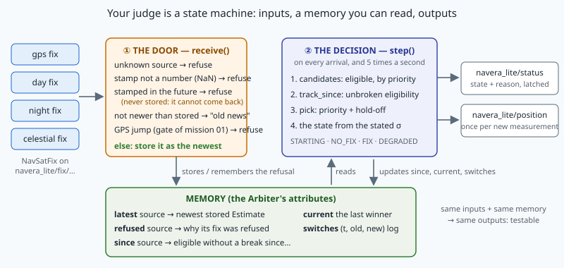
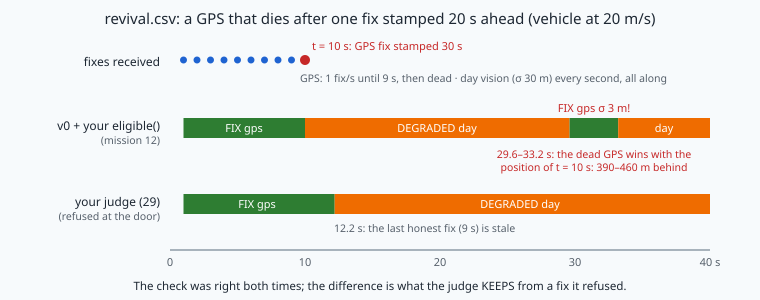
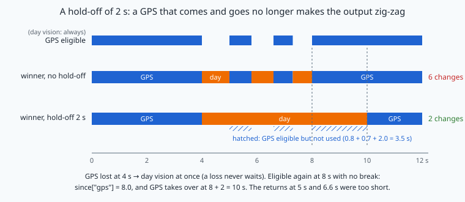

# Who to trust? The arbiter as a state machine



> [!NOTE] Mission brief
> **NAVERA's simulator, before 3 October 2026.** NAVERA, IRIS's product, accepted a day-vision position
> for 3 s after its photo. Under CPU load the photos came every 1–4 s, so the judge went FIX, NO_FIX,
> FIX, NO_FIX on **20 to 60 % of the samples**, and the autopilot **landed** during a gap of 6.7–9.2 s.
> A code review a few days earlier (2026-09-28) had listed the opposite disease: when the GPS came and
> went, the output **zig-zagged** between GPS and vision, because nothing made a returning source
> wait. Both were fixed by 2026-10-03 (the window in the simulator, the hold-off on the bench;
> validation report of 2026-10-03).
>
> In mission 12 you met a third disease: arbiter v0 brought a **dead GPS back to life** 60 s after a fix
> stamped in the future. Arbiter v0 stays naive on purpose. Today you replace it. **Session 1 — the
> judge:** you write NAVERA Lite's real judge as a state machine (who may compete, who wins, how long
> a returning source must wait, what to refuse at the door) and you close the revival for good.
> **Session 2 — live, and what it costs:** your judge runs on ROS, races the course's reference on a
> 31 s scenario, and you measure the price of each design choice.
> Badges: **Fair judge**, then **Steady hand**.
>
> **Start now:** open the 🛠️ **Lab** tab, do **Step 0** (ten minutes, no code), then come back for §1.

**Objectives.** After this mission you can:

1. describe a judge as a **state machine** (inputs, a small explicit memory, outputs) and predict
   its next decision from that memory;
2. code **eligibility and priority**, and a **door** that refuses impossible inputs (unknown source,
   bad stamp, future stamp, old news, GPS jump) so that a refused fix can **never come back**;
3. implement **hysteresis** (a hold-off) and **measure its cost** in unused GPS time;
4. map the winner to **FIX / DEGRADED / NO_FIX** with a reason a human can read;
5. argue **selection versus fusion** with numbers (correlation, a spoofed source).

**You need:** mission 01 (the jump gate), 09 (arbiter v0, the status topic), 11 (a silent source
goes stale), 12 (`eligible()`, `stated_sigma()`, the revival), 24 and 27 (`blend()`,
`uncertainty.fuse()`: inverse-variance fusion). ⏱ Reading: about 70 minutes with the ✏️ checks. Lab: 4 h 30 to 6 h in two sessions (6 to 7 h 30 in all).

**What you already know** — answer without looking; if you miss two, reread the mission named.

<details><summary>1. Mission 12: now = 300.0 s. A GPS fix is stamped 301.0 s. What does eligible() say, and why?</summary>
(False, "from the future"): it is 1.0 s ahead, more than future_tolerance_s = 0.5 s. A clock is wrong
somewhere, so its age means nothing.
</details>

<details><summary>2. Mission 01: the last trusted GPS fix is 2 s old. A new fix is 300 m away. Jump gate verdict (100 m/s, margin 50 m)?</summary>
The gate allows 100 × 2 + 50 = 250 m: refused. And a refused fix never becomes the trusted one.
</details>

<details><summary>3. Mission 24: blend 0 m (variance 9 m²) with 12 m (variance 27 m²). Result and variance?</summary>
x = (0 × 27 + 12 × 9) / 36 = 3.0 m, variance 9 × 27 / 36 = 6.75 m². The smaller variance pulls harder.
</details>

<details><summary>Words of this lesson</summary>

| Word | Plain meaning | Français |
|---|---|---|
| **state machine** | a system whose answer depends on its inputs AND on a memory the inputs update | machine à états |
| **memory (state)** | what the judge keeps between two decisions | mémoire (état) |
| **candidate** | a source eligible now, allowed to compete | candidat |
| **priority** | a fixed order: the first candidate in the order wins | priorité |
| **chattering** | a fast back-and-forth switching of the output | battement, oscillation |
| **hysteresis, hold-off** | a stricter rule to switch than to stay; here: wait 2 s | hystérésis, temporisation |
| **door** | the test a message passes before the judge stores it | porte (contrôle d'entrée) |
| **old news** | a message not newer than the one already stored | message périmé |
| **availability** | the share of time a source (or the output) is usable | disponibilité |
| **selection / fusion** | use one source / mix several into one value | sélection / fusion |
</details>

## 1. Four witnesses, one answer

An autopilot cannot fly on four opinions. Five times a second it needs **one** position and an
honest word about how far to trust it. NAVERA Lite has four witnesses (GPS, day vision, night
vision, celestial), each publishing `NavSatFix` messages on its own topic (mission 12). The **judge**
measures nothing. It applies a written policy to their messages, the same way every time.

Could the judge be a pure function of the latest messages? No. Look at three questions it must answer:

- *Has this GPS been usable for 2 s without a break?* — it needs to remember **since when**.
- *Which source won last time?* — it needs to remember the **current winner**.
- *Was this fix already refused?* — it needs to remember **what it refused**.

A system whose output depends on its inputs **and** on a memory that the inputs update is a
**state machine**. The good news: the memory is small, and in your judge it is in plain sight, as
attributes of the `Arbiter` object (figure above): `latest`, `refused`, `since`, `current`,
`switches`. Same inputs and same memory give the same decision. That is what makes the judge
**testable**: you can replay a scenario and must get the same answers, offline or live.

> [!TIP] 🧰 A state table (instead of a formula)
> Engineers describe a state machine with a table: one row per event, the memory before, the
> output, the memory after. A door with a code lock:
>
> | event | memory before | output | memory after |
> |---|---|---|---|
> | right code | locked | "open" | open |
> | wrong code | locked | "wrong" | locked, 1 error |
> | wrong code | locked, 2 errors | "blocked 60 s" | blocked |
>
> The same event ("wrong code") gives different outputs: the memory makes the difference. Your judge
> works the same way, with fixes as events.

**Worked example.** Hold-off 2 s. Day vision has been the winner since 40.0 s. GPS fixes arrive:

| t (s) | event | since["gps"] before → after | current | decision |
|---|---|---|---|---|
| 41.0 | GPS fix, eligible | — → 41.0 | day | day (GPS eligible for 0.0 s) |
| 42.0 | GPS fix, eligible | 41.0 → 41.0 | day | day (1.0 s < 2 s) |
| 43.0 | GPS fix, eligible | 41.0 → 41.0 | day → gps | **gps** (2.0 s: it has waited) |

Same input three times (a good GPS fix), three different `since` values, and the third answer differs.

> [!QUESTION] ✏️ Check
> Continue the table: at 43.5 s the GPS says "no fix" (valid False), at 44.0 s it sends a good fix
> again. What is the decision at 43.5 s and at 44.0 s, and what is `since["gps"]` after 44.0 s?

<details><summary>Answer</summary>
43.5 s: GPS is not eligible, so it is forgotten (no `since["gps"]`), and the winner is lost: day vision
at once. 44.0 s: GPS eligible again, `since["gps"]` = 44.0; it must wait until 46.0 s. Decision: day.
</details>

## 2. Who may compete: eligibility, then priority

Mission 12 wrote the checklist: `eligible(est, now_s, cfg)` refuses a fix with no position, a
null island, a broken position, a fake covariance, a stamp from the future, an unknown source, or an
age above its source's **timeout** (3 s GPS, 5 s day, 5 s night, 45 s celestial). The judge applies
it to the **stored** fix of each source. The sources that pass are the **candidates**.

Among the candidates, the judge uses a **priority** order: GPS, then day, then night, then
celestial (`estimate.SOURCES`). GPS beats day vision whenever both are candidates, even if the day
fix states a better σ. Priority is the order of quality *when the source works*: GPS is metres,
vision tens of metres, celestial kilometres. The stated σ only colours the answer (§5).

**Worked example.** now = 500.0 s. Stored fixes: GPS stamped 496.8 (σ 3 m), day stamped 498.0
(σ 30 m), night with valid False, celestial stamped 470.0 (σ 2 km).
GPS: age 3.2 s > 3.0 s, stale. Day: 2.0 s, eligible. Night: "no position". Celestial: 30 s ≤ 45 s,
eligible. The candidates, in priority order: `["day", "celestial"]`.

> [!TIP] 🧰 Keep a fixed order
> A dict remembers the order in which its keys were **added**, not the order you want:
> ```python
> latest = {"night": 1, "gps": 2}
> list(latest)                                          # ['night', 'gps']
> [k for k in ("gps", "day", "night") if k in latest]   # ['gps', 'night']: walk YOUR order
> ```

> [!QUESTION] ✏️ Check
> now = 80.0 s. Stored: celestial stamped 40.0 (σ 900 m), GPS stamped 77.5 (σ 4 m), day stamped 80.3
> (σ 30 m). List the candidates in order. Which one wins if nothing else matters?

<details><summary>Answer</summary>
GPS (age 2.5 s ≤ 3 s), day (stamped 0.3 s ahead: within the 0.5 s tolerance, eligible), celestial (age
40 s ≤ 45 s): `["gps", "day", "celestial"]`. GPS wins.
</details>

## 3. The door: what the judge refuses to store

Before it decides, the judge receives. Each new message passes a **door** (`Arbiter.receive`), and
only then is it stored as the newest of its source. The door refuses, in this order:

1. **an unknown source** — nothing to compare it with, no timeout;
2. **a bad stamp** — not a finite number (NaN): every test `x > limit` is False for NaN, so it would
   pass them all and never age;
3. **a stamp in the future** (more than 0.5 s ahead of the judge's clock);
4. **old news** — a stamp not newer than the fix already stored for that source. Messages can
   arrive late: a serial buffer, the network reordering two packets. A late GPS fix must not replace
   a newer one (and must not be scored as a jump: it is old, not far);
5. **a GPS jump** — mission 01's gate: farther from the last trusted GPS fix than the vehicle can fly
   (`max_speed_mps` × elapsed + 50 m). Only GPS goes through it: GPS is the source a spoofer imitates.

**Why test the future at the door?** Remember mission 12. Arbiter v0 with your `eligible()` refused
a fix stamped 60 s ahead: correct. But v0 **stored** it as the newest GPS fix and tested it again at
every tick. The day the clock reached its stamp, the old message became "fresh", and a dead GPS was
FIX again, with a position as old as the message.



`eligible()` was right both times. The mistake was in **what the judge kept**. A message that was
from the future when it arrived proves that its source's clock is wrong: nothing it says can be
trusted later. So the rule is: **a fix refused at the door is never stored, and therefore can never
come back**. The judge remembers only *why* it refused (`refused["gps"]`), to tell the operator.
NAVERA's code review of 2026-09-28 listed a bug of the same family: "a future timestamp kept a dead
source fresh" (EST-2, critical, fixed). NAVERA's architecture document states its rule this way: "a fix
stamped in the future does not set the order; it is refused by eligibility". Your door gets both
effects by never storing such a fix.

A stored future fix does even more damage than the revival. You will find two more effects in lab
Step 5; read the box below only after it.

<details><summary>Read this after lab Step 5 — what else a stored future fix breaks</summary>

**It sets the order.** The door drops "old news": a fix not newer than the stored one. A stored fix
stamped 20 s ahead makes **every honest fix** of the next 20 s older than it: all dropped. The
honest GPS is locked out, and the judge falls back to vision.

**It poisons the jump gate.** If the future fix reaches the gate, the gate accepts it easily (its
stamp is far ahead, so the distance allowed is huge) and makes it the trusted fix. Once the clock
passes its stamp, the honest fixes are newer again, but the gate measures them from a position that
is 20 s old, with only a few seconds elapsed: in Step 5, `jump 410 m > 100 m in 0.5 s`. They are
refused until 100 m/s × elapsed + 50 m catches up (about t = 35 s), and GPS wins again at 37 s after
the hold-off. A fake fix 800 m away with a clock 30 s ahead would keep the real GPS out for 30 s (old
news), then for about 7.5 s more (jumps). (A door that ran the gate **before** the future test would
be worse still: it refuses the fix but leaves it trusted, so the honest fixes get a *negative* time
from it and only the 50 m margin.) That is why the door tests the future **before** the gate.
</details>

> [!QUESTION] ✏️ Check
> Stored: GPS stamped 299.5 s. now = 300.0 s, 100 m/s, margin 50 m. What does the door say to: (a) a
> day fix stamped 300.3; (b) a GPS fix stamped 301.0; (c) a GPS fix stamped 299.2; (d) a GPS fix
> stamped 300.0, 800 m from the GPS fix of 299.5 (the last trusted one); (e) a GPS fix stamped NaN?

<details><summary>Answer</summary>
(a) stored (0.3 s ahead is within the tolerance); (b) refused, from the future (1.0 s ahead), and
remembered in `refused["gps"]`; (c) old news (not newer than 299.5); (d) the gate allows
100 × 0.5 + 50 = 100 m: refused, a jump. (e) refused, "bad stamp": a NaN
would pass every test and never age.
</details>

## 4. Hysteresis: make a returning source wait

Pure priority has a weakness. A GPS at the edge of a jammer's range comes and goes every second or
two. Each time it returns, priority switches to GPS; each time it drops, the judge falls back to a
vision fix tens of metres away. The output jumps back and forth: **chattering**. The autopilot sees
its position teleport several times a minute.

The classic cure is **hysteresis**: the rule to *enter* a state is stricter than the rule to stay in
it (a thermostat that heats up to 21 °C but restarts only below 19 °C does the same). The judge's
rule, with the **hold-off** h = `switch_holdoff_s` = 2 s:

- a source may **replace** the current winner only after h seconds of eligibility **without a break**;
- if the current winner stops being a candidate, the judge switches **at once** to the first candidate.

The rule is asymmetric on purpose: keeping a source that is *gone* means flying on nothing, while
keeping a worse but *valid* source for 2 s more only costs some accuracy. Losses never wait; gains do.



The memory is `since`: for each candidate, the instant it became eligible **without a break**. Before
each decision it is brought up to date: a candidate already in it keeps its instant, a new candidate
gets *now*, and every source that is not a candidate is forgotten (its next eligibility starts again).

> [!TIP] 🧰 dict.get with a default, and a dict built in one line
> ```python
> ages = {"tom": 31}
> ages.get("tom", 0), ages.get("ann", 0)          # (31, 0): the default when the key is missing
> {name: len(name) for name in ["ann", "bo"]}     # {'ann': 3, 'bo': 2}: a dict comprehension
> ```

One more case: the winner is night vision; day vision has been a candidate for 9 s, GPS for 0.5 s.
GPS has not waited enough, but day has: day takes over. **The winner is the first candidate, in
priority order, that is the current winner or has waited the hold-off.**

**How much does it help?** Model the GPS "on" periods as random with an exponential law of mean μ
(the probability that an on-period lasts longer than h is e^(−h/μ)). With μ = 3 s and h = 2 s,
e^(−2/3) = 0.51: about half of the returns still cause a switch, and every return shorter than 2 s
causes none. The price: after each return that does take over, 2 s of good GPS were not used. You
will measure both sides in the lab on a 10-minute flight.

> [!QUESTION] ✏️ Check
> 1. Day vision is the winner. GPS is eligible at 50.0 s, says "no fix" at 51.5 s, is eligible again
>    at 52.0 s and stays. When does GPS take over (h = 2 s)?
> 2. With the exponential model, μ = 4 s: what share of GPS returns still take over with h = 2 s?

<details><summary>Answer</summary>
1. At 54.0 s: the break at 51.5 s erased `since["gps"]`; it restarts at 52.0 s. 2. e^(−0.5) = 0.61,
about 61 %: a hold-off helps less when the on-periods are long — but then the GPS is really usable.
</details>

## 5. From the winner to the state


The state tells the operator and the autopilot how much to trust the position:

| Situation | State | Reason (NAVERA Lite's words) |
|---|---|---|
| nothing received yet (nothing stored, nothing refused) | STARTING | `no position received yet` |
| no candidate | NO_FIX | `no usable source (gps: stale (4.0 s > 3.0 s); day: …)` |
| the winner states σ ≤ 25 m (`fix_max_sigma_m`) | **FIX** | `gps: σ 3.0 m` |
| the winner states σ > 25 m | DEGRADED | `day: σ 30.0 m > 25.0 m` |
| the winner states no σ (type 0, zero, not a covariance) | DEGRADED | `night: σ unknown` |

The σ is the one `estimate.stated_sigma()` believes (mission 12), and the words come from the given
`classify()`. The rule is **self-correcting**: a day vision that one day states 18 m, because its
accuracy was measured, becomes FIX without changing one line of the judge. Promotion is the reward
for measuring, never a decision. The NO_FIX reason lists every source that sent something, in
priority order: one line that tells an engineer what went wrong.

Two more rules of the node around your judge: it decides on **every arrival** and **5 times a
second** (a silent source sends nothing, so only the clock can notice it); and it publishes the
winner's position **once per new measurement**, never in NO_FIX: a filter downstream must never
receive the same measurement twice as if it were new.

> [!QUESTION] ✏️ Check
> State and reason? (1) GPS stale, day vision stating 12 m is a candidate. (2) Only night vision,
> type 0. (3) Nothing is stored, but the door refused one celestial fix from the future.

<details><summary>Answer</summary>
(1) FIX, "day: σ 12.0 m". (2) DEGRADED, "night: σ unknown". (3) Not STARTING: something arrived.
NO_FIX, "no usable source (celestial: refused: from the future (… s ahead))".
</details>

## 6. How fresh is fresh enough?

Each source's timeout is a trade-off between two errors. A **short** timeout turns every slow photo
into a gap (NO_FIX, if nothing else is usable). A **long** one lets the judge use old positions:
mission 12's **staleness** = speed × age.

If the gaps G between photos are random and independent, a source with timeout T is usable for
min(G, T) seconds of each gap, so its **availability** is E[min(G, T)] / E[G] (E[·] = the mean).

> [!TIP] 🧰 Two integrals you need
> ∫ₐᵇ g dg = (b² − a²)/2: the area under the line y = g, a trapezium. ∫ₐᵇ T dg = T·(b − a): a rectangle.
> E.g. ∫₁³ g dg = (9 − 1)/2 = 4 and ∫₃⁴ 3 dg = 3 × 1 = 3. For gaps uniform between a and b, the mean of
> anything is its integral divided by (b − a). And min(g, T) is g while g < T and T after it: so
> cut the integral at T — ∫ₐᵀ g dg + ∫ᵀᵇ T dg.

**Worked example.** Gaps uniform between 1 and 4 s: E[G] = 2.5 s. For T = 3 s, E[min(G, 3)] =
(1/3)·(∫₁³ g dg + ∫₃⁴ 3 dg) = (1/3)·(4 + 3) = 2.33 s: availability 2.33 / 2.5 = **93 %**. For
T = 2 s: (1/3)·(1.5 + 4) = 1.83 s, only **73 %**. The cost of T = 3 s at 40 m/s: a used position can
be up to 3 × 40 = 120 m behind the vehicle.

> [!QUESTION] ✏️ Check
> Gaps uniform between 2 and 6 s, T = 5 s. Availability? Largest staleness at 15 m/s?

<details><summary>Answer</summary>
E[G] = (2 + 6)/2 = 4 s. E[min(G, 5)] = (1/4)·(∫₂⁵ g dg + ∫₅⁶ 5 dg), with ∫₂⁵ g dg = (25 − 4)/2 = 10.5
and ∫₅⁶ 5 dg = 5 × 1 = 5: (1/4)·15.5 = 3.875 s. Availability 3.875 / 4 = 96.9 %. At most 5 × 15 = 75 m.
</details>

## 7. Select or fuse?

Why choose **one** source? Mission 24's `blend()` and mission 27's `uncertainty.fuse()` mix two
independent measurements with inverse-variance weights (27 with covariance matrices):

w₁ = (1/σ₁²) / (1/σ₁² + 1/σ₂²),  x̂ = w₁x₁ + w₂x₂,  σ̂² = 1 / (1/σ₁² + 1/σ₂²)

**Worked example.** GPS σ₁ = 3 m, vision σ₂ = 30 m: w₁ = 100/101 = 0.990, σ̂ = 2.985 m. A gain of
0.5 % over GPS alone. Now three problems.

1. **Correlation.** If the two errors are correlated (ρ), the real variance of the same x̂ is
   w₁²σ₁² + w₂²σ₂² + 2w₁w₂ρσ₁σ₂. With ρ = 0.8: σ = 3.213 m — **worse than GPS alone**, while the
   formula still claims 2.985 m. Why would they be correlated? In NAVERA, vision searches the map
   around the judge's own output while GPS is the winner: its errors are not independent of GPS.
2. **Unknown σ.** A weight built from a guessed σ is a guess presented as a measurement.
3. **Faults spread.** A GPS spoofed 2 km away drags the fused value 0.990 × 2000 = 1980 m with it.
   A single winner can be refused, checked and explained in one reason line.

And the autopilot downstream already runs a filter (ArduPilot's EKF) that fuses the position it
receives with its IMU. The judge's job is to deliver **one honest measurement**, not a second filter
with hidden correlations. Fusion can win later — when every σ is measured and the correlations known.

> [!QUESTION] ✏️ Check
> GPS σ 4 m, vision σ 12 m. The GPS weight, and the fused σ fusion claims? If the GPS is spoofed 500 m
> east and vision is right, how far east does the fused value move?

<details><summary>Answer</summary>
1/16 = 0.0625, 1/144 = 0.00694: w₁ = 0.0625 / 0.06944 = 0.90; σ̂ = 1/√0.06944 = 3.79 m. It moves
0.90 × 500 = 450 m east.
</details>

> [!WARNING] Common wrong ideas
> - "Priority means the most accurate source wins." No: GPS at σ 30 m beats a day vision stating
>   18 m. The σ decides the state (FIX or DEGRADED), not the winner.
> - "A refused message is harmless if `eligible()` refuses it every time." Only while the reason
>   holds. A future stamp stops being "future"; store nothing you refused.
> - "Hold-off = wait before every switch." Losses switch at once; only a source that **replaces**
>   a working winner waits.
> - "since = the last time the source was eligible." No: the FIRST instant of the current unbroken run.
> - "Fusion is always better than selection." Only with independent errors and honest σ.

## In NAVERA

NAVERA's arbiter applies the same policy (architecture document, and validation report of
2026-10-03): priority GPS, day, night, celestial; eligibility = valid, a measured or dead-reckoned
mode, fresh for its source (GPS 3 s, day 5 s, night 5 s, celestial 45 s) and not more than 0.5 s
in the future, a finite position, a real covariance; a hold-off of 2 s; its first state is called
INITIALIZING (NAVERA Lite says STARTING); FIX only for a measured (not dead-reckoned) position that
states σ ≤ 25 m — today only GPS: day vision states a conservative 30 m until its accuracy is measured with
NAVERA's own camera. On the bench, a GPS flapping every 0.5 s gave **one source switch in 8 s, no
zig-zag**; a fix stamped 60 s in the future was refused ("clock problem"); a GPS fix 0.8 s late,
60 m behind a vehicle at 75 m/s, is **dropped as old news** and GPS stays FIX (before, it was refused
as possible spoofing); one measurement is published **once** (before, it was re-published at 5 Hz).
The day-vision window is 5 s since the simulator showed the flicker of the mission brief. NAVERA's
judge also cross-checks GPS against vision to catch a patient spoofer: that is mission 30. NAVERA is
Release 0.2: these are bench and simulator results; field validation is pending.

## In NAVERA Lite

Your five TODOs live in `navera_lite/arbiter.py`. The given `ros/arbiter_node.py` plugs your
`Arbiter` into ROS on arbiter v0's topics (`navera_lite/status`, `navera_lite/position`), so it
replaces v0 from now on. Mission 30 adds the cross-check to your door; mission 31 flies your judge
in Sim Lite.

## 🐦 How birds do it

A migrating songbird has several compasses: the sun by day, the stars at night, the Earth's magnetic
field at any time. In a classic experiment (Cochran, Mouritsen and Wikelski, *Science*, 2004), wild
thrushes exposed at sunset to a magnetic field turned towards the east flew the wrong way that night
— then flew correctly the next night after a normal sunset. They steered by the magnetic compass but
**re-set it against the sunset every evening**: one cue is the reference, the others are checked
against it. Navi the swallow does not change course at every flicker of one cue either: hysteresis.

## Summary

1. The judge is a **state machine**: same inputs and same memory (latest, refused, since, current,
   switches) give the same decision — so it can be replayed and tested.
2. **Candidates** are the stored fixes that are eligible now; the winner follows a fixed **priority**.
3. **The door** refuses unknown sources, bad (NaN) stamps, future stamps, old news and GPS jumps, and **stores
   nothing it refuses**: a refused fix can never come back.
4. **Hysteresis**: a source replaces a working winner only after a 2 s hold-off without a break; a
   lost winner is replaced at once. It removes chattering and costs unused GPS time.
5. The winner's **stated σ** makes FIX or DEGRADED; no candidate is NO_FIX. **Selection** stays more
   honest than fusion while σ are unmeasured and errors correlated.

**Next mission:** spoofing — your door gets a cross-check, and you play the attacker.

## Check yourself

Answer without scrolling up.

<details><summary>1. Name the five parts of the judge's memory and what each one is for.</summary>
latest (newest stored fix per source), refused (why a source's fix was refused), since (start of each
candidate's unbroken eligibility, for the hold-off), current (the last winner), switches (the log of
changes of winner).
</details>

<details><summary>2. Why is "store it, eligible() will refuse it anyway" wrong for a fix stamped in the future?</summary>
Because eligibility changes with time: when the clock reaches the stamp, the fix looks fresh and
wins, with a position as old as the message. It also blocks newer honest fixes as "old news". The
door must refuse it and never store it.
</details>

<details><summary>3. Day vision wins. GPS has been a candidate for 1.4 s, night for 10 s. Who wins now (h = 2 s)? And if day vision becomes stale at this instant?</summary>
Day stays (GPS has not waited 2 s; night has lower priority than day). If day is stale: the winner is
lost, so the first candidate wins at once: GPS.
</details>

<details><summary>4. A GPS states σ 40 m and day vision states 12 m. Both are candidates and GPS is the current winner. State?</summary>
DEGRADED, "gps: σ 40.0 m > 25.0 m": priority picks GPS; its σ makes it DEGRADED.
</details>

<details><summary>5. (Mission 12) Type 0 covariance with a = c = 4 m². Stated σ, and the state if it wins?</summary>
None (type 0 states nothing): DEGRADED "σ unknown".
</details>

<details><summary>6. (Mission 11) Why does the judge also decide 5 times a second, not only when a message arrives?</summary>
A source that goes silent sends no message to say so: only the clock can notice that its last fix is
now too old.
</details>

Now open the **🛠️ Lab** tab.
