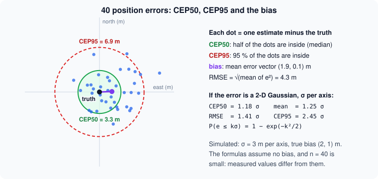
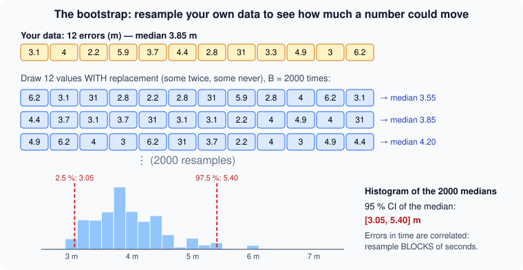

# Measuring honestly: error statistics, baselines and confidence intervals

> [!NOTE] In short
> - A claim like "4 m without GPS" means nothing until you know which statistic, how many
>   measurements, where, and compared with what.
> - You learn the error statistics (median, percentiles, CEP, RMSE), and you always state the
>   percentile rule.
> - A position you do not get is not 0 m: always report **availability** and continuity too.
> - A method is useful only if it beats a **baseline**, such as "repeat the last known position".
> - **Confidence intervals** (the bootstrap, the Wilson interval) say how sure a number is.
> - In the lab you measure three flights, compare NAVERA with the baseline, and check a stated σ
>   with NAVERA's `evaluate_session.py`.

At an international technology fair, a company presents a navigation box for drones: *"Accuracy: 4 m
without GPS!"* A logistics company that wants to fly medicine from a coastal city to villages in the
mountains asks you, the engineer, whether to buy it.

Before you answer, you ask five questions. **4 m — the mean, the median, or the best case?**
**Computed on how many measurements, and how sure is that number?** **Measured where: on a bench, in
a simulator, in flight over terrain like ours?** **Compared with what?** **And how often does the box
give no position at all?** Without these answers, "4 m" means nothing. It can even be true *and*
useless.

NAVERA's engineering rules say *"Measure, don't guess"* and *"Honesty over optimism. If a result is
only validated in simulation, say so."* NAVERA is a commercial product at "Release 0.x — field
validation pending", and its `docs/VALIDATION_STATUS.md` says on its first page: *"None of them comes
from a real flight."* This lesson teaches you how to produce numbers that deserve to be believed —
and how to read other people's numbers critically. You will need lesson 26 (σ, covariance, the 2-D
Gaussian) and a little statistics.

## 1. Truth, estimate, error

To measure a navigation system you need the **ground truth**: where the vehicle really was. In a
simulator it is free — the simulator *is* the world. In the field it comes from a **reference that is
much better than the system under test**: an RTK GPS (centimetres) to measure a GPS, or an ordinary
GPS (a few metres) to measure a vision system that is good to tens of metres. A useful rule: the
reference should be at least 3–5 times more accurate than what you measure, otherwise you are partly
measuring the reference.

For each instant *i* where the system gave an estimate, the **error vector** is the estimate minus the
truth, in local metres (east, north) — lesson 6:

```
dE_i = R · cos(lat) · (lon_est − lon_true)      (angles in radians, R = 6 371 000 m)
dN_i = R · (lat_est − lat_true)
e_i  = sqrt(dE_i² + dN_i²)                      the horizontal (radial) error, always ≥ 0
```

For long distances, use the haversine formula instead (it is what NAVERA's code uses). A flight at 1 Hz
gives a long list of errors e_1 … e_n. Now you must summarise it — and every summary hides something.

## 2. Summary statistics for errors

| Statistic | Definition | Question it answers | Weakness |
|---|---|---|---|
| **mean** | (1/n) Σ e_i | the average error | pulled by a few huge errors (**outliers**) |
| **RMSE** | sqrt((1/n) Σ e_i²) | the "energy" of the error; what a Kalman filter's covariance describes | even more sensitive to outliers |
| **CEP50** (median) | the radius that contains 50 % of the errors | "how good is a typical fix?" | hides the bad cases completely |
| **p90, CEP95** | radius that contains 90 % / 95 % | "how bad on a bad day?" | needs many samples |
| **max** | the largest error | "what is the worst that happened?" | decided by one sample |

**CEP** means **circular error probable**: the radius of a circle, centred on the truth, that contains
a given share of the errors. CEP50 is simply the median of e_i; CEP95 is its 95th percentile. Military
and aviation documents also use **R95** (same as CEP95) and **2DRMS** (= 2 × RMSE).



### Percentiles: the rule matters

A **percentile** p is a value below which p % of the sorted data lie. There are several rules for
the value "between two samples"; on small samples they give different answers.

> [!NOTE]
> **The course rule, and the one exception.** Lessons 22 and 30 (and the bootstrap intervals of this
> lesson, computed with `np.percentile`) use **linear interpolation**, the course rule stated in
> lesson 22. In **this lesson only**, the error statistics (CEP50, p90, CEP95) use NAVERA's
> **nearest-rank** rule, because you compare your numbers with the tables of NAVERA's own tool
> `evaluate_session.py`, and numbers that you compare must use the same rule. Always write the rule
> you used.

NAVERA's tools use the **nearest-rank** rule:

```python
def pct(v, q):                                   # navera_tools/evaluate_session.py
    s = sorted(v)
    return s[min(len(s) - 1, int(round(q / 100.0 * (len(s) - 1))))]
```

`numpy.median` (and `np.percentile`) **interpolate** between two samples instead. Neither is wrong,
but two reports that use different rules cannot be compared at the last decimal. Write which rule you
used. One more trap: Python's `round()` rounds halves to the **even** integer (`round(4.5) == 4`,
`round(5.5) == 6`). That is the rule NAVERA's code uses, so use `round()`, not `math.ceil()`.

### Worked example (a test drive on a desert test range)

Ten errors (m) from a test drive: `2.1 3.4 1.8 4.6 2.9 3.1 12.5 2.4 3.8 2.6`.
Sorted: `1.8 2.1 2.4 2.6 2.9 3.1 3.4 3.8 4.6 12.5`, n = 10.

```
mean  = 39.2 / 10                         = 3.92 m
RMSE  = sqrt(241.6 / 10) = sqrt(24.16)    = 4.92 m
CEP50 = s[round(0.50 · 9)] = s[round(4.5)] = s[4] = 2.9 m   (np.median gives 3.0 m)
p90   = s[round(0.90 · 9)] = s[round(8.1)] = s[8] = 4.6 m
CEP95 = s[round(0.95 · 9)] = s[round(8.55)] = s[9] = 12.5 m
max   = 12.5 m
```

One bad sample (12.5 m) moves the mean by about 1 m and the RMSE even more, but does not change the
median. CEP95 = max here: with only 10 samples, "95 %" is the worst sample. You need about 100
samples before a p95 means something.

### Bias and spread

The error vectors d_i = (dE_i, dN_i) have a mean **b** (the **bias**: a systematic offset, for example
a map that is shifted, or a camera mounted at an angle). A useful identity:

```
RMSE² = |b|²  +  (1/n) Σ |d_i − b|²
        bias²    spread² (random part)
```

Example: d = (3, 1), (5, −1), (4, 3) m. b = (4, 1), |b|² = 17. Deviations (−1, 0), (1, −2), (0, 2):
spread² = (1 + 5 + 4)/3 = 3.33. RMSE² = 20.33, RMSE = 4.51 m. Check directly: (10 + 26 + 25)/3 =
20.33. ✔ Here most of the error is bias — a calibration problem, not noise. The bias can be fixed;
the spread cannot.

### The Gaussian reference

If the error is a 2-D Gaussian with **no bias** and σ per axis (lesson 26), the radial error follows a
**Rayleigh distribution**: P(e ≤ kσ) = 1 − exp(−k²/2). From it:

| Statistic | Value | Share inside |
|---|---|---|
| CEP50 | σ · sqrt(2 ln 2) = **1.18 σ** | 50 % |
| mean | σ · sqrt(π/2) = 1.25 σ | — |
| RMSE | sqrt(2) · σ = **1.41 σ** | 63 % |
| 1σ / 2σ / 3σ circle | — | **39 % / 86 % / 99 %** |
| CEP95 | σ · sqrt(2 ln 20) = **2.45 σ** | 95 % |

So for a healthy Gaussian source, RMSE / CEP50 ≈ 1.2. If you measure RMSE / CEP50 = 80, the errors are
**not** one Gaussian: they are a mixture (a good mode and a terrible one), and one number for the
whole flight is misleading — report each phase separately. The 39 / 86 / 99 % line is what NAVERA's
`evaluate_session.py` uses to check whether a source's stated σ is honest (section 8).

## 3. Availability and continuity: a position you don't get is not 0 m

A system that answers only when it is sure can show a beautiful CEP50 — computed on the 10 % of the
time it answered. The error statistics are **conditional**: "error *given* that a position was
given". So you must always report two more numbers, over the same period:

- **Availability** = (time with a usable position) / (total time). In NAVERA "usable" means state FIX
  or DEGRADED with a position.
- **Continuity**, here measured by the **longest gap**: the longest run of time without a usable
  position. An autopilot can bridge 1 s; it may land or hold after a few seconds.

NAVERA learned this the hard way (VALIDATION_STATUS.md, **simulator only**): with a 3 s freshness
window for day vision, under load, *NAVERA alternated FIX / NO_FIX on 20–60 % of samples and the
autopilot landed during a 6.7–9.2 s gap*. Every single fix was fine; the system as a whole was not
usable. The window became 5 s. In the lab you will see the opposite trick: remove the bad positions
of a flight, and its CEP50 improves while the vehicle loses its position three quarters of the time.

## 4. Compared with what? The baseline

A method is useful only if it beats the **simplest thing you could do instead** — the **baseline**.
For navigation without GPS, the simplest thing is: **repeat the last known position**. The vehicle
moves, so the baseline's error grows with time — at 15 m/s, about 900 m after one minute. A harder,
fairer baseline is **dead reckoning**: continue the last known velocity in a straight line.


Read this table from VALIDATION_STATUS.md (33 labelled replay frames around Sousse, search limited to
600 m around the previous true position):

| Method | Median error | Within 300 m |
|---|---|---|
| DINOv2 tile retrieval (the former day vision) | 442 m | 41 % |
| Random tile in the same circle (**baseline**) | 536 m | 17 % |
| Repeating the previous position (**baseline**) | 480 m | 31 % |
| Best tile available (resolution limit) | 107 m | 94 % |

A deep neural network, 1120 map tiles, GPU time — and the median beats "repeat the previous position"
by 38 m. The document concludes honestly: *"the retrieval method must not be relied on as a GPS
replacement"*. It was replaced by local feature matching: *32/33 frames within 9 m, median 4 m*, on
aerial frames from another source — **not yet NAVERA's camera**. Note the last row too: the **upper
bound** (the best that the tile resolution allows) tells you how much room for improvement exists.

**Compare on the same data, at the same instants.** When the method and the baseline are evaluated on
the same seconds of the same flight, the comparison is **paired**: look at the *difference*
e_method,i − e_baseline,i, not at two separate averages. Pairing removes everything the two share
(the route, the jam length, the terrain) and makes small differences visible.

## 5. How sure is the number? Confidence intervals

"CEP50 = 430 m on 60 samples" is an **estimate** of the true CEP50 of the method. Another flight would
give another number. A **95 % confidence interval (CI)** is a range computed from the data by a
procedure that, if you repeated the whole experiment many times, would contain the true value in 95 %
of the repetitions. The 95 % describes the procedure, not this one interval.

### The bootstrap

For a mean there is a formula (mean ± 1.96 · s/sqrt(n)). For a median, a CEP95 or a difference of
medians there is no simple formula — and errors are not Gaussian anyway. The **bootstrap**
(Efron, 1979) replaces the formula by computation:

1. From your n errors, draw n values **with replacement** (a **resample**: some values appear twice,
   some not at all).
2. Compute the statistic (e.g. the median) of the resample.
3. Repeat B times (B = 2000 is common).
4. The 2.5th and 97.5th percentiles of the B statistics are the 95 % CI (**percentile bootstrap**).



The idea: the data are the best picture you have of the unknown distribution, so you sample from
the data to see how much the statistic moves between "possible experiments". On the 12 errors of
the picture (one outlier at 31 m), with `numpy.random.default_rng(29)`, B = 2000:

```
median 3.85 m   95 % CI [3.05, 5.40] m
mean   6.21 m   95 % CI [3.47, 10.99] m      <- the outlier makes the mean very uncertain
```

### Correlated errors: the block bootstrap

The bootstrap assumes the n values are **independent**. Errors recorded at 1 Hz are not: a vision
fix 30 m north at second 10 is usually still about 30 m north at second 11. Correlated samples carry
less information than independent ones. For a process where each second keeps a fraction ρ of the
previous error (an AR(1) process), the **effective sample size** of the mean is approximately

```
n_eff ≈ n · (1 − ρ) / (1 + ρ)          n = 60, ρ = 0.9  →  n_eff ≈ 3
```

Sixty correlated seconds are worth about three independent measurements! An ordinary bootstrap
pretends they are 60, so its interval is far too narrow. The **moving-block bootstrap** resamples
**blocks** of L consecutive seconds (e.g. L = 10) instead of single seconds: inside each block the
correlation is kept. It is better, not perfect — with few blocks the interval is still too narrow.
In the lab you will *measure* this with a **coverage experiment**: simulate many flights where the
true median is known, and count how often each method's 95 % CI really contains it.

### Paired difference

To decide whether a method beats the baseline, bootstrap the **difference**: in each resample use the
**same** indices for both lists, compute median(method) − median(baseline), and take the percentiles.
If the 95 % CI of the difference **contains 0**, you cannot claim that the method is better on this
data. If it is entirely below 0, the method is better, and the interval says by how much.

### Proportions: "32 of 33"

For a success rate k/n (frames within 9 m, frames within 300 m) use the **Wilson score interval**:

```
p = k/n,  z = 1.96
centre = (p + z²/(2n)) / (1 + z²/n)
half   = z / (1 + z²/n) · sqrt( p(1−p)/n + z²/(4n²) )
CI     = [centre − half, centre + half]
```

For 32/33: p = 0.970, z²/n = 0.116, centre = 0.921, half = 0.074 → **[84.7 %, 99.5 %]**. "97 %" from
33 frames really means "somewhere between 85 % and 99.5 %". And **zero failures is not zero risk**:
"0 wrong positions accepted in 33 frames" is compatible with a true rate up to about 3/n ≈ 9 % (the
**rule of three**, a 95 % upper bound). To show a rate below 1 %, you need about 300 clean trials.

## 6. Simulation is not the field

A simulator is an excellent **behaviour** test (does NAVERA switch source? does the autopilot keep
flying? does the spoof get refused?). It is a weak **accuracy** test, because the simulator *decides*
the errors. In NAVERA's simulator the camera images are cut from the very map vision matches
against, the ground is flat, and the GPS noise is a formula. VALIDATION_STATUS.md labels such numbers
**"simulator only"** or **"optimistic"**, and its summary lists *"field validation pending"*.

Statisticians call this **external validity**: does the result transfer to the real conditions? A
number measured in Sousse with simulated images says little about a flight over the sand of the Sahara,
the dark rock of the Andes, or the open sea off Cape Town — different texture, haze, heat shimmer,
lighting. A confidence interval only covers the *sampling* noise of *this* experiment; it says nothing
about such differences. So always write **where** a number comes from — *bench*, *replay*,
*synthetic data*, *simulation*, *flight* — and on **how much** data.

## 🐦 How birds do it

Ornithologists face exactly the measurement problems of this lesson.

**Missing data.** Since 1899, when the Danish teacher Hans Christian Mortensen ringed starlings,
scientists have put numbered rings on birds' legs. Only a small fraction of ringed birds are ever
found and reported again. A ring that never comes back is not a bird that went nowhere — it is
**missing data**, like a position NAVERA did not give. Results that use only the recovered rings are
conditional on recovery, exactly like an error computed only on the seconds with a position.

**Know your instrument's error.** A light-level **geolocator** estimates a bird's position from the
times of sunrise and sunset; its errors are often more than 100 km. Researchers therefore leave
geolocators at a known place for some days (a calibration period) and measure their error before
they trust the tracks. A GPS tag is far more precise but heavier. The tool sets the error bars.

**Counting a tidal flat.** The Banc d'Arguin, on the Atlantic coast of Mauritania, is one of the most
important wintering sites for shorebirds in the world: more than two million waders feed on its tidal
flats in winter. International teams of researchers have counted and tagged birds there for decades.
Counting birds on a tidal flat is a measurement too: different observers and different tides give
different numbers, so counts are repeated and compared before a trend is announced.

**Records need evidence.** In 2010 Carsten Egevang and colleagues fitted geolocators to **Arctic
terns** in Greenland and Iceland: about **70 900 km per year** on average, from the Arctic to the
seas of Antarctica and back. In 2022 a young **bar-tailed godwit** with a satellite tag flew
**non-stop** from Alaska to Tasmania: about **13 560 km in about 11 days**. Such claims were accepted
because the tags, their errors and their data were published.

**Control groups.** In experiments, biologists keep a **control group**: birds handled the same way
but not changed. Perdeck's displaced starlings (lesson 23) only mean something compared with the
normal route of starlings that were not moved. That control group is a **baseline**. Navi the
swallow would say: before you boast about your new route, compare it with the old one — on the same
day, in the same wind.

## 7. In NAVERA: `evaluate_session.py`

For real data, the product has its own tool. The recipe (`navera_tools/README.md`, *Measuring
accuracy on a real session*, and `docs/FIELD_TEST_PROCEDURE.md` §7):

1. Enable **shadow mode** (`NAVERA_SHADOW_MODE=true`): vision runs while GPS is valid, so it can be
   scored against GPS.
2. Record the session into a ROS 2 bag: `navera_tools/record_session.sh <dir> day`.
3. `python3 navera_tools/evaluate_session.py <dir> --csv <file>`.

The tool uses the **valid GPS fixes as the truth**, interpolated in time at each vision measurement's
instant (`sensor_stamp`, the photo's exposure — not when the result was published):

```python
def truth_at(gps, t, max_gap):
    """GPS position interpolated at t, or None if no fix within max_gap."""
    times = [g[0] for g in gps]
    i = bisect.bisect_left(times, t)
    if 0 < i < len(gps):
        (t0, la0, lo0), (t1, la1, lo1) = gps[i - 1], gps[i]
        if t - t0 <= max_gap and t1 - t <= max_gap:
            w = (t - t0) / (t1 - t0) if t1 > t0 else 0.0
            return la0 + w * (la1 - la0), lo0 + w * (lo1 - lo0)
```

It prints, per source and mode: n, median, p90, max, the share within 50 / 100 / 300 m, and how many
frames gave no position. Then, for sources that **state** a σ, how often the true error is within
1σ, 2σ, 3σ, and the σ that would be honest:

```python
within = [100.0 * sum(e <= k * s for e, s in es) / len(es) for k in (1, 2, 3)]
honest = pct([e for e, _ in es], 86) / 2.0       # 86 % of a 2-D Gaussian is inside 2σ
print(... + ("   <- stated sigma too optimistic" if within[1] < 80 else ""))
```

Why p86 / 2? From section 2: for an honest 2-D Gaussian, 86 % of the errors are inside 2σ. So the
86th percentile of the errors, divided by 2, is the σ that would make the statement true. The README
ends with the rule: *"Only numbers produced this way, on representative data, go into
docs/VALIDATION_STATUS.md."* Note the limit of this method: GPS is the truth, so errors smaller than
a few metres cannot be measured with it — fine for vision at tens of metres, not for a 1 m system.

## Glossary

| Word | Meaning |
|---|---|
| **ground truth** | the true position, from the simulator or a much better reference |
| **error vector / radial error** | estimate − truth in metres (east, north) / its length |
| **outlier** | a sample far from the others (a wrong match, a glitch) |
| **RMSE** | root mean square error, sqrt(mean of e²) |
| **CEP50 / CEP95** | radius of the circle around the truth containing 50 % / 95 % of the errors |
| **percentile (nearest-rank)** | the sorted value at index round(p/100 · (n−1)) |
| **bias / spread** | the mean error vector / the random scatter around it |
| **Rayleigh distribution** | distribution of the radial error of an unbiased 2-D Gaussian |
| **availability** | share of time with a usable position |
| **continuity (longest gap)** | the longest time without a usable position |
| **baseline** | the simplest alternative a method must beat (e.g. repeat the last position) |
| **paired comparison** | comparing two methods on the same samples, through their differences |
| **confidence interval (CI)** | a range from a procedure that contains the true value in 95 % of repetitions |
| **bootstrap / resample** | estimating a CI by recomputing the statistic on data drawn with replacement |
| **block bootstrap** | resampling blocks of consecutive samples, to keep their correlation |
| **effective sample size** | the number of independent samples that would carry the same information |
| **coverage** | how often a CI method really contains the true value |
| **Wilson interval** | a CI for a proportion k/n that behaves well for small n and p near 0 or 1 |
| **external validity** | whether a result transfers to real conditions |
| **shadow mode** | vision runs while GPS is good, so it can be scored against GPS |

## Check what you learned

<details><summary>1. Method A: CEP50 5 m, availability 30 %. Method B: CEP50 12 m, availability 98 %, longest gap 2 s. Which one for an autopilot?</summary>
Probably B: 70 % of the time A gives nothing, and A's 5 m is computed only on the easy 30 %. The
question has no answer without both numbers — accuracy is conditional on availability.
</details>

<details><summary>2. A source has CEP50 = 10 m and RMSE = 12 m. Another has CEP50 = 10 m and RMSE = 300 m. What do you conclude?</summary>
The first looks like one Gaussian (RMSE / CEP50 ≈ 1.2 ≈ 1.41/1.18). The second has a heavy tail or a
second mode (rare huge errors): look at p90, CEP95 and max, and find the cause of the outliers.
</details>

<details><summary>3. Ten errors give CEP95 = max. Why, and what do you write?</summary>
With n = 10 the nearest-rank index of p95 is round(8.55) = 9, the last sample. "CEP95" from 10 samples
is just the worst sample; write "n = 10, max = …" and do not claim a p95.
</details>

<details><summary>4. A 95 % CI of "CEP50 of method − CEP50 of baseline" is [−297, 221] m. Is the method better?</summary>
Not shown: the interval contains 0, so on this data the difference is within the sampling noise.
You may write "no significant difference from the baseline on n = 60 s", not "better".
</details>

<details><summary>5. Why can an ordinary bootstrap on 60 errors recorded at 1 Hz be over-confident?</summary>
Consecutive errors are correlated, so the 60 samples carry the information of far fewer independent
ones (n_eff ≈ n(1−ρ)/(1+ρ)). The ordinary bootstrap treats them as independent and gives an interval
that is too narrow; a block bootstrap reduces the problem.
</details>

<details><summary>6. Your simulated flight shows vision at 20 m CEP50 [19, 23]. Can you write "NAVERA's day vision is accurate to 20 m"?</summary>
No. Write: "CEP50 20 m [95 % CI 19–23] on one simulated flight over Sousse (60 s jam, simulated vision
error profile, not measured with a real camera)". The CI covers sampling noise only, not the
difference between simulation and the field.
</details>

Now open the **🛠️ Lab** tab.
