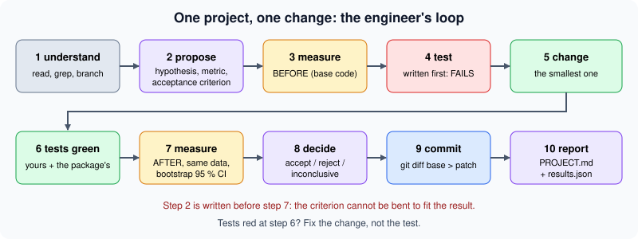
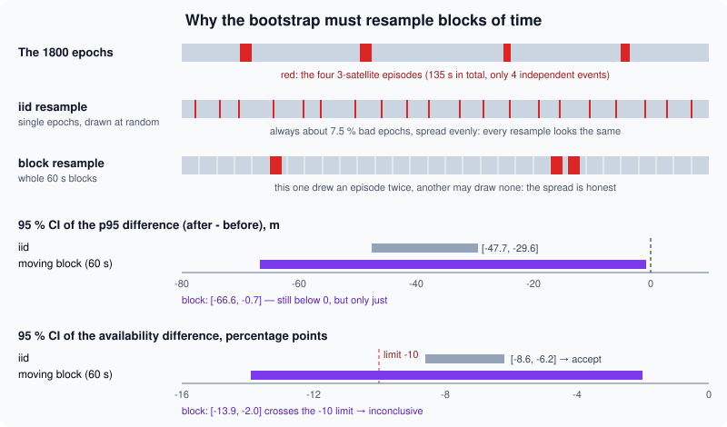

# Final project: one change, tested and measured with confidence

> [!NOTE] In short
> - In this final project you improve NAVERA with **one** change and prove with measurements that
>   it helps.
> - First write a proposal and a decision rule, before you look at any result.
> - Write a test that fails first, then passes after the change.
> - Measure before and after on the same data, with **bootstrap** confidence intervals; then
>   accept, reject, or say "inconclusive".
> - Follow NAVERA's rules: work on a git branch, one concern per commit, measure instead of
>   guessing, report honestly.
> - You finish with a commit, a patch and a report; the guided example changes the GPS driver
>   (`gps_node.py`).

A NAVERA box is installed on a survey drone in a large coastal city. The operator reports that, near
the tall buildings of the business district and in the narrow streets of the old town, the GPS position sometimes jumps by
tens of metres for half a minute — while the receiver still says "fix". A colleague proposes a
one-line fix: *"refuse GPS fixes computed from fewer than 4 satellites"*.

Is that a good change? It removes some bad positions, but it also removes GPS time. Is the gain real,
or did we get lucky with one recording? How sure are we? Would a reviewer at IRIS Systems accept the
change into the product?

This last lesson answers those questions with the method that real engineering teams use:
**a written proposal, a test that fails first, a measurement before and after with confidence
intervals, a decision rule fixed in advance, and an honest report**. Then you apply it to a change of
your own in your NAVERA copy.



## 1. The rules of the product

NAVERA is a commercial product (**Release 0.2 — field validation pending**, `docs/VALIDATION_STATUS.md`).
Its engineering guide, `CLAUDE.md` in your copy, starts with golden rules. Four of them define this
project:

> 1. **The system currently WORKS. Never break a working pipeline.**
> 2. **Always work on a git branch**, never directly on `main`. Commit small, commit often.
> 5. **One concern per commit.** Cleaning, refactor, optimization, and new features go in separate commits.
> 6. **Measure, don't guess.** For any performance/accuracy claim, run a measurement and report the number.

Rule 7 adds: *"Honesty over optimism. If a result is only validated in simulation, say so."* Your
report follows the same rule.

Why **one** change? Because a measurement compares two versions. If the two versions differ in three
ways and the metric improves, you cannot say which change helped, or whether one of them made things
worse and was hidden by the others. One change → one comparison → one conclusion.

## 2. The proposal: decide how you will judge, before you look

A **proposal** is a short text written *before* the "after" measurement. It has four parts:

| Part | Question | Example (the 4-satellite rule) |
|---|---|---|
| **Problem** | What goes wrong, for whom, how often? | gps_node accepts 3-satellite fixes that can be tens of metres wrong |
| **Hypothesis** | A sentence the data can prove *false* | Refusing them lowers the p95 error of accepted fixes |
| **Metric** | What number, which unit, which direction is better, on which data? | p95 horizontal error (m), lower is better, on 1800 epochs; guard-rail: availability |
| **Acceptance criterion** | Which result means "accept"? | 95 % CI of Δp95 entirely below 0 m, and CI of Δavailability above −10 points |

> [!TIP]
> **A metric with a right value.** Some metrics are not "lower is better" or "higher is better":
> they have a **target**. Example: an honest 2-D Gaussian σ puts 86 % of the errors inside 2σ, so a
> 2σ coverage of 80 % is too optimistic and 95 % is too cautious. For such a **calibration metric**,
> judge the **distance to the target**, |coverage − 86 %|, which *is* "lower is better". Compute it
> inside each bootstrap resample (so that it has its own CI), and save it with
> `write_results(..., better="closer", target=86.0)`. Choosing "higher is better" for a calibration
> metric is a classic mistake: it rewards a σ that is too large.

A **guard-rail metric** is a second metric that must not get much worse. Almost every safety rule
has a price: here, fewer accepted fixes means less GPS time. If you only measure the gain, you will
always "win".

Why must the criterion be written first? Because after seeing the numbers it is very easy — even
without bad intent — to choose the metric, the subset of data or the threshold that makes the change
look good. Statisticians call this the **garden of forking paths**: each small choice is reasonable,
but together they can turn noise into a "result". Writing the criterion first removes those choices.

## 3. The experiment: same data, same command, paired

NAVERA can replay recorded data. That gives you a **controlled experiment**: the old rule and the new
rule see exactly the same inputs, so any difference in the output is caused by the change, not by the
weather or the satellites. Three rules:

1. **Same data, same command** before and after. Only the code changes.
2. **Record what you ran**: the data file, the number of samples, the command, the random seed.
3. **Paired comparison**: compute the *difference* after − before on the same samples.

Why paired? For two metrics A (after) and B (before) measured on the same epochs,

```
Var(A − B) = Var(A) + Var(B) − 2 Cov(A, B)
```

When A and B are computed on the same data, they are strongly correlated (Cov > 0): the variance of
the difference is much smaller than Var(A) + Var(B). So the uncertainty of the *difference* is smaller
than what two separate error bars suggest. Never decide by checking whether two confidence intervals
overlap; compute the confidence interval of the difference directly.

## 4. The metrics

For a set of n horizontal errors e₁ … eₙ (metres, against the known truth):

- **CEP50** (circular error probable): the median error, 50 % of the fixes are closer than this.
- **p95**: 95 % of the fixes are closer than this. It describes the bad cases that the median hides.
- **max**: the worst case. It is real, but it depends on one sample only.
- **availability** = accepted epochs / all epochs. An epoch here is one second (one GGA sentence).

The percentile is computed with **linear interpolation** — the course rule of lesson 22 (numpy's
default `np.percentile`, and the one you implement in `stats_tools.percentile`). Lesson 29 used
NAVERA's nearest-rank rule only to reproduce `evaluate_session.py`; your project uses linear
interpolation and says so in its method:

```
sort:  x[0] ≤ x[1] ≤ … ≤ x[n−1]
h  = (n − 1) · q / 100
pq = x[⌊h⌋] + (h − ⌊h⌋) · (x[⌊h⌋+1] − x[⌊h⌋])
```

**Worked example.** Eight errors (m): 2.1, 3.4, 1.8, 2.9, 4.2, 2.5, 38.0, 3.1.
Sorted: 1.8, 2.1, 2.5, 2.9, 3.1, 3.4, 4.2, 38.0.

- Median: h = 7 · 0.5 = 3.5 → 2.9 + 0.5 · (3.1 − 2.9) = **3.0 m**.
- p95: h = 7 · 0.95 = 6.65 → 4.2 + 0.65 · (38.0 − 4.2) = **26.2 m**.

One bad fix moves the p95 from "about 4 m" to 26 m, while the median does not see it. That is why
NAVERA reports more than one number.

## 5. How sure are we? The bootstrap

A metric computed on one recording is an **estimate**. Another recording of the same situation would
give a slightly different value. A **95 % confidence interval (CI)** is a range built by a method
that contains the true value in about 95 % of repeated experiments.

For a mean, there is a formula: x̄ ± 1.96 · s / √n. For a p95, a difference of p95s or an availability
difference, there is no simple formula. The **bootstrap** (Efron, 1979) replaces the formula with
computation:

1. Treat the sample as a small copy of the world.
2. Draw a **resample**: n values *with replacement* from the sample (some appear twice, some not at all).
3. Compute the statistic on the resample. Repeat B times (B = 1000–2000).
4. The **percentile CI** is the interval between the α/2 and 1 − α/2 percentiles of the B values
   (2.5 % and 97.5 % for a 95 % CI).

In code (the structure of your `bootstrap_ci`):

```python
rng = np.random.default_rng(seed)          # ONE generator, created once: reproducible
for b in range(n_boot):
    idx = rng.integers(0, n, size=n)        # n indices drawn with replacement
    stats[b] = stat(values[idx])
lo, hi = np.percentile(stats, [100 * alpha / 2, 100 * (1 - alpha / 2)])
```

**Worked example, continued.** In the eight errors above, the probability that a resample does *not*
contain the 38.0 m value is (7/8)⁸ = 0.34. So about one resample in three has a p95 ≤ 4.2 m, and the
others have a p95 around 26 m or more. The bootstrap distribution of the p95 is wide — honestly
telling you that eight samples cannot pin down a p95.

## 6. Time series: when samples are not independent

The ordinary (iid) bootstrap assumes the samples are **independent**. GPS errors are not: multipath
from a building changes slowly, and a 3-satellite episode lasts tens of seconds. A simple model is the
**first-order autoregressive process** AR(1):

```
e[k] = ρ · e[k−1] + √(1 − ρ²) · σ · w[k],      w[k] ~ N(0, 1)
```

With ρ = 0.9 (the bench file of this lab), neighbouring seconds are almost the same. The correlation
time is about −1 / ln ρ ≈ 10 s. For the mean of such a series, the **effective sample size** is

```
n_eff ≈ n · (1 − ρ) / (1 + ρ) = 1800 · 0.1 / 1.9 ≈ 95
```

1800 seconds carry about as much information as 95 independent samples. An iid bootstrap pretends
there are 1800 and gives a CI about √((1+ρ)/(1−ρ)) = √19 ≈ 4.4 times too narrow.

The **moving-block bootstrap** fixes this: it resamples **whole blocks** of L consecutive epochs, so
the correlation inside each block is kept.

```
k = ⌈n / L⌉ blocks; each starts at a random s in 0 … n−L;
indices = [s₁ … s₁+L−1, s₂ … s₂+L−1, …] cut to n
```

Choose L much longer than the correlation time and than the typical event (here 25–40 s episodes):
L = 60 s. With L = 1 it is the iid bootstrap again.



How much does L matter on the example? The 95 % CI of Δp95 (m) and of Δavailability (points),
1000 resamples (with 2000, as in the lab, the bounds move by a few tenths):

| Block length L | CI of Δp95 (m) | CI of Δavailability (points) |
|---|---|---|
| 1 (iid) | [−47.3, −29.8] | [−8.6, −6.2] |
| 10 s | [−60.0, −3.8] | [−11.2, −4.1] |
| 30 s | [−66.0, −0.9] | [−13.1, −2.6] |
| 60 s | [−66.5, −0.7] | [−13.9, −1.8] |
| 120 s | [−66.9, −0.9] | [−13.9, −2.4] |

The interval grows until L is longer than the episodes, then it is stable: that plateau is how you
check that L is large enough. The iid bootstrap would say "accept, sure"; the honest answer is
different, as you will see.

## 7. The decision: accept, reject or inconclusive

With the CI of the difference D = after − before (for a metric where *lower is better*):

| CI of D | Meaning | Decision |
|---|---|---|
| entirely below 0 | the change improves the metric | accept (if the guard-rails are also OK) |
| entirely above 0 | the change makes it worse | reject |
| contains 0, or a guard-rail CI crosses its limit | the data cannot tell | **inconclusive** |

"Inconclusive" is not a failure. It is a precise statement: *more data is needed*, and it says which
data (more independent episodes). A team that writes "inconclusive" when it is true is a team whose
"accept" can be trusted.

## 8. Tests: fail first, then pass

A **unit test** checks one function without hardware or a ROS graph. An **integration test** starts
real nodes and talks to them (NAVERA's are in `navera_tools/tests/`). For a change like this one, the
logic should live in a **pure function** — inputs in, result out, no ROS — so that it can be
unit-tested in milliseconds.

A good test for a change:

1. is written **before** the change and **fails** on the old code (it proves the test sees the problem);
2. **passes** after the change;
3. covers the **boundary** (3 satellites refused, 4 accepted), the normal case, and the **old
   behaviour that must not change** (quality 0 and 6 still refused with the same reason);
4. stays in the product, so nobody breaks the rule again by accident (a **regression test**).

The check of this lab verifies point 1 itself: it extracts the `base` version of your package
(`git archive base`), puts your new test beside it, runs it, and expects a failure.

**Property-based testing** goes one step further. Instead of a few hand-picked cases, you state a
property and the library `hypothesis` (installed) generates hundreds of inputs:

```python
from hypothesis import given, strategies as st

@given(st.integers(min_value=0, max_value=3))
def test_fewer_than_four_satellites_is_never_usable(sats):
    assert fix_problem(1, True, sats) != ""
```

## 9. Git for a project, and the patch

You know the basics from lesson 5. In your NAVERA copy, `base` is a **tag** on the commit your copy
started from, so `git diff base` is *everything you changed*:

```bash
cd ~/navera
git checkout -b project/min-satellites base   # a branch for one project, starting at base
# … test first, change, test …
git add gps_pkg/gps_pkg/nodes/gps_node.py gps_pkg/test/test_gga_validation.py
git commit -m "gps: refuse GGA fixes computed from fewer than 4 satellites"
git log --oneline base..HEAD                  # your commits
git diff base > ~/lessons/30-final-project/my_project.patch
git apply --check -R ~/lessons/30-final-project/my_project.patch   # the patch matches the branch
```

A **patch** is the diff saved in a file. A reviewer applies it to a fresh copy with `git apply` —
that is how changes travel between engineers, and how your teacher reviews the project.

> [!TIP]
> Your copy is built with `colcon build --symlink-install`: Python edits work **immediately**. Only
> message changes (`navera_msgs`) or a package's `setup.py` need
> `colcon build --symlink-install --packages-select <package>`.

## 10. Project ideas

Choose **one**. ★ a few lines, ★★ an afternoon, ★★★ a real challenge. All paths are in your copy
`~/navera/`. Whatever you choose, the deliverables are the same (section 11).

| # | Idea | ★ | Start here | Metric idea |
|---|---|---|---|---|
| 1 | **Refuse GPS fixes from fewer than 4 satellites** (the worked example of the lab) | ★ | `gps_pkg/gps_pkg/nodes/gps_node.py` (`_publish_fix`), new test in `gps_pkg/test/` | p95 error, availability |
| 2 | **"NO FIX since 12 s"** in the operator view, so the operator knows how long the gap is | ★ | `simulation_web/simulation_web/resources/operator.html` (`showNoPosition`), tests in `simulation_web/test/test_operator_sim.py` | correctness of the shown duration on scripted gaps |
| 3 | **Is the GPS σ honest?** gps_node states σ = 2 m × HDOP. On the bench file (truth known), measure the fraction of errors inside 1σ and 2σ (an honest 2-D Gaussian gives 39 % and 86 %), propose a value with a CI. **The change** = a named constant (e.g. `UERE_M`) + a unit test; change its *value* only if the CI of the fitted value excludes the current 2.0 m. Metric: distance of the 2σ coverage to 86 % (`better="closer"`) | ★★ | `gps_pkg/gps_pkg/nodes/gps_node.py` (the `cov = (hdop * 2.0) ** 2` line) | coverage at 1σ / 2σ |
| 4 | **HDOP-aware jump margin**: the kinematic gate allows a fixed 50 m of GPS noise; make it `max(50, 3 × stated σ)` as a pure function with unit tests | ★★ | `navera_estimator/navera_estimator/nodes/estimator_node.py` (`_check_gps_plausibility`, `gps_jump_margin_m`); pure function + test in `navera_common/navera_common/` and `navera_common/test/` | false alarms on noisy-but-honest GPS vs detection of jumps |
| 5 | **Skip featureless frames** (sea, the uniform sand of a desert, blur) before the expensive search, with a clear reason | ★★ | `day_pkg/day_pkg/local_matcher.py` (`locate`, "too few features…"), tests in `day_pkg/test/test_local_matcher.py` | time per frame, good frames lost |
| 6 | **Dead-reckoning drift alarm**: how far has a propagated position travelled since its last measured fix? Warn past a threshold | ★★ | `navera_common/navera_common/track.py` (`TrackVelocity.propagate`), `navera_common/test/test_track.py` | alarm delay vs false alarms on a recorded track |
| 7 | **A "GPS frozen" fault** in the simulated receiver (same position, still "fix"): add the mode and its unit test; then (simulator booked) observe what NAVERA does | ★★ | `navera_tools/sim/nmea_gps.py` (`MODES`, `reported`), `navera_tools/sim/sim.html` | detection: does anything notice? |
| 8 | **A "GPS frozen" detector** in the arbiter: refuse a GPS whose position does not change for N fixes while another source says the vehicle moves | ★★★ | `estimator_node.py` (`_on_gps`, `_check_gps_plausibility`); integration test in `navera_tools/tests/test_estimator.py` | ROC: N vs false alarms / detections |
| 9 | **Is day vision's σ honest?** Record a simulator flight in shadow mode, run the evaluation, propose the σ day vision should state, with a CI | ★★★ | `navera_tools/evaluate_session.py`, `navera_tools/record_session.sh`, `navera_tools/tests/test_evaluate_session.py` | coverage of the stated σ |
| 10 | **Freshness windows from data**: the arbiter's per-source timeouts were chosen from simulator runs; measure inter-arrival times and propose values with CIs | ★★★ | `navera_estimator/navera_estimator/config/estimator_params.yaml`, `estimator_node.py` | flicker rate FIX↔NO FIX, gap detection delay |

Your own idea is welcome — check with the teacher that it is **one** change you can **test** and
**measure** in a few hours.

> [!WARNING]
> Ideas 7–10 may need the simulator, which the class shares: book it and keep runs short. When it is
> busy, work on recorded data (lessons 28 and 29). Never change files outside `~/navera` and your
> lesson folder.

## 11. The deliverables

The check verifies:

1. `stats_tools.py`: `percentile`, `bootstrap_ci`, `block_bootstrap_ci` (they serve every project).
2. `measure_project.py`: `summary()` (the example's metrics).
3. **`PROJECT.md`** with six sections: *Proposal* (Problem, Hypothesis, Metric, Acceptance criterion),
   *Change*, *Test*, *Measurement* (before/after with CIs), *Result* (the decision), *Limits*.
4. **`results.json`**: metric, before/after/difference with 95 % CIs, bootstrap settings and a decision
   that follows from the CI (`write_results()` writes the format). For the example project the check
   re-measures the file and compares.
5. A **project branch** in `~/navera` with commit(s) since `base` and a clean working tree.
6. A **test** in your commits that **passes** on your branch and **fails** on `base`.
7. The existing unit tests of every package you touched still pass.
8. **`my_project.patch`**, exported after your last commit.

## In NAVERA

The example project touches the GPS driver, `gps_pkg/gps_pkg/nodes/gps_node.py`. The decision you will
change today is in `_publish_fix()`:

```python
gps_qual = int(msg.gps_qual) if msg.gps_qual else 0
has_pos = bool(msg.lat) and bool(msg.lon)
if not has_pos or gps_qual not in _VALID_GPS_QUAL:      # _VALID_GPS_QUAL = {1, 2, 4, 5}
    fix.status.status = NavSatStatus.STATUS_NO_FIX
    ...
    # Contract: an invalid fix is published, not swallowed. valid=False,
    # NaN position, covariance UNKNOWN. Still MODE_MEASURED: it IS a live reading.
    reason = (f"no GPS fix (qual={gps_qual})" if gps_qual not in (6, 7, 8) else
              f"receiver reports a non-satellite position (qual={gps_qual}) — not used")
    self._publish_estimate(fix.header, valid=False, ..., reason=reason, ...)
    return
...
hdop = _field_float(msg.horizontal_dil)
if hdop is not None and hdop > 0:
    # sigma = HDOP x 2 m (assumed user range error); vertical ~2x horizontal.
    cov = (hdop * 2.0) ** 2
```

The number of satellites (`msg.num_sats`) is read only *after* the decision, for the log. Notice also
the comment on `confidence` a few lines lower: *"any HDOP->confidence curve needs a CHOSEN constant we
have not measured"* — the product refuses unmeasured numbers, exactly the attitude of this lesson.

Other places you will use:

| What | Where |
|---|---|
| Golden rules and workflow | `CLAUDE.md` |
| What is measured, and how | `docs/VALIDATION_STATUS.md` |
| The whole test suite | `navera_tools/run_tests.sh` (unit tests; `--integration` adds real nodes) |
| Existing GPS unit tests | `gps_pkg/test/test_ros_gps.py` |
| A simulated NMEA receiver (checksums, fault modes) | `navera_tools/sim/nmea_gps.py` |

NAVERA's real data — the satellite map, the recorded frames and the simulator area — covers
**Sousse, Tunisia**, where NAVERA is developed. The bench file of this lab is **synthetic**: a simulated
receiver standing still at a point in Sousse. Say so in your report.

## 🐦 How birds do it

Every autumn, barn swallows from Europe cross the Mediterranean Sea and the Sahara on their way to
Africa south of the desert, and fly back north every spring; white storks take the short sea crossing
at the Strait of Gibraltar. Navi the swallow is one of those travellers. Her first journey was
the hardest.

Young birds start with an **inherited programme**: roughly a direction and a duration of flight. In a
classic experiment in the 1950s, A. C. Perdeck caught migrating starlings in the Netherlands and
released them in Switzerland. The **young** birds kept their inherited direction and ended up in the
wrong region; the **adults** corrected towards their usual winter area. Experience had given them
something the young did not have: a map, built from earlier journeys. Many studies since have found
the same pattern: first-time migrants make more errors, and birds become better navigators with
experience.

That is the loop of this lesson. A bird does not change everything at once; it keeps what worked,
corrects one thing, and the next journey tests the correction. NAVERA was built the same way: the
arbiter's rules, the honest σ, the spoofing checks each came from one measured improvement after
another. Your project is one more step on that migration.

## Glossary

| Word | Meaning |
|---|---|
| **proposal** | the problem, hypothesis, metric and acceptance criterion, written before measuring |
| **hypothesis** | a statement the measurement can prove false |
| **guard-rail metric** | a second metric that must not get much worse (here: availability) |
| **acceptance criterion** | the rule, fixed in advance, that turns numbers into a decision |
| **paired comparison** | before and after computed on the same samples; you analyse the difference |
| **CEP50 / p95** | the median error / the error that 95 % of fixes stay below |
| **availability** | the fraction of time with an accepted position |
| **confidence interval (CI)** | a range from a method that contains the true value in ~95 % of experiments |
| **bootstrap** | estimating a CI by recomputing the statistic on many resamples with replacement |
| **autocorrelation** | neighbouring samples resemble each other (errors change slowly) |
| **effective sample size** | the number of independent samples a correlated series is worth |
| **moving-block bootstrap** | a bootstrap that resamples blocks of consecutive samples |
| **regression test** | a test that keeps a fixed bug from coming back |
| **property-based test** | a test that checks a property on many generated inputs (`hypothesis`) |
| **patch** | the output of `git diff` saved in a file, applied with `git apply` |

## Check what you learned

<details><summary>1. Why must the acceptance criterion be written before the "after" measurement?</summary>
After seeing the numbers it is easy to choose (even unconsciously) the metric, subset or threshold that
makes the change look good — the "garden of forking paths". A criterion fixed in advance removes those
choices, so the decision means something.
</details>

<details><summary>2. Errors (m): 1.0, 2.0, 3.0, 4.0, 10.0. What are the median and the p95 with linear interpolation?</summary>
Median: h = 4 · 0.5 = 2 → 3.0 m. p95: h = 4 · 0.95 = 3.8 → 4.0 + 0.8 · (10.0 − 4.0) = 8.8 m.
</details>

<details><summary>3. A series of 1800 errors has ρ = 0.9 between neighbouring seconds. Roughly how many independent samples is it worth for a mean, and what happens to an iid bootstrap CI?</summary>
n_eff ≈ 1800 · 0.1 / 1.9 ≈ 95. The iid bootstrap treats it as 1800 independent samples, so its CI is
about √19 ≈ 4.4 times too narrow. A moving-block bootstrap with blocks longer than the correlation time
gives an honest width.
</details>

<details><summary>4. The CI of Δp95 is [−66.6, −0.7] m, the CI of Δavailability is [−13.9, −2.0] points, and the criterion allows at most −10 points. Decision?</summary>
Inconclusive. The accuracy gain is shown (the whole CI is below 0), but the availability CI crosses the
−10 point limit: the data cannot show that the cost is acceptable. More independent episodes are needed.
</details>

<details><summary>5. Your new test passes on your branch. Why is that not enough?</summary>
A test that also passes on the old code does not check your change at all. It must fail on base and pass
on your branch; only then does it prove the problem exists and that your change fixes it.
</details>

<details><summary>6. Why compute the CI of the difference instead of checking whether the before and after CIs overlap?</summary>
Before and after are computed on the same data, so they are positively correlated:
Var(A − B) = Var A + Var B − 2 Cov(A, B) is smaller than the two separate intervals suggest. Overlapping
intervals can hide a clear, paired improvement.
</details>

Now open the **🛠️ Lab** tab.
