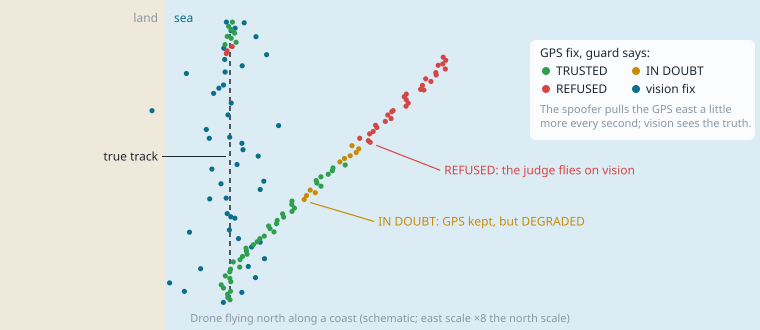
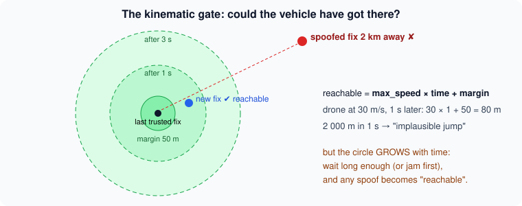
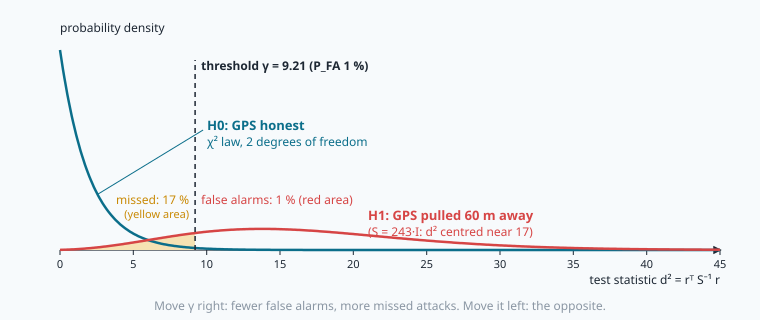
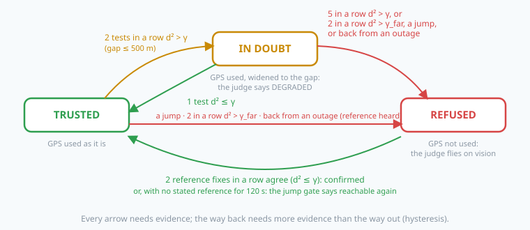

# Detecting GPS spoofing: hypothesis tests in the arbiter



> [!NOTE] Mission brief
> **June 2013, the Mediterranean.** With the owner's permission, a team from the University of Texas at
> Austin (Todd Humphreys's Radionavigation Laboratory) brought a small home-built spoofer on board the 65 m
> yacht *White Rose of Drachs*. Its fake GPS signals took over the yacht's receivers and turned the yacht a
> few degrees off its course. On the bridge, the chart showed a straight track. No alarm sounded.
>
> NAVERA met the same enemy in its own mission simulator (two items of its engineering backlog). **EST-9:**
> a spoofer who jumped 2 km and simply *waited* was accepted once the jump became "reachable", and then the
> **true** GPS was locked out. **EST-11:** jam the GPS, then come back spoofed: accepted. Both are fixed — by a
> cross-check with an independent source. NAVERA's validation document (2026-10-03) also says, honestly, what
> is still not caught.
>
> Today you treat detection as a statistician would: as a **hypothesis test**, with a false-alarm rate, a
> detection rate and a delay. **Session 1 — Statistician:** the χ² test of a GPS fix against vision,
> persistence, the hole in the jump gate, and a ROC curve you measure. **Session 2 — Guardian:** you put your
> guard in front of mission 29's judge, play nine attacks against it (and one live over ROS 2), then switch
> sides and attack it yourself.
>
> **Start now:** open the 🛠️ **Lab** tab, do **Step 0** (five minutes, no code), then come back here for §1.

**Objectives.** After this mission you can:

1. **state** spoofing detection as a hypothesis test (H0, H1, false alarm, missed detection) and **compute**
   the threshold of a χ² test for a chosen false-alarm probability;
2. **build** the innovation d² of a GPS fix against an independent position, with both covariances and the
   time gap, and **explain** why one disagreeing fix is not evidence (persistence);
3. **compute** the two delays that matter: when the jump gate lets a patient spoofer in, and when a drift is
   caught;
4. **measure** a ROC curve by Monte Carlo, **choose** an operating point, and **show** how correlated errors
   break the independence assumption;
5. **put** the guard in front of the judge (TRUSTED → IN_DOUBT → REFUSED → confirmed), **attack** it, and
   **state** what it cannot catch.

**You need:** mission 01 (the jump gate), 27 (covariance, Mahalanobis distance, χ² by simulation), 29 (the
judge: eligibility, priority, hold-off), 06 (east/north metres with `enu_flat`). ⏱ Reading: about 75 minutes
with the ✏️ checks: §1–§4 before session 1, §5–§6 before session 2. Lab: 3 h 30 to 5 h.

**Before you start.** Answer without looking; if you miss two, reread mission 27 §3 and mission 29 §2.

<details><summary>1. (Mission 01) The jump gate: v_max = 30 m/s, margin 50 m, last trusted fix 2 s ago. Largest accepted jump?</summary>
30 × 2 + 50 = 110 m. A fix farther than that from the last TRUSTED fix is refused, and a refused fix never
becomes the trusted one.
</details>
<details><summary>2. (Mission 27) In 2-D, which d² holds 95 % of honest errors, and how did you find it?</summary>
d² ≤ 5.99. By simulation: square and add two N(0, 1) numbers many times; 95 % fall below 5.99. (The 1σ
ellipse holds only 39 %.)
</details>
<details><summary>3. (Mission 29) GPS was lost and the judge flies on day vision. GPS comes back. When does the judge switch back?</summary>
After the hold-off: GPS must stay eligible for 2 s (switch_holdoff_s) before it takes over again.
</details>

<details><summary>Words of this lesson (open if you need them)</summary>

| Word | Meaning | Français |
|---|---|---|
| **spoofing / jamming** | fake but consistent satellite signals / noise that hides the real ones | leurrage / brouillage |
| **hypothesis test** | deciding between H0 (honest) and H1 (attacked) by comparing a statistic with a threshold | test d'hypothèse |
| **false alarm (P_FA)** | an alarm while H0 is true: a good GPS refused | fausse alarme |
| **missed detection, P_D** | no alarm while H1 is true; P_D = 1 − P_MD is the detection probability | non-détection, probabilité de détection |
| **innovation** | the difference between a measurement and what another source predicts | innovation |
| **χ² (chi-square) law** | the law of a sum of squared standard Gaussian numbers | loi du χ² |
| **persistence** | requiring n alarms in a row before deciding | persistance |
| **ROC curve** | detection probability against false-alarm probability, one point per threshold | courbe COR |
| **hysteresis** | different conditions to enter and to leave a state | hystérésis |
| **independent source** | a position measured without the GPS (vision, stars) | source indépendante |
</details>

## 1. The threat, and the first test you already have

The GPS signal is weak: at the ground it arrives below the receiver's own thermal noise, and the civil code
is public. So an attacker can do two things:

| | Jamming | Spoofing |
|---|---|---|
| The attacker transmits | noise on the GPS band | fake satellite signals, slightly stronger than the real ones |
| The receiver reports | "no fix" | a **wrong** position, with "fix OK" |
| The receiver knows? | yes | **no** |
| The judge (mission 29) | the GPS is not eligible: another source flies | must **detect** it |

Jamming is loud but honest. Spoofing is the dangerous case, and a classic sequence is **jam, then spoof**:
after an outage the receiver searches again and locks onto the strongest signal, the fake one. We describe
an attack by the offset b(t) the spoofer adds to the true position: a **jump** (b = 2 km at once), a **patient
spoofer** (a jump, then it waits), a **slow drift** (b = u·t with u a few m/s), **jam then spoof**.

**Test 1 is the jump gate of mission 01.** A fix farther than v_max·Δt + m from the last trusted fix is
refused. It is a **bound**, not a statistical threshold: an honest fix only fails it if the receiver error is
larger than the margin m. It catches every jump. But the allowed circle **grows with time**, and that is its
hole. The spoofer jumps D to the side and keeps the fake position there. The vehicle flies on at speed s, the
last trusted fix gets older, and after Δt the fake fix is at distance √((s·Δt)² + D²) from it. It becomes
"reachable" when

```
v_max·Δt + m ≥ √((s·Δt)² + D²)    ⇔    (v_max² − s²)·Δt² + 2·v_max·m·Δt + (m² − D²) ≥ 0
```

(square both sides: both are positive). That is a quadratic a·Δt² + b·Δt + c ≥ 0; the answer is its positive
root.

**Worked example (a harbour patrol boat).** v_max = 20 m/s (a boat's top speed), s = 8 m/s, m = 50 m,
D = 1 500 m. a = 400 − 64 = 336, b = 2 · 20 · 50 = 2 000, c = 2 500 − 2 250 000 = −2 247 500.
Δt = (−2 000 + √(2 000² + 4 · 336 · 2 247 500)) / (2 · 336) = (−2 000 + 54 997) / 672 = **78.9 s**.
After 79 s the spoof is accepted, and worse: when the true GPS comes back it is 1.5 km from the (fake)
trusted fix, so the **honest receiver is refused as a jump**. This is NAVERA's EST-9.



> [!QUESTION] ✏️ Check
> A drone hovers (s = 0). A spoofer moves its GPS 1 km to the side and waits. v_max = 20 m/s, m = 50 m.
> When is the spoof accepted? What happens to the formula when a = 0, and when a < 0?

<details><summary>Answer</summary>
With s = 0 the condition is simply 20·Δt + 50 ≥ 1000: Δt = 47.5 s (the quadratic gives the same root). If
s = v_max, a = 0: the inequality is linear, b·Δt + c ≥ 0, so Δt = −c/b — unless b = 0 too (no margin): then it
says c ≥ 0, false, so <b>never</b> (do not divide by zero). If s > v_max (the gate's speed is set too low for the
vehicle), a < 0: the spoof never becomes reachable — but neither does the vehicle's own true position.
</details>

## 2. Detection is a hypothesis test

At every check, the guard chooses between two hypotheses:

```
H0: the GPS is honest     (its error is noise, a few metres)
H1: the GPS is spoofed    (its error contains an offset b)
```

It computes a **test statistic** T from the data and raises an alarm when T > γ (the **threshold**). Two
errors are possible:

| | truth H0 (honest) | truth H1 (spoofed) |
|---|---|---|
| no alarm | correct | **missed detection** (P_MD) |
| alarm | **false alarm** (P_FA) | correct detection (P_D = 1 − P_MD) |

One threshold cannot make both small: a lower γ catches more attacks and refuses more honest fixes. Plotting
P_D against P_FA for every γ gives the **ROC curve** (receiver operating characteristic). Choosing a point on
it is an engineering decision: what does a false alarm cost (a good GPS refused, the vehicle flies on a less
accurate source) against a missed attack (the vehicle is pulled away)? For a moving vehicle a third number
matters: the **detection delay**, how far the attacker has pulled before the alarm.

**The statistic for 2-D positions.** In mission 27 you found by simulation that d² = x² + y² of two standard
Gaussian numbers stays below 5.99 in 95 % of cases. Here is why, exactly. The length ρ = √d² of a 2-D standard
Gaussian vector has the **Rayleigh** density ρ·e^(−ρ²/2), so its tail is

```
P(ρ > r) = ∫ from r to ∞ of ρ·e^(−ρ²/2) dρ = e^(−r²/2)      →      P(d² > γ) = e^(−γ/2)
```

This is the **χ² law with 2 degrees of freedom**: its tail is an exponential, so the threshold for a chosen
false-alarm probability is simply **γ = −2 ln P_FA**. Worked: P_FA = 1 % → γ = −2 ln 0.01 = **9.21**; 5 % →
5.99 (mission 27's number, now exact: it is the closed form inside `uncertainty.chi2_threshold`, which you
call with the probability of being INSIDE the gate, 1 − P_FA).

> [!WARNING] The 2-D trap
> "Beyond 3σ" is rare in 1-D (0.27 %). In 2-D, d² > 9 has probability e^(−4.5) = **1.1 %**: four times more
> often. One honest fix in 90 lands beyond "3σ". Never import 1-D intuition into a 2-D test.



> [!QUESTION] ✏️ Check
> A colleague wants "one false alarm per 10 000 tests". Which γ? An honest fix gives d² = 12.0: what is its
> p-value (the probability of an honest d² at least that large)?

<details><summary>Answer</summary>
γ = −2 ln(10⁻⁴) = 18.42. p-value = e^(−12/2) = e^(−6) = 0.0025: rare, but at one test every 2 s it happens about
once every 13 minutes. A single test is not a verdict.
</details>

## 3. The innovation: GPS against an independent position

The second test needs a position that a radio transmitter cannot change. **Day vision** matches the camera
image with the map: it measures the position without the GPS (missions 21–23). The **innovation** compares the
two measurements of the same moment:

```
r = p_GPS − p_vision          (east, north) metres, geo.enu_flat from vision to GPS
S = P_GPS + P_vision + g²·I   g = v_max · |t_GPS − t_vision|
d² = rᵀ S⁻¹ r                 under H0: a χ² law with 2 degrees of freedom
```

d² is mission 27's Mahalanobis distance of r for S; in mission 28's Kalman filter the same number, computed on
the filter's own innovation, was the NIS.

Why **both** covariances? Under H0, p_GPS = p + e_g and p_vision = p + e_v with independent errors, so
r = e_g − e_v and its covariance is the **sum** P_GPS + P_vision (mission 27: variances of independent errors
add). Why the **g²** term? The photo and the GPS fix are rarely taken at the same instant; in the gap the vehicle
may have flown up to v_max·|gap|. We count that distance as one more σ on each axis — a deliberately
pessimistic choice (the vehicle seldom flies at v_max). If either source states **no accuracy**, there is
nothing to test: d² does not exist.

**Worked example.** The GPS states σ 3 m, vision states σ 15 m (both round: P = σ²·I). The photo was taken
0.1 s after the GPS fix; v_max = 30 m/s, so g = 3 m. S = (9 + 225 + 9)·I = 243·I. The GPS is 50 m east of the
vision fix: d² = 50² / 243 = **10.29** > 9.21 → this test **disagrees** at P_FA = 1 % (p-value e^(−5.14) =
0.006). The test's radius, the largest gap that still agrees, is √(9.21 · 243) = 47.3 m.

> [!QUESTION] ✏️ Check
> NAVERA's day vision states σ 30 m today (not yet measured with its camera). Same GPS, same 50 m gap, same
> gap term: does the test still disagree? What is its radius now? What if vision stated 5 m while its real
> error is 15 m?

<details><summary>Answer</summary>
S = (9 + 900 + 9)·I = 918·I, d² = 2 500 / 918 = 2.72 < 9.21: it agrees; radius √(9.21 · 918) = 92 m. A
pessimistic σ makes the test <b>blind</b> to anything inside 92 m. An optimistic σ (5 m stated, 15 m real) makes
S far too small: honest gaps look huge and good GPS fixes are refused — P_FA explodes. An honest σ is a safety
property in both directions.
</details>

## 4. Persistence, and the delay of a drift

A map match can be wrong: a repeated texture, a new building. Refusing a good GPS on **one** disagreeing
vision fix would happen about once every 100 tests at P_FA = 1 %. So the guard asks for **n disagreeing
tests in a row**. If the tests are independent,

```
P(n in a row, honest) = P_FA^n          P_FA = 0.05, n = 3:  0.05³ = 1.25 · 10⁻⁴
```

Each vision fix counts **once**: comparing one photo with three GPS fixes is one test, not three (otherwise a
single wrong match would make a streak by itself). And the formula assumes **independence**. If vision's error
stays the same for several frames (the same map misalignment), one bad error gives several "disagreeing"
tests in a row: the streak is then almost one event, with a probability close to P_FA, not P_FA^n. Lab Step 6
measures how much this matters.

**The delay of a drift (worked example).** A spoofer pulls the GPS at u = 2 m/s from t = 0. One test every
T = 2 s, at t = 0, 2, 4 …; S = 243·I as in §3, P_FA = 1 % per test (radius 47.3 m), n = 5. The offset passes
47.3 m at 47.3 / 2 = 23.65 s; the first test beyond it is at **24 s**; the fifth in a row at 24 + 4 · 2 =
**32 s**, when the offset is **64 m**. Noise moves this by a few seconds either way. A faster drift is caught
sooner, but at a similar offset: the test **bounds the offset**, not the time.

> [!QUESTION] ✏️ Check
> Same test, but the spoofer drifts at 0.5 m/s. When and at what offset is it caught? Is a 0.5 m/s drift
> "safer" for the vehicle than a 2 m/s one?

<details><summary>Answer</summary>
47.3 / 0.5 = 94.6 s → first test beyond at 96 s → fifth at 104 s, offset 52 m. Later in time, but the vehicle is
pulled about as far (52 m against 64 m): the damage is bounded by the test's radius, not by the drift speed.
</details>

## 5. The guard: a state machine with hysteresis

Tests alone are not a product. NAVERA Lite's **guard** (`navera_lite/spoof.py`, `SpoofGuard`) turns them into a
verdict on every GPS fix, with three states and asymmetric rules (hysteresis, as the hold-off of mission 29):



| Rule (NAVERA Lite's defaults, `GUARD_DEFAULTS`) | Effect |
|---|---|
| a jump the gate refuses | **REFUSED** at once (test 1) |
| 2 reference fixes in a row with d² > γ (γ for P_FA 1 %), gap ≤ 500 m | **IN_DOUBT**: still used, but its covariance is widened to the gap, so the judge calls it DEGRADED |
| 5 in a row with d² > γ | **REFUSED** (a slow drift) |
| 2 in a row with d² > γ_far (γ for P_FA 10⁻⁶: radius 82 m with S = 243·I) | **REFUSED** (a clear disagreement) |
| one reference fix with d² ≤ γ | back to **TRUSTED** (a doubt is cleared) |
| REFUSED, then 2 reference fixes in a row agree | **TRUSTED** again ("confirmed") |
| GPS back after an outage (> 3 s, `gps_timeout_s`) while a stated reference exists | **REFUSED** until confirmed: this closes "jam, then spoof" |
| no reference of stated accuracy heard for 120 s | the jump gate alone decides again |

Why each choice? **Doubt before refusal**: the autopilot already weighs the GPS less (it is DEGRADED) before
any switch, so the switch is not a surprise. **A gap above 500 m gives no doubt**: a 500 m disagreement that
appears at once is more likely a wrong vision match than a spoofer that patient; the far rule still refuses
it if it persists. **A GPS refused by the cross-check comes back only through the cross-check**: comparing a GPS
with its own (spoofed) past proves nothing. **Re-acceptance after an outage** asks the same proof, because the
jump gate's circle has grown huge during the outage (at 30 m/s, 80 s of jamming allow 2 450 m).

How does the guard reach the judge you wrote in mission 29? It stands **in front** of it (`GuardedArbiter`):
a TRUSTED GPS fix goes through unchanged, an IN_DOUBT one with its widened covariance, a REFUSED one as "no
position" (`valid = False`), so the judge's own eligibility rules switch to vision at once. The judge needs no
change.

> [!QUESTION] ✏️ Check
> The guard is IN_DOUBT, gap 60 m. Your judge receives the GPS fix with its covariance widened to 60² m².
> Which state does the judge report, and why is that better than keeping FIX until the refusal?

<details><summary>Answer</summary>
Its stated σ becomes 60 m > 25 m: DEGRADED (mission 12's classify). The autopilot and the operator see the doubt
seconds before the refusal, and the autopilot's own filter already trusts the GPS less: the later switch to
vision is a small step, not a jump in what it believes.
</details>

## 6. The honest limits

From NAVERA's architecture document: all the protections beyond the jump gate **need an independent source
with a stated accuracy**. Concretely:

- **No landmark, no test.** Over the open sea, or a sand sea of uniform dunes, vision cannot match the map:
  only the gate is left. A jump is caught; a patient spoofer, a slow drift and "jam, then spoof" are not.
- **Unknown or dishonest σ.** If vision states no σ, a 100 m gap proves nothing. Too large a σ makes the test
  blind; too small a σ refuses good GPS (§3).
- **A spoofer below the radius.** An attacker who knows the rule keeps the offset just inside the test's
  radius and is never refused. The test does not remove the error: it **bounds** it (lab Step 11 measures that
  bound on your own guard).
- **Correlated errors** make streaks likelier than P_FA^n (§4).
- **Other defences exist** outside the judge: receivers that watch signal power or the direction the signals come
  from (several antennas), and authenticated signals such as Galileo's **OSNMA** service. They need receiver
  hardware support; the judge's tests work with any receiver. A strong system uses both.

> [!WARNING] Common wrong ideas
> - "A spoofed receiver would say something is wrong." It reports a normal fix: the fake signals are
>   consistent. Only reasoning about positions (or special receivers) notices.
> - "3σ means 0.3 % of false alarms." In 2-D, d² > 9 happens 1.1 % of the time (§2).
> - "Use the vision σ alone." The innovation's covariance is the **sum** of both covariances (plus the time gap).
> - "Five tests in a row: P_FA⁵." Only for independent tests. The same map error repeated breaks it (§4, lab Step 6).
> - "The jump gate stops spoofing." It stops jumps. Time, an outage or a slow drift get through it (§1).
> - "With the guard, spoofing is solved." Without an independent source of stated accuracy only the gate is left,
>   and a careful spoofer inside the radius is never refused (§6).

## In NAVERA

From NAVERA's architecture document, its validation document (Release 0.2, 2026-10-03) and its engineering
backlog (review of 28 September 2026), in words:

- **Kinematic gate** (EST-4): a GPS fix farther from the last trusted fix than the vehicle could travel —
  maximum speed × elapsed + **50 m** — is refused ("implausible jump … possible spoofing"). The maximum speed is
  set **per vehicle** (backlog R-1: it used to be one speed for every vehicle).
- **Cross-check while the GPS is good:** day vision still matches one frame around the GPS position **every
  2 s** (within 600 m) and publishes it with its stated accuracy. Every GPS fix is compared with the most
  accurate fresh independent source of stated accuracy, at the instant that source measured. NAVERA's tolerance
  is a distance: **3 σ of the vision fix + maximum speed × time gap**. **In doubt** from **2 distinct fixes in a
  row** beyond it (up to a 500 m gap): GPS still used, its accuracy made no better than the gap, so DEGRADED.
  **Refused** after **5 distinct fixes in a row**, or beyond **5 σ + 50 m** (+ maximum speed × gap) for **3 s**
  with at least 2 distinct fixes — never on one fix (EST-8).
- **Re-acceptance:** a GPS refused by the cross-check, or back after an outage, is re-accepted only when **2
  distinct independent fixes agree within 3 σ** (EST-9, EST-11, both found in NAVERA's mission simulator). Only
  if no independent source of stated accuracy has been heard for **120 s** does the gate decide alone.
- **Measured** (simulation and bench, none in flight): a 2 km spoof on a boat for 150 s refused within 1 s; a
  drone jammed 30 s then spoofed 2 km: refused throughout, the true GPS re-accepted 3 s after it returned; a
  slow drift at 4 m/s refused at about **160–200 m** in one test and, with a gimbal camera in the mission
  simulator, at about **140 m**, NAVERA's error median 15 m, max 143 m — against median 417 m, max 902 m, never
  refused, before the cross-check existed. Before the EST-9 fix, a patient 2 km spoof was accepted after
  offset / maximum speed (33 s) and the true GPS was then locked out.
- **QA-1 (campaign of 30 September 2026):** with the real vision, a spoof left NAVERA with no position and the
  drone landed — vision had taken the first spoofed fix as its search centre. Vision now takes its GPS
  reference from the arbiter's vetted output (re-test: 3/3 spoofs taken over by vision).
- **Known limitation 7:** all these protections need that independent source. Day vision states σ 30 m, **not
  yet measured with NAVERA's camera**; over the sea or uniform ground there is no independent source, and a
  gradual spoofer is not caught.

## In NAVERA Lite

[navera_lite/spoof.py](file:./navera_lite/spoof.py) is NAVERA Lite's guard. You write the statistics
(`chi2_threshold_2d`, `innovation`, `first_alarm`, `patient_accept_time`, `drift_alarm_time`) and the two
decisions of `SpoofGuard` (`on_reference`, `on_gps`). Given: `GUARD_DEFAULTS`, the guard's skeleton, the jump
gate (`guard.JumpGate`, mission 01's rule), mission 27's `uncertainty.chi2_threshold` and `mahalanobis2`
(shipped finished), and `GuardedArbiter`, which puts the guard in front of mission 29's
judge (`navera_lite/arbiter.py`, shipped finished). `guard_node.py` runs the pair as a ROS 2 node.
NAVERA Lite tests with a χ² on **both** covariances, once per reference fix; NAVERA uses a distance tolerance
on the vision σ, at every GPS fix: the same family of test, and the rules (2 / 5 in a row, 2 to confirm,
500 m, 120 s) are NAVERA's.

## 🐦 How birds do it

Birds can be fooled too, in ways that look like jamming and spoofing. Bright artificial lights (lit towers,
offshore platforms) attract night-migrating songbirds, which circle them for hours: a false signal far stronger
than the faint stars, like a spoofer's signal above the real satellites. In 2014, Engels and colleagues
(*Nature*) found that European robins on their campus in Oldenburg, Germany, could not use their magnetic
compass: weak human-made radio noise jammed it; in huts screened with grounded aluminium they oriented again.
And birds that get conflicting cues (a turned magnetic field at sunset) compare their compasses and
recalibrate one against another: three senses that must agree are much harder to fool than one.

## Summary

1. Spoofing gives a wrong position with "fix OK": only reasoning about positions (or special receivers) catches it.
2. Detection is a hypothesis test: a statistic, a threshold, P_FA against P_D (the ROC), and a delay.
3. The innovation d² = rᵀS⁻¹r, S = both covariances + the time-gap term, is χ² with 2 degrees of freedom:
   P(d² > γ) = e^(−γ/2), γ = −2 ln P_FA.
4. The jump gate catches jumps; time, outages and drifts get through it. Persistence (n in a row) controls false
   alarms only if the tests are independent; a drift is caught at a roughly fixed offset, the test's radius.
5. The guard (TRUSTED → IN_DOUBT → REFUSED → confirmed) sits in front of the judge. Everything beyond the gate
   needs an independent source of stated accuracy, and a spoofer inside the radius is never refused.

**Next mission:** the simulator. Your judge and guard fly a whole vehicle, and you meet the autopilot's side of
the story.

## Check yourself

Answer without scrolling up.

<details><summary>1. Jamming or spoofing: which one does the receiver notice, and why?</summary>
Jamming: the signals are drowned, the receiver has no fix and says so. Spoofing: the fake signals are consistent,
the receiver computes a position and reports a normal fix.
</details>
<details><summary>2. Write the threshold of a 2-D χ² test for P_FA = 0.1 %.</summary>
γ = −2 ln 0.001 = 13.8.
</details>
<details><summary>3. GPS σ 3 m, vision σ 15 m, photo 0.2 s after the GPS fix, v_max 30 m/s. S?</summary>
g = 6 m: S = (9 + 225 + 36)·I = 270·I.
</details>
<details><summary>4. Why must each vision fix count only once in a streak?</summary>
One photo compared with several GPS fixes is one measurement: counting it several times would let a single wrong
map match build a whole streak, and the false-alarm rate would be the single-test rate, not P_FA^n.
</details>
<details><summary>5. Which attacks get through when vision states no accuracy?</summary>
All except a sudden jump: the patient spoofer (once reachable), the slow drift, and jam-then-spoof (the gate's
circle has grown during the outage).
</details>
<details><summary>6. (Mission 27) Why is "the 1σ ellipse" a bad gate for 2-D positions?</summary>
It holds only 39 % of honest errors: such a gate refuses 61 % of good fixes. A gate is set from the χ² law
(5.99 for 95 %, 9.21 for 99 %).
</details>
<details><summary>7. (Mission 29) The guard refuses the GPS. What does the judge receive, and what does it do?</summary>
A GPS estimate with valid = False ("no position"): the GPS is no longer a candidate. Day vision has been eligible
for longer than the hold-off, so the judge switches to it at once — no need to wait for the GPS to go stale.
</details>

Now open the **🛠️ Lab** tab.
