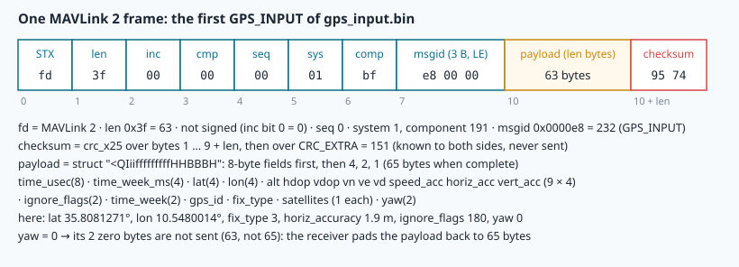
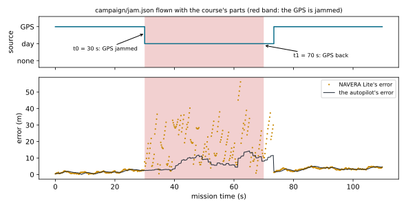

# Simulation and fault injection: SITL, MAVLink and NAVERA's mission simulator

> [!NOTE] In short
> - You cannot jam GPS over a real city to test NAVERA, so you test it in a **simulator**, where you can
>   repeat a failure safely.
> - NAVERA's mission simulator joins ArduPilot **SITL**, **MAVLink** and simulated sensors in a
>   closed loop.
> - NAVERA sends its position to the autopilot in a MAVLink `GPS_INPUT` message, which you can
>   decode byte by byte.
> - A **fault-injection campaign** runs scripted failures and turns the results into PASS / FAIL
>   verdicts.
> - A simulation proves behaviour (logic, timing, integration), not real accuracy.
> - In the lab you decode MAVLink messages, check the sensor models, and analyse a campaign of
>   five flights.

A survey drone leaves a harbour to inspect a long stretch of coast. Halfway, its GPS stops giving a fix.
GNSS interference is a known problem for aviation and shipping in several regions of the world, so
this is not science fiction: the question is what the whole system does at that moment. Does NAVERA
switch to vision? How fast? Does the autopilot keep flying, or does it land in the sea? And when the
GPS comes back, but 2 km wrong, does NAVERA accept it?

You cannot answer these questions by jamming GPS over a real coast: transmitting on GNSS frequencies is
illegal in most countries, and a crash is expensive. You answer them in a **simulator**, where you
can inject the same failure a hundred times, measure the reaction, and nobody is in danger. This
lesson explains how NAVERA's mission simulator is built (ArduPilot **SITL**, **MAVLink**, simulated
sensors), what its sensor models are mathematically, and how engineers run a **fault-injection
campaign** and turn it into pass/fail results — while staying honest about what a simulation can
and cannot prove.

> [!NOTE]
> NAVERA's test map covers **Sousse, Tunisia**, where NAVERA is developed, so every recorded flight
> in this lesson flies over Sousse. The examples in the text use generic places; the physics and the
> software are the same.

## 1. The test ladder

A navigation product is tested at several levels. Each level adds more of the real system, costs
more, and proves more.

| Level | What is real | What is simulated or replayed | NAVERA example | What it can prove |
|---|---|---|---|---|
| **Unit test** | one function | its inputs | `navera_output/test/` (GPS_INPUT fields) | the function's maths and edge cases |
| **Integration test** | one or more nodes | scripted messages | `navera_tools/tests/test_estimator.py` (lessons 27–30) | the rules and their timing |
| **Replay** | the nodes | recorded sensor data (a ROS bag) | `evaluate_session.py` on a bag (lesson 32) | behaviour on real data, offline |
| **SITL** (Software In The Loop) | NAVERA **and** the autopilot firmware | the world, the sensors, the vehicle physics | `navera_tools/run_sim.sh` | the closed loop: what the *vehicle* does |
| **HIL** (Hardware In The Loop) | + the real computers and cables | the world | (not done yet) | timing and interfaces on the real hardware |
| **Field test** | everything | nothing | `docs/FIELD_TEST_PROCEDURE.md` | real accuracy |

The important word in "Software In The Loop" is **loop**. In an integration test, a script decides
what the sensors say. In SITL, the autopilot *acts* on NAVERA's position, the simulated vehicle
*moves*, and the sensors then measure the new state. A wrong position from NAVERA changes the
trajectory, which changes the next measurements. Only a closed loop shows that kind of interaction.

## 2. The closed loop, as equations

Write the true state of the vehicle (position, velocity, attitude) as **x**. Every simulation step
of length Δt does four things:

```
x[k+1] = f(x[k], u[k], Δt)          physics: ArduPilot's built-in vehicle model (here a quadcopter)
y[k]   = h(x[k]) + e[k]             sensors: GNSS receiver, IMU, camera — truth plus a modelled error
p[k]   = NAVERA(y[0..k])            NAVERA's position: the arbiter's choice among its sources
u[k]   = autopilot(p[k], IMU, plan) the autopilot's commands (motors) from its own filter (EKF)
```

The simulator owns `f` and `h`; NAVERA and the autopilot are the real programs. The **error model**
`e[k]` is where fault injection happens: "jam the GPS" means "change `h` for the GNSS receiver from
now on". The truth `x[k]` is always available to the simulator, so every error can be computed
exactly — something you never have in a field test.


### What the NAVERA simulator starts

`navera_tools/run_sim.sh` checks that the ports are free, takes a lock file, and starts
`navera_tools/sim/sim_server.py`. A mission then starts:

| Component | Real or simulated | How it talks |
|---|---|---|
| ArduPilot SITL (`arducopter`, quad model) | **real** firmware, compiled for Linux | MAVLink over TCP: 5760 (ground station), 5762 (NAVERA's input) |
| `gps_node` | **real** NAVERA driver | reads NMEA 0183 from a **pseudo-terminal** (`/dev/pts/N`), exactly like `/dev/ttyTHS1` on the box |
| `estimator_node` (the arbiter) | **real**, product parameters | ROS 2 topics `/navera/estimate/*` → `/navera/nav_status`, `/navera/position` |
| `vehicle_output` | **real** | MAVLink `GPS_INPUT` (id 232) to the autopilot, 5 Hz |
| GNSS receiver (`sim/nmea_gps.py`) | simulated | writes `$GPGGA` / `$GPRMC` into the pseudo-terminal |
| vision | simulated **error profile** (or the real day vision on synthetic images) | publishes `PositionEstimate` on `/navera/estimate/day` |
| IMU | simulated (BNO085-class bias) | ROS topic |
| control page / API | simulator | HTTP on 8190 (`/api/state`, `/api/mission`, `/api/fault`) |
| operator view | **real** NAVERA web bridge | HTTP on 8181 |

The decisive settings are in `sim/autopilot.py`:

```python
f.write("GPS_TYPE 14\nSIM_GPS_DISABLE 1\nGPS_AUTO_CONFIG 0\n"
        "SERIAL1_PROTOCOL 2\n"
        ...
        # NAVERA integration (navera_output/README.md): position only
        # from NAVERA; velocity from the autopilot's own IMU
        "EK3_SRC1_VELXY 0\nEK3_SRC1_VELZ 0\n")
```

`GPS_TYPE 14` means "my GPS is a MAVLink message", and `SIM_GPS_DISABLE 1` switches off SITL's own
simulated GPS. So the autopilot's **only** position input is NAVERA's output. If NAVERA is wrong, the
drone flies wrong; if NAVERA has nothing, the autopilot's own **failsafe** acts (a Copter lands, a
Rover holds). NAVERA is judged by what the vehicle does — the honest test.

## 3. MAVLink, byte by byte

**MAVLink** is the binary message protocol between autopilots, ground stations and companion
computers (like the NAVERA box). Every message is a **frame**:



| Offset | Bytes | Field | Note |
|---|---|---|---|
| 0 | 1 | `STX` = `0xFD` | start of a MAVLink **2** frame (MAVLink 1 uses `0xFE`) |
| 1 | 1 | `len` | payload length, 0–255 |
| 2 | 1 | `incompat_flags` | bit 0 = the frame is **signed** (13 extra bytes at the end) |
| 3 | 1 | `compat_flags` | ignored by receivers that do not understand it |
| 4 | 1 | `seq` | sequence number 0–255: a gap means lost frames |
| 5 | 1 | `sysid` | system id (NAVERA's box: 1) |
| 6 | 1 | `compid` | component id (NAVERA's `vehicle_output`: 191) |
| 7 | 3 | `msgid` | message id, little-endian (`GPS_INPUT` = 232) |
| 10 | `len` | payload | the message fields |
| 10+len | 2 | `checksum` | CRC-16, little-endian |

All multi-byte numbers are **little-endian**: the least significant byte comes first. The bytes
`e8 00 00` are the number 0x0000E8 = 232.

### The checksum: CRC-16/MCRF4XX plus CRC_EXTRA

A **CRC** (cyclic redundancy check) is a short number computed from the bytes; the receiver
recomputes it and drops the frame if it differs. MAVLink uses the CRC-16 called **MCRF4XX** (also
"X.25" in MAVLink's code). It starts at `0xFFFF` and processes one byte `b` at a time:

```
tmp = b XOR (crc AND 0xFF)
tmp = (tmp XOR (tmp << 4)) AND 0xFF
crc = (crc >> 8) XOR (tmp << 8) XOR (tmp << 3) XOR (tmp >> 4)        (all kept on 16 bits)
```

The standard test: the CRC of the ASCII text `123456789` is `0x6F91`. The CRC covers the bytes from
`len` to the end of the payload (not the `0xFD`), and then **one more byte, `CRC_EXTRA`**, which is not
sent. `CRC_EXTRA` is computed from the message definition (its field names and types): 50 for
`HEARTBEAT`, 151 for `GPS_INPUT`. If the sender and the receiver were built with *different*
definitions of message 232, their CRC_EXTRA differ and every frame is rejected — a wrong decoding is
worse than no decoding.

A CRC-16 does not detect every error, but it detects every single-byte error and every burst of up to
16 bits; a random corruption passes with probability about 2⁻¹⁶ ≈ 1.5 × 10⁻⁵.

### The payload: GPS_INPUT (id 232)

The fields are **reordered by size** on the wire (8-byte fields first, then 4, 2, 1), so the struct
format of `GPS_INPUT` is `<QIiifffffffffHHBBBH` (Python `struct` notation):

| Field | Type | Unit / meaning |
|---|---|---|
| `time_usec` | uint64 | UTC time of the measurement, µs since 1970 |
| `time_week_ms`, `time_week` | uint32, uint16 | the same instant in GPS time: ms of the week, week number |
| `lat`, `lon` | int32 | degrees × 10⁷ (1 unit = 1.1 cm in latitude) |
| `alt` | float | m above mean sea level |
| `hdop`, `vdop` | float | NAVERA sends σ / 2 m (its user range error, `UERE_M = 2.0`) |
| `vn`, `ve`, `vd` | float | velocity north / east / down, m/s |
| `speed_accuracy`, `horiz_accuracy`, `vert_accuracy` | float | **1-σ accuracies in metres** |
| `ignore_flags` | uint16 | bit mask: which fields the autopilot must ignore |
| `gps_id`, `fix_type`, `satellites_visible` | uint8 | fix_type 1 = no fix, 3 = 3D fix |
| `yaw` | uint16 | (extension field, 0 = not sent) |

That is 63 + 2 = 65 bytes. **MAVLink 2 truncates trailing zero bytes** of the payload, so a frame
whose last fields are 0 is shorter: a receiver must pad the payload with zeros back to 65 bytes
before unpacking. Forgetting this is the classic MAVLink-2 decoding bug.

Integers are used for latitude and longitude because a 32-bit float has only 24 bits of mantissa:
near 35.8° its resolution is about 2⁻¹⁸ degree ≈ 0.4 m. An int32 in units of 10⁻⁷ degree gives 1.1 cm.

`ignore_flags` is a **bit mask**: each bit is one flag, and the value is the sum of the bits that are set.

| Bit | Value | Flag |
|---|---|---|
| 0 | 1 | `IGNORE_ALT` |
| 1 | 2 | `IGNORE_HDOP` |
| 2 | 4 | `IGNORE_VDOP` |
| 3 | 8 | `IGNORE_VEL_HORIZ` |
| 4 | 16 | `IGNORE_VEL_VERT` |
| 5 | 32 | `IGNORE_SPEED_ACCURACY` |
| 6 | 64 | `IGNORE_HORIZONTAL_ACCURACY` |
| 7 | 128 | `IGNORE_VERTICAL_ACCURACY` |

A bit is set when `flags & value != 0`.

### Worked example: one real frame

This is the `GPS_INPUT` NAVERA would send at t = 100.7 s of the sample flight (re-encoded with
NAVERA's own `gps_input_fields()`; see the lab):

```
fd 3f 00 00 c9 01 bf e8 00 00 | 20 af b8 63 3d 5d 06 00 | 04 85 a6 11 | 81 58 5a 15 | f2 ec 56 06 | ...
```

- `3f` → len = 63 (not 65: the `yaw` field, 0, was truncated), `c9` → seq 201, `01 bf` → system 1,
  component 191, `e8 00 00` → message 232.
- `lat` bytes `81 58 5a 15` → 0x155A5881 = 358 242 433 → **35.8242433°**.
- `lon` bytes `f2 ec 56 06` → 0x0656ECF2 = 106 360 050 → **10.6360050°**.
- Further on, `ignore_flags` = 48 = 32 + 16: ignore the speed accuracy and the vertical velocity —
  a GPS fix with altitude and horizontal velocity. A day-vision fix gives 57 = 32 + 16 + 8 + 1: it
  has **no altitude and no velocity**, and NAVERA says so instead of inventing them.
- `horiz_accuracy` = 1.4 m (GPS: HDOP 0.7 × 2 m) → `hdop` field = 1.4 / 2 = 0.7.

### The messages of the simulator

| Id | Message | Direction | Used for |
|---|---|---|---|
| 0 | `HEARTBEAT` | everyone, 1 Hz | "I am alive", vehicle type, mode, armed |
| 24 | `GPS_RAW_INT` | autopilot → GCS | what the autopilot received as GPS (= NAVERA) |
| 33 | `GLOBAL_POSITION_INT` | autopilot → GCS | the autopilot's **belief** (its EKF output) |
| 76 | `COMMAND_LONG` | GCS → autopilot | arm, take off, set speed |
| 86 | `SET_POSITION_TARGET_GLOBAL_INT` | GCS → autopilot | "fly to this point" (GUIDED mode) |
| 108 | `SIM_STATE` | SITL → GCS | the **truth** from the physics (only exists in simulation) |
| 193 | `EKF_STATUS_REPORT` | autopilot → GCS | is its position usable? (`EKF_POS_HORIZ_ABS`) |
| 232 | `GPS_INPUT` | NAVERA → autopilot | NAVERA's position |
| 253 | `STATUSTEXT` | autopilot → GCS | text such as "EKF3 IMU0 is using GPS" |

So the simulator can compute two errors at every instant: **NAVERA's error** (NAVERA's position vs
`SIM_STATE`) and the **autopilot's error** (`GLOBAL_POSITION_INT` vs `SIM_STATE`). They differ: the
autopilot's EKF smooths NAVERA's input with its IMU.

## 4. The simulated sensors, mathematically

A simulator is only as good as its error models. Here are NAVERA's, from the code.

### GNSS receiver noise: a first-order Gauss–Markov process

Real GNSS errors are not white noise: multipath and atmospheric delays change slowly, so the error
at one second is close to the error at the previous second. `sim/nmea_gps.py` models each horizontal
axis as a **first-order Gauss–Markov** process, updated every Δt = 0.2 s (5 Hz):

```
n[k+1] = n[k] − n[k]·Δt/τ + q·√Δt·w[k]          w[k] ~ N(0, 1) independent,  τ = 20 s,  q = 0.6
       = a·n[k] + q·√Δt·w[k]                      with a = 1 − Δt/τ = 0.99
```

Two properties follow from this recursion:

- **Stationary variance.** If the process is stationary, Var(n[k+1]) = Var(n[k]) = σ², so
  σ² = a²σ² + q²Δt, hence **σ² = q²Δt / (1 − a²)**. With the numbers above:
  1 − a² = 1 − 0.9801 = 0.0199, σ² = 0.36 × 0.2 / 0.0199 = 3.62 m², **σ ≈ 1.90 m per axis**.
  (For small Δt this is ≈ q²τ/2, the continuous-time result.)
- **Autocorrelation.** n[k+m] = aᵐ n[k] + (independent noise), so the correlation between two
  samples m steps apart is **ρ(m) = aᵐ** ≈ e^(−mΔt/τ). After τ = 20 s the correlation has dropped to
  1/e ≈ 0.37. τ is called the **correlation time**.

Why it matters: averaging N white-noise samples divides σ by √N. Averaging correlated samples over
much less than τ divides it by almost nothing. That is why a GPS "standing still" wanders slowly
instead of jittering.

### Spoofing models

- `spoof_jump`: a fixed offset of **2000 m** in a random direction is added from the moment of the fault.
- `spoof_drift`: the offset grows at **4 m/s** (east 3.2 m/s, north 2.4 m/s): after t seconds it is 4t m.
- `jammed`: the receiver still talks, but with no fix: `$GPGGA` quality 0, `$GPRMC` status V.
- `off`: no sentences at all — only a timeout can notice it (lesson 29).

### Vision error profiles and the Rayleigh distribution

When the real day vision is not run (it needs the GPU and a prepared map), the simulator draws a
vision position as truth + an independent Gaussian error on each axis, east and north, with the same σ.
The **horizontal** error r = √(e² + n²) of such an error follows a **Rayleigh distribution**:

```
P(r ≤ R) = 1 − exp(−R² / (2σ²))      so the p-quantile is   R_p = σ·√(−2·ln(1 − p))
median (p = 0.5): R_50 = σ·√(2 ln 2) ≈ 1.177 σ          p = 0.95: R_95 = σ·√(2 ln 20) ≈ 2.448 σ
```

- **Target** profile: σ = 15 m (`DAY_TARGET_SIGMA`), *the accuracy goal, not a measured
  performance*. Median horizontal error 17.7 m, 95 % below 36.7 m. It **states** its σ, so the
  arbiter calls it FIX and can use it to cross-check the GPS (lesson 30).
- **Measured** profile: the code chooses σ so that the *median* matches the former day vision's
  measured median of ~440 m: `DAY_MEASURED_SIGMA = 440.0 / math.sqrt(2.0 * math.log(2.0))` = 373.7 m.
  It states **no** σ (covariance type UNKNOWN), so it is DEGRADED and cannot vouch for or against GPS.

You will check these formulas numerically in the lab, and compare them with the error NAVERA really
had in the recorded flights (it is a bit larger — finding out why is part of the lab).

## 5. Fault injection and campaigns

**Fault injection** is causing a failure on purpose to observe the reaction. A **fault** is described
by: *what* fails (GPS, camera, IMU), *how* (jam, jump, drift, off), *when* (onset, relative to a
flight phase) and *how long*. A **campaign** is a planned set of such runs — a **test matrix** — with
the expected behaviour written down *before* running it.

### Scripted, not clicked

Clicking a fault button by hand is good for a demo but bad for engineering: the timing differs at
every run, and nobody can repeat it exactly. A campaign runs a **scenario file**: the recorded campaign
was flown that way on the full simulator (`sim_ctl.py campaign scenario.json`, run by the teacher), and
your own scenario flies the same way in Sim Lite (**▶ Fly my scenario**, lab Part E):

```json
{"name": "drift_target", "vision": "target",
 "faults": [[30, "gps", "spoof_drift"], [110, "gps", "ok"]], "tail_s": 45}
```

Times are seconds after the drone starts flying to its destination. Same file → same mission, same
faults, same times. (The sensor noise is random, so two runs are still not identical — lesson 32 deals
with that.)

### From NAVERA's rules to expected numbers

Before a campaign you **predict** the result from the design (lessons 27–30). For the drone (maximum
speed 30 m/s in the simulator):

| Fault | Rule that should act | Predicted |
|---|---|---|
| GPS jammed | `gps_node` publishes `valid=false` at the next sentence | NAVERA leaves GPS within ≤ 1 s |
| GPS off | no message: stale after `gps_timeout_s` = 3 s | NAVERA leaves GPS after ≈ 3 s |
| GPS back after an outage | `switch_holdoff_s` = 2 s, plus a cross-check with vision | GPS used again ≈ 2–4 s later |
| Spoof jump 2 km | kinematic gate: reachable = v_max·Δt + 50 m = 30 × 0.2 + 50 = **56 m** | refused at the first spoofed fix |
| Spoof drift 4 m/s | cross-check vs vision (σ 15 m): 5 fixes in a row beyond 3σ, or beyond 5σ + 50 m for 3 s | refused after tens of metres, not kilometres |
| GPS jammed **and** camera failed | no eligible source | NO FIX → the autopilot's own failsafe (Copter: LAND) |

### What to measure

For each injected fault, starting at its onset t₀ and ending at t₁:

- **Switch latency**: first time NAVERA's source is no longer GPS, minus t₀.
- **Recovery (re-acquisition) latency**: first time NAVERA uses GPS again after t₁, minus t₁.
- **Availability** during the fault: fraction of samples with a position (state FIX or DEGRADED).
- **Error during the fault**: median and 95th percentile of NAVERA's horizontal error vs the truth.
- **Spoof leakage**: seconds during which NAVERA used a GPS more than 100 m wrong.
- **Vehicle outcome**: did the autopilot leave its mission mode (GUIDED) — and to what (LAND, RTL)?

Then each measurement is compared with a **requirement**, e.g. *"after a GPS jam, NAVERA provides a
position from another source within 1 s"*, and gets PASS or FAIL. This table — scenario, requirement,
measured value, verdict — is what an engineering test report contains.



### Worked example: the jam in the sample flight

In the recorded sample flight, the GPS receiver is jammed at t₀ = 110.8 s and released at
t₁ = 171.2 s. The recording (one row per second) shows NAVERA on DAY VISION already in the row of
t = 110.8 s: **switch latency 0.0 s** at the 1 s resolution of the recording (the real latency is
below one second). GPS is used again at t = 173.2 s: **recovery latency 2.0 s** — exactly the 2 s
hold-off. Every row of the jam has a position: **availability 100 %**. Requirement "switch ≤ 1 s":
PASS. Requirement "recovery ≤ 5 s": PASS.

Note the resolution: a recording at 1 Hz cannot measure a latency of 0.2 s. To measure it, record
faster or read the time stamps in the logs.

## 6. Fidelity: what a simulation can and cannot prove

Simulation results are **behaviour** results, not accuracy results. NAVERA's validation document
says it plainly about this simulator: *"these are behaviour results, not accuracy results"*.

| The simulator can show | The simulator cannot show |
|---|---|
| the logic: which source wins, which state, which reason | the real accuracy of vision: the profiles are drawn by the simulator, and the synthetic camera images are cut from the very map vision matches against |
| the timing of the rules (timeouts, hold-off, gates) | how a real receiver degrades under jamming (signal-to-noise drops gradually, positions get noisy *before* the fix is lost) |
| the integration: NMEA parsing, MAVLink encoding, the autopilot's reaction and failsafes | a real spoofer's behaviour (it may also fake the time, or move slowly and smoothly) |
| regressions: a change that breaks a scenario that passed yesterday | the timing on a loaded Jetson in a vibrating, hot aircraft |

The documented simulator results (VALIDATION_STATUS.md, *Autopilot in the loop*, **simulation**)
include: GPS OK → NAVERA error 1–4 m; GPS jammed in flight with the target vision profile → the
mission continues, autopilot error 2–18 m for 2.5 min, no failsafe; GPS jammed 30 s then spoofed 2 km
for 30 s → spoof refused throughout, true GPS re-accepted 3 s after it returns; GPS jammed and camera
failed → NO FIX → autopilot failsafe (Copter LAND, Rover HOLD). In the lab you will compare your own
measurements with these lines — they come from a different run, sometimes an earlier software version,
so small differences are expected and worth explaining.

NAVERA is a commercial product in **Release 0.x — field validation pending**: the simulator is how its
behaviour is checked today; the field test procedure is how its accuracy will be measured.

## 7. Two simulators: the full one and Sim Lite

The **full** simulator needs fixed TCP ports — 8190 (control page), 8443 (HTTPS), 8181 (operator
view), 5760 and 5762 (ArduPilot) — and a port can be used by **one** program at a time. It also needs
about 2–3 GB of the Jetson's 8 GB. So it runs one flight at a time; the campaign you analyse was
recorded on it. Its control page has no password (*"Development tool — no authentication"*), so it
must never run on a box installed in a vehicle.

**Sim Lite** (the 🛩️ Simulator tab) is built for a class: it runs in **your browser**, so everyone
flies at once. It keeps what matters for NAVERA's behaviour — your own `navera_estimator`, the GPS
estimate with jamming and spoofing, the vision fixes with the measured or target error profiles, an
autopilot whose only position is NAVERA's output — and simplifies the rest: simple vehicle
kinematics instead of ArduPilot's physics, no camera images, a stand-in for ROS 2 with simulated time.
Same rule as always: a simulation proves **behaviour**, not accuracy.

## 🐦 How birds do it

Biologists cannot ask a bird how it navigates. Like NAVERA's engineers, they build **controlled
worlds** where they decide what the bird senses, and they inject "faults".

- **The Emlen funnel** (Stephen Emlen and John Emlen, 1966). A migratory songbird kept in a cage
  becomes restless at migration time and hops in its migration direction. In a paper funnel with an
  ink pad at the bottom, each hop up the sloping wall leaves a footprint: in the morning, the ink
  marks are the "log file" of the night.
- **The planetarium.** Stephen Emlen showed indigo buntings an artificial night sky and then
  rotated it: the birds changed their direction with the sky. A fault injection on the star compass.
- **Magnetic coils.** Wolfgang and Roswitha Wiltschko placed European robins inside coils that turn
  the Earth's magnetic field by a chosen angle. The birds turned their preferred direction with it.

Each experiment changes **one** input, keeps the others, and records the reaction — exactly the
method of a fault-injection campaign. And biologists know the limit of their simulators: a bird in
a funnel is not a bird crossing the Sahara. Millions of birds migrate between Europe and Africa —
white storks cross at the Strait of Gibraltar in their thousands — and the big laboratory results have to be checked on free-flying birds with radio tags
and GPS loggers. Simulation first, reality after: the same rule as NAVERA's. Navi, our swallow, would
add that she prefers the real sky — but she also prefers not to be jammed over the sea.

## 8. In NAVERA

| What | Where in your copy (`~/navera/…`) |
|---|---|
| The launcher (ports check, lock file, ROS domain, logs) | `navera_tools/run_sim.sh` |
| World, missions, vision profiles, HTTP API | `navera_tools/sim/sim_server.py` |
| ArduPilot SITL: parameters, MAVLink, truth (`SIM_STATE`) | `navera_tools/sim/autopilot.py` |
| Simulated GNSS receiver: Gauss–Markov noise, jam, spoof | `navera_tools/sim/nmea_gps.py` |
| NAVERA's `GPS_INPUT` encoding | `navera_output/navera_output/mavlink_out.py` |
| What NAVERA sends to the vehicle, and when | `navera_output/navera_output/policy.py` |
| The documented simulator results | `docs/VALIDATION_STATUS.md`, *Autopilot in the loop* |

The receiver's error model (`nmea_gps.py`):

```python
def reported(self, lat, lon, dt):
    """Position the receiver reports (truth + noise + spoofing)."""
    for i in (0, 1):                          # first-order Gauss-Markov noise
        self.noise[i] += -self.noise[i] * dt / 20.0 + self.rng.gauss(0, 0.6) * math.sqrt(dt)
    if self.mode == "spoof_drift":
        self.spoof[0] += 4.0 * dt * 0.8
        self.spoof[1] += 4.0 * dt * 0.6
    e, n = self.noise[0] + self.spoof[0], self.noise[1] + self.spoof[1]
    return (lat + n / M_PER_DEG,
            lon + e / (M_PER_DEG * math.cos(math.radians(lat))))
```

How NAVERA marks what it does not know (`mavlink_out.py`, shortened):

```python
msl = out.alt_msl_m
if math.isfinite(msl):
    fields["alt"] = float(msl)
    fix_type = FIX_3D
else:
    ignore |= IGNORE_ALT                       # vision: no altitude
    fix_type = fix_type_without_alt
if out.has_velocity:
    fields.update(vn=float(out.vel_n_mps), ve=float(out.vel_e_mps))
else:
    ignore |= IGNORE_VEL_HORIZ                 # vision: no velocity
if math.isfinite(out.sigma_h_m):
    fields["horiz_accuracy"] = float(out.sigma_h_m)
    fields["hdop"] = float(min(out.sigma_h_m / UERE_M, 99.9))
```

## Glossary

| Term | Meaning |
|---|---|
| **SITL** | Software In The Loop: the real autopilot firmware, compiled for a PC, flying a simulated vehicle |
| **HIL** | Hardware In The Loop: the real flight computers, with a simulated world |
| **closed loop** | the system's output (commands) changes its future inputs (sensor readings) |
| **MAVLink** | binary message protocol between autopilots, ground stations and companion computers |
| **frame** | one MAVLink packet: header, payload, checksum |
| **CRC** | cyclic redundancy check: a checksum that detects corrupted bytes |
| **CRC_EXTRA** | a byte derived from a message's definition, added to the CRC so that mismatched definitions are rejected |
| **little-endian** | multi-byte numbers stored least significant byte first |
| **bit mask** | an integer whose individual bits are on/off flags |
| **GCS** | ground control station |
| **EKF** | extended Kalman filter: the autopilot's navigation filter |
| **failsafe** | the autopilot's own automatic reaction to a lost input (LAND, RTL, HOLD) |
| **Gauss–Markov process** | noise where each value is a fraction of the previous one plus new random noise |
| **correlation time τ** | the time after which the noise correlation drops to 1/e |
| **Rayleigh distribution** | the distribution of √(e² + n²) when e, n are independent N(0, σ²) |
| **fault injection** | causing a failure on purpose to test the reaction |
| **campaign / test matrix** | a planned set of fault-injection runs with expected results |
| **latency** | the delay between a cause (the fault) and the reaction (the switch) |
| **availability** | the fraction of time a position is available |
| **fidelity** | how closely a simulation reproduces reality |

## Check what you learned

<details><summary>1. In NAVERA's simulator, where does the ArduPilot autopilot get its position from, and why is that the honest set-up?</summary>
Only from NAVERA's MAVLink GPS_INPUT (GPS_TYPE 14, SIM_GPS_DISABLE 1). So the vehicle's behaviour (staying on course, failsafe) is a direct consequence of NAVERA's output: NAVERA is judged by what the vehicle does, not by a separate number.
</details>

<details><summary>2. A MAVLink 2 GPS_INPUT frame has len = 62. Is it broken? How do you decode it?</summary>
Not broken: MAVLink 2 truncates trailing zero bytes. The full payload is 65 bytes; pad the 62 received bytes with three zeros (yaw = 0, satellites_visible = 0) and unpack with <code>&lt;QIiifffffffffHHBBBH</code>.
</details>

<details><summary>3. ignore_flags = 57. Which fields must the autopilot ignore, and what kind of fix is it?</summary>
57 = 32 + 16 + 8 + 1: speed accuracy, vertical velocity, horizontal velocity and altitude. A position without altitude and without velocity: a vision (or celestial) fix.
</details>

<details><summary>4. The GNSS model has a = 0.99 and q√Δt = 0.268 m. What is its stationary σ per axis, and how correlated are two samples 10 s apart?</summary>
σ² = q²Δt/(1 − a²) = 0.0720/0.0199 = 3.62 m², σ ≈ 1.90 m. 10 s = 50 steps: ρ = 0.99⁵⁰ ≈ 0.61 — still strongly correlated.
</details>

<details><summary>5. A spoofer jumps the GPS by 2 km between two fixes 0.2 s apart; the drone's maximum speed is 30 m/s. What does the arbiter do, and what would change on a plane with v_max = 100 m/s?</summary>
Reachable distance 30 × 0.2 + 50 = 56 m ≪ 2000 m: refused as an implausible jump. With 100 m/s: 100 × 0.2 + 50 = 70 m, still refused. Only a slow drift can pass this gate; that needs the cross-check with vision.
</details>

<details><summary>6. The simulated vision has median error 20 m in your flight. Can you write "NAVERA's day vision is accurate to 20 m"?</summary>
No. The error was drawn by the simulator's target profile (σ 15 m is a goal, not a measurement). The flight shows behaviour (switching, states, the autopilot's reaction), not vision accuracy.
</details>

Now open the **🛠️ Lab** tab.
