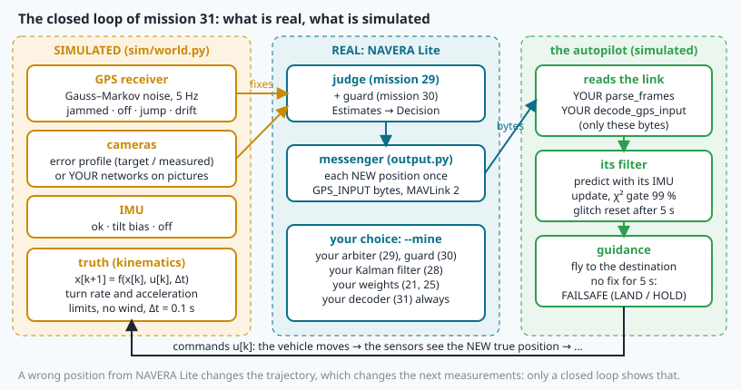

# Simulation and fault injection: SITL, MAVLink and NAVERA's simulator



> [!NOTE] Mission brief
> **Autumn 2026, NAVERA's mission simulator.** NAVERA, IRIS's product, had passed its unit and integration
> tests. Then its engineers connected it to a real autopilot firmware running on a PC (ArduPilot **SITL**) whose
> only position input was NAVERA's output — and found five integration defects no earlier test could see, among
> them items OUT-1, OUT-2 and OUT-5 of its engineering backlog. Without a velocity in its messages, the autopilot's filter
> raised a failsafe at take-off. Vision fixes sent as "2-D" were silently ignored by the autopilot. An output
> polled at 5 Hz while positions also arrived at 5 Hz dropped or doubled messages, and the autopilot reported
> "GPS not healthy" and refused to arm. Every rule was right; the **integration** was wrong.
>
> Today you are the **test engineer** of NAVERA Lite. **Session 1 — Messenger:** the bytes your stack sends to
> an autopilot (MAVLink 2, `GPS_INPUT`), decoded byte by byte, and the error models of the simulated sensors.
> **Session 2 — Test engineer:** you fly NAVERA Lite in a closed-loop simulator, inject faults, turn the runs
> into PASS / FAIL verdicts, diagnose the one that fails — and then fly **your own** judge, guard, Kalman filter
> and trained networks in the loop.
>
> **Start now:** open the 🛠️ **Lab** tab, do **Step 0** (five minutes, no code), then come back here for §1.

**Objectives.** After this mission you can:

1. **place** a test on the test ladder (unit → integration → replay → SITL → HIL → field) and **state** what a
   simulation proves and what it does not;
2. **decode** a MAVLink 2 `GPS_INPUT` frame byte by byte with `struct` (the checksum function is given), read
   its flags, and **count** lost and doubled frames;
3. **simulate** Gauss–Markov noise and **verify** its stationary σ and its autocorrelation; **convert** a
   vision error's median into a σ with the Rayleigh law;
4. **derive** expected values from the rules, **run** a fault-injection campaign, **give** PASS / FAIL
   verdicts and **diagnose** a failing run;
5. **fly** your own NAVERA Lite parts in the loop, and **say** what the result means.

**You need:** mission 15 (σ = 2 × HDOP), 27 (Mahalanobis distance, χ²), 28 (predict / update), 29 (the
judge: freshness, priority, hold-off), 30 (the guard: drift test, persistence). ⏱ Reading: about 80 minutes
with the ✏️ checks: §1–§4 before session 1, §5–§7 before session 2. Lab: 4 h (fast) to 8 h.

**Before you start.** Answer without looking; if you miss two, reread mission 29 §4 and mission 30 §4.

<details><summary>1. (Mission 29) GPS was lost and the judge flies on day vision. GPS comes back. When does the judge switch back?</summary>
After the hold-off: GPS must stay eligible for 2 s (switch_holdoff_s) without a break before it takes over.
</details>
<details><summary>2. (Mission 30) What does the guard need to catch a slow drift, and why does one disagreeing fix not refuse the GPS?</summary>
An independent source that STATES its accuracy (vision with a σ), so that d² can be computed. One fix beyond γ
happens to an honest GPS with probability p_fa; the guard waits for several in a row (persistence).
</details>
<details><summary>3. (Mission 15) A receiver reports HDOP 0.9. What σ does NAVERA Lite state for its position?</summary>
σ = 2 m × HDOP = 1.8 m per horizontal axis. (The simulator's receiver states HDOP 0.95, so σ 1.9 m.)
</details>

<details><summary>Words of this lesson (open if you need them)</summary>

| Word | Meaning | Français |
|---|---|---|
| **SITL / HIL** | software in the loop: the real software with a simulated world / hardware in the loop: the real computers too | SITL / HIL |
| **closed loop** | the system's output changes its future inputs | boucle fermée |
| **frame** | one MAVLink packet: header, payload, checksum | trame |
| **checksum (CRC)** | a short number computed from the bytes; a receiver drops a frame whose number differs | somme de contrôle |
| **little-endian** | a multi-byte number stored least significant byte first | petit-boutiste |
| **bit mask** | an integer whose bits are on/off flags | masque de bits |
| **Gauss–Markov noise** | noise where each value is a fraction of the previous one plus new random noise | bruit de Gauss–Markov |
| **correlation time τ** | the time after which the noise has "forgotten" its value (correlation 1/e) | temps de corrélation |
| **fault injection** | causing a failure on purpose to test the reaction | injection de fautes |
| **requirement, verdict** | a measurable rule written before the test / PASS or FAIL against it | exigence, verdict |
| **latency** | the delay between a cause (the fault) and the reaction | latence |
| **failsafe** | the autopilot's own automatic reaction to a lost input (land, hold) | mode de sécurité |
| **fidelity** | how closely a simulation reproduces reality | fidélité |
</details>

## 1. The test ladder

A navigation product is tested at several levels. Each level adds more of the real system, costs more, and
proves more.

| Level | What is real | What is simulated or replayed | In this course | What it can prove |
|---|---|---|---|---|
| **unit test** | one function | its inputs | `pytest navera_lite/tests` (mission 14) | the maths and the edge cases |
| **integration test** | several parts or nodes | scripted messages | mission 29's race, mission 30's attacks | the rules and their timing |
| **replay** | the nodes | recorded sensor data | mission 32 (a recorded flight) | behaviour on real data, offline |
| **SITL** | the navigation software **and** the autopilot's software | the world, the sensors, the vehicle's physics | this mission | the closed loop: what the **vehicle** does |
| **HIL** | + the real computers and cables | the world | — | timing and interfaces on the real hardware |
| **field test** | everything | nothing | — | real accuracy |

The important word in "software in the loop" is **loop**. In an integration test a script decides what the
sensors say, whatever the stack answers. In a closed loop the autopilot **acts** on your position, the vehicle
**moves**, and the sensors then measure the **new** state. A wrong position changes the trajectory, which
changes the next measurements — and only a closed loop shows that kind of interaction. It is also where the
**integration** defects of the mission brief live: they are in the bytes between two programs, not in either
program's rules.

> [!QUESTION] ✏️ Check
> A colleague says: "our 359 unit tests pass, so we don't need SITL". Give one defect of the mission brief that
> no unit test of the navigation software could have found, and say which level finds it.

<details><summary>Answer</summary>
OUT-2: a vision fix sent as a 2-D fix is valid MAVLink and passes every unit test of the encoder; only the
autopilot (its firmware, in SITL) decides to ignore it. It takes a closed loop with the real autopilot software
to see the vehicle lose its position.
</details>

## 2. The closed loop, as equations

Write the true state of the vehicle (position, velocity, attitude) as **x**. Every simulation step of length Δt
does four things:

```
x[k+1] = f(x[k], u[k], Δt)          physics: the vehicle model
y[k]   = h(x[k]) + e[k]             sensors: GPS, cameras, IMU — the truth plus a modelled error
p[k]   = NAVERA_Lite(y[0..k])       your stack: the judge's position, sent as GPS_INPUT bytes
u[k]   = autopilot(p[k], IMU, plan) the autopilot's commands, from ITS OWN filter fed by those bytes
```

The simulator owns f and h; your stack and the autopilot are real programs. The **error model** e[k] is where
fault injection happens: "jam the GPS" means "change h for the GPS from now on". The truth x[k] is always known
to the simulator, so every error can be computed exactly — something a field test never has.

**What runs in mission 31** (the picture at the top). Simulated (`navera_lite/sim/world.py`): the kinematics,
a GPS receiver at 5 Hz, one camera fix per second, an IMU, and a small **autopilot** that reads the link with
**your** decoder (§3), keeps its position with a Kalman filter (mission 28, χ² gate 99 %) and goes into
**failsafe** after 5 s without a usable position. Real: NAVERA Lite — the judge (29), its guard (30), the
messenger. The autopilot is not real firmware: this tests **your** software in the loop.

> [!QUESTION] ✏️ Check
> In the loop above, the GPS is spoofed and your judge accepts the spoof for 20 s. Why can the vehicle's error
> after those 20 s be LARGER than the spoofer's offset, even after your judge refuses the spoof?

<details><summary>Answer</summary>
The autopilot flew towards the destination using the wrong position, so the truth moved away; when the judge
switches to vision, the autopilot's own filter may refuse the "jump" back (its χ² gate) until it resets.
Meanwhile the vehicle keeps flying on its wrong belief. The loop amplifies errors: the drift run of the lab
shows exactly this.
</details>

## 3. MAVLink, byte by byte

**MAVLink** is the binary message protocol between autopilots, ground stations and companion computers (like a
NAVERA box). Every message travels as a **frame**:


| Offset | Bytes | Field | Note |
|---|---|---|---|
| 0 | 1 | `STX` = `0xFD` | start of a MAVLink **2** frame (MAVLink 1 uses `0xFE`) |
| 1 | 1 | `len` | payload length, 0–255 |
| 2 | 1 | `incompat_flags` | bit 0 = the frame is **signed** (13 more bytes after the checksum) |
| 3 | 1 | `compat_flags` | ignored by receivers that do not understand it |
| 4 | 1 | `seq` | sequence number 0–255, then 0 again: a gap means lost frames |
| 5–6 | 1 + 1 | `sysid`, `compid` | who sent it (a companion computer: component 191) |
| 7 | 3 | `msgid` | message id, little-endian (`GPS_INPUT` = 232) |
| 10 | `len` | payload | the message's fields |
| 10 + len | 2 | checksum | CRC-16, little-endian |

> [!TIP] 🧰 Bytes in Python
> `data = b"\xfd\x3f"` is a `bytes` object; `data[0]` → 253 (an int), `data[1:3]` → bytes. Hexadecimal:
> `0x3f` = 63, `f"{63:02x}"` → `"3f"`. **Little-endian:** the least significant byte first, so the bytes
> `e8 00 00` are the number 0x0000e8 = 232: `int.from_bytes(b"\xe8\x00\x00", "little")` → 232.
> **struct** turns bytes into numbers with a format: `struct.unpack("<HB", b"\x34\x12\x07")` → (4660, 7):
> `<` little-endian, `H` a 2-byte unsigned int (0x1234), `B` one byte. Other letters used here: `Q` 8 bytes, `I`
> 4 bytes unsigned, `i` 4 bytes signed, `f` a 4-byte float. `bytes(3)` → three zero bytes.

**The checksum.** A **CRC** is a 16-bit number computed from the bytes; the receiver recomputes it and **drops**
the frame if it differs — for the receiver a damaged frame is a lost frame. MAVLink's CRC (MCRF4XX, called "X.25"
in its code) covers the bytes from `len` to the end of the payload, then **one more byte, CRC_EXTRA**, which is
never sent: it is computed from the message's definition (151 for `GPS_INPUT`). Two programs built with different
definitions of message 232 get different CRC_EXTRAs, and every frame is rejected: a wrong decoding would be worse
than none. The function is given (`output.crc_x25`, `output.frame_crc`); its standard test is
`crc_x25(b"123456789")` → `0x6F91`. A message id with no known CRC_EXTRA cannot be checked at all.

**The payload of GPS_INPUT (id 232).** On the wire the fields are **ordered by size** (8-byte fields first, then
4, 2, 1) — except `yaw`, a field added later (a MAVLink 2 *extension*): extensions are never re-sorted, they follow
the base fields — so its `struct` format is `<QIiifffffffffHHBBBH` (`output.GPS_INPUT_FORMAT`, names in
`GPS_INPUT_FIELDS`): `time_usec`, `time_week_ms`, `lat`, `lon` (degrees × 10⁷, as `int32`), nine floats (`alt`,
`hdop`, `vdop`, `vn`, `ve`, `vd`, `speed_accuracy`, `horiz_accuracy`, `vert_accuracy` — accuracies are 1-σ in
metres), `ignore_flags`, `time_week`, `gps_id`, `fix_type`, `satellites_visible`, `yaw`. That is 65 bytes. But
**MAVLink 2 drops the trailing zero bytes** of a payload: if `yaw` is 0, its two zero bytes are not sent. A
receiver must **pad** the payload with zeros back to 65 bytes before unpacking it — forgetting it is the classic
MAVLink 2 decoding bug.

> [!TIP] 🧰 Where each field sits (offsets in the payload)
> 0–7 time_usec · 8–11 time_week_ms · 12–15 lat · 16–19 lon · 20–55 the nine floats (4 bytes each) ·
> 56–57 ignore_flags · 58–59 time_week · 60 gps_id · 61 fix_type · 62 satellites_visible · 63–64 yaw.
> A payload of 63 bytes lost bytes 63–64 (yaw); one of 62 bytes lost satellites_visible too.

**Worked example.** Inside a payload, `lat` is the bytes `81 58 5a 15` at offsets 12–15. Little-endian, that is
0x155a5881 = 358 242 433 → **35.8242433°**; `lon` = `f2 ec 56 06` → 0x0656ecf2 = 106 360 050 → **10.6360050°**.
In code: `struct.unpack("<i", bytes.fromhex("81585a15"))[0] / 1e7`.

**Flags: what the autopilot must NOT use.** `ignore_flags` is a **bit mask**: bit 0 (value 1) `alt`, 1 (2) `hdop`,
2 (4) `vdop`, 3 (8) `vel_horiz`, 4 (16) `vel_vert`, 5 (32) `speed_accuracy`, 6 (64) `horiz_accuracy`, 7 (128)
`vert_accuracy` (`output.IGNORE_FLAGS`). A flag is set when `flags & value != 0`: 57 = 32 + 16 + 8 + 1 →
ignore the speed accuracy, both velocities and the altitude. This is where a navigation system is **honest**:
the rules of NAVERA Lite's messenger (`output.gps_input_fields`, given) are

- NO_FIX or STARTING → `fix_type` 1 (no fix), latitude and longitude 0, every flag set: **never** an old position;
- FIX or DEGRADED → the winner's position with **its measurement time** (NAVERA Lite's rule; NAVERA goes one step
  further for vision, see "In NAVERA"), `fix_type` 3 (a 2-D fix is ignored by
  autopilots: OUT-2), the altitude only if the source measured one, the σ the winner states in
  `horiz_accuracy` (or the flag "ignore horiz_accuracy" when it states none), the velocity only when the GPS
  receiver gave one (OUT-1);
- each new position is sent **once**, when the judge decides (never re-sent "fresh": NAVERA's OUT-3; never
  polled at a fixed rate: OUT-5).

**Lost and doubled frames.** `seq` counts 0, 1, …, 255, 0, … Between two frames received with seq a then b,
(b − a − 1) mod 256 frames were lost; b = a is a doubled frame. 250, 251, 253, 253, 0, 1 → 252 lost, 253 doubled,
254 and 255 lost: 3 lost, 1 doubled. An autopilot that sees many is right to call its "GPS" unhealthy.

`time_week` and `time_week_ms` give the instant in **GPS time** (the lab's Going further has more).

> [!QUESTION] ✏️ Check
> A frame arrives with `len` = 61. Is it broken? And what does `ignore_flags` = 64 tell the autopilot about the
> position?

<details><summary>Answer</summary>
Not broken: its last 4 bytes were zeros and MAVLink 2 cut them; pad with 4 zeros. But look at which bytes: 61–64
are fix_type, satellites_visible and yaw, so fix_type = 0 ("no GPS"). NAVERA Lite never sends that (its no-fix is
1): the frame is valid, but it comes from another sender or a bug. 64 = horiz_accuracy ignored: the position
is sent but its accuracy is not
known (a DEGRADED source that states no σ) — the autopilot must assume its own default.
</details>

## 4. The simulated sensors, mathematically

A simulator is only as good as its error models.

### GPS noise: a first-order Gauss–Markov process

Real GPS errors are not white noise: multipath and the atmosphere change slowly, so the error now is close to
the error a second ago. The simulated receiver models each horizontal axis as a **first-order Gauss–Markov**
process, updated every Δt:

```
x[k+1] = a·x[k] + q·√Δt·w[k]        a = 1 − Δt/τ,   w[k] independent N(0, 1)
```

with τ the **correlation time** and q the noise strength (the receiver: Δt = 0.2 s, τ = 20 s, q = 0.6 m/√s).
a = 1 − Δt/τ is the first-order form of the exact e^(−Δt/τ) (0.99 against 0.99005 here); the course uses it
everywhere, so your code must too. A walk-through: a = 0.99, q√Δt = 0.268; from x = 0 and w = 1.0, x = 0.268; the
next w = −0.5 gives x = 0.99 · 0.268 − 0.134 = 0.131. Two properties follow.

- **Stationary σ.** After a long time Var(x[k+1]) = Var(x[k]) = σ², so σ² = a²σ² + q²Δt, hence
  **σ² = q²Δt / (1 − a²)**.
- **Autocorrelation.** x[k+m] = aᵐ·x[k] + (new, independent noise), so two samples m steps apart have the
  correlation **ρ(m) = aᵐ** ≈ e^(−mΔt/τ): after τ it is about 1/e ≈ 0.37.

**Worked example** (a slower model: Δt = 1 s, τ = 30 s, q = 0.5 m/√s). a = 1 − 1/30 = 0.9667;
1 − a² = 0.06556; σ² = 0.25 × 1 / 0.06556 = 3.81 m², **σ ≈ 1.95 m**. Ten samples apart: ρ = 0.9667¹⁰ = **0.71**.

The **sample autocorrelation** of a series measures ρ: remove the mean m, then
r(lag) = Σ (x[i] − m)(x[i + lag] − m) / Σ (x[i] − m)², the top over the overlapping pairs, the bottom over
the whole series. Example: 1, 2, 3, 4 (mean 2.5): deviations −1.5, −0.5, 0.5, 1.5; lag 1: (0.75 − 0.25 + 0.75) /
5 = **0.25**.

<details><summary>Read this after lab Step 4</summary>

Why it matters: averaging N **independent** samples divides σ by √N. Averaging correlated samples over a time
much shorter than τ divides it by almost nothing — 50 fixes in 10 s with τ = 20 s are worth little more than one.
That is why a GPS "standing still" wanders slowly instead of jittering, and why "we averaged 10 s of GPS" does not
make a reference 7 times better. It also means a test of the guard sees the same GPS error in many fixes in a
row: the "independent tests" of mission 30 are not independent (its ρ = 0.9 experiment).
</details>

### Vision errors: the Rayleigh law

When the simulator does not run a real matcher, it draws a vision fix as the truth plus an independent N(0, σ²)
error on east and on north. The **horizontal** error r = √(e² + n²) then follows a **Rayleigh** law:

```
P(r ≤ R) = 1 − exp(−R² / (2σ²))      so the p-quantile is   R_p = σ·√(−2·ln(1 − p))
median: R_50 = σ·√(2 ln 2) ≈ 1.177 σ        95 %: R_95 = σ·√(2 ln 20) ≈ 2.448 σ
```

Worked example: the night **target** profile, σ = 25 m: median 29.4 m, 95 % below 61.2 m.

The simulator has two vision profiles (`sim/world.py`):

- **target**: day σ 15 m, night σ 25 m, **stated** (covariance given). This is the accuracy **goal**, not a
  measurement. It states a σ, so the judge calls it FIX and the guard can test the GPS against it.
- **measured**: day vision with a **median** of 440 m — NAVERA's former day method, tile retrieval, measured at
  442 m on labelled replay frames, searching only 600 m around the true position (VALIDATION_STATUS, 2026-10-03; its newer local matcher is not yet measured with
  NAVERA's camera) — and **no stated σ**; at night, an estimate that follows only a quarter of the true motion. It
  states nothing, so it is DEGRADED and cannot vouch for or against the GPS.

A third way is **your networks** (vision "mine", §7): pictures cut from the corridor and located by the weights
you trained in missions 21 and 25.

### Two more faults: a late camera and a tilted IMU

- **Camera late / delayed** (1.5 s): the picture shows where the vehicle was 1.5 s ago. "delayed" stamps the
  fix with the picture's time (honest); "late" stamps it with the time it reaches the pipeline.
- **IMU bias** (3°): the camera is not where the pipeline believes; the ground point at the centre of the
  picture is altitude × tan 3° away (8 m at 150 m — mission 18's tilt error). **IMU off**: no attitude, so the
  vision pipeline refuses every picture (mission 20's rule).

> [!QUESTION] ✏️ Check
> A vision profile has a median error of 30 m. What σ per axis does the simulator use, and what error do 95 % of
> its fixes stay below?

<details><summary>Answer</summary>
σ = 30 / 1.177 = 25.5 m; R_95 = 2.448 × 25.5 = 62.4 m. (σ is per axis: the 2-D error is larger than σ.)
</details>

## 5. Fault injection and campaigns

**Fault injection** is causing a failure on purpose to observe the reaction. A fault is described by **what**
fails (GPS, camera, IMU, light), **how** (jammed, off, a 2 km jump, a 4 m/s drift, blackout, late, bias), **when**
(relative to take-off) and **how long**. A **campaign** is a planned set of such runs — a **test matrix** — with
the expected behaviour written **before** running it.

**Scripted, not clicked.** Clicking a fault button is fine for a demo but bad for engineering: the timing differs
every time, and nobody can repeat it. A campaign runs **scenario files**:

```json
{"name": "jam", "vehicle": "drone", "vision": "target", "seed": 12, "duration_s": 110,
 "faults": [[30, "gps", "jammed"], [70, "gps", "ok"]]}
```

Times are **mission seconds** (since take-off). Same file → same flight, same faults, and with the same `seed`
the same noise: the runs of this mission are deterministic (lesson 32 deals with what changes from seed to seed).

### From the rules to expected numbers — before the run

The hardest idea of this mission is that a test's expectation comes from the **rules**, not from the last run.
You know the rules: missions 01, 12, 29, 30 and `navera_lite.yaml`. **Worked example — one of NAVERA's drift rules.**
NAVERA refuses a GPS that disagrees with vision beyond 5σ + 50 m for 3 s (VALIDATION_STATUS, 2026-10-03). Vision
states σ = 30 m; the spoofer drifts at 4 m/s. The gap reaches 5 × 30 + 50 = 200 m after 200 / 4 = 50 s; held 3 s
more → refused at **53 s, about 212 m** of offset. The document reports "at ~160–200 m" in the simulator: the GPS
noise and the vision errors make the gap cross the threshold earlier, sometimes. A later run was refused at
~140 m, for another reason: NAVERA's current rule set also refuses after **5 distinct fixes in a row beyond 3σ**
(3 × 30 = 90 m, then five fixes 2 s apart), which acts first. A new rule needs a new expectation. **Discuss the gap, never hide it**: a requirement uses the rule plus a margin.

For NAVERA Lite's guard (mission 30) the same reasoning uses its own rule — a χ² test at p_fa = 0.01, five
disagreeing reference fixes in a row — and its function `spoof.drift_alarm_time` (given in your folder): you do it
in lab Step 8, with the campaign's numbers.

### What to measure

For a fault from t0 to t1 (mission seconds), on the rows of a run (one every 0.2 s). `campaign.py` takes t0 = the
**first** fault of the scenario's list and t1 = the moment that same sensor comes back:

| Metric | Definition |
|---|---|
| `switch_s` | first row at or after t0 whose source is not GPS, minus t0 (None: never) |
| `recover_s` | first row at or after t1 whose source is GPS, minus t1 (None: never, or no t1) |
| `availability` | share of rows of the fault window with a position (FIX or DEGRADED) |
| `leak_s` | seconds of the window flown on a GPS more than 100 m wrong |
| `max_err_m`, `error95_m` | NAVERA Lite's error = its latest position against the truth **now** (so a held vision fix grows by speed × age: up to 15 m between two 1 Hz fixes at 15 m/s); the largest in the window; the 95th percentile over the run |
| `failsafe_s` | first row at or after t0 (to the end of the run) where the autopilot is in LAND or HOLD, minus t0 |
| `false_refusal_s` | seconds **of the whole run** during which the guard REFUSED a GPS that was honest (error < 20 m) |

A **requirement** turns a metric into a promise: "after a GPS jam, NAVERA Lite stops using the GPS within 1 s" →
`switch_s` ≤ 1.0. The **verdict** is PASS if the measured value keeps the promise, FAIL otherwise — and FAIL if
the event never happened (no switch at all is not "fast"). The table scenario · requirement · measured value ·
verdict is what a test report contains. Note the resolution: one row every 0.2 s cannot measure a latency of
0.05 s.

### Diagnosing a FAIL

A FAIL is information, not an embarrassment. A method that works:

1. **Read the events** of the failing run, not only its numbers: find the first decision that differs from what
   the rules predicted.
2. **Ask which input** caused that decision: which source, which fix, at what time — and compare the input with
   the truth (the CSV has the errors of every source).
3. **Check the times**: when was each input measured, when was it stamped, when did it arrive? Most integration
   defects are about time.
4. **Make a hypothesis and test it** with a variant of the scenario that changes only that one thing.
5. **Then** decide where the fix belongs — the rule, the part, or the requirement.

> [!QUESTION] ✏️ Check
> A boat (top speed 20 m/s for the jump gate) gets a GPS fix every 0.2 s. A spoofer jumps the GPS 2 km. What does
> the jump gate allow for the next fix (margin 50 m)? Which metric would show a failure of this gate?

<details><summary>Answer</summary>
20 × 0.2 + 50 = 54 m: a 2 km jump is refused at the first spoofed fix. A failure would show as leak_s > 0
(seconds flown on a GPS more than 100 m wrong).
</details>

## 6. Fidelity: what a simulation can and cannot prove

Simulation results are **behaviour** results, not accuracy results. NAVERA's validation document says it plainly
about its own simulator: "these are behaviour results, not accuracy results".

| A simulation can show | It cannot show |
|---|---|
| the logic: which source wins, which state, which reason | the real accuracy of vision: the profiles are drawn by the simulator, and its pictures are cut from the very map the matcher uses |
| the timing of the rules (timeouts, hold-off, gates) | how a real receiver degrades under jamming (noisy positions before the fix is lost) |
| the integration: bytes, flags, timestamps, the autopilot's reaction | a real spoofer (who may also fake the time, or move smoothly) |
| regressions: a change that breaks yesterday's PASS | the timing on a hot, loaded, vibrating computer |

**Optimism.** When the simulated camera is cut from the matcher's own map, the matcher finds "itself": NAVERA's
document notes about 1 m of error in such runs, against a median of 96 m with its real day vision on simulated
pictures over another route — which the document also calls optimistic, for the same reason. Your day network will do the same in this simulator (lab Step 11): a number that
proves the pipeline works, not that it is accurate.

## 7. Your stack in the loop

By default the simulator flies the **course's** NAVERA Lite (the parts shipped finished in this folder). With
`--mine` it flies **yours**, part by part, from your earlier lesson folders: your judge
(`../29-arbiter/navera_lite/arbiter.py`), your guard (`../30-spoofing/navera_lite/spoof.py`), your Kalman filter
as the autopilot's (`../28-kalman/navera_lite/kalman.py`), and with vision "mine" your trained weights
(`../21-features/my_desc.pt` by day, `../25-thermal-night/my_homography.pt` at night). A part you have not
finished flies as the course's, and the run says so. Your decoder (this mission) always reads the autopilot's
link. The same campaign with two stacks is a **regression test**: if a verdict changes, one of your parts
behaves differently from the course's — find out which, and why. A regression test is worth something only if it
catches a change: in the lab you change ONE rule in a copy of your guard (`--part spoof=my_spoof.py`) and watch
which verdict moves. `--not NAME` flies the course's part instead of yours, and a part of yours that crashes during
a flight is replaced by the course's for that flight (the events say so).

The vision source states a σ. For your networks it should be the σ you **measured** — lab Step 11 measures them
on the corridor, converts the median error into σ with §4's Rayleigh law, and writes `my_vision_profile.json`.

## Common wrong ideas

- **"A bad checksum frame is just ignored, nothing is lost."** For the receiver it IS lost: its seq is missing.
- **"Averaging 10 s of GPS divides the noise by 7."** Only for independent samples; with τ = 20 s it barely
  helps.
- **"An honest time stamp is enough."** It fixes the checks that compare stamps (the guard); a consumer that
  uses a fix on arrival still needs the position carried to now (In NAVERA, after Step 9).
- **"The expected value is what the run gave last time."** That is a regression baseline, not an expectation:
  expectations come from the rules.

## In NAVERA

NAVERA's **mission simulator** (a development tool, described here in words) joins ArduPilot **SITL** — the real
autopilot firmware (Copter 4.5, Rover, a motorboat) compiled for a PC — with NAVERA's real nodes and simulated
sensors. Its GPS driver reads a simulated receiver through a pseudo-terminal, exactly as it reads the serial port
on the box; its output sends `GPS_INPUT` to the autopilot, configured so that NAVERA's output is the autopilot's
**only** position input. The truth comes from the simulator's physics, so NAVERA's error and the autopilot's
error are both known at every instant.

Documented results (VALIDATION_STATUS, "Autopilot in the loop", **simulation**, 2026-10-03): GPS OK → NAVERA error
1–4 m, autopilot 1–3 m; GPS jammed in flight with vision at the target accuracy (σ 15 m, simulated) → the mission
continues, autopilot error 2–18 m for 2.5 min, no failsafe; GPS jammed 30 s then spoofed 2 km for 30 s → spoof
refused throughout, true GPS re-accepted 3 s after it returns; a 4 m/s drift → refused at about 160–200 m, the
autopilot followed the drift to about 200 m and then recovered on vision; GPS jammed and camera failed → NO FIX
→ autopilot failsafe (Copter LAND, Rover HOLD). These are **behaviour** results: NAVERA is a commercial product in
**Release 0.2 — field validation pending**; the field test procedure is how its accuracy will be measured.

<details><summary>Read this after lab Step 9</summary>

NAVERA met the same cause in its own simulator, with another symptom. Its validation document (2026-10-03, "Vision positions carried
to the present") records that a vision position used to be sent as it was, describing a photo 1–2.5 s old: for a
plane at 40 m/s with a gimbal camera, a match error of 0–1 m became an **output** error of 83 m median, with 0 %
of positions inside the stated σ. The fix: carry each vision position to the present along the measured ground
velocity and grow its stated accuracy by the lag (a 1.5 s old photo at 40 m/s is moved 60 m and stated ±31.5 m).
The same document raised the day-vision freshness window from 3 s to 5 s after the simulator showed the judge
alternating FIX / NO_FIX under load and the autopilot landing during a 6.7–9.2 s gap. Both were found only with
the loop closed.

Why carry, and not only stamp honestly? ArduPilot uses the stamps only relative to each other. NAVERA's ArduPilot
notes (2026-10-03) say it maps the `GPS_INPUT` time through a transport-jitter correction that assumes the
least-delayed recent message arrived without delay. Differences between messages are kept, but a delay **common** to
them is invisible, and only its `GPS_DELAY_MS` setting (0–250 ms) compensates it. When vision flies alone, every fix
is 1–2.5 s old, and that whole delay is common. This simulator's autopilot also
fuses every fix as "now". So there are two correct designs: (1) stamp at exposure **and** make every consumer
handle the latency itself; or (2) carry the position forward to the present, grow its stated σ by the lag, and
stamp it **now**. An honest stamp alone fixes the guard (plane_delayed), not the autopilot: when vision flies, a
1.5 s old fix would still be fused 60 m behind. NAVERA does (2) for vision and celestial positions (sent stamped
now; GPS positions keep their measurement instant; with no velocity known, the old stamp and a σ grown by the
maximum speed × the age).
</details>

## In NAVERA Lite

- [navera_lite/output.py](file:./navera_lite/output.py) — the messenger (given: constants, `crc_x25`,
  `frame_crc`, `gps_time`, `gps_input_fields`, `encode_gps_input`, `ignored`) and the receiving side you write
  (TODOs 1–3).
- [navera_lite/sim/sensors.py](file:./navera_lite/sim/sensors.py) — the error models (TODOs 4–7; given
  `sigma_for_median`, `GaussMarkov`).
- `navera_lite/sim/world.py` (the world and the autopilot), `sim/vision.py` (your networks in the loop),
  `sim/run.py` (the headless runner, `--mine`) — given: read them, they are short and commented.
- [campaign.py](file:./campaign.py) — the test engineer's tool (TODOs 8–9).

## 🐦 How birds do it

Biologists build controlled worlds and inject faults too. In an **Emlen funnel** (1966) a caged songbird hops
towards its migration direction and leaves inked footprints; Stephen Emlen **rotated a planetarium sky** over
indigo buntings, and the Wiltschkos **turned the magnetic field** around European robins: the birds turned with it.
One input changed, the reaction recorded — a fault-injection campaign. And the results are checked on free-flying
birds with GPS loggers: a funnel is not a stork crossing the Strait of Gibraltar.

## Summary

1. A **closed loop** (SITL) is the first test where the vehicle acts on your output; it finds **integration**
   defects that unit and integration tests cannot.
2. A MAVLink 2 frame = 10-byte header + payload + CRC (+ CRC_EXTRA, never sent); payloads lose their trailing
   zeros; **honest fields** (flags, accuracy, measurement time, each position once) are part of navigation.
3. GPS noise is **correlated** (Gauss–Markov: σ² = q²Δt/(1 − a²), ρ(m) = aᵐ); a 2-D Gaussian error has a
   **Rayleigh** radius (median 1.177 σ).
4. Expected values come from the **rules**, written before the run; a campaign gives **verdicts**; a FAIL is
   diagnosed from events, inputs and **times**.
5. A simulation proves **behaviour**, not accuracy.

**Next mission:** measuring — errors, percentiles, availability and confidence intervals on recorded flights.

## Check yourself

Answer without scrolling up.

<details><summary>1. Why is "the autopilot's only position input is the navigation output" the honest set-up for a SITL test?</summary>
The vehicle's behaviour (staying on course, failsafe) is then a direct consequence of the navigation output: the
system is judged by what the vehicle does.
</details>
<details><summary>2. Received seq: 254, 0, 0, 3. Lost and doubled?</summary>
254 → 0: 255 lost (1); 0 → 0: doubled (1); 0 → 3: 1 and 2 lost (2). Lost 3, doubled 1.
</details>
<details><summary>3. Δt = 0.2 s, τ = 20 s. Correlation of the GPS noise 10 s apart?</summary>
a = 0.99, 50 steps: 0.99⁵⁰ ≈ 0.61 — still strongly correlated.
</details>
<details><summary>4. (Mission 28) What does the χ² gate of the autopilot's filter do with a fix whose d² is 15, and what happens if every fix is refused for 5 s?</summary>
15 > 9.21 (99 %, 2 degrees of freedom): the fix is refused, the state is only predicted. After 5 s of refusals
the simulated autopilot resets its position on the fix (a glitch reset).
</details>
<details><summary>5. (Mission 12) A position must carry the instant it was measured. When may NAVERA stamp a position "now"?</summary>
Only once it has been carried to now (moved along the ground velocity, its σ grown by the lag), as NAVERA does
for vision. A fix that is merely old must keep its old stamp.
</details>

Now open the **🛠️ Lab** tab.
