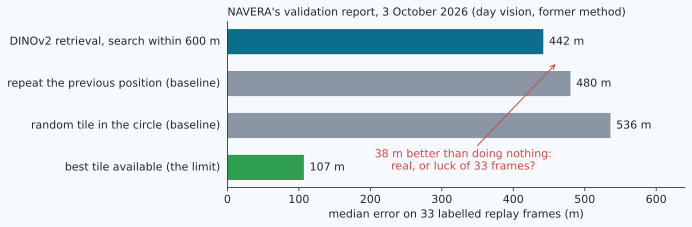
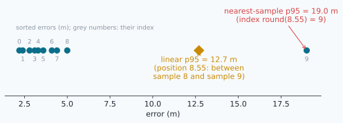
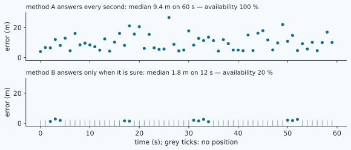
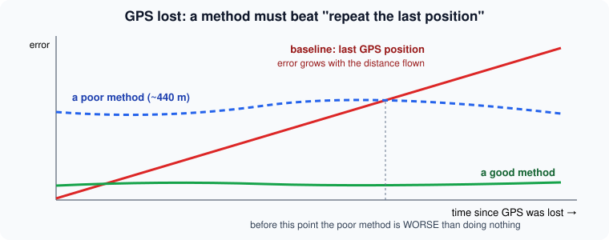
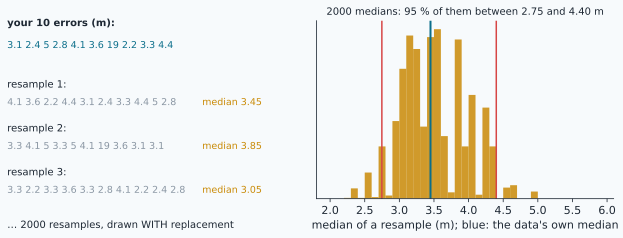
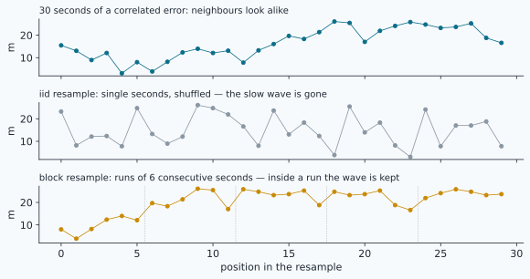
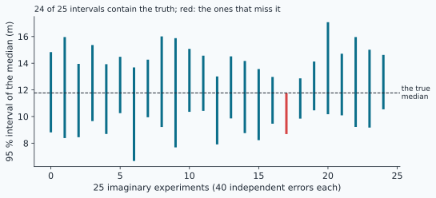

# Measuring honestly: error statistics, baselines and confidence intervals



> [!NOTE] Mission brief
> **NAVERA's validation report, 3 October 2026.** Its first lines say: *"Every number below comes from a run on
> the Jetson Orin Nano (bench, replay and synthetic data). None of them comes from a real flight."* Then the
> table above. NAVERA's former day vision, a large neural network (DINOv2) that compares the photo with 1 120 map
> tiles, placed 33 labelled replay frames with a median error of **442 m**. Repeating the previous position, with
> no picture at all, gave **480 m**. The report concludes: *"the retrieval method must not be relied on as a GPS
> replacement."* Its successor, local feature matching, placed **32 of 33** aerial frames within 9 m, with no
> wrong position accepted — on frames *"from another source"*, **not** from NAVERA's camera, so day vision still
> states a conservative 30 m until it is measured with that camera.
>
> Read those numbers like an auditor. Is "38 m better than doing nothing" real, or the luck of 33 frames? Is
> 32/33 "97 %", or something wider? Does "0 wrong in 33" mean "never wrong"? Today you build the tools that
> answer, as a buyer's auditor would. Badges: **Honest ruler**, then **Auditor**.
>
> **Start now:** open the 🛠️ **Lab** tab, do **Step 0** (ten minutes, no code), then come back for §1.

**Objectives.** After this mission you can:

1. compute position errors against a truth taken **at the right instant**, and summarise them (median = CEP50,
   p90, p95, RMSE, max) with a **stated percentile rule**;
2. report **availability** and **continuity** next to accuracy, and recognise **selective reporting**;
3. compare a method with a **baseline** on the same seconds (a **paired** comparison);
4. give **bootstrap** (iid, block, paired) and **Wilson** intervals, and test them with a **coverage experiment**;
5. check whether a source's **stated σ is honest**, and write a validation note that says what it does not prove.

**You need:** mission 04 (runs of outages, median vs mean), 23 (baselines, the linear percentile), 27 (σ, the
Rayleigh median 1.18 σ, the 39 / 86 / 99 % of a 2-D Gaussian), 29 (the judge's states). ⏱ Reading: about
75 minutes with the ✏️ checks. Lab: 4 h 30 to 6 h in two sessions (5 h 30 to 7 h in all).

**What you already know** — answer without looking; if you miss two, reread the mission named.

<details><summary>1. Mission 04: valid = [1, 1, 0, 0, 0, 1, 0]. Which runs does outage_runs() return?</summary>
[(2, 5), (6, 7)]: index pairs with the end excluded, like a slice; a run that lasts to the end is closed at len.
</details>

<details><summary>2. Mission 27: a round 2-D Gaussian error with σ = 10 m per axis. Median distance? Share within 2σ?</summary>
1.18 × 10 = 11.8 m (Rayleigh median, √(2 ln 2) σ). Within 2σ: 1 − e^(−2) ≈ 86 %.
</details>

<details><summary>3. Mission 23: why compare a localiser with "stay at the prior"?</summary>
Because a method that uses a photo is useful only if it beats an answer that uses no photo at all.
</details>

<details><summary>Words of this lesson</summary>

| Word | Plain meaning | Français |
|---|---|---|
| **ground truth** | where the vehicle really was, from a much better reference | vérité terrain |
| **CEP50 / CEP95** | radius around the truth that holds 50 % / 95 % of the errors (median / p95) | rayon d'erreur circulaire |
| **RMSE** | root mean square error: √(mean of e²) | erreur quadratique moyenne |
| **availability** | share of the time with a usable position | disponibilité |
| **continuity, gap** | the longest time without a usable position | continuité, trou |
| **baseline** | the simple answer a method must beat | référence (méthode naïve) |
| **paired comparison** | two methods compared at the same instants, through their differences | comparaison appariée |
| **confidence interval (CI)** | a range from a procedure that holds the true value in 95 % of experiments | intervalle de confiance |
| **bootstrap, resample** | recompute a statistic on data drawn again with replacement | bootstrap, rééchantillon |
| **coverage** | how often an interval method really holds the truth | taux de couverture |
</details>

## 1. Truth, at the right instant

An **error** is a distance: from the position a system gave to the **ground truth**, the position the vehicle
really had. In a simulator the truth is free. In the field it comes from a reference that is much better than
the system under test — as a rule of thumb **3 to 5 times better**, or you partly measure the reference. A GPS
(a few metres) can judge a vision source of tens of metres; it cannot judge a 1 m system.

The truth must be taken **at the instant the position describes**, not when it was published. A vision fix
describes the photo's instant; it may be published a second later. NAVERA learned this in its simulator
(validation report, 2026-10-03): on a plane at 40 m/s the matcher's error was 0–1 m, yet the output was off by
**83 m** (median), because a position 1–2.5 s old was sent as current. Measured against the photo's instant, the
matcher was excellent; measured against the instant of use, the system was not. Both numbers are true; they
answer different questions. Say which one you give.

Truth samples rarely fall exactly on a fix's instant, so you **interpolate in time**. **Worked example.** The
truth says north = 150.0 m at t = 10.0 s and 165.0 m at t = 11.0 s. A photo was taken at 10.4 s, so the truth
at that instant is 150.0 + 0.4 × (165.0 − 150.0) = **156.0 m**. Using the sample of 11.0 s instead would add
9 m of error that the vision source never made.

> [!QUESTION] ✏️ Check
> A plane flies at 40 m/s. A vision fix is published 1.2 s after its photo and scored against the truth at the
> publication instant. How much error does the scoring itself add, at most?

<details><summary>Answer</summary>
40 × 1.2 = 48 m, along the track. A tool that scores at the wrong instant blames the matcher for the delay.
</details>

## 2. Summarising errors, with a stated rule

A flight at 1 Hz gives hundreds of errors e₁ … eₙ. Every summary keeps one side of them:

| Statistic | Answers | Weakness |
|---|---|---|
| **median** (= **CEP50** for radial errors) | how good is a typical position? | blind to the bad cases |
| **p90**, **p95** (= **CEP95**) | how bad on a bad day? | needs many samples |
| **max** | the worst that happened | decided by one sample |
| **mean** | the average | pulled by outliers |
| **RMSE** = √(mean of e²) | the "energy" of the error; what a covariance describes | pulled even more |

**Percentiles: the rule matters.** The q-th **percentile** of n sorted values sits at **position**
(n − 1) · q / 100. The course rule is **linear**: if the position falls between two samples, interpolate between
them (numpy's default, mission 23). Another rule, the **nearest sample**, takes the sorted value at index
round((n − 1) · q / 100) — no interpolation. (Textbooks also know a "nearest-rank" rule, index ⌈n·q/100⌉ − 1 — a
third rule: always say which one.) NAVERA's evaluation tool uses that second rule (described in words under "In NAVERA").
Neither is wrong, but two reports with different rules are not comparable on small samples. Write your rule.

> [!TIP] 🧰 Positions, by hand
> Sorted [1, 3, 5, 7] (n = 4). p50: position 3 × 0.5 = 1.5 → linear 3 + 0.5 × (5 − 3) = **4.0**; nearest
> round(1.5) = 2 → **5**. p90: position 2.7 → linear 5 + 0.7 × 2 = **6.4**; nearest round(2.7) = 3 → **7**.
> Python's `round()` sends halves to the **even** integer: `round(1.5) == 2`, `round(2.5) == 2`.

**Worked example** (ten errors of a test drive, m): 3.1 2.4 5.0 2.8 4.1 3.6 19.0 2.2 3.3 4.4.
Sorted: 2.2 2.4 2.8 3.1 3.3 3.6 4.1 4.4 5.0 19.0.

```
mean   = 49.9 / 10                                  = 4.99 m
median : position 4.5  → 3.3 + 0.5 × (3.6 − 3.3)     = 3.45 m    (nearest sample: index 4 → 3.3)
p90    : position 8.1  → 5.0 + 0.1 × (19.0 − 5.0)    = 6.4 m     (nearest: index 8 → 5.0)
p95    : position 8.55 → 5.0 + 0.55 × (19.0 − 5.0)   = 12.7 m    (nearest: index 9 → 19.0)
max    = 19.0 m           RMSE = √(474.07 / 10)      = 6.89 m
```



One bad sample moved the mean by more than 1 m and doubled the RMSE against the median; the median did not
care. In the tail the two rules disagree by 6 m: with ten values, "p95" is little more than the worst sample.
Mission 27 gives a health test: for a round Gaussian error, RMSE / median = 1.41 σ / 1.18 σ ≈ **1.2**. Here it
is 6.89 / 3.45 = **2.0**: not one Gaussian, but a good mode plus an outlier. Report the tail, and find its cause.

> [!QUESTION] ✏️ Check
> Errors (m): 6.0 1.5 2.5 9.0 3.0 2.0 4.0 40.0. Give the median and the p90 with both rules, and the RMSE.

<details><summary>Answer</summary>
Sorted 1.5 2.0 2.5 3.0 4.0 6.0 9.0 40.0. Median: position 3.5 → linear 3.5 m, nearest round(3.5) = 4 → 4.0 m.
p90: position 6.3 → linear 9.0 + 0.3 × 31 = 18.3 m, nearest index 6 → 9.0 m. RMSE = √(1754.5 / 8) = 14.8 m.
</details>

## 3. A position you don't get is not 0 m

Errors exist only for the seconds with a position, so every accuracy number is **conditional**: "the error,
*given* that the system answered". A system that answers only when it is sure can show a beautiful median.
Always give, over the same period:

- **availability** — the share of time with a **usable** position (the judge in FIX or DEGRADED *and* a
  position in the message);
- **continuity** — here the **longest gap**: the longest time without one. An autopilot bridges a second; after
  a few seconds it holds, lands or fails safe.



In the figure, method B's median (1.8 m) is five times better than A's (9.4 m) — on 12 seconds out of 60. For an
autopilot B is useless: it is blind 80 % of the time. NAVERA met the system-level version in its simulator
(report, 2026-10-03): with a 3 s freshness window under load, the judge alternated FIX / NO_FIX on **20–60 % of
the samples** and the autopilot **landed during a 6.7–9.2 s gap**. Each fix was fine; the system was not usable.
Over uniform terrain near Gabès (long route, 2026-10-01), day vision had **no position for 13 or 18 of 48
samples** in two runs. Those counts belong in the result as much as the median.

> [!WARNING] Selective reporting — five ways to make a number look better without lying
> 1. **Conditioning**: the median of the positions given, without the availability.
> 2. **Best of N**: five test flights with medians 11, 9, 14, 4 and 12 m; the brochure says "4 m".
> 3. **Statistic chosen after the data**: the median when the mean is ugly, the mean when the median is.
> 4. **Outliers removed** without a rule written *before* the test ("that one was a glitch").
> 5. **Easy conditions only**: report the textured terrain, not the uniform one (NAVERA's former day vision on
>    2026-10-01: median 111 m over textured ground near Sousse, 351 m over uniform terrain near Gabès).
>
> The cure is the same each time: decide the statistics, the data and the exclusion rules **before** you look,
> and publish all the runs.

> [!QUESTION] ✏️ Check
> Over a 50 s GPS loss a method gives a position at seconds 0–9 and 30–34 only. Availability, longest gap?

<details><summary>Answer</summary>
15 of 50 s = 30 %. Gaps: 10–29 (20 s) and 35–49 (15 s): the longest is 20 s.
</details>

## 4. Compared with what? Baselines and pairs

A method is worth what it beats. The **baseline** is the simplest thing you could do instead. When GPS is lost,
the simplest thing is to **repeat the last known position**. The vehicle keeps moving, so the baseline's error
grows: about speed × time. **Worked example.** A drone at 20 m/s loses GPS for 40 s. The frozen position is
20, 40, … 800 m behind: its median error is (400 + 420) / 2 = **410 m**. The vision method of the figure has a median
of about 200 m and "beats" it — but look closer: in its first 9 seconds (and again at 14–15 s), doing nothing is
better than that vision.



NAVERA's table (mission brief) uses two baselines and one **limit**: repeat the previous position (480 m),
a random tile in the circle (536 m), and the best tile available (107 m: the best that tile-sized answers can
ever do). The same report uses a baseline for a yes/no test too: a threshold on the matching score classified
whole-map matches right **94 %** of the time — against **88 %** for "always reject". A score that barely beats
"always reject" cannot flag wrong matches.

**Compare at the same instants.** When the method and the baseline are scored on the same seconds, look at the
**differences** d_i = e_method,i − e_baseline,i, not at two separate summaries. This is a **paired**
comparison: everything the two share (the route, the jam, the terrain) cancels in d_i, and a small but steady
advantage becomes visible. And never compare a method on its own chosen seconds with a baseline on all of
them.

> [!QUESTION] ✏️ Check
> A boat at 6 m/s loses GPS for 120 s. Median error of "repeat the last position"? A vision source has a median
> of 250 m on the same seconds. Better?

<details><summary>Answer</summary>
6, 12, … 720 m: median (360 + 366) / 2 = 363 m. 250 m is lower — but only the paired comparison, with an
interval (§5–6), says whether the difference is more than luck.
</details>

## 5. How sure is the number? The bootstrap

"Median 3.45 m on 10 errors" is an **estimate**: another drive would give another number. A **95 % confidence
interval** is a range computed from the data by a procedure that, over many repeated experiments, would contain
the true value **95 % of the time**. The 95 % belongs to the procedure, not to one interval.

> [!TIP] 🧰 s, σ, the standard error and 1.96
> σ is the spread of the whole population; **s** is its estimate from your n values (`np.std(x, ddof=1)`). The
> mean of n independent values wobbles less than one value: its **standard error** is s / √n. A Gaussian puts
> 95 % within ±1.96 standard deviations, hence **mean ± 1.96 · s/√n**. On the worked example: s = 5.00,
> s/√10 = 1.58, so 4.99 ± 3.10 → [1.89, 8.09] m — if the mean were Gaussian, which ten skewed errors are not.

For a median, a p90 or a difference of medians there is no simple formula. The **bootstrap** (Efron, 1979)
replaces the formula by computation. Your n values are the best picture you have of the unknown distribution,
so you draw new "experiments" from them:

1. draw n values **with replacement** from your data (a **resample**: some values twice, some not at all);
2. compute the statistic of the resample;
3. repeat B times (B = 2 000);
4. the 2.5th and 97.5th percentiles of the B results are the 95 % interval (the **percentile bootstrap**).



On the ten errors of §2 (B = 2 000, seed 1): median 3.45 m, 95 % CI **[2.75, 4.40] m**; mean 4.99 m, CI
**[3.00, 8.22] m** — the outlier makes the mean far less certain. Fix the generator's **seed** and the same call
always gives the same interval: results must be reproducible.

> [!QUESTION] ✏️ Check
> Why can the bootstrap interval of the median of 10 values never contain a number below the smallest value?

<details><summary>Answer</summary>
Every resample is made of the data's values, so its median lies between the smallest and the largest of them.
With few values the bootstrap cannot imagine anything outside what it saw — one reason it is optimistic on tiny n.
</details>

## 6. Correlated seconds: the block bootstrap and the paired interval

The bootstrap assumes **independent** values. Navigation errors at 1 Hz are not: a vision fix 30 m north at
second 10 is still about 30 m north at second 11. Correlated samples carry less information. If each second keeps
a fraction ρ of the previous error (an **AR(1)** process), the **effective sample size** of the mean is about

```
n_eff ≈ n · (1 − ρ) / (1 + ρ)          n = 60, ρ = 0.9  →  n_eff ≈ 3.2
```

(The formula is for the mean; a median behaves alike.)

Sixty correlated seconds are worth about three independent values. An ordinary (**iid**) bootstrap shuffles
single seconds and pretends there are 60: its interval is too narrow. The **moving-block bootstrap** draws
**runs of L consecutive values** (L = 10 s, say) instead, joined until the resample has n values. Inside each run
the correlation is kept. A run may start anywhere from index 0 to n − L, so it never wraps around the end.



Blocks need **neighbours in the list to be neighbours in time**. If seconds are missing — a method that answered
only when it was sure — a "block" of 10 kept values may span a whole minute: then no block interval is honest.

**The paired interval.** To decide whether a method beats the baseline, bootstrap the **difference**: in each
resample, draw ONE set of indices (or blocks) and use it for both lists, then compute
stat(method) − stat(baseline). If the 95 % interval of the difference **contains 0**, you cannot claim a
difference on this data — which is not the same as "equal": absence of evidence is not evidence of absence; if it lies entirely below 0, the data show that the method is better — plausibly by at least |upper end| (a
95 % statement, not a guarantee). Do not
judge by whether two separate intervals overlap: pairing removes the shared part, and only the interval of the
difference says it.

> [!QUESTION] ✏️ Check
> The 95 % interval of "median(method) − median(baseline)" is [−210, 45] m. Write the sentence for the report.

<details><summary>Answer</summary>
"On this flight the method is not shown to differ from the baseline: the 95 % interval of the difference of
medians, [−210, 45] m, contains 0." Not "slightly better", not "45 m worse".
</details>

## 7. Success rates: "32 of 33"

For a share k/n — frames within 9 m, matches accepted — use the **Wilson score interval**:

```
p = k/n,  z = 1.96
centre = (p + z²/(2n)) / (1 + z²/n)
half   = z / (1 + z²/n) · √( p(1−p)/n + z²/(4n²) )          CI = [centre − half, centre + half]
```

**Worked example**, NAVERA's 32 of 33: p = 0.970, z²/n = 0.1164, centre = 1.0279 / 1.1164 = 0.921,
half = 1.756 × √(0.000890 + 0.000882) = 0.074 → **[84.7 %, 99.5 %]**. "97 %" from 33 frames means "somewhere
from 85 % to 99.5 %". The naive p ± 1.96 √(p(1−p)/n) gives [91.1 %, 102.8 %]: above 100 %, impossible — it
breaks down near 0 and 1, exactly where navigation claims live.

**Zero failures is not zero risk.** "0 wrong positions accepted in 33 frames" is compatible with a true rate of
several per cent. A quick 95 % upper bound is the **rule of three**: 3 / n = 9.1 % for n = 33 (Wilson gives a
similar bound, computed in the lab). To show a rate below 1 %, you need about 300 clean trials.

> [!QUESTION] ✏️ Check
> NAVERA's product module accepted 30 of 33 frames. Wilson 95 % interval?

<details><summary>Answer</summary>
p = 0.909, centre = (0.909 + 0.0582) / 1.1164 = 0.866, half = 1.756 × √(0.002504 + 0.000882) = 0.102 →
[76.4 %, 96.9 %].
</details>

## 8. Do your intervals work? Coverage

"95 %" is a promise about the **procedure**. You can test it: invent experiments whose true answer you know (a
simulated error source with a known median), compute an interval in each, and count how often it holds the truth.
That share is the **coverage**. An honest 95 % method covers about 95 % of the time; one that covers 60 % is
lying with a straight face.



A coverage experiment needs three parts: a way to draw one experiment's data, a way to compute its interval, and
the true value.

> [!QUESTION] ✏️ Check
> In 200 imaginary experiments, how many misses do you expect from an honest 95 % method? Would 15 misses
> worry you? And 60?

<details><summary>Answer</summary>
About 10 (5 %). 15 is within chance for 200 trials (a binomial spread of about ±3); 60 misses (70 % coverage)
is not chance: the method is broken for that kind of data.
</details>

## 9. Is the stated σ honest?

A source that **states** σ makes a promise the judge relies on (missions 27, 29). Test it like any claim: score
the source against a truth and count how often the error stays within 1, 2 and 3 × its stated σ. For an honest
round 2-D Gaussian: about **39 / 86 / 99 %** (mission 27). Then compute the σ that **would** be honest: the
86th percentile of the errors, divided by 2 (86 % lies within 2σ).

**Worked example.** A source states σ = 10 m. Its errors: p86 = 31 m, and 62 % are within 2 × 10 m. The honest
σ is 31 / 2 = **15.5 m**; 62 % is far below 86 %: the statement is **too optimistic**, and a judge that believes
it will trust bad positions. A source that states *more* than its honest σ is only **pessimistic**: the judge is
more careful than needed — the safer mistake.

On a real flight the truth is the GPS itself (shadow mode, below): fine for vision at tens of metres, but it
cannot measure anything finer than the GPS (§1).

> [!QUESTION] ✏️ Check
> A source states σ = 20 m; 90 % of its errors are within 40 m. Honest, optimistic or pessimistic?

<details><summary>Answer</summary>
Within 2σ: 90 % ≥ 86 %: honest to slightly pessimistic.
</details>

## 10. Simulation is not the field

A confidence interval covers sampling noise — another flight of the same kind — not **external validity**: whether
the result transfers to other conditions. NAVERA labels simulator numbers *"simulator only"* and states 30 m for local
matching until it measures with its own camera. Every result carries its conditions: bench, replay, synthetic,
simulation or flight; where; how much data; which camera.

## In NAVERA

NAVERA's evaluation harness (backlog FEAT-4, done) scores a recorded **shadow-mode** session (vision keeps working
while GPS is good) against GPS, interpolated at each vision measurement's instant. Per source it prints count,
median, p90, max, the share within 50 / 100 / 300 m, the share within 1 / 2 / 3 stated σ and the honest σ (p86 / 2),
flagging a σ as too optimistic below 80 % within 2σ. Its percentiles use the nearest-sample rule (§2). Its
validation report (Release 0.2, 2026-10-03) puts conditions, dates and baselines next to every figure, and
*"field validation pending"* at the top.

## In NAVERA Lite

Your nine TODOs live in `navera_lite/stats.py`: `errors_m`, `percentile` (linear), `summary`, `availability`,
`longest_gap_s` (which reuses mission 04's `outage_runs`), `bootstrap_ci`, `paired_diff_ci`, `wilson` and
`coverage_experiment`; `pct_nearest` (the nearest-sample rule) and `wald` (the naive interval) are given to
compare. The given tool `python3 -m navera_lite.tools.evaluate_bag` scores the `/navera_lite/fix/*` sources of a
ROS 2 bag against GPS or a truth file, with YOUR percentile. Mission 33 measures your project with this part.

## 🐦 How birds do it

<details class="further"><summary>🐦 How birds do it (optional)</summary>

Ornithologists fight the same traps. Since 1899, when Hans Christian Mortensen ringed starlings in Denmark,
birds have carried numbered rings; only a small share is ever found again, so results built on recovered rings
are **conditional** — like an error computed only on the seconds with a position. Light-level geolocators,
whose positions can be 100 km off, are first left at a **known place** to measure their error (a ground truth).
The famous records — Arctic terns at about 70 900 km a year (Egevang and colleagues, 2010), a bar-tailed godwit
flying Alaska to Tasmania non-stop in 2022 — were accepted because the tags, their errors and the data were
published. And a displaced-bird experiment means something only against birds handled the same way but not
moved: the **control group** is the baseline. Navi the swallow would add: compare on the same day, in the same wind.
</details>

## Summary

1. An error is measured against a truth **at the instant the position describes**, from a reference 3–5× better.
2. Give the median, p90/p95, max and RMSE **with the percentile rule**; RMSE / median far above 1.2 means a tail.
3. Accuracy is conditional: always add **availability** and the **longest gap**, and beware of selective reporting.
4. A method is worth what it beats: compare with a **baseline**, **paired**, at the same seconds.
5. **Intervals**: bootstrap (blocks for correlated seconds, paired for differences), **Wilson** for k/n — and a
   **coverage experiment** tells whether an interval method keeps its promise. They cover sampling noise only.

**Next mission:** the final project — you change NAVERA Lite and prove, with these tools, that it got better.

## Check yourself

Answer without scrolling up.

<details><summary>1. Method A: median 5 m, availability 30 %. Method B: median 12 m, availability 98 %, longest gap 2 s. Which one for an autopilot?</summary>
B, very probably: A gives nothing 70 % of the time and its 5 m is measured only on its easy seconds.
</details>

<details><summary>2. Two sources have a median of 10 m; RMSE 12 m for one, 300 m for the other. What do you conclude?</summary>
The first behaves like one Gaussian (ratio 1.2); the second has a heavy tail or a second mode: report p95/max and
find the cause.
</details>

<details><summary>3. Why is an iid bootstrap on 60 errors recorded at 1 Hz over-confident, and what helps?</summary>
Consecutive errors are correlated, so they carry far fewer independent values (n_eff); the iid bootstrap treats
them as 60. Blocks of consecutive seconds keep the correlation (helpful, not perfect with few blocks).
</details>

<details><summary>4. "32/33 within 9 m": what interval, and what would you ask before believing it for a product?</summary>
Wilson [84.7 %, 99.5 %]. Ask: which camera and frames (here: another source, not the product's camera), which
terrain, how the truth was obtained, and whether frames were excluded.
</details>

<details><summary>5. (Mission 29) Why did a 3 s freshness window make NAVERA's simulated drone land, although each fix was accurate?</summary>
Photos came every 1–4 s under load: fixes went stale between photos, so the judge flickered to NO_FIX and a 6.7–9.2 s
gap appeared. Availability and continuity failed, not accuracy.
</details>

<details><summary>6. (Mission 04) Why can the mean of a speed error be misleading, and what did you use instead?</summary>
A few wild values pull the mean; the median and the MAD (× 1.4826) resist them.
</details>

Now open the **🛠️ Lab** tab.
