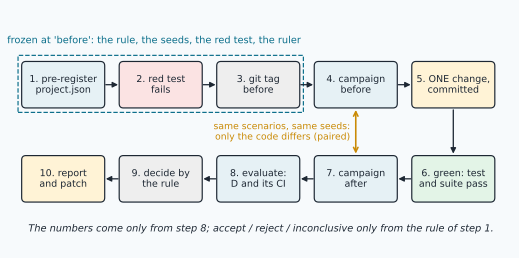
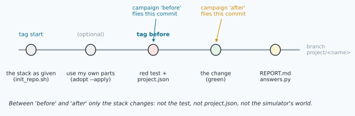
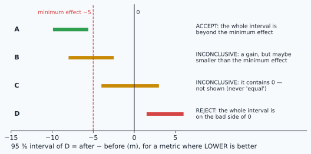
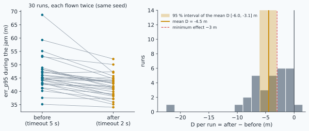

# Final project: one change, tested and measured with confidence



> [!NOTE] Mission brief
> **2015, Science.** Two hundred and seventy researchers repeated 100 published psychology experiments, with the
> original materials, the authors' help and samples large enough to see the original effects. 97 of the originals
> had reported a significant result; only **35** of those 97 repetitions did — 36 % (Open Science Collaboration, *Estimating the
> reproducibility of psychological science*, 2015). Fraud explains almost none of it. Among the causes discussed since:
> small samples, and choices made after seeing the data — which measure to report, which participants to keep, when
> to stop collecting. Each choice looks reasonable; together they can turn noise into a "finding".
>
> Engineering has the same disease, in another form: *"I changed the judge and the error went down on my run."* One
> run, a metric chosen afterwards, no test, no record of which code flew. Today you change **your own NAVERA Lite**
> — the stack you built from mission 03 to 32 — and prove the change the way an IRIS reviewer would accept it.
> **Session 1** (badge **Pre-registered**): choose the change, write the rule, pin the problem with a failing test,
> fly the baseline. **Session 2** (**Measured**): make the change, fly it, compute the interval. **Session 3**
> (**Engineer**): decide by the rule and write the report.
>
> **Start now:** open the 🛠️ **Lab** tab and do **Step 0** (ten minutes, no code), then come back for §1.

**Objectives.** After this mission you can:

1. **pre-register** a change: a hypothesis, a metric with its window and direction, a minimum effect, a guard-rail
   and a decision rule, written and committed before any "after" number exists;
2. pin the problem with a **red test** that fails on a tagged baseline commit and passes after the change, and keep
   it as a regression test (a branch, small commits, tags);
3. measure before and after as a **paired campaign** of independent seeded runs flown from **commits**, with the
   simulator held fixed, and compute the **paired bootstrap interval** of the difference;
4. **decide** accept, reject or inconclusive by the rule, and write a report whose every claim the interval supports,
   with its limits.

**You need:** mission 05 (git: branch, commit, diff, tag), 14 (pytest; a regression test), 31 (scenarios, seeds, the
headless simulator; what a simulation proves), 32 (the paired interval; "contains 0" means "not shown"). ⏱ Reading:
about 50 minutes with the ✏️ checks. Lab, three sessions: about 4 h 30 if you are fast, up to 9 h if Python or git is
still slow for you (a ★★★ project: up to 11 h).

**What you already know** — answer without looking; if you miss two, reread the mission named.

<details><summary>1. Mission 14: what is a regression test, and why is a failing test "good news, delivered on a desk"?</summary>
A test written after a bug so that it cannot come back unnoticed. A failing test shows the problem on your desk, in
seconds, instead of in flight.
</details>

<details><summary>2. Mission 31: two runs of the same scenario file with the same seed. Same CSV?</summary>
Yes: the simulator is deterministic for a given scenario and seed (the GPS noise, the vision errors and the spoof
direction all come from the seed). A different seed gives another, equally likely, flight.
</details>

<details><summary>3. Mission 32: the 95 % paired interval of "median(method) − median(baseline)" is [−210, 45] m. What may you write?</summary>
"Not shown to differ from the baseline on this flight: the interval contains 0." Not "slightly better", and not
"equal".
</details>

<details><summary>Words of this lesson</summary>

| Word | Plain meaning | Français |
|---|---|---|
| **pre-registration** | the rule that will judge a change, written and frozen before the result exists | pré-enregistrement |
| **hypothesis** | one sentence the measurement can prove wrong | hypothèse |
| **metric, window** | the number computed on each run, and the part of the run it looks at | métrique, fenêtre |
| **minimum effect** | the smallest gain that matters; a smaller one is not worth the change | effet minimal |
| **guard-rail** | a second metric that must not get worse by more than a stated limit | garde-fou |
| **red / green test** | a test that fails before the change / passes after it | test rouge / vert |
| **baseline commit** | the commit, tagged `before`, that the "before" campaign flies | commit de référence |
| **paired runs** | the same scenario and seed flown before and after: one pair per seed | essais appariés |
| **the ruler** | what measures both versions: the simulator, the scenarios, the metric code | l'étalon |
| **patch** | a change saved as the output of `git diff`, applied elsewhere with `git apply` | correctif |
</details>

## 1. One change, and the loop

Your stack is complete: the witnesses (GPS 15, day vision 21–23, VO 24, night 25, stars 26), the uncertainty
toolbox (27–28), the judge (29), the guard (30), the messenger and the simulator (31), the measuring part (32). It is
a working pipeline. The first rule of NAVERA's own development guide says exactly that: the system works — **never
break a working pipeline**. The others: always work on a **branch**, **one concern per commit**, **measure, don't
guess** (every accuracy claim comes with a measurement), and **honesty over optimism** (a result validated only in
simulation says so).

Why **one** change? A measurement compares two versions. If they differ in three ways and the metric improves, you
cannot tell which change helped, or whether one of them made things worse and was hidden by the others. One change,
one comparison, one conclusion. "One change" may touch several lines — a new setting, the function that uses it and
its test — but it answers one question.

The figure at the top is the whole project in ten steps. Two ideas carry it: what is **frozen** at the tag `before`
(the rule, the seeds, the red test, the ruler), and the **pairing** of the two campaigns. The rest of this lesson
takes them one at a time, on a worked example that is *not* in the project menu: **should day vision's freshness
window be 2 s instead of 5 s?**

The story. During a GPS jam NAVERA Lite flies on day vision, one fix per second. Over water or uniform sand the
matcher finds nothing, and the judge keeps the last day fix until it is older than `day_timeout_s` (5 s) — mission
32's lake. Meanwhile the drone moves on at 15 m/s, so the held fix drifts up to 75 m behind. A shorter window would
drop it sooner. The scenario `campaign/lake.json` flies exactly that: GPS jammed from 30 to 75 s, the camera blind
from 45 to 48 s.

> [!QUESTION] ✏️ Check
> A colleague changes `day_timeout_s` to 2.0 **and**, in the same commit, the jump gate's margin from 50 to 30 m.
> The error during the jam goes down. What can you conclude about the timeout?

<details><summary>Answer</summary>
Nothing yet. Two changes, one comparison: the gain may come from either, or from one while the other made things
worse. Split them into two commits and measure the timeout alone (the margin only matters when GPS returns — but
"probably" is a guess, not a measurement).
</details>

## 2. Pre-registration: decide how you will judge, before you look

A **pre-registration** is the rule that turns numbers into a decision, written before the numbers exist. In this
project it is a file, `project.json`, committed with the red test and frozen at the tag `before`. It answers six
questions.

| Question | The worked example |
|---|---|
| **Hypothesis** — one sentence the data can prove wrong | A 2 s window lowers NAVERA Lite's large errors during a jam |
| **Metric** and **window** — which number, on which part of each run | `err_p95`: the 95th percentile of NAVERA Lite's error, window `fault` (from the jam to its end) |
| **Direction** — lower, higher, or closer to a target | lower is better |
| **Minimum effect** — the smallest gain worth a change | 3 m |
| **Guard-rail** and its **limit** — what the change may cost | `availability` (share of the jam with a position) may lose at most **0.02** (about one second per minute) |
| **Runs** — scenarios and a block of seeds | `lake.json`, seeds 1201 to 1230: 30 runs, never flown while exploring |

The decision rule is the same for every project: **accept** if the whole 95 % interval of the difference is on the
good side of the minimum effect and the guard-rail cannot have lost more than its limit; **reject** if the whole
interval is on the bad side of 0, or the guard-rail's interval is entirely beyond its limit; **inconclusive**
otherwise.

Why write it first? After seeing the numbers it is very easy — with no bad intent — to pick the metric that moved, the
window where it moved, the seeds where it moved, or a guard-rail limit just above the loss you got. Statisticians call
this the **garden of forking paths** (Gelman and Loken, 2013): each fork is reasonable, the path through them is not.
Each row of the table closes one fork. The **block of seeds** (first and count, consecutive) closes the subtlest one:
you cannot drop the seeds that went badly.

The same goes for the change itself. Tune it (a speed, a threshold) on **exploring seeds** below 1000 with
`project.py one`, never on the pre-registered block. The block is flown once, by the version you commit as THE change;
a second version is a new pre-registration with a new block, and both are reported (the bench writes every
evaluation in a journal, and the check asks your report to name each one).

A **guard-rail** exists because almost every safety change has a price. A judge that refuses more positions has fewer
bad positions *and* fewer positions. Measure only the gain, and you will always "win".

Choose the numbers from the **use**, not from the data: the minimum effect is the gain that would justify a change
(here 3 m, a fifth of day vision's stated σ); the guard-rail limit is what the operator can live without. The
**directions** are not a choice: availability is better when higher, an error when lower (`project.py plan` refuses
the other way — a guard-rail "better when lower" would turn every loss into a gain).

> [!TIP] 🧰 A metric with a target
> Some metrics are not "lower is better". `honest2` is the share of rows whose error is within 2 × the σ the judge
> states; an honest round 2-D Gaussian gives **0.86** (mission 27). 0.70 is too optimistic, 0.99 too cautious. For
> such a metric write `"better": "closer", "target": 0.86`: the bench then compares |mean − 0.86| before and after,
> which *is* "lower is better". Choosing "higher is better" for it is a classic mistake: it rewards a σ that is far
> too large.

> [!QUESTION] ✏️ Check
> A team measures first, then writes: "metric `err_max`, guard-rail availability may lose at most 0.05". Their loss
> was 0.049. What is wrong, even if every number is true?

<details><summary>Answer</summary>
The limit was chosen after the result, just above it: the decision was made by the data, not by the rule. The same
number with a limit written beforehand (from what the operator needs) would mean something.
</details>

## 3. The red test

A **red test** shows the problem on a commit, before you change anything. In the lab you write it in
`navera_lite/tests/test_<name>.py`, commit it with `project.json`, and tag that commit `before`. The bench checks
that, at `before`, your test **fails** and every other test of the suite **passes**; after the change, your test and
the whole suite pass (**green**).

Why must it fail first? A test that already passes on the old code does not see the problem: it would pass whatever
you change, and prove nothing about your change. Failing first is the evidence that the test checks the behaviour
you are adding. It then stays in the suite as a **regression test** (mission 14).

Three practical rules:

- **Fail, don't crash.** If the test imports a function that does not exist yet (`from navera_lite.guard import
  new_rule` at the top of the file), pytest cannot even collect the file: it prints `ERROR`, not `FAILED`, and stops
  with an exit code other than 1 (1 means "tests ran and some failed"). A typo gives the same error, so it proves
  nothing. Put imports of **new** names inside the test function: pytest then reports a clean failure.
- **The red test is frozen** at `before`. It is your specification. You may add more tests afterwards, in another
  file.
- **An old test may disagree with your change.** If your change breaks an existing test, stop and read it: either the
  old test pins a behaviour you are deliberately changing (then update it, in the same commit, and say why), or your
  change broke something real. Never delete a test to get green.

> [!QUESTION] ✏️ Check
> Your red test asserts `new_rule(3, 0.5) is False` and starts with `from navera_lite.guard import new_rule`. At
> `before`, pytest prints `ERROR … ImportError` and exits with code 4. Red?

<details><summary>Answer</summary>
No: an error, not a failure (exit code 1 means "tests failed"; 2 or 4 mean "could not run"). A typo would give the
same error. Move the import inside the test function: the test then fails with that ImportError as its reason — a red
test that really ran.
</details>

## 4. The campaign: committed code, seeds, pairs, and a ruler that does not move

**Fly commits, not files.** The bench `project.py` never flies your working folder. `campaign before` unpacks the
commit tagged `before` (`git archive`) into `runs/.code/` and flies that; `campaign after` flies `HEAD`, and refuses
while the stack has uncommitted changes. So "before" and "after" are two versions anyone can rebuild from your branch,
and the run logs record which commit flew.



**Seeds make runs independent.** A seed fixes the GPS noise, the vision errors and the fault details of one run
(mission 31). Different seeds give independent runs; the same seed gives the same flight. A campaign is a list of
scenarios × a block of seeds, e.g. 2 scenarios × 20 seeds = 40 runs, about 15 s of computing.

**Pairs.** Both campaigns fly the **same** scenarios and seeds. For each pair the bench computes the metric before
(bᵢ) and after (aᵢ), and studies the difference dᵢ = aᵢ − bᵢ. Why pairs? For two numbers measured on the same runs,

```
Var(a − b) = Var(a) + Var(b) − 2 Cov(a, b)
```

A hard run (a long blackout, an unlucky noise) is hard before *and* after, so a and b move together: Cov > 0, and the
variance of the difference is smaller than the two separate spreads suggest. The shared luck cancels; what is left is
the change. Worked example: in the lake campaign the per-run err_p95 has a standard deviation of 6.5 m before and
4.2 m after; two independent campaigns would give a difference spread of √(6.5² + 4.2²) ≈ 7.7 m, the paired
differences only 4.2 m (the two runs of a pair have a correlation of 0.77).

**Why an iid bootstrap is honest here.** In mission 32 the seconds of one flight were correlated, and only a block
bootstrap was honest. Here the units are **runs** with different seeds: independent by construction. So the bench
resamples whole runs, with replacement, B = 2000 times (mission 32's `paired_diff_ci`, the same indices for a and b),
and takes the 2.5th and 97.5th percentiles of the resampled mean difference. That is also why the bench asks for at
least 20 runs: with 5, the interval is wide and the bootstrap cannot imagine anything outside the 5 values it saw.

**The ruler does not move.** Between `before` and `after`, three things must stay the same: the **simulator's world**
(`navera_lite/sim/world.py`, `run.py`, `sensors.py`), the **scenarios and seeds**, and the **metric code**
(`project.py`, frozen; `my_metric.py` if you wrote one). If the world changed too, you could not tell your change
from a change of the measurement. A project that needs a new sensor model or a new fault (a frozen GPS, a tilted error
ellipse) adds it **before** `before`, with the red test: both campaigns then fly the new world.

> [!NOTE] A project of kind "sim"
> One kind of project *is* a change of the ruler: a more realistic sensor model. Then the stack stays the same and the
> question becomes "how does the stack's result change under the new model?" Write `"kind": "sim"` in
> `project.json`: the check then demands the opposite — only `navera_lite/sim/` changes. Your conclusion speaks about
> the model, not about a better stack.

> [!QUESTION] ✏️ Check
> 1. Why do both campaigns use seeds 1201–1230, instead of 1201–1230 before and 1231–1260 after?
> 2. A student re-runs the "after" campaign with a new block of seeds because the first interval contained 0, and
>    reports only the second. What is that, in mission 32's words?

<details><summary>Answer</summary>
1. With the same seeds each run is paired with its twin: the shared noise cancels in the difference. Different seeds
would make two independent samples: a wider interval for the same number of runs.
2. Best of N (selective reporting). A second campaign is a new pre-registration — a new block of seeds written
before it flies — and both results are reported.
</details>

## 5. Decide by the rule

`python3 project.py evaluate` computes the metric of every run, D = mean(after) − mean(before) (or the difference of
|mean − target| for a "closer" metric), its 95 % paired bootstrap interval, the same for the guard-rail, and applies
your rule. Read the interval with the figure below.



**Worked example, the result.** Thirty runs of `lake.json`, flown from both commits:



| | before | after | D | 95 % interval of D |
|---|---|---|---|---|
| err_p95 (m) | 46.4 | 42.0 | −4.5 | [−6.0, −3.1] |
| availability | 1.000 | 0.951 | −0.049 | [−0.049, −0.049] |

The accuracy part passes: the whole interval lies beyond −3 m, the minimum effect. The guard-rail does not: the
window lost 0.049 of its time with a position — about 2.2 s of a 45 s jam — and the whole interval is beyond the 0.02
limit. By the rule written first: **REJECT**.

Two remarks. The guard-rail's interval has **zero width**: every run loses exactly the same 2.2 s, because the
blackout starts at the same mission second in every run (they share one scenario file). That is not a miracle of precision; it says the
loss is built into the scenario, not random. And had the team written a limit of 0.05, the same data would give
"accept" — which is exactly why the limit is written before the result. (With only the first 5 seeds, the interval
of err_p95 would be [−3.6, −1.0]: it crosses −3, inconclusive. Too few runs cannot show a small effect.)

**A 0/1 guard-rail** (false_alarm, failsafe) needs care: 0 alarms in 30 runs before and after gives a bootstrap
interval of [0, 0] — the bootstrap cannot imagine an alarm it never saw. The bench therefore never gives a 0/1 metric
a narrower interval than Wilson's (mission 32): 0 in 30 only shows a rate below 0.114, so a limit of 0.05 needs about
75 runs.

**Inconclusive is a result.** "The data cannot tell" is a precise statement, with a precise next step: which runs to
add, or which effect size you would need. A team that writes "inconclusive" when it is true is a team whose "accept"
can be trusted.

The course's own example shows why the block is fixed first: the same change (a held fix states a σ that grows with
its age, idea 1 of the lab's menu) was ACCEPTED on one block of 20 seeds (D −0.111 [−0.140, −0.082]) and is
INCONCLUSIVE on another (D −0.032 [−0.059, −0.005], minimum effect 0.02). Neither result is wrong; one block of 20 seeds
(40 paired runs on jam and lake) is simply short for a 0.02 effect — which is why the block is chosen before the result, not after.

> [!QUESTION] ✏️ Check
> Metric `ap_err_max`, lower is better, minimum effect 2 m, no guard-rail. Decision for each interval of D:
> (a) [−6.1, −2.4] m, (b) [−6.1, −1.2] m, (c) [−0.8, 1.9] m, (d) [0.3, 4.0] m.

<details><summary>Answer</summary>
(a) accept: the whole interval is beyond −2. (b) inconclusive: a gain, but perhaps smaller than 2 m. (c) inconclusive:
contains 0 — not shown, not "equal". (d) reject: the whole interval is on the bad side of 0.
</details>

## 6. The report

The report has eight fixed sections (the template `REPORT.md`): the problem, the pre-registration, the change, the
red test, the campaign, the results table, the decision, the limits. Two rules decide whether a reviewer trusts it.

**Every number comes from the evaluation**, correctly rounded, with its interval. The check compares the report with
`evaluation.json`, and `evaluation.json` with your runs, and flies one of your runs again from your commit.

**Every claim matches the interval.** Mission 32's sentences, now for a decision:

- **accept** (made-up numbers — copy the structure): "On 40 paired simulated runs (drift and baseline scenarios,
  seeds 501–520), the guard caught the drift 1.9 s sooner (95 % interval 1.4 to 2.5 s), with no honest GPS refused in
  either version (0 of 20). Accepted by the rule written before the baseline."
- **inconclusive:** "D = −1.4 m, 95 % interval [−3.1, 0.4] m: it contains 0. The change is not shown to lower the
  error on these 30 runs." — never "slightly better", never "the same".
- **reject:** "The error fell (D = −4.5 m [−6.0, −3.1]) but availability lost 0.049 of the jam, beyond the 0.02
  limit: rejected." — the gain is reported, and so is the price.

**Limits.** A confidence interval covers the randomness of *these* scenarios in *this* simulator, nothing else.
Section 8 says what the simulation does not contain (a real camera, wind, terrain, other vehicles, other speeds), what
was never flown, and what you would measure next. NAVERA labels such numbers "simulator only"; so do you.

> [!QUESTION] ✏️ Check
> A report says: "Inconclusive. Our change improves the median error by 1.4 m, but more runs are needed." Fix it.

<details><summary>Answer</summary>
"Inconclusive: D = −1.4 m, 95 % interval [a, b] m, contains 0 — a gain is not shown on these runs." An "improves" in
an inconclusive report is a claim the interval does not support.
</details>

## 7. Choosing a project

The lab's Step 2 holds the menu: ten ideas from ★ (about a day) to ★★★ (a real challenge — talk to your teacher first).
Several come from real problems of NAVERA, described in words; in your project they are NAVERA Lite problems to solve
in your own stack. A good idea is one you can state in one sentence AND see in a run. Your own idea is welcome if it is
**one** change you can **test** and **measure** in a day. The lesson's worked example (the 2 s window) is not a
project.

## In NAVERA

NAVERA's development guide states the rules of §1 in its own words: the system works and must not be broken, always a
branch, small commits with one concern each, a measurement for every performance claim, and "if a result is only
validated in simulation, say so". Its validation report (Release 0.2, 2026-10-03) shows the loop on a real change: a
vision position used to be sent as it was, describing a photo 1–2.5 s old while stating the matcher's ±30 m. Measured
in the simulator, a plane at 40 m/s with a matching error of 0–1 m had an output error of 83 m median and **0 %**
within the stated σ; a drone at 15 m/s, 12–23 m. The change carried the position along the measured ground velocity
and grew its stated accuracy by the lag, backed by unit tests (a 1.5 s old photo at 40 m/s is moved 60 m and stated
±31.5 m), and the result is labelled **simulator only**. The same report keeps, next to each figure, its conditions and
its date. The problems in the lab's menu (√max(a, c), the night anchor, the inlier minimum written as 6 and set to 8) were
found by the course's team while writing these missions and logged for NAVERA's engineers; they are described here in
words only.

## In NAVERA Lite

Your lesson folder holds the **whole** NAVERA Lite, finished, with its whole test suite: the course's versions of
every part. `python3 -m navera_lite.tools.adopt` puts **your own** parts in their place — those you finished in missions
03–32 whose course tests and one flight still pass — and lists them in `navera_lite/MINE.md`: your project then
changes your own stack. `navera_lite/tools/init_repo.sh` (mission 14) makes the folder a repository tagged `start`.
The bench `project.py` (given, frozen) flies campaigns from commits with mission 31's `sim/run.py`, computes the
metrics, and judges them with mission 32's `stats.paired_diff_ci` and `stats.wilson` (yours, if you adopted
your `stats.py`).

## 🐦 How birds do it

<details class="further"><summary>🐦 How birds do it (optional)</summary>

In the autumns of the 1950s A. C. Perdeck caught about 11 000 migrating starlings in the Netherlands, ringed them and
released them in Switzerland, hundreds of kilometres south-east of their usual route. The experiment had one change (the displacement), a
comparison planned in advance (young birds against adults, both displaced) and a measurement nobody could bend
(where the rings were found). The young kept their inborn direction and ended in Spain; the adults corrected towards
their usual winter grounds. Navi the swallow would add: one change, the same birds, a rule fixed before the rings came
back.
</details>

## Summary

1. **One change**, on a branch, measured: one comparison, one conclusion.
2. **Pre-register** before any "after" number: hypothesis, metric and window, direction, minimum effect, guard-rail,
   runs. Each row closes a fork of the garden.
3. A **red test** fails at the tagged baseline and passes after the change; it is frozen and stays as a regression
   test.
4. Fly **commits**, the **same seeds** before and after (pairs), with a **ruler** that does not move; independent runs
   make the iid bootstrap of runs honest.
5. **Decide by the rule** — accept, reject, inconclusive — and write only claims the interval supports, with the
   limits of a simulation.

**After this mission:** your branch, your patch and your report are what an engineer hands to a reviewer. Keep them.

## Check yourself

Answer without scrolling up.

<details><summary>1. Why is a guard-rail part of the pre-registration?</summary>
Almost every safety change has a price (fewer positions, more refusals, a failsafe). Measured alone, the gain always
"wins"; the guard-rail and its limit, written first, say how much price is acceptable.
</details>

<details><summary>2. Your test passes at 'before'. What does that tell you, and what do you do?</summary>
It does not see the problem, so it cannot prove anything about the change. Make it ask for the new behaviour (fail
first), commit it, and move the tag before flying the baseline (if you already flew it: lab Step 5 hint 2).
</details>

<details><summary>3. Why does the bench fly a commit instead of your working folder?</summary>
So that "before" and "after" are two exactly known versions that anyone can rebuild from the branch; uncommitted edits
would make the measurement unreproducible.
</details>

<details><summary>4. D's interval is [−0.2, 3.5] m for a "lower is better" metric. Decision and sentence?</summary>
Inconclusive: it contains 0. "Not shown to differ on these runs" — not "equal", not "slightly worse".
</details>

<details><summary>5. (Mission 32) Why did seconds of one flight need a block bootstrap, while runs with different seeds do not?</summary>
Consecutive seconds are correlated (n_eff ≪ n); runs with different seeds are independent by construction, so
resampling whole runs is honest.
</details>

<details><summary>6. (Mission 14) What is a mutant, and how could you use one to test your red test?</summary>
A deliberately broken copy of the code. Undo or break your change on purpose (a mutant of your fix): if your red test
still passes, it does not guard your change.
</details>

Now open the **🛠️ Lab** tab.
